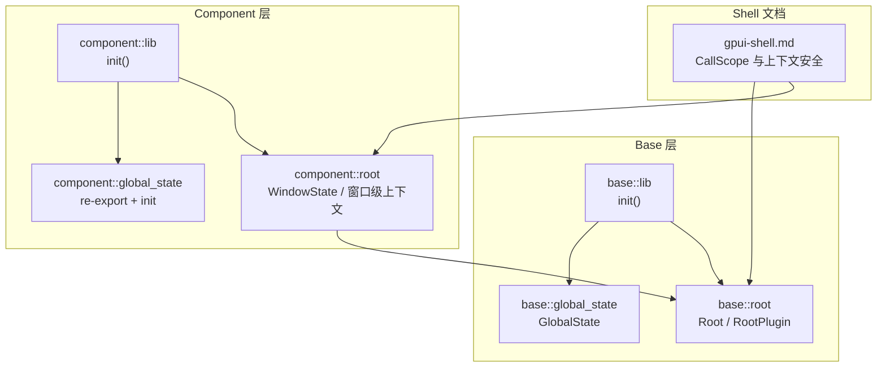
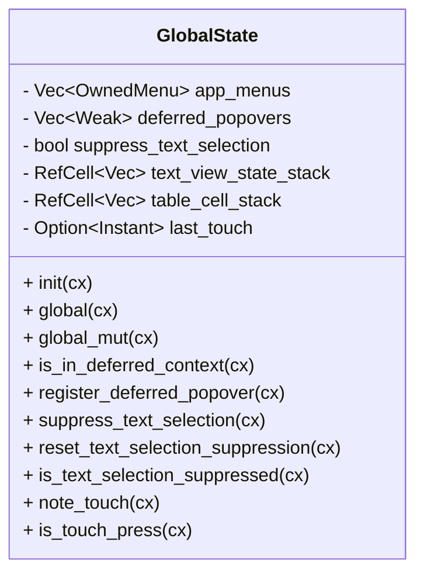
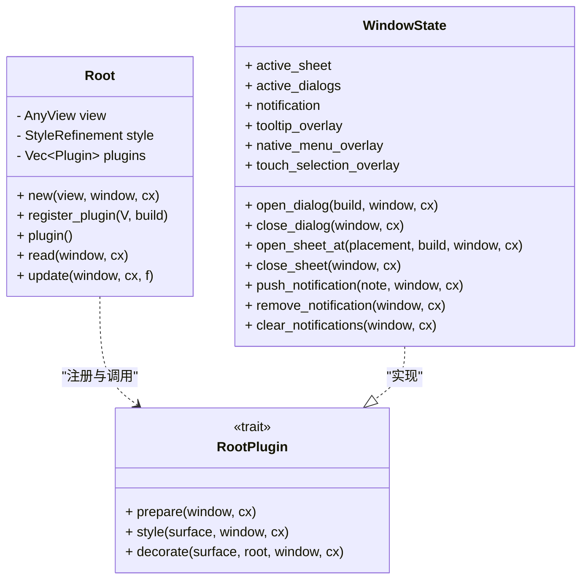
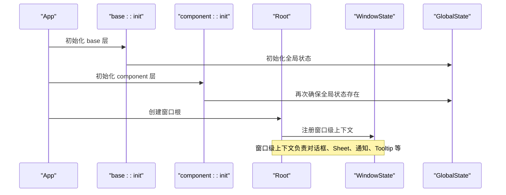
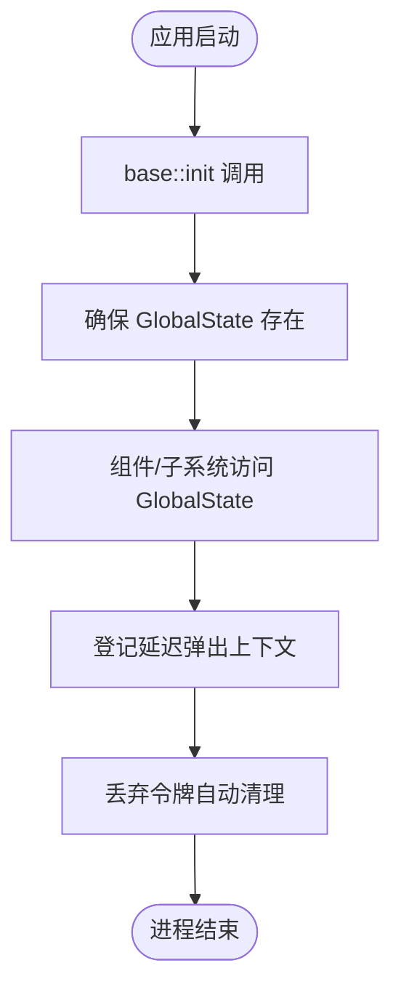
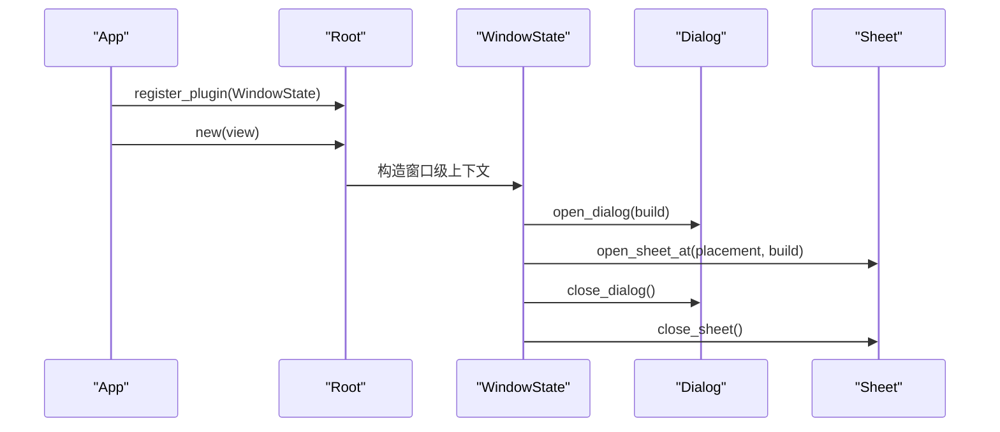
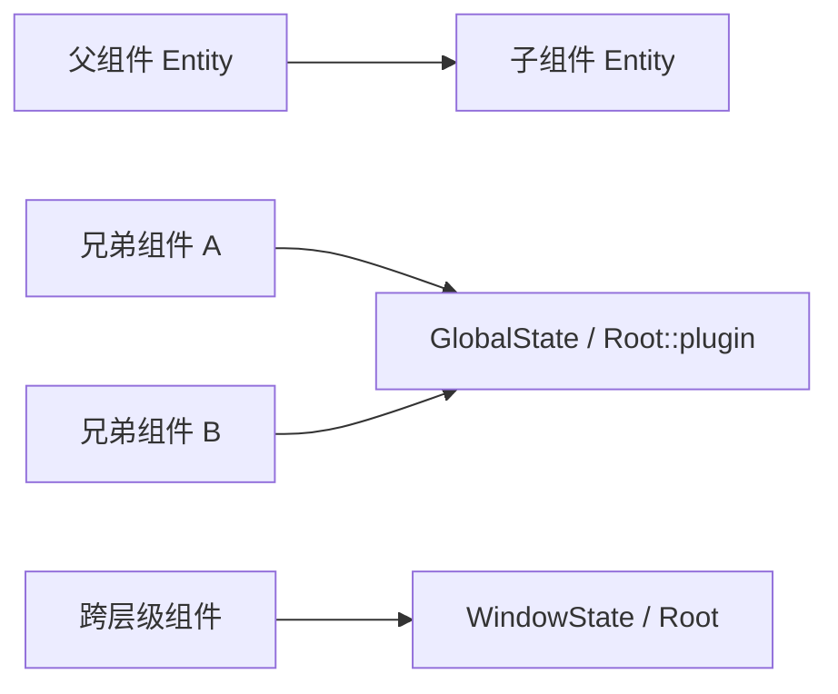
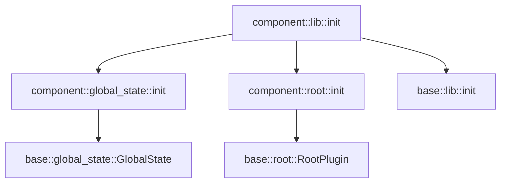

# Context 上下文管理

<cite>
**本文引用的文件**   
- [crates/base/src/global_state.rs](file://crates/base/src/global_state.rs)
- [crates/component/src/global_state.rs](file://crates/component/src/global_state.rs)
- [crates/base/src/lib.rs](file://crates/base/src/lib.rs)
- [crates/component/src/lib.rs](file://crates/component/src/lib.rs)
- [crates/base/src/root.rs](file://crates/base/src/root.rs)
- [crates/component/src/root.rs](file://crates/component/src/root.rs)
- [docs/gpui-shell.md](file://docs/gpui-shell.md)
</cite>

## 目录
1. [引言](#引言)
2. [项目结构](#项目结构)
3. [核心组件](#核心组件)
4. [架构总览](#架构总览)
5. [详细组件分析](#详细组件分析)
6. [依赖关系分析](#依赖关系分析)
7. [性能与内存考虑](#性能与内存考虑)
8. [故障排查指南](#故障排查指南)
9. [结论](#结论)
10. [附录：使用模式与最佳实践](#附录使用模式与最佳实践)

## 引言
本文面向 GPUI 应用中的“上下文”概念，围绕以下目标展开：
- 解释 Context 的作用域管理、依赖注入机制、全局状态访问和局部状态传递。
- 说明 Context 的生命周期：初始化、作用域创建、状态设置与清理。
- 阐述在组件通信中的应用：父子、兄弟、跨层级组件通信模式。
- 给出最佳实践：性能、内存管理与错误处理。
- 结合仓库实际代码，展示依赖注入、全局配置管理和事件分发的组织方式。
- 解释 Context 与 Entity、GlobalState 的关系，以及在大型应用中的组织模式。

GPUI 的“上下文”并非单一 API，而是由多层能力组合而成：
- 框架层 Context<T>：用于组件实体（Entity）的状态读写、通知与生命周期回调。
- 应用级全局状态 GlobalState：通过 App 的全局存储提供进程级共享数据。
- 窗口级 Root/WindowState：作为窗口根与插件体系，承载窗口级上下文与覆盖层。
- Shell 层的 CallScope：保证脚本侧对 &mut App / &mut Window / &mut Context<T> 的调用处于合法作用域内。

这些层次共同构成“上下文系统”，既支持依赖注入，也支持全局状态访问与局部状态传递。

## 项目结构
本仓库中与“上下文”直接相关的实现主要分布在 base 与 component 两个 crate，以及 shell 文档中对作用域安全的说明：
- base 层提供基础行为与基础设施，包括 GlobalState 与 Root 插件体系。
- component 层在 base 之上提供 UI 组件与窗口级状态管理（如对话框、Sheet、通知等）。
- shell 文档说明了“上下文仅在调用期间有效”的安全约束。

**图表来源**
- [crates/base/src/lib.rs:238-256](file://crates/base/src/lib.rs#L238-L256)
- [crates/base/src/root.rs:42-103](file://crates/base/src/root.rs#L42-L103)
- [crates/base/src/global_state.rs:21-37](file://crates/base/src/global_state.rs#L21-L37)
- [crates/component/src/lib.rs:127-151](file://crates/component/src/lib.rs#L127-L151)
- [crates/component/src/root.rs:21-43](file://crates/component/src/root.rs#L21-L43)
- [crates/component/src/global_state.rs:1-10](file://crates/component/src/global_state.rs#L1-L10)
- [docs/gpui-shell.md:345-348](file://docs/gpui-shell.md#L345-L348)

**章节来源**
- [crates/base/src/lib.rs:238-256](file://crates/base/src/lib.rs#L238-L256)
- [crates/component/src/lib.rs:127-151](file://crates/component/src/lib.rs#L127-L151)
- [crates/base/src/root.rs:42-103](file://crates/base/src/root.rs#L42-L103)
- [crates/component/src/root.rs:21-43](file://crates/component/src/root.rs#L21-L43)
- [crates/base/src/global_state.rs:21-37](file://crates/base/src/global_state.rs#L21-L37)
- [crates/component/src/global_state.rs:1-10](file://crates/component/src/global_state.rs#L1-L10)
- [docs/gpui-shell.md:345-348](file://docs/gpui-shell.md#L345-L348)

## 核心组件
本节聚焦三类关键上下文能力：
- 全局状态 GlobalState：进程级共享数据，用于应用级行为（菜单、文本选择抑制、延迟弹出上下文等）。
- 窗口级 Root 与 WindowState：窗口级上下文与覆盖层（对话框、Sheet、通知、Tooltip、原生菜单回退等）。
- 组件实体 Context<T>：组件实体的状态读写、通知与生命周期回调。

### 全局状态 GlobalState
GlobalState 是应用级全局状态容器，通过 gpui::Global trait 注册到 App 中。它提供：
- 应用菜单管理。
- 延迟弹出上下文登记与检测。
- 文本选择抑制与恢复。
- 触摸输入时间戳。
- 文本视图状态栈与表格单元格绘制范围栈。

**图表来源**
- [crates/base/src/global_state.rs:21-37](file://crates/base/src/global_state.rs#L21-L37)
- [crates/base/src/global_state.rs:67-101](file://crates/base/src/global_state.rs#L67-L101)
- [crates/base/src/global_state.rs:143-171](file://crates/base/src/global_state.rs#L143-L171)

**章节来源**
- [crates/base/src/global_state.rs:21-37](file://crates/base/src/global_state.rs#L21-L37)
- [crates/base/src/global_state.rs:67-101](file://crates/base/src/global_state.rs#L67-L101)
- [crates/base/src/global_state.rs:143-171](file://crates/base/src/global_state.rs#L143-L171)

### 窗口级 Root 与 WindowState
Base 层提供 Root 与 RootPlugin 体系，用于窗口级呈现插件；Component 层在此基础上扩展 WindowState，管理 Sheet、Dialog、Notification、Tooltip、Native Menu Overlay 等窗口级上下文。

**图表来源**
- [crates/base/src/root.rs:53-103](file://crates/base/src/root.rs#L53-L103)
- [crates/base/src/root.rs:119-240](file://crates/base/src/root.rs#L119-L240)
- [crates/component/src/root.rs:25-43](file://crates/component/src/root.rs#L25-L43)
- [crates/component/src/root.rs:375-408](file://crates/component/src/root.rs#L375-L408)
- [crates/component/src/root.rs:514-558](file://crates/component/src/root.rs#L514-L558)
- [crates/component/src/root.rs:560-602](file://crates/component/src/root.rs#L560-L602)

**章节来源**
- [crates/base/src/root.rs:53-103](file://crates/base/src/root.rs#L53-L103)
- [crates/base/src/root.rs:119-240](file://crates/base/src/root.rs#L119-L240)
- [crates/component/src/root.rs:25-43](file://crates/component/src/root.rs#L25-L43)
- [crates/component/src/root.rs:375-408](file://crates/component/src/root.rs#L375-L408)
- [crates/component/src/root.rs:514-558](file://crates/component/src/root.rs#L514-L558)
- [crates/component/src/root.rs:560-602](file://crates/component/src/root.rs#L560-L602)

### 组件实体 Context<T>
Context<T> 是 GPUI 组件实体的运行时上下文，用于：
- 读取与更新实体状态。
- 订阅变化并触发重绘。
- 在生命周期钩子中执行副作用。
- 与 Window、App 交互（例如写入剪贴板、打开 URL、调度任务等）。

虽然具体 Context<T> 定义来自底层 gpui，但仓库多处展示了其用法：
- RootPlugin::prepare/style/decorate 接收 &mut Context<Self>。
- WindowState 方法接收 &mut Context<'_, WindowState>。
- Shell 文档强调“&mut Context<T> 只在宿主调用期间有效”。

**章节来源**
- [crates/base/src/root.rs:74-103](file://crates/base/src/root.rs#L74-L103)
- [crates/component/src/root.rs:375-408](file://crates/component/src/root.rs#L375-L408)
- [docs/gpui-shell.md:345-348](file://docs/gpui-shell.md#L345-L348)

## 架构总览
下图展示“上下文系统”的整体架构：应用启动时初始化 base 与 component，随后通过 Root 与 WindowState 建立窗口级上下文；GlobalState 提供进程级全局状态；Context<T> 在组件实体内部提供局部状态与作用域。

**图表来源**
- [crates/base/src/lib.rs:238-256](file://crates/base/src/lib.rs#L238-L256)
- [crates/component/src/lib.rs:127-151](file://crates/component/src/lib.rs#L127-L151)
- [crates/base/src/global_state.rs:67-73](file://crates/base/src/global_state.rs#L67-L73)
- [crates/component/src/global_state.rs:5-9](file://crates/component/src/global_state.rs#L5-L9)
- [crates/base/src/root.rs:127-190](file://crates/base/src/root.rs#L127-L190)
- [crates/component/src/root.rs:21-43](file://crates/component/src/root.rs#L21-L43)

## 详细组件分析

### 全局状态 GlobalState 的生命周期
GlobalState 的生命周期贯穿应用进程：
- 初始化：base::init 与 component::init 都会确保 GlobalState 存在。
- 使用：组件或子系统通过 global()/global_mut() 访问。
- 清理：随进程结束而销毁；DeferredPopover 通过弱引用自动清理。

**图表来源**
- [crates/base/src/lib.rs:238-256](file://crates/base/src/lib.rs#L238-L256)
- [crates/component/src/lib.rs:127-151](file://crates/component/src/lib.rs#L127-L151)
- [crates/base/src/global_state.rs:67-73](file://crates/base/src/global_state.rs#L67-L73)
- [crates/base/src/global_state.rs:143-171](file://crates/base/src/global_state.rs#L143-L171)

**章节来源**
- [crates/base/src/global_state.rs:67-73](file://crates/base/src/global_state.rs#L67-L73)
- [crates/base/src/global_state.rs:143-171](file://crates/base/src/global_state.rs#L143-L171)

### 窗口级上下文 Root 与 WindowState 的工作流
Root 负责注册与实例化 RootPlugin；WindowState 作为 RootPlugin 实现，管理窗口级上下文。

**图表来源**
- [crates/base/src/root.rs:127-190](file://crates/base/src/root.rs#L127-L190)
- [crates/component/src/root.rs:375-408](file://crates/component/src/root.rs#L375-L408)
- [crates/component/src/root.rs:514-558](file://crates/component/src/root.rs#L514-L558)

**章节来源**
- [crates/base/src/root.rs:127-190](file://crates/base/src/root.rs#L127-L190)
- [crates/component/src/root.rs:375-408](file://crates/component/src/root.rs#L375-L408)
- [crates/component/src/root.rs:514-558](file://crates/component/src/root.rs#L514-L558)

### 组件通信模式
- 父子组件通信：通过父组件持有子组件 Entity 的 handle，调用子组件方法或订阅其状态变化。
- 兄弟组件通信：通过共享的 GlobalState 或 Root/WindowState 提供的窗口级服务（如通知、Tooltip）进行间接通信。
- 跨层级组件通信：通过 Root::plugin<V>() 获取指定插件实体，或通过 GlobalState 访问进程级状态。

[此图为概念性流程图，不直接映射具体源码文件]

### 依赖注入与事件分发
- 依赖注入：通过 Root::register_plugin 将插件注入窗口级上下文；组件可通过 Root::plugin<V>() 获取插件实体。
- 事件分发：通过 gpui 的事件系统与 Context<T> 的通知机制（notify）驱动 UI 更新；GlobalState 提供应用级事件相关状态（如延迟弹出上下文）。

**章节来源**
- [crates/base/src/root.rs:127-190](file://crates/base/src/root.rs#L127-L190)
- [crates/base/src/global_state.rs:143-171](file://crates/base/src/global_state.rs#L143-L171)

## 依赖关系分析
- base::lib::init 初始化 GlobalState、Root 插件体系等基础能力。
- component::lib::init 先初始化 component 自身，再调用 base::init，确保依赖顺序正确。
- component::global_state 重新导出 base::GlobalState，并提供兼容性的 init 入口。
- component::root::WindowState 实现 base::root::RootPlugin，扩展窗口级上下文。

**图表来源**
- [crates/component/src/lib.rs:127-151](file://crates/component/src/lib.rs#L127-L151)
- [crates/component/src/global_state.rs:5-9](file://crates/component/src/global_state.rs#L5-L9)
- [crates/component/src/root.rs:21-23](file://crates/component/src/root.rs#L21-L23)
- [crates/base/src/lib.rs:238-256](file://crates/base/src/lib.rs#L238-L256)

**章节来源**
- [crates/component/src/lib.rs:127-151](file://crates/component/src/lib.rs#L127-L151)
- [crates/component/src/global_state.rs:5-9](file://crates/component/src/global_state.rs#L5-L9)
- [crates/component/src/root.rs:21-23](file://crates/component/src/root.rs#L21-L23)
- [crates/base/src/lib.rs:238-256](file://crates/base/src/lib.rs#L238-L256)

## 性能与内存考虑
- 避免频繁访问 GlobalState：GlobalState 是进程级共享状态，频繁读写可能引发竞争或锁开销；建议缓存热点数据或使用 Entity 局部状态。
- 合理使用 DeferredPopover：延迟弹出上下文通过弱引用自动清理，避免手动注销；注意在弹窗状态被移除后仍保持注册会导致功能异常。
- 控制窗口级上下文数量：对话框、Sheet、通知等窗口级上下文会增加渲染负担；应尽快关闭不再使用的上下文。
- 遵循 Shell 上下文安全：&mut App / &mut Window / &mut Context<T> 仅在宿主调用期间有效，避免跨帧持有引用。

**章节来源**
- [crates/base/src/global_state.rs:143-171](file://crates/base/src/global_state.rs#L143-L171)
- [docs/gpui-shell.md:345-348](file://docs/gpui-shell.md#L345-L348)

## 故障排查指南
- 全局状态未初始化：若出现 GlobalState 缺失错误，检查是否在应用入口调用了 base::init 与 component::init。
- 窗口级上下文缺失：若无法访问 Root::plugin<V>()，确认是否已注册 RootPlugin 且组件库已初始化。
- 延迟弹出上下文未清理：若应用误判仍有弹窗打开，检查 DeferredPopover 令牌是否正确释放。
- 上下文越界访问：若在脚本或异步回调中持有 &mut Context<T> 引用，可能导致非法访问；应遵循“上下文仅在调用期间有效”的规则。

**章节来源**
- [crates/base/src/global_state.rs:67-73](file://crates/base/src/global_state.rs#L67-L73)
- [crates/base/src/root.rs:127-190](file://crates/base/src/root.rs#L127-L190)
- [crates/base/src/global_state.rs:143-171](file://crates/base/src/global_state.rs#L143-L171)
- [docs/gpui-shell.md:345-348](file://docs/gpui-shell.md#L345-L348)

## 结论
GPUI 的上下文系统由 GlobalState、Root/WindowState 与 Context<T> 三层组成：
- GlobalState 提供进程级全局状态，适合应用级配置与共享行为。
- Root/WindowState 提供窗口级上下文，适合对话框、Sheet、通知等覆盖层管理。
- Context<T> 提供组件实体局部状态与作用域，适合组件间通信与状态更新。

在大型应用中，建议：
- 将全局配置放入 GlobalState，将窗口级状态放入 WindowState，将组件局部状态放入 Entity。
- 通过 Root::register_plugin 注入依赖，通过 Root::plugin<V>() 获取依赖。
- 遵循 Shell 上下文安全规则，避免跨帧持有上下文引用。
- 合理使用延迟弹出上下文与窗口级覆盖层，避免内存泄漏与性能问题。

## 附录：使用模式与最佳实践
- 依赖注入：
  - 在应用启动时通过 Root::register_plugin 注册插件。
  - 在组件中通过 Root::plugin<V>() 获取插件实体。
- 全局配置管理：
  - 将应用级配置放入 GlobalState，通过 global()/global_mut() 访问。
  - 避免在热路径中频繁访问 GlobalState。
- 事件分发：
  - 使用 Context<T> 的 notify() 触发 UI 更新。
  - 通过 GlobalState 管理应用级事件相关状态（如延迟弹出上下文）。
- 内存管理：
  - 使用 DeferredPopover 令牌自动清理延迟弹出上下文。
  - 及时关闭对话框、Sheet、通知等窗口级上下文。
- 错误处理：
  - 确保在应用入口正确初始化 base 与 component。
  - 遵循 Shell 上下文安全规则，避免非法访问。

**章节来源**
- [crates/base/src/root.rs:127-190](file://crates/base/src/root.rs#L127-L190)
- [crates/base/src/global_state.rs:67-73](file://crates/base/src/global_state.rs#L67-L73)
- [crates/base/src/global_state.rs:143-171](file://crates/base/src/global_state.rs#L143-L171)
- [docs/gpui-shell.md:345-348](file://docs/gpui-shell.md#L345-L348)