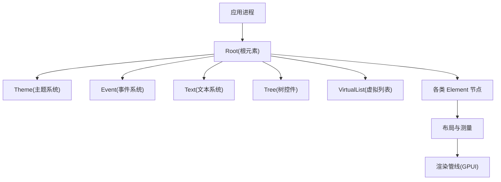
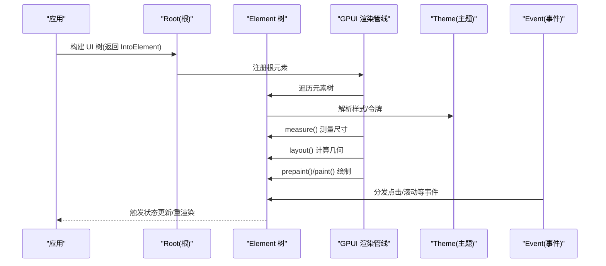
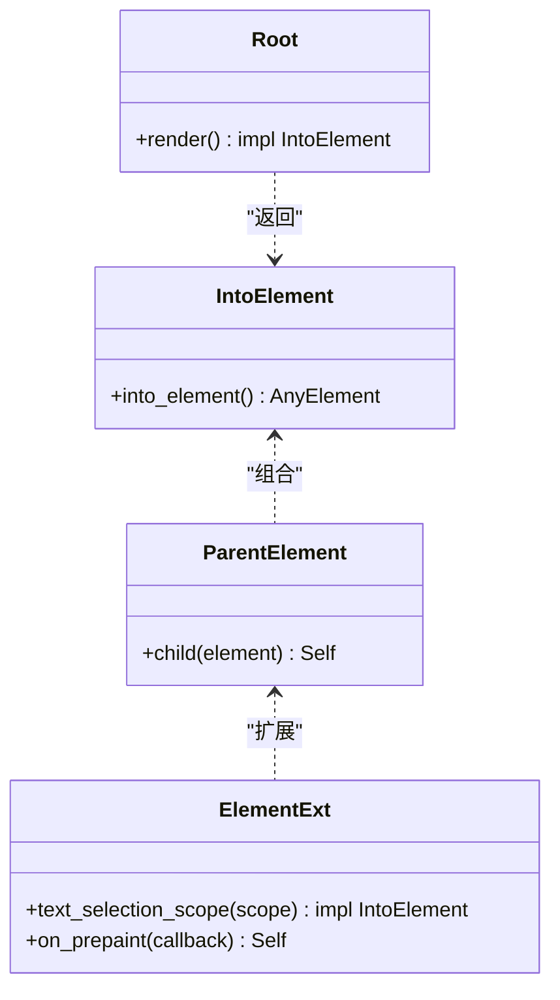
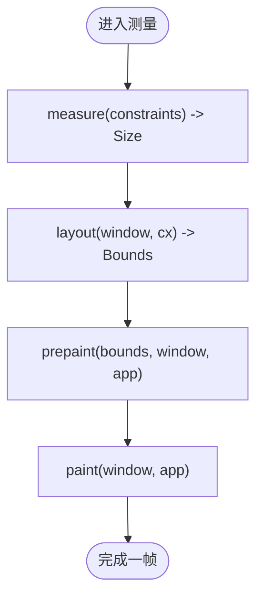
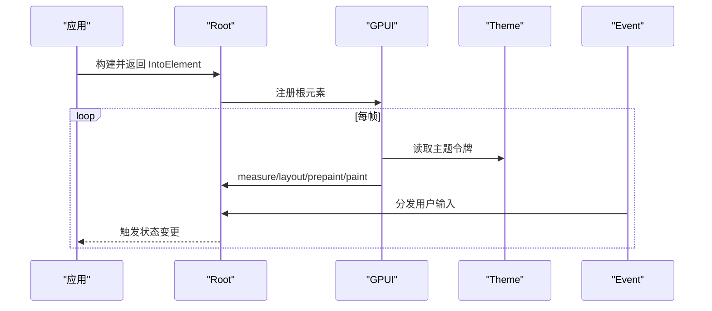
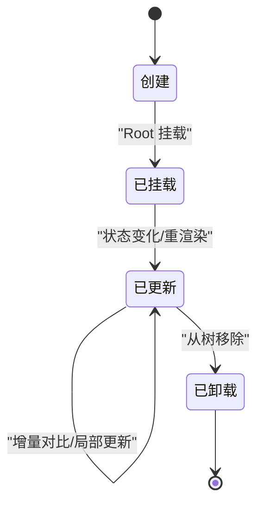
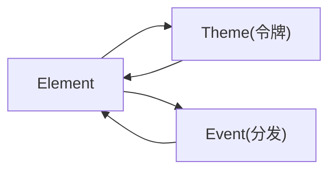
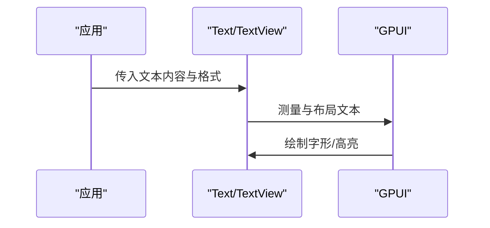
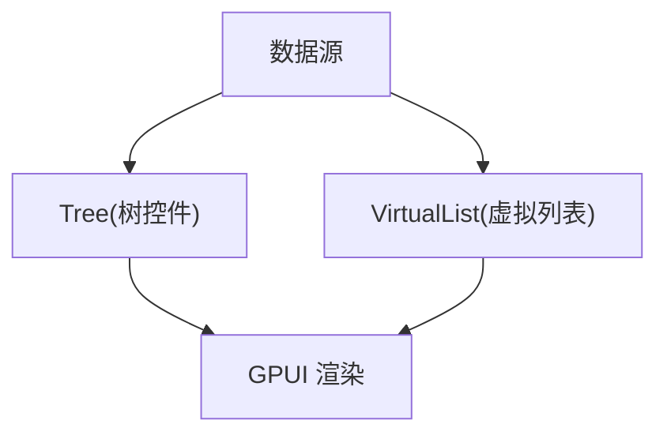
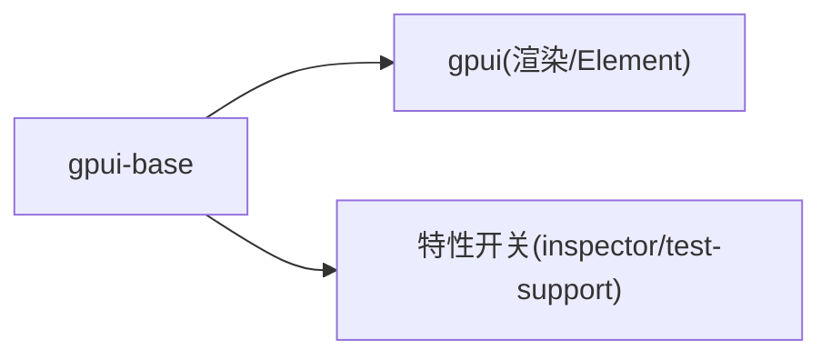

# Element 元素树

<cite>
**本文引用的文件**   
- [crates/base/src/lib.rs](file://crates/base/src/lib.rs)
- [crates/base/Cargo.toml](file://crates/base/Cargo.toml)
- [crates/base/src/element_ext.rs](file://crates/base/src/element_ext.rs)
- [crates/base/src/root.rs](file://crates/base/src/root.rs)
- [crates/base/src/theme.rs](file://crates/base/src/theme.rs)
- [crates/base/src/event.rs](file://crates/base/src/event.rs)
- [crates/base/src/tree.rs](file://crates/base/src/tree.rs)
- [crates/base/src/virtual_list.rs](file://crates/base/src/virtual_list.rs)
- [crates/base/src/text/mod.rs](file://crates/base/src/text/mod.rs)
- [crates/base/src/motion/presence.rs](file://crates/base/src/motion/presence.rs)
- [crates/base/src/observe.rs](file://crates/base/src/observe.rs)
</cite>

## 目录
1. [简介](#简介)
2. [项目结构](#项目结构)
3. [核心组件](#核心组件)
4. [架构总览](#架构总览)
5. [详细组件分析](#详细组件分析)
6. [依赖关系分析](#依赖关系分析)
7. [性能考量](#性能考量)
8. [故障排查指南](#故障排查指南)
9. [结论](#结论)
10. [附录](#附录)

## 简介
本文件系统性梳理 GPUI 的元素（Element）体系与元素树运行机制，围绕以下目标展开：
- 解释 Element 的定义、层次关系、布局算法与渲染流程
- 说明元素的创建、更新、测量、布局与绘制过程，以及与 GPUI 渲染管道的集成
- 阐述元素生命周期管理（创建、挂载、更新、卸载）的钩子与回调
- 提供元素树优化最佳实践（虚拟 DOM 对比、增量更新、性能调优）
- 给出自定义元素类型、复杂布局逻辑与渲染优化的具体示例路径
- 解释元素树与主题系统、事件系统的关系，以及在响应式设计中的应用模式

## 项目结构
GPUI 应用以“行为与基础设施层”为核心，位于 crates/base。该层对外暴露大量 UI 原语与基础能力，并通过 gpui 提供的 Element 抽象进行组合与渲染。根入口通过 Root 将应用 UI 挂载到窗口，主题系统、文本系统、树控件等子系统在初始化阶段注册全局状态。

图表来源
- [crates/base/src/lib.rs:238-256](file://crates/base/src/lib.rs#L238-L256)
- [crates/base/src/root.rs:1-200](file://crates/base/src/root.rs#L1-L200)

章节来源
- [crates/base/src/lib.rs:1-90](file://crates/base/src/lib.rs#L1-L90)
- [crates/base/Cargo.toml:1-30](file://crates/base/Cargo.toml#L1-L30)

## 核心组件
- Element 抽象与 IntoElement/ParentElement：所有 UI 构件均实现为 Element，支持链式构建与父子组合
- Root：应用根元素，负责挂载 UI 到窗口并驱动渲染循环
- Theme：主题系统，集中管理颜色、间距、圆角、阴影等设计令牌
- Event：事件系统，处理交互事件的分发与冒泡
- Tree/VirtualList：树与虚拟列表，展示大规模数据的高效渲染策略
- observe/motion：观察与动效，辅助元素状态变化与过渡动画

章节来源
- [crates/base/src/lib.rs:91-226](file://crates/base/src/lib.rs#L91-L226)
- [crates/base/src/root.rs:1-200](file://crates/base/src/root.rs#L1-L200)
- [crates/base/src/theme.rs:1-200](file://crates/base/src/theme.rs#L1-L200)
- [crates/base/src/event.rs:1-200](file://crates/base/src/event.rs#L1-L200)
- [crates/base/src/tree.rs:1-200](file://crates/base/src/tree.rs#L1-L200)
- [crates/base/src/virtual_list.rs:1-200](file://crates/base/src/virtual_list.rs#L1-L200)

## 架构总览
GPUI 渲染管道基于 Element 树。应用代码返回 IntoElement，GPUI 将其转换为可布局与绘制的内部表示，依次执行测量（measure）、布局（layout）、预绘制（prepaint）与绘制（paint）。主题系统为样式解析提供上下文；事件系统在命中测试后分发至对应元素。

图表来源
- [crates/base/src/root.rs:1-200](file://crates/base/src/root.rs#L1-L200)
- [crates/base/src/theme.rs:1-200](file://crates/base/src/theme.rs#L1-L200)
- [crates/base/src/event.rs:1-200](file://crates/base/src/event.rs#L1-L200)

## 详细组件分析

### Element 定义与层次关系
- 所有 UI 构件实现 IntoElement，作为树节点参与布局与绘制
- ParentElement 提供 child 方法，用于构建父子关系
- ElementExt 扩展了 ParentElement，提供 on_prepaint 等便捷能力，便于在预绘制阶段获取最终边界并进行覆盖绘制或记录度量

图表来源
- [crates/base/src/element_ext.rs:1-36](file://crates/base/src/element_ext.rs#L1-L36)
- [crates/base/src/root.rs:1-200](file://crates/base/src/root.rs#L1-L200)

章节来源
- [crates/base/src/element_ext.rs:1-36](file://crates/base/src/element_ext.rs#L1-L36)

### 布局算法与测量
- 测量阶段：元素根据内容、约束与主题令牌计算最小/最大尺寸
- 布局阶段：父元素分配精确几何（Bounds），子元素按布局规则（如 Flex/Grid/绝对定位）排列
- 预绘制/绘制：在已知几何基础上进行像素级绘制；on_prepaint 可用于叠加绘制或采集信息

图表来源
- [crates/base/src/element_ext.rs:15-32](file://crates/base/src/element_ext.rs#L15-L32)

章节来源
- [crates/base/src/element_ext.rs:15-32](file://crates/base/src/element_ext.rs#L15-L32)

### 渲染流程与 GPUI 集成
- 应用通过 Root 将 UI 树注入 GPUI
- GPUI 调度 measure/layout/prepaint/paint 四阶段
- 主题系统提供样式上下文，事件系统监听并分发交互事件

图表来源
- [crates/base/src/lib.rs:238-256](file://crates/base/src/lib.rs#L238-L256)
- [crates/base/src/root.rs:1-200](file://crates/base/src/root.rs#L1-L200)

章节来源
- [crates/base/src/lib.rs:238-256](file://crates/base/src/lib.rs#L238-L256)

### 生命周期管理与钩子
- 创建：元素在 render 中构造并返回
- 挂载：Root 将元素树挂入窗口
- 更新：状态变化触发重新渲染，GPUI 进行增量对比与局部更新
- 卸载：元素从树中移除时释放资源（如订阅、定时器）
- 常用钩子：
  - on_prepaint：在预绘制阶段访问最终边界
  - observe：观察元素状态变化
  - motion/presence：控制出现/消失动画

图表来源
- [crates/base/src/observe.rs:1-200](file://crates/base/src/observe.rs#L1-L200)
- [crates/base/src/motion/presence.rs:1-200](file://crates/base/src/motion/presence.rs#L1-L200)

章节来源
- [crates/base/src/observe.rs:1-200](file://crates/base/src/observe.rs#L1-L200)
- [crates/base/src/motion/presence.rs:1-200](file://crates/base/src/motion/presence.rs#L1-L200)

### 与主题系统和事件系统的关系
- 主题系统：集中管理语义化令牌（颜色、间距、圆角、阴影等），元素在样式解析时读取主题
- 事件系统：统一捕获、路由与分发事件，支持冒泡、阻止传播与自定义处理器

图表来源
- [crates/base/src/theme.rs:1-200](file://crates/base/src/theme.rs#L1-L200)
- [crates/base/src/event.rs:1-200](file://crates/base/src/event.rs#L1-L200)

章节来源
- [crates/base/src/theme.rs:1-200](file://crates/base/src/theme.rs#L1-L200)
- [crates/base/src/event.rs:1-200](file://crates/base/src/event.rs#L1-L200)

### 与文本系统的集成
- 文本系统提供 Markdown/HTML 解析、行高、断行、选择等能力
- 文本元素参与测量与布局，并在绘制阶段输出字形与高亮

图表来源
- [crates/base/src/text/mod.rs:1-200](file://crates/base/src/text/mod.rs#L1-L200)

章节来源
- [crates/base/src/text/mod.rs:1-200](file://crates/base/src/text/mod.rs#L1-L200)

### 树控件与虚拟列表
- Tree：层级数据展示，支持展开/折叠、选中、键盘导航
- VirtualList：大数据集高效渲染，仅可视区域生成元素，滚动时复用

图表来源
- [crates/base/src/tree.rs:1-200](file://crates/base/src/tree.rs#L1-L200)
- [crates/base/src/virtual_list.rs:1-200](file://crates/base/src/virtual_list.rs#L1-L200)

章节来源
- [crates/base/src/tree.rs:1-200](file://crates/base/src/tree.rs#L1-L200)
- [crates/base/src/virtual_list.rs:1-200](file://crates/base/src/virtual_list.rs#L1-L200)

## 依赖关系分析
- base 层依赖 gpui 提供的 Element 抽象与渲染管线
- 通过 Cargo.toml 可见 gpui 版本锁定与工作区配置
- 可选特性（如 inspector、test-support）影响调试与测试能力

图表来源
- [crates/base/Cargo.toml:27-31](file://crates/base/Cargo.toml#L27-L31)
- [crates/base/Cargo.toml:33-60](file://crates/base/Cargo.toml#L33-L60)

章节来源
- [crates/base/Cargo.toml:1-30](file://crates/base/Cargo.toml#L1-L30)
- [crates/base/Cargo.toml:27-60](file://crates/base/Cargo.toml#L27-L60)

## 性能考量
- 使用 VirtualList 渲染大规模数据，避免一次性构建完整元素树
- 利用 on_prepaint 仅在必要时进行覆盖绘制，减少重复计算
- 合理拆分元素粒度，避免过深嵌套导致布局成本上升
- 使用主题令牌而非硬编码样式，提升一致性并减少样式分支
- 对频繁更新的子树使用 key/context 稳定标识，降低对比开销
- 结合 observe/motion 精准触发重渲染与动画，避免全量刷新

[本节为通用指导，不直接分析具体文件]

## 故障排查指南
- 元素未显示：检查是否被父容器裁剪或尺寸为零；确认主题令牌是否正确解析
- 事件未触发：确认事件是否在正确元素上注册；检查事件冒泡与阻止传播逻辑
- 性能抖动：定位高频更新子树，考虑虚拟化或惰性加载；减少不必要的 on_prepaint 绘制
- 文本渲染异常：检查字体加载与断行策略；确认 Markdown/HTML 解析扩展是否启用

章节来源
- [crates/base/src/element_ext.rs:15-32](file://crates/base/src/element_ext.rs#L15-L32)
- [crates/base/src/event.rs:1-200](file://crates/base/src/event.rs#L1-L200)
- [crates/base/src/text/mod.rs:1-200](file://crates/base/src/text/mod.rs#L1-L200)

## 结论
GPUI 的元素树以 Element 为核心，通过 measure/layout/prepaint/paint 四阶段驱动渲染。主题系统与事件系统为样式与交互提供支撑。借助 VirtualList、on_prepaint、observe 与 motion 等机制，可在保证交互体验的同时实现高性能渲染。遵循本文的最佳实践与示例路径，可有效构建可扩展、可维护且性能优异的 UI 系统。

[本节为总结性内容，不直接分析具体文件]

## 附录
- 自定义元素类型示例路径：参考任意实现了 IntoElement 的组件文件（例如按钮、输入框等）
- 复杂布局逻辑示例路径：参考 flex/grid 相关组件与 positioner/positioning 工具
- 渲染优化示例路径：参考 virtual_list 与 observe/motion 的使用方式

[本节为指引性内容，不直接分析具体文件]