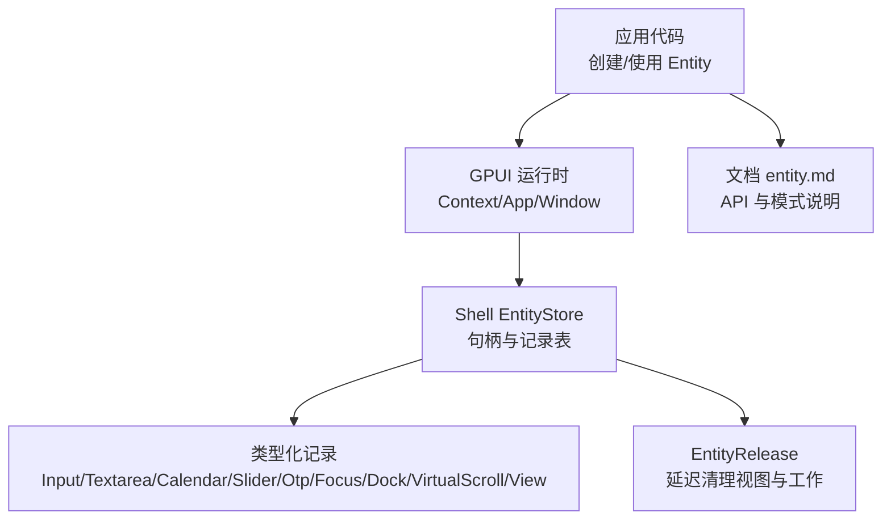
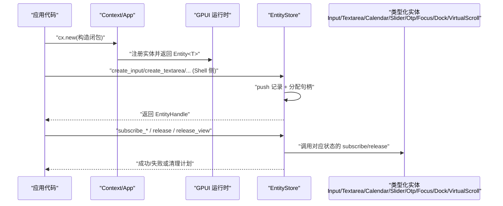
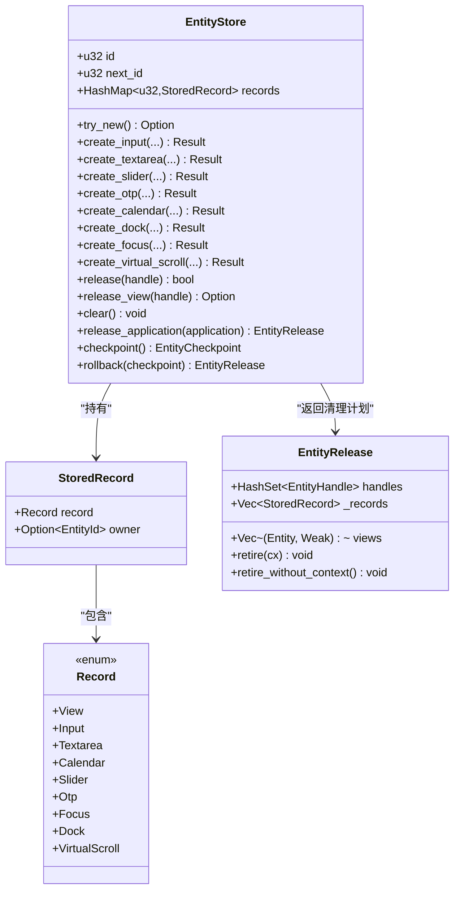
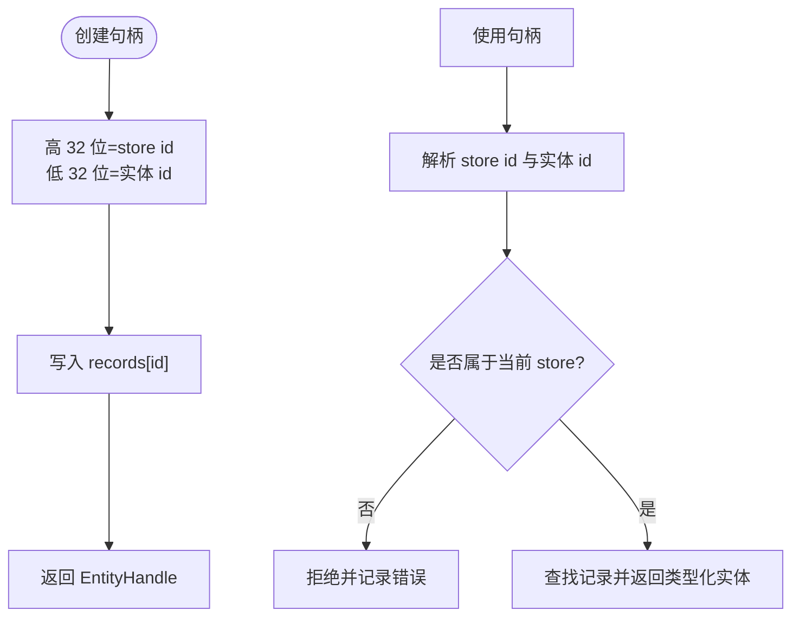
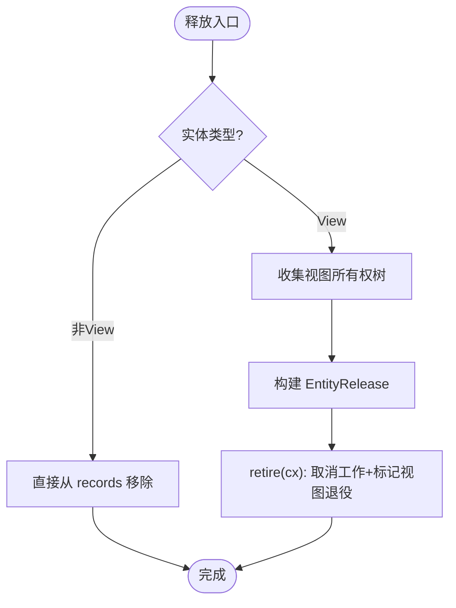
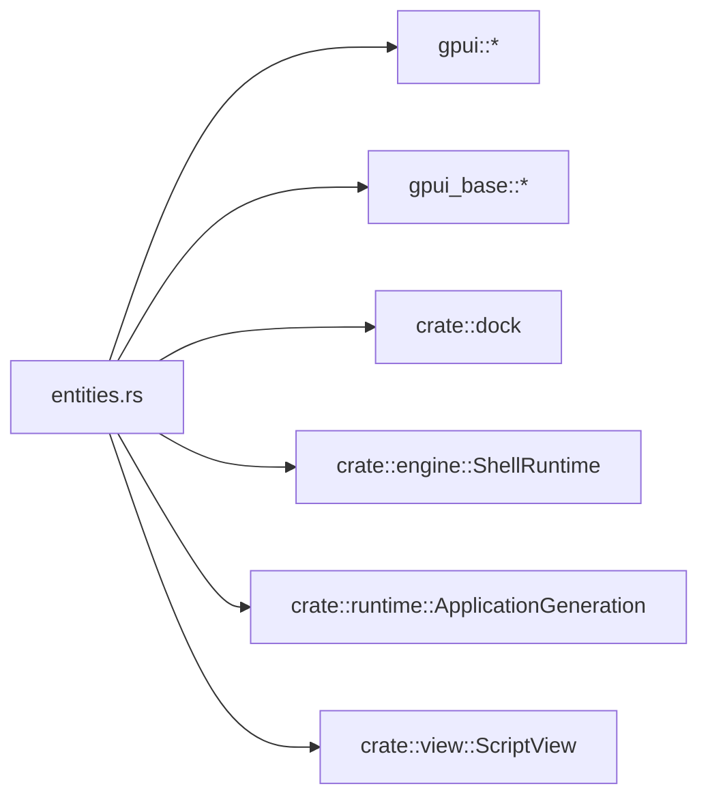

# Entity 系统

<cite>
**本文引用的文件**   
- [entities.rs](file://crates/shell/src/entities.rs)
- [entity.md](file://website/docs/entity.md)
</cite>

## 目录
1. [引言](#引言)
2. [项目结构](#项目结构)
3. [核心组件](#核心组件)
4. [架构总览](#架构总览)
5. [详细组件分析](#详细组件分析)
6. [依赖关系分析](#依赖关系分析)
7. [性能与内存管理](#性能与内存管理)
8. [故障排查指南](#故障排查指南)
9. [结论](#结论)
10. [附录：使用模式与示例路径](#附录使用模式与示例路径)

## 引言
本文面向 GPUI Kit 的 Entity 系统，目标是帮助读者理解实体在状态管理、生命周期、观察机制和内存管理中的角色。文档分为两层：
- 应用层：基于 GPUI 的 `Entity<T>`，用于跨 View、事件处理器和异步任务共享状态；支持受控与非受控两种状态持有模式。
- 宿主层：Shell 提供的 `EntityStore`，为脚本侧持有的“保留实体”提供句柄、类型安全访问、订阅管理和释放策略。

重点覆盖：
- Entity 的创建、读取、更新、观察、弱引用与生命周期。
- Shell 中脚本可见实体的类型化存储、所有权树清理、运行时隔离与容量限制。
- 与 GPUI 渲染引擎的集成方式：通过 `Context`、`Window`、`App` 协调更新与重绘。
- 最佳实践：避免循环引用、防止内存泄漏、减少不必要克隆、合理使用缓存与观察。

## 项目结构
本仓库中与 Entity 系统直接相关的代码主要位于：
- `crates/shell/src/entities.rs`：Shell 层的实体存储、句柄分配、类型分发、订阅管理与释放流程。
- `website/docs/entity.md`：面向使用者的 Entity 文档，涵盖创建、读写、观察、生命周期、WeakEntity、缓存等。

**图表来源**
- [entities.rs:190-250](file://crates/shell/src/entities.rs#L190-L250)
- [entity.md:1-120](file://website/docs/entity.md#L1-L120)

**章节来源**
- [entities.rs:1-120](file://crates/shell/src/entities.rs#L1-L120)
- [entity.md:1-120](file://website/docs/entity.md#L1-L120)

## 核心组件
本节聚焦两个层面：
- 应用层 Entity：由 GPUI 提供，用于共享可变状态、触发通知、建立观察与事件订阅。
- Shell 层 EntityStore：为脚本侧暴露的“保留实体”提供句柄、类型安全访问、订阅托管与释放。

关键要点：
- `cx.new` 创建强引用；`read` 同步读；`update` 同步写并可选返回结果；`downgrade` 生成弱引用。
- `observe` 监听 `notify()`；`subscribe` 监听类型化事件；两者都返回 `Subscription`，需妥善保存以控制生命周期。
- Shell 的 `EntityStore` 维护一个按运行时隔离的句柄到记录的映射，并通过 `Record` 区分不同实体类型。

**章节来源**
- [entity.md:1-120](file://website/docs/entity.md#L1-L120)
- [entities.rs:190-250](file://crates/shell/src/entities.rs#L190-L250)

## 架构总览
下图展示从应用代码到 Shell 实体存储的整体交互：

**图表来源**
- [entities.rs:289-344](file://crates/shell/src/entities.rs#L289-L344)
- [entities.rs:363-394](file://crates/shell/src/entities.rs#L363-L394)
- [entities.rs:422-447](file://crates/shell/src/entities.rs#L422-L447)
- [entities.rs:466-489](file://crates/shell/src/entities.rs#L466-L489)
- [entities.rs:495-508](file://crates/shell/src/entities.rs#L495-L508)
- [entities.rs:560-581](file://crates/shell/src/entities.rs#L560-L581)
- [entities.rs:653-686](file://crates/shell/src/entities.rs#L653-L686)

## 详细组件分析

### Shell 实体存储：EntityStore
`EntityStore` 是 Shell 运行时的实体中心，负责：
- 分配唯一且进程内安全的 store id。
- 将脚本可见的“保留实体”统一登记为 `Record`。
- 提供类型安全的 create/get/subscribe/release API。
- 管理订阅的生命周期，避免脚本侧无法持有 `Subscription` 导致的静默失效。
- 支持按应用版本（ApplicationGeneration）和嵌套视图的所有权树进行批量释放。

#### 数据结构与复杂度
- `records: HashMap<u32, StoredRecord>`：O(1) 查找、插入、删除。
- `next_id: u32`：单调递增，永不重用，避免悬垂句柄被复用。
- `id: u32`：每个运行时唯一的 store id，高 32 位编码于 `EntityHandle`。
- `MAX_LIVE_ENTITIES = 10_000`：硬上限，超出返回 `EntityLimitError`。

**图表来源**
- [entities.rs:174-250](file://crates/shell/src/entities.rs#L174-L250)
- [entities.rs:195-250](file://crates/shell/src/entities.rs#L195-L250)
- [entities.rs:59-162](file://crates/shell/src/entities.rs#L59-L162)

**章节来源**
- [entities.rs:190-250](file://crates/shell/src/entities.rs#L190-L250)
- [entities.rs:257-344](file://crates/shell/src/entities.rs#L257-L344)
- [entities.rs:363-447](file://crates/shell/src/entities.rs#L363-L447)
- [entities.rs:466-508](file://crates/shell/src/entities.rs#L466-L508)
- [entities.rs:560-686](file://crates/shell/src/entities.rs#L560-L686)

#### 句柄布局与运行时隔离
- `EntityHandle` 是 64 位整数，高 32 位表示 store id，低 32 位表示实体 id。
- 跨 store 的句柄会被拒绝，避免不同运行时互相污染。
- 每个运行时拥有独立的 `NEXT_STORE_ID`，保证 store id 不冲突。

**图表来源**
- [entities.rs:43-53](file://crates/shell/src/entities.rs#L43-L53)
- [entities.rs:1075-1085](file://crates/shell/src/entities.rs#L1075-L1085)
- [entities.rs:1098-1113](file://crates/shell/src/entities.rs#L1098-L1113)

**章节来源**
- [entities.rs:43-53](file://crates/shell/src/entities.rs#L43-L53)
- [entities.rs:1075-1113](file://crates/shell/src/entities.rs#L1075-L1113)

#### 创建与获取 API
- 输入/多行文本：`create_input`、`create_textarea`，设置占位符、初始值、编辑器样式。
- 滑块：`create_slider`，设置 min/max/step/scale/default_value。
- OTP：`create_otp`，设置长度、默认值、掩码。
- 日历：`create_calendar`，绑定窗口焦点。
- Dock：`create_dock`，安装皮肤与渲染器。
- Focus：`create_focus`，创建焦点句柄。
- 虚拟滚动：`create_virtual_scroll`，保留滚动请求。

所有 create 方法均先检查容量，再分配 id，最后 push 记录。

**章节来源**
- [entities.rs:317-344](file://crates/shell/src/entities.rs#L317-L344)
- [entities.rs:363-394](file://crates/shell/src/entities.rs#L363-L394)
- [entities.rs:422-447](file://crates/shell/src/entities.rs#L422-L447)
- [entities.rs:466-489](file://crates/shell/src/entities.rs#L466-L489)
- [entities.rs:495-508](file://crates/shell/src/entities.rs#L495-L508)
- [entities.rs:560-581](file://crates/shell/src/entities.rs#L560-L581)
- [entities.rs:653-686](file://crates/shell/src/entities.rs#L653-L686)

#### 订阅与事件分发
- 输入/多行文本：`subscribe_input`，统一处理 `InputEventName`。
- 滑块：`subscribe_slider`，区分 change/release。
- OTP：`subscribe_otp`，区分 change/complete/focus/blur，替换旧 handler。
- 日历：`subscribe_calendar`，单一事件。
- Dock：`subscribe_dock`，布局变化事件。

订阅由 Store 持有，避免脚本侧 drop Subscription 导致回调静默停止。

**章节来源**
- [entities.rs:697-731](file://crates/shell/src/entities.rs#L697-L731)
- [entities.rs:738-767](file://crates/shell/src/entities.rs#L738-L767)
- [entities.rs:776-820](file://crates/shell/src/entities.rs#L776-L820)
- [entities.rs:519-550](file://crates/shell/src/entities.rs#L519-L550)
- [entities.rs:613-635](file://crates/shell/src/entities.rs#L613-L635)

#### 释放与清理
- `release`：释放非 View 实体。
- `release_view`：递归收集子视图及其创建的实体，构建清理计划。
- `release_application`：按 ApplicationGeneration 清理某应用版本的所有实体。
- `clear`：清空全部记录。
- `checkpoint`/`rollback`：回滚某个边界后分配的实体。
- `EntityRelease::retire`：在 GPUI 上下文中执行视图退役与回调取消。

**图表来源**
- [entities.rs:824-835](file://crates/shell/src/entities.rs#L824-L835)
- [entities.rs:837-876](file://crates/shell/src/entities.rs#L837-L876)
- [entities.rs:889-929](file://crates/shell/src/entities.rs#L889-L929)
- [entities.rs:931-947](file://crates/shell/src/entities.rs#L931-L947)
- [entities.rs:949-972](file://crates/shell/src/entities.rs#L949-L972)

**章节来源**
- [entities.rs:824-972](file://crates/shell/src/entities.rs#L824-L972)

### 应用层 Entity：创建、读写、观察、弱引用
- 创建：`cx.new(|cx| T)`，返回强引用 `Entity<T>`。
- 读取：`entity.read(cx)` 或 `entity.read_with(cx, |t, cx| ...)`。
- 更新：`entity.update(cx, |t, cx| { ...; cx.notify(); })`。
- 弱引用：`entity.downgrade()` 得到 `WeakEntity<T>`，通过 `upgrade()` 恢复强引用。
- 观察：`cx.observe(&entity, |this, entity, cx| ...)` 监听 notify。
- 事件：`cx.subscribe(&entity, Self::handler)` 监听类型化事件。

注意：
- 不要在同一个 Entity 正在 update 或 render 时再次 read/update，避免重入 panic。
- 不要将 `&T` 引用跨帧或 await 保存，应拷贝所需值。
- 父持子强引用，子持父弱引用，避免循环。

**章节来源**
- [entity.md:1-120](file://website/docs/entity.md#L1-L120)
- [entity.md:136-189](file://website/docs/entity.md#L136-L189)
- [entity.md:218-266](file://website/docs/entity.md#L218-L266)
- [entity.md:268-345](file://website/docs/entity.md#L268-L345)
- [entity.md:347-415](file://website/docs/entity.md#L347-L415)
- [entity.md:417-467](file://website/docs/entity.md#L417-L467)

## 依赖关系分析
Shell 实体存储依赖以下外部类型与模块：
- `gpui::{App, AppContext, Entity, EntityId, FocusHandle, Subscription, Window}`：GPUI 运行时基础能力。
- `gpui_base`：输入、日历、滑块、OTP、DockArea、虚拟滚动等 UI 状态类型。
- `crate::dock`：Dock 的皮肤槽与上下文。
- `crate::engine::ShellRuntime`：与脚本引擎交互，取消视图相关任务。
- `crate::runtime::ApplicationGeneration`：按应用版本隔离实体。
- `crate::view::ScriptView`：脚本侧视图实体。

**图表来源**
- [entities.rs:21-41](file://crates/shell/src/entities.rs#L21-L41)

**章节来源**
- [entities.rs:21-41](file://crates/shell/src/entities.rs#L21-L41)

## 性能与内存管理
- 句柄克隆开销：克隆 `Entity<T>` 仅复制句柄并增加强引用计数，不深拷贝模型。适合跨模块传递，但应避免在热路径无意义地重复克隆。
- 容量限制：`MAX_LIVE_ENTITIES = 10_000`，超过会返回 `EntityLimitError`，防止无限增长。
- 订阅托管：Store 持有 `Subscription`，避免脚本侧 drop 导致回调提前终止；但需注意长驻实体上反复 detach 可能累积回调。
- 视图退役：`EntityRelease::retire` 在 GPUI 上下文中执行，确保快照与回调生命周期正确。
- 弱引用：使用 `WeakEntity` 打破父子循环；异步任务中使用 `weak_entity().update(...).ok()` 处理已释放情况。
- 渲染缓存：对昂贵子视图可使用 `child.clone().cached(style)`，但父必须保持同一 child Entity，且 style 需提供确定外尺寸。

建议：
- 在父 View 中持有子 Entity 的强引用，子 View 用 `WeakEntity` 回指父。
- 将 `Subscription` 保存在 `_subscription` 或 `_subscriptions` 字段，随 View 销毁自动取消。
- 避免在 `render` 中创建需要跨帧保留的状态（如 focus handle、scroll handle）。
- 谨慎使用 `detach()`，仅在明确需要长生命周期时使用。

**章节来源**
- [entity.md:160-189](file://website/docs/entity.md#L160-L189)
- [entity.md:268-345](file://website/docs/entity.md#L268-L345)
- [entity.md:347-415](file://website/docs/entity.md#L347-L415)
- [entity.md:462-467](file://website/docs/entity.md#L462-L467)
- [entities.rs:53-57](file://crates/shell/src/entities.rs#L53-L57)
- [entities.rs:974-985](file://crates/shell/src/entities.rs#L974-L985)
- [entities.rs:1115-1119](file://crates/shell/src/entities.rs#L1115-L1119)

## 故障排查指南
常见问题与定位思路：
- 句柄无效：检查是否跨 store 使用；Shell 会记录错误并返回 None。
- 回调未触发：确认是否保存了 `Subscription`；脚本侧不能自行 drop。
- 视图未更新：确认是否在 update 中调用了 `cx.notify()`；仅修改状态不会自动通知。
- 死锁/panic：避免在同一 Entity 的 update 或 render 期间再次 read/update；使用返回值或拆分更新。
- 内存泄漏：检查父子强引用循环；使用 `WeakEntity`；检查 detached 订阅是否长期累积。
- 资源未释放：确认 `release`/`release_view`/`release_application` 是否被调用；Shell 会在运行时析构时清理。

调试技巧：
- 使用 `EntityStore::len`/`is_empty` 断言实体数量稳定。
- 使用 `focus_handles`/`first_input`/`first_slider` 等测试辅助方法验证行为。
- 使用 `checkpoint`/`rollback` 在测试中回滚临时实体。

**章节来源**
- [entities.rs:1075-1085](file://crates/shell/src/entities.rs#L1075-L1085)
- [entities.rs:974-1003](file://crates/shell/src/entities.rs#L974-L1003)
- [entity.md:218-266](file://website/docs/entity.md#L218-L266)
- [entity.md:347-415](file://website/docs/entity.md#L347-L415)

## 结论
GPUI 的 Entity 系统提供了强大的状态共享与生命周期管理能力。应用层通过 `Entity<T>` 实现跨组件的状态持有与观察；Shell 层通过 `EntityStore` 为脚本侧提供类型安全、可追踪、可释放的实体句柄。正确使用强/弱引用、订阅托管与容量限制，可以在复杂组件树中保持高性能与内存安全。

## 附录：使用模式与示例路径
- 数据模型与观察视图：见 [entity.md:34-66](file://website/docs/entity.md#L34-L66)。
- 最小示例（Hello World 风格）：见 [entity.md:68-134](file://website/docs/entity.md#L68-L134)。
- 创建与传递句柄：见 [entity.md:136-189](file://website/docs/entity.md#L136-L189)。
- 受控组件状态（InputState）：见 [entity.md:190-217](file://website/docs/entity.md#L190-L217)。
- 读取与更新：见 [entity.md:218-266](file://website/docs/entity.md#L218-L266)。
- 弱引用与异步任务：见 [entity.md:268-345](file://website/docs/entity.md#L268-L345)。
- 观察与事件订阅：见 [entity.md:347-415](file://website/docs/entity.md#L347-L415)。
- 生命周期与缓存：见 [entity.md:417-467](file://website/docs/entity.md#L417-L467)。

Shell 侧实体 API 参考路径：
- 创建输入/多行文本/滑块/OTP/日历/Dock/Focus/虚拟滚动：[entities.rs:317-686](file://crates/shell/src/entities.rs#L317-L686)。
- 订阅与事件分发：[entities.rs:519-820](file://crates/shell/src/entities.rs#L519-L820)。
- 释放与清理：[entities.rs:824-972](file://crates/shell/src/entities.rs#L824-L972)。