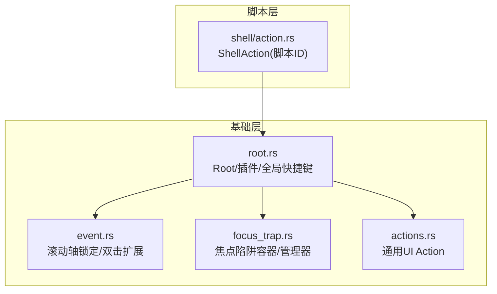
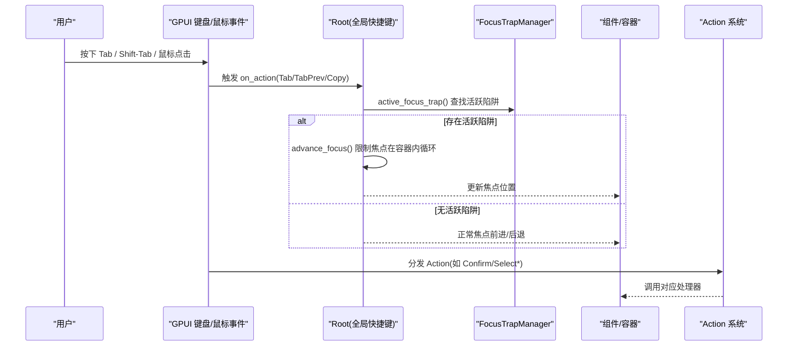
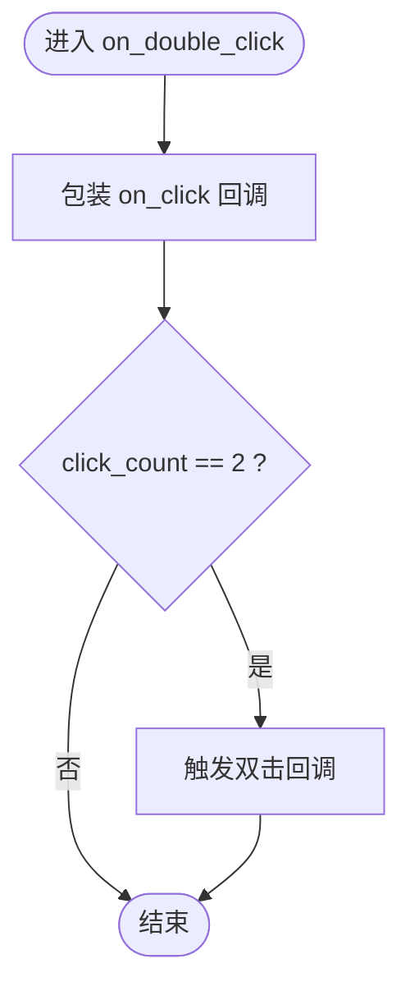
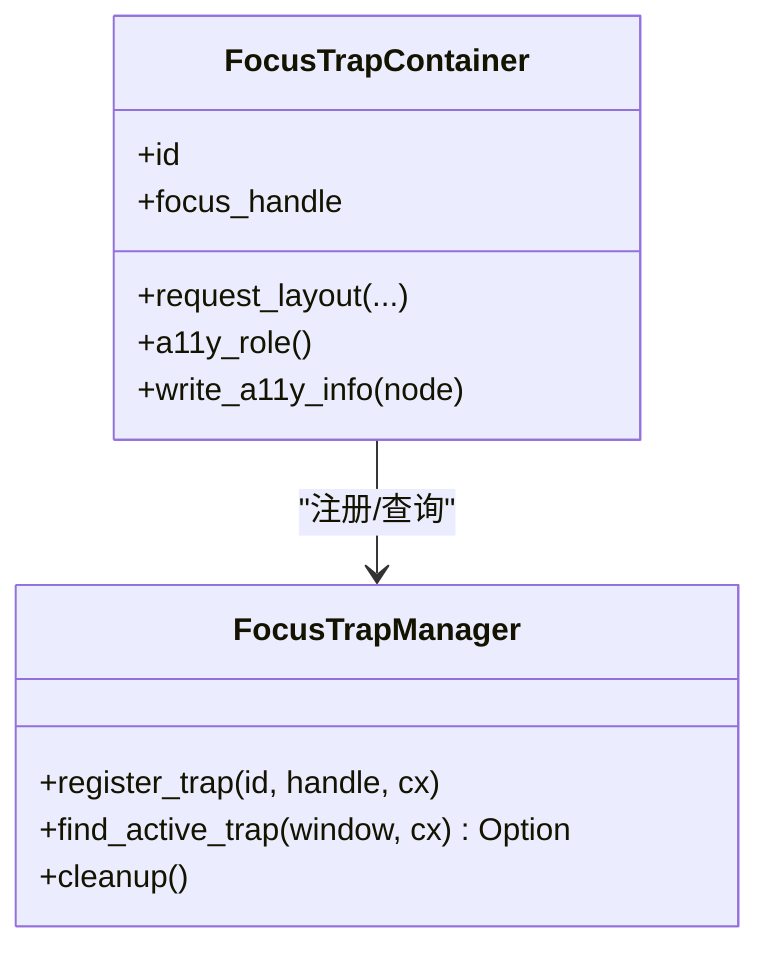
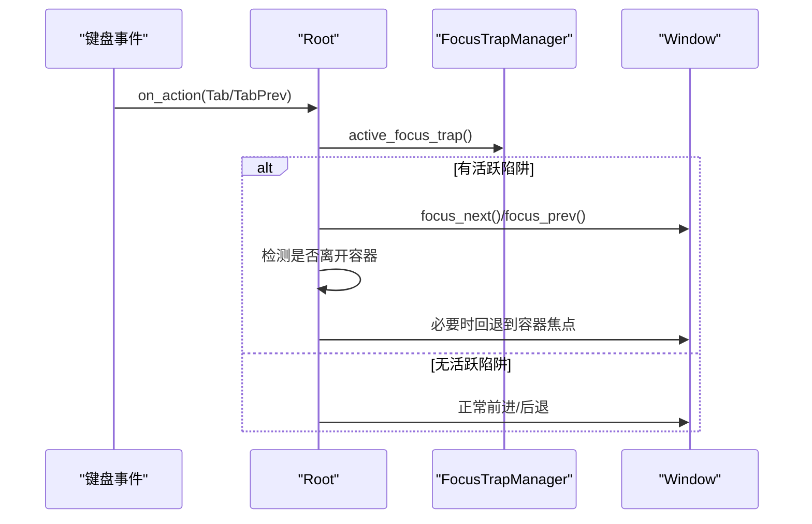
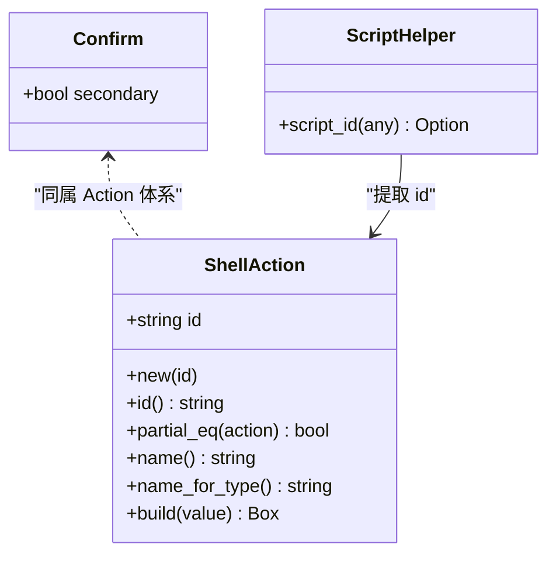
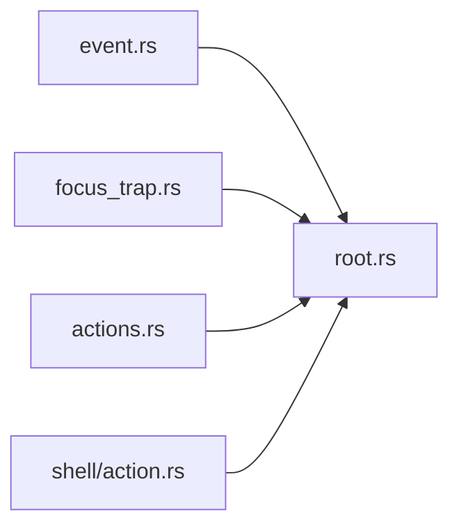

# 事件处理机制

<cite>
**本文引用的文件**   
- [event.rs](file://crates/base/src/event.rs)
- [focus_trap.rs](file://crates/base/src/focus_trap.rs)
- [root.rs](file://crates/base/src/root.rs)
- [actions.rs](file://crates/base/src/actions.rs)
- [action.rs](file://crates/shell/src/action.rs)
</cite>

## 目录
1. [引言](#引言)
2. [项目结构](#项目结构)
3. [核心组件](#核心组件)
4. [架构总览](#架构总览)
5. [详细组件分析](#详细组件分析)
6. [依赖关系分析](#依赖关系分析)
7. [性能考虑](#性能考虑)
8. [故障排查指南](#故障排查指南)
9. [结论](#结论)

## 引言
本文件系统性梳理 GPUI Kit 的事件处理机制，覆盖以下关键主题：
- 事件冒泡与捕获、传播控制（含双击扩展）
- 键盘事件与焦点管理（Tab/Shift-Tab、复制）
- 鼠标事件与滚动轴锁定
- 事件的注册、分发、监听和处理流程
- 自定义事件与 Action 系统协作
- 焦点陷阱 Focus Trap 的交互模式
- 无障碍访问与键盘导航
- 性能优化技巧（事件委托、批量处理、防抖节流）
- 在交互式组件中的应用模式与实践建议

## 项目结构
围绕事件系统的核心代码集中在 base 与 shell 两个 crate：
- base/crates/base/src
  - event.rs：滚动轴锁定与双击扩展
  - focus_trap.rs：焦点陷阱容器与全局管理器
  - root.rs：根节点、插件生命周期、全局快捷键与 Tab 导航
  - actions.rs：通用 UI Action 定义（如 Confirm、Select* 等）
- shell/crates/shell/src
  - action.rs：脚本侧 ShellAction，统一字符串 ID 的 Action 类型

图表来源
- [root.rs:11-50](file://crates/base/src/root.rs#L11-L50)
- [focus_trap.rs:8-50](file://crates/base/src/focus_trap.rs#L8-L50)
- [event.rs:1-61](file://crates/base/src/event.rs#L1-L61)
- [actions.rs:1-40](file://crates/base/src/actions.rs#L1-L40)
- [action.rs:1-108](file://crates/shell/src/action.rs#L1-L108)

章节来源
- [root.rs:11-50](file://crates/base/src/root.rs#L11-L50)
- [focus_trap.rs:8-50](file://crates/base/src/focus_trap.rs#L8-L50)
- [event.rs:1-61](file://crates/base/src/event.rs#L1-L61)
- [actions.rs:1-40](file://crates/base/src/actions.rs#L1-L40)
- [action.rs:1-108](file://crates/shell/src/action.rs#L1-L108)

## 核心组件
- 滚动与点击增强
  - OngoingScrollExt：跨平台滚动轴锁定（wasm 下为无操作）
  - InteractiveElementExt：提供 on_double_click 双击监听封装
- 焦点陷阱
  - FocusTrapManager：全局维护所有焦点陷阱容器
  - FocusTrapContainer：包装元素，注册并参与 Tab 循环
- Root 与全局快捷键
  - 注册 Tab/Shift-Tab/Copy 快捷键
  - 通过 advance_focus 实现受控的焦点遍历
- Action 系统
  - base/actions.rs：通用 UI Action（Confirm、Select* 等）
  - shell/action.rs：ShellAction，将脚本侧字符串 ID 映射为统一 Action 类型

章节来源
- [event.rs:1-61](file://crates/base/src/event.rs#L1-L61)
- [focus_trap.rs:8-110](file://crates/base/src/focus_trap.rs#L8-L110)
- [root.rs:11-50](file://crates/base/src/root.rs#L11-L50)
- [actions.rs:1-40](file://crates/base/src/actions.rs#L1-L40)
- [action.rs:1-108](file://crates/shell/src/action.rs#L1-L108)

## 架构总览
下图展示从用户输入到焦点管理与 Action 分发的整体流程。

图表来源
- [root.rs:11-50](file://crates/base/src/root.rs#L11-L50)
- [root.rs:222-239](file://crates/base/src/root.rs#L222-L239)
- [focus_trap.rs:84-110](file://crates/base/src/focus_trap.rs#L84-L110)
- [actions.rs:6-28](file://crates/base/src/actions.rs#L6-L28)

## 详细组件分析

### 滚动与点击增强（event.rs）
- 滚动轴锁定
  - 非 wasm 平台：使用 filter 锁定滚动的起始主轴，避免浏览器中轴丢失导致异常
  - wasm 平台：直接忽略，避免 time 未实现导致的崩溃
- 双击扩展
  - 基于 on_click 内部判断 click_count == 2，转发给自定义回调

图表来源
- [event.rs:43-57](file://crates/base/src/event.rs#L43-L57)

章节来源
- [event.rs:1-61](file://crates/base/src/event.rs#L1-L61)

### 焦点陷阱（focus_trap.rs）
- 初始化与扩展
  - init(cx)：设置全局 FocusTrapManager
  - FocusTrapElement：为任意可交互元素添加 .focus_trap(id, handle)
- 全局管理器
  - register_trap：按元素全局 ID 注册 WeakFocusHandle
  - find_active_trap：根据当前聚焦元素所在容器，选择最内层活跃陷阱
  - cleanup：清理已释放的弱引用
- 容器包装
  - FocusTrapContainer：在 request_layout 阶段注册陷阱，透传 a11y 语义

图表来源
- [focus_trap.rs:8-110](file://crates/base/src/focus_trap.rs#L8-L110)
- [focus_trap.rs:122-212](file://crates/base/src/focus_trap.rs#L122-L212)

章节来源
- [focus_trap.rs:8-110](file://crates/base/src/focus_trap.rs#L8-L110)
- [focus_trap.rs:122-212](file://crates/base/src/focus_trap.rs#L122-L212)

### Root 与全局快捷键（root.rs）
- 快捷键绑定
  - Tab/Shift-Tab：前进/后退焦点
  - Copy：macOS 用 cmd-c，其他平台 ctrl-c
- 焦点推进策略
  - advance_focus：若存在活跃焦点陷阱，则确保焦点在容器内循环；否则交由 GPUI 默认行为
- Root 渲染管线
  - 插件 prepare/style/decorate 三阶段
  - 注入 TextSelectionLayer 与应用视图，并在顶层挂载插件 overlay

图表来源
- [root.rs:11-50](file://crates/base/src/root.rs#L11-L50)
- [root.rs:18-40](file://crates/base/src/root.rs#L18-L40)
- [root.rs:222-239](file://crates/base/src/root.rs#L222-L239)

章节来源
- [root.rs:11-50](file://crates/base/src/root.rs#L11-L50)
- [root.rs:18-40](file://crates/base/src/root.rs#L18-L40)
- [root.rs:222-239](file://crates/base/src/root.rs#L222-L239)

### Action 系统与脚本 Action（actions.rs / action.rs）
- base/actions.rs
  - 定义通用 UI Action（如 Confirm、Cancel、SelectUp/Down/Left/Right/First/Last/PageUp/PageDown），供键盘驱动控件复用
- shell/action.rs
  - ShellAction：以字符串 id 标识的 Action，用于脚本侧动态命名
  - 通过 partial_eq 比较 id，name_for_type 返回统一类型名，build 从 JSON 构建实例
  - script_id：从任意 Any 中提取脚本 Action 的 id

图表来源
- [actions.rs:6-28](file://crates/base/src/actions.rs#L6-L28)
- [action.rs:30-98](file://crates/shell/src/action.rs#L30-L98)
- [action.rs:100-108](file://crates/shell/src/action.rs#L100-L108)

章节来源
- [actions.rs:1-40](file://crates/base/src/actions.rs#L1-L40)
- [action.rs:1-108](file://crates/shell/src/action.rs#L1-L108)

## 依赖关系分析
- Root 依赖 FocusTrapManager 获取活跃陷阱，从而约束 Tab 导航范围
- Root 同时订阅通用 Action（Tab/TabPrev/Copy），并与文本选择层协作完成复制
- event.rs 提供的扩展方法被组件广泛使用，简化双击与滚动轴锁定
- shell/action.rs 的 ShellAction 作为桥接类型，使脚本侧 Action 能接入 GPUI 的 Action 分发

图表来源
- [root.rs:11-50](file://crates/base/src/root.rs#L11-L50)
- [focus_trap.rs:8-110](file://crates/base/src/focus_trap.rs#L8-L110)
- [event.rs:1-61](file://crates/base/src/event.rs#L1-L61)
- [actions.rs:1-40](file://crates/base/src/actions.rs#L1-L40)
- [action.rs:1-108](file://crates/shell/src/action.rs#L1-L108)

章节来源
- [root.rs:11-50](file://crates/base/src/root.rs#L11-L50)
- [focus_trap.rs:8-110](file://crates/base/src/focus_trap.rs#L8-L110)
- [event.rs:1-61](file://crates/base/src/event.rs#L1-L61)
- [actions.rs:1-40](file://crates/base/src/actions.rs#L1-L40)
- [action.rs:1-108](file://crates/shell/src/action.rs#L1-L108)

## 性能考虑
- 事件委托
  - 在 Root 或父容器集中处理 Tab/Shift-Tab，避免每个子元素重复注册
  - 使用 on_action 而非 on_key_down，让 keymap 决定组合键，减少分支判断
- 批量处理
  - 对高频事件（如滚动、拖拽）采用批量化状态更新，减少 notify 次数
  - 在 Root 渲染前统一执行插件 prepare，避免多次重绘
- 防抖与节流
  - 对搜索、过滤等输入场景，结合外部调度器进行节流/防抖，降低计算压力
- 滚动轴锁定
  - 在非 wasm 平台启用 restrict_scroll_to_axis/filter，避免无效滚动路径带来的额外布局与绘制
- 焦点遍历优化
  - 使用 FocusTrapManager 的 active_focus_trap 快速定位活跃容器，避免全树扫描

[本节为通用指导，不直接分析具体文件]

## 故障排查指南
- 双击无响应
  - 检查是否使用了 on_double_click 扩展；确认 click_count 条件满足
  - 参考路径：[event.rs:43-57](file://crates/base/src/event.rs#L43-L57)
- 滚动在 wasm 上崩溃
  - 确认未直接调用底层时间相关 API；OngoingScrollExt 已在 wasm 下做无操作保护
  - 参考路径：[event.rs:6-24](file://crates/base/src/event.rs#L6-L24)
- Tab 焦点逃逸出模态框
  - 确认容器已调用 .focus_trap(id, handle)，且 Root 已初始化
  - 检查 active_focus_trap 是否能找到活跃容器
  - 参考路径：[focus_trap.rs:84-110](file://crates/base/src/focus_trap.rs#L84-L110)、[root.rs:18-40](file://crates/base/src/root.rs#L18-L40)
- 复制功能无效
  - 检查是否有选中文本；若无文本会 propagate 继续分发
  - 参考路径：[root.rs:230-239](file://crates/base/src/root.rs#L230-L239)
- 脚本 Action 未触发
  - 确认 ShellAction::id 与 keymap 配置一致；listener 中通过 script_id 区分不同脚本 Action
  - 参考路径：[action.rs:52-98](file://crates/shell/src/action.rs#L52-L98)、[action.rs:100-108](file://crates/shell/src/action.rs#L100-L108)

章节来源
- [event.rs:6-57](file://crates/base/src/event.rs#L6-L57)
- [focus_trap.rs:84-110](file://crates/base/src/focus_trap.rs#L84-L110)
- [root.rs:18-40](file://crates/base/src/root.rs#L18-L40)
- [root.rs:230-239](file://crates/base/src/root.rs#L230-L239)
- [action.rs:52-108](file://crates/shell/src/action.rs#L52-L108)

## 结论
GPUI Kit 的事件系统以 Root 为中心，结合 FocusTrapManager 与通用 Action，形成统一的输入处理与焦点管理机制。通过 event.rs 的扩展能力，开发者可以便捷地处理双击与滚动轴锁定；通过 actions.rs 与 shell/action.rs，脚本与原生代码共享一致的 Action 模型。在实际项目中，建议：
- 优先使用 on_action 与通用 Action，保持键盘与菜单的一致性
- 在模态/浮层中使用 .focus_trap 保证可访问性与键盘导航
- 对高频事件进行批处理与节流，提升性能
- 充分利用 Root 的插件机制，集中处理窗口级交互与样式

[本节为总结性内容，不直接分析具体文件]