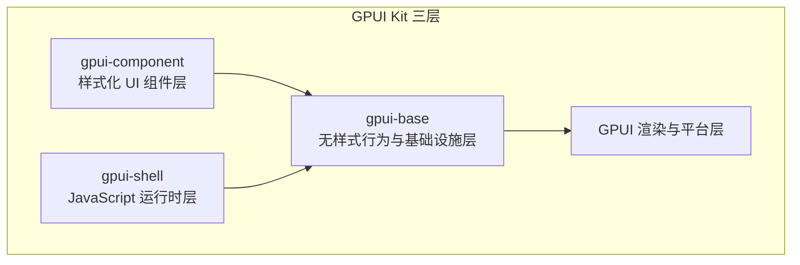
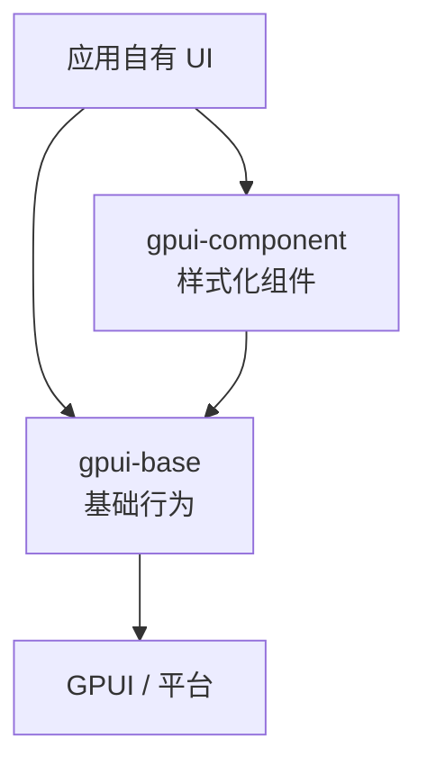
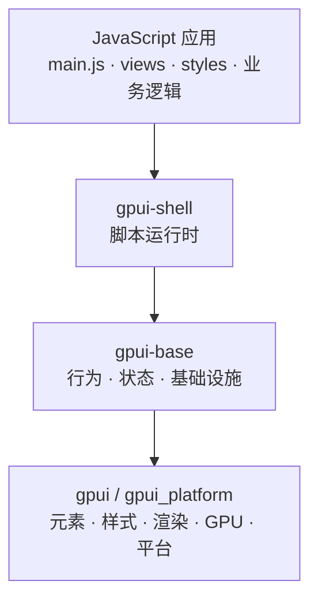
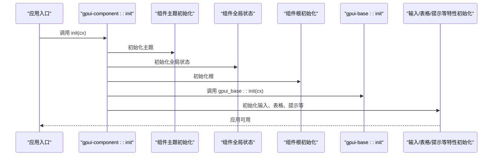
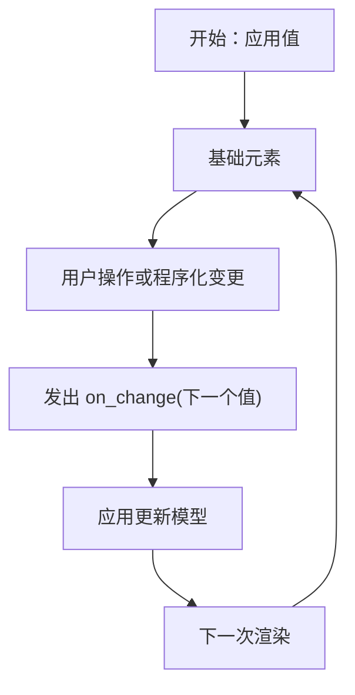
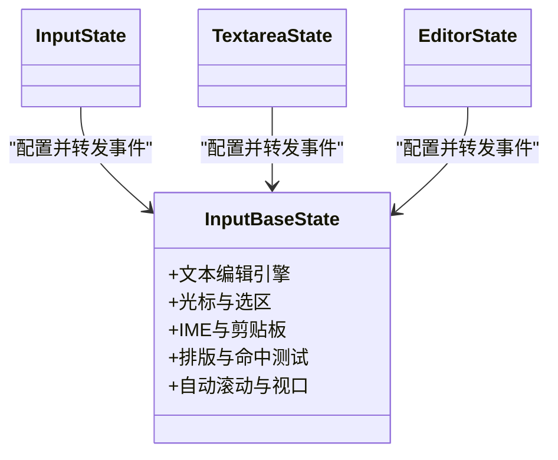
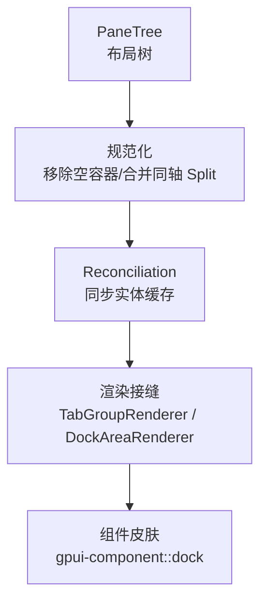
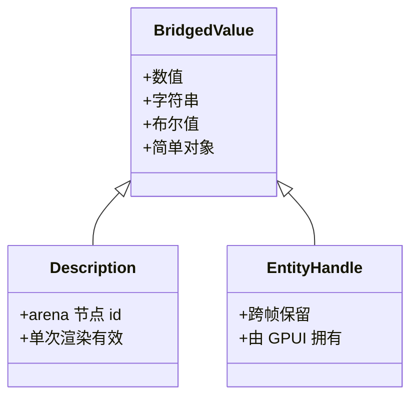
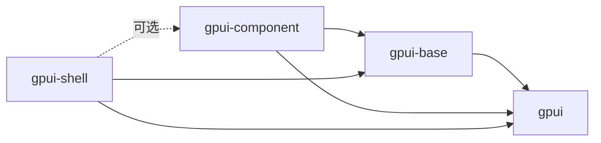
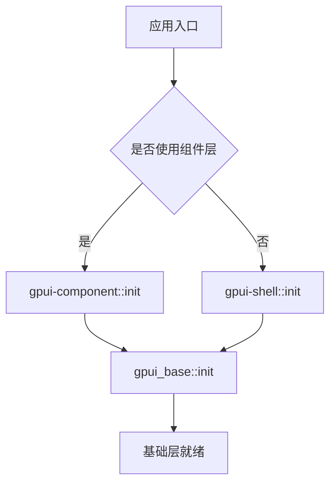

# 架构概览

<cite>
**本文引用的文件**   
- [ARCHITECTURE.md](file://docs/ARCHITECTURE.md)
- [gpui-shell.md](file://docs/gpui-shell.md)
- [base/lib.rs](file://crates/base/src/lib.rs)
- [component/lib.rs](file://crates/component/src/lib.rs)
- [shell/lib.rs](file://crates/shell/src/lib.rs)
- [base/Cargo.toml](file://crates/base/Cargo.toml)
- [component/Cargo.toml](file://crates/component/Cargo.toml)
- [shell/Cargo.toml](file://crates/shell/Cargo.toml)
</cite>

## 目录
1. [引言](#引言)
2. [项目结构](#项目结构)
3. [核心组件](#核心组件)
4. [架构总览](#架构总览)
5. [详细组件分析](#详细组件分析)
6. [依赖关系分析](#依赖关系分析)
7. [性能与权衡](#性能与权衡)
8. [故障排查指南](#故障排查指南)
9. [结论](#结论)
10. [附录：模块家族分类](#附录模块家族分类)

## 引言
本文件面向希望理解 GPUI Kit 三层架构的开发者，目标是说明以下设计事实：
- `gpui-component` 是样式化 UI 组件层，负责产品视觉语言、主题映射和最终组合。
- `gpui-base` 是无样式行为和基础设施层，拥有可复用行为、几何计算、状态系统和通用布局能力。
- `gpui-shell` 是 JavaScript 运行时层，把脚本应用放在与 `gpui-component` 平行的“应用自有 UI”分支上，直接绑定 `gpui-base` 和底层 GPUI。

文档同时解释模块家族分类、依赖方向、初始化顺序、扩展点以及关键的技术权衡，帮助读者在扩展组件、替换主题或编写脚本时做出符合框架原则的选择。

## 项目结构
仓库围绕三个核心 crate 组织：
- `crates/base`：暴露无样式行为、几何、主题语义 token、滚动、虚拟列表、文本编辑引擎、弹出定位、可访问性、全局初始化等。
- `crates/component`：基于 `gpui-base` 提供带样式的组件库，并维护产品主题、图标、尺寸系统、国际化与组件初始化流程。
- `crates/shell`：基于 `gpui-base` 提供脚本运行时，让 JavaScript 应用直接构建元素树、表达样式和业务逻辑，而不被某个产品视觉系统绑定。

**图表来源**
- [ARCHITECTURE.md:34-55](file://docs/ARCHITECTURE.md#L34-L55)
- [gpui-shell.md:218-241](file://docs/gpui-shell.md#L218-L241)

**章节来源**
- [ARCHITECTURE.md:1-55](file://docs/ARCHITECTURE.md#L1-L55)
- [gpui-shell.md:1-57](file://docs/gpui-shell.md#L1-L57)

## 核心组件
### gpui-base：基础行为层
`gpui-base` 的职责是“可复用的行为和实现它所需的几何”。它不决定品牌色、字号、圆角、图标、控件密度或最终组合；这些属于表现层。其公共导出包含语义控件根、复合行为根、状态系统、滚动与虚拟列表、弹出定位、文本编辑、动画、主题 token、全局初始化等。

关键点：
- 通过 `init(cx)` 安装基础主题、全局状态、减少动效偏好、对话框、焦点陷阱、弹出、选择器、输入、树、文本、根等基础设施。
- 明确区分“语义元素”“复合行为根”“状态系统”“基础设施工具”四类模块，避免把它们当作完全相同的“原始控件”。
- 保持对 `gpui-component` 的零依赖，使基础层可被任意视觉系统复用。

**章节来源**
- [ARCHITECTURE.md:18-55](file://docs/ARCHITECTURE.md#L18-L55)
- [ARCHITECTURE.md:57-127](file://docs/ARCHITECTURE.md#L57-L127)
- [base/lib.rs:1-6](file://crates/base/src/lib.rs#L1-L6)
- [base/lib.rs:238-256](file://crates/base/src/lib.rs#L238-L256)

### gpui-component：样式化组件层
`gpui-component` 是 `gpui-base` 之上的产品视觉适配层。它：
- 将主题投影到基础 token 和基础设施默认值。
- 包装基础元素，添加标签、图标、尺寸、变体和产品布局。
- 提供应用级弹出菜单、LSP 视图和本地集成。
- 保留历史公开接口，但把行为委托给基础层。

它的 `init(cx)` 会先初始化主题、全局状态、可选检查器、根、基础层、输入、差异、日期选择、停靠区、面板、列表、命令、轮播、通知、弹出、问卷、菜单、表格、提示等。

**章节来源**
- [ARCHITECTURE.md:686-698](file://docs/ARCHITECTURE.md#L686-L698)
- [component/lib.rs:127-151](file://crates/component/src/lib.rs#L127-L151)

### gpui-shell：JavaScript 运行时层
`gpui-shell` 是一个基于 `gpui-base` 的可脚本应用运行时。主机负责渲染、布局、文本编辑、虚拟化、覆盖层和系统能力；脚本负责组合、展示和业务逻辑。JavaScript 默认运行在 QuickJS 上。

关键职责：
- 提供嵌入脚本运行时、VM、调度、错误恢复、热重载。
- 绑定 `gpui` 元素与样式层以及 `gpui-base` 行为层。
- 提供能力门控的系统 API，如文件系统、本地存储、剪贴板、进程、HTTP、TCP、WebSocket。
- 提供命令行宿主，运行脚本应用目录、校验并生成类型声明。

初始化入口包括：
- `init(cx)`：调用 `gpui_base::init`，安装样式反射表。
- `init_with_components(cx, components)`：先执行组件注册表的初始化器，再执行 shell 初始化。

**章节来源**
- [gpui-shell.md:15-57](file://docs/gpui-shell.md#L15-L57)
- [gpui-shell.md:218-241](file://docs/gpui-shell.md#L218-L241)
- [shell/lib.rs:1-10](file://crates/shell/src/lib.rs#L1-L10)
- [shell/lib.rs:279-301](file://crates/shell/src/lib.rs#L279-L301)

## 架构总览
### 依赖方向
依赖方向向下：应用或 `gpui-component` 使用 `gpui-base`，`gpui-base` 使用 GPUI。`gpui-base` 不得导入 `gpui-component` 的主题、资源或门面类型。`gpui-component::init` 可以初始化并为主题配置基础层，但基础层也必须能在直接初始化时工作。

**图表来源**
- [ARCHITECTURE.md:34-55](file://docs/ARCHITECTURE.md#L34-L55)

### 脚本运行时位置
脚本应用位于“应用自有 UI”分支，与 `gpui-component` 平行，而不是在其下游。Shell 绑定 `gpui-base` 和 `gpui`，不绑定 `gpui-component`，从而把样式、状态样式、间距和颜色决策交给脚本。

**图表来源**
- [gpui-shell.md:218-241](file://docs/gpui-shell.md#L218-L241)

### 初始化交互序列
典型 Rust 应用使用 `gpui-component` 时的初始化顺序如下：

**图表来源**
- [component/lib.rs:127-151](file://crates/component/src/lib.rs#L127-L151)
- [base/lib.rs:238-256](file://crates/base/src/lib.rs#L238-L256)

## 详细组件分析
### 基础层模块家族
基础层公共表面分为四类模块，每类有明确职责和使用场景。

| 模块家族 | 代表能力 | 设计要点 | 使用场景 |
|---|---|---|---|
| 语义元素 | Button、Checkbox、Radio、Switch、Toggle、Link、Tabs、Progress、Avatar、Table 语义部分 | 直接实现 GPUI 接口，提供稳定元素身份、事件归一化、焦点、键盘激活、可访问性语义、受控值和可选语义状态样式 | 需要稳定语义和交互语义，但不关心产品外观 |
| 复合行为根 | Accordion、Dialog、AlertDialog、Sheet、Popover、HoverCard、Select、Combobox、DatePicker、Popup | 协调多个部分或应用子节点，封装打开状态、焦点转移、Escape/Confirm、层级、遮罩命中测试、焦点捕获、触发测量与弹出定位 | 需要复杂交互协议，不希望每个调用方重复实现 |
| 状态系统 | InputState、TextareaState、EditorState、CalendarState、TreeState、SliderState、ResizableState、OtpState、ColorPickerState、QuestionnaireState、ToastManager、NavStackState、DockArea、TabGroup | 跨帧保留数据，通常由 Entity、键控元素状态或应用模型持有；暴露渲染接缝而非内部实现 | 需要测量、订阅、历史、焦点、增量更新或复杂布局 |
| 基础设施工具 | Positioner、Scrollbar、VirtualList、FocusTrapElement、AutoScroll、motion、History、几何辅助、测量、主题 token、全局初始化 | 小接口隐藏布局、生命周期或数据结构复杂度；接口即测试接缝 | 被多个控件复用，不应让调用方复制算法 |

**章节来源**
- [ARCHITECTURE.md:57-127](file://docs/ARCHITECTURE.md#L57-L127)

### 状态所有权与受控值
基础层的状态所有权遵循行为需求，而不是单一模式：
- 受控值：控件接收当前值并通过回调报告请求变更，不静默修改应用状态。
- 句柄与显式共享状态：例如 DialogHandle、Scrollbar 适配器、ToastStackState。
- Entity 驱动状态：复杂模块使用 `Entity<State>` 以支持观察、订阅、焦点句柄和增量通知。
- 键控元素状态：与元素身份绑定的短暂状态，要求稳定的 `ElementId`。

**图表来源**
- [ARCHITECTURE.md:129-173](file://docs/ARCHITECTURE.md#L129-L173)

**章节来源**
- [ARCHITECTURE.md:129-173](file://docs/ARCHITECTURE.md#L129-L173)

### 样式模型
基础层分离三种样式机制：
1. 普通 GPUI `Styled` 实例样式。
2. 类型化的语义状态样式构建器，如 checked、selected、disabled。
3. GPUI 原生运行时修饰符，如 hover、active、focus-visible。

复合与状态模块通过明确的呈现接缝暴露样式扩展点：根或部分的 `Styled`、应用提供的子节点、类型化部分元素、项渲染回调、内部虚拟化容器样式、呈现快照等。

**章节来源**
- [ARCHITECTURE.md:174-194](file://docs/ARCHITECTURE.md#L174-L194)

### 文本编辑架构
基础层为单行输入、多行文本和编辑器提供统一但分层的设计：
- `Input` + `InputState`：单行值、占位符、掩码、验证和提交。
- `Textarea` + `TextareaState`：普通多行文本、固定行数、软换行、可选自动增长限制。
- `Editor` + `EditorState`：源码文本、语言高亮、行号、折叠、搜索、诊断和 LSP 集成。
- `InputBaseState` 共享编辑引擎：Rope 文本、编辑历史、光标、选区、IME、剪贴板、聚焦、排版、命中测试、自动滚动、视口滚动、原生文本内容集成。

**图表来源**
- [ARCHITECTURE.md:286-343](file://docs/ARCHITECTURE.md#L286-L343)

**章节来源**
- [ARCHITECTURE.md:286-343](file://docs/ARCHITECTURE.md#L286-L343)

### 覆盖层与定位
覆盖层模块将生命周期与定位、呈现分离：
- `Positioner` 提供边定位、首选边、翻转、对齐、偏移和视口裁剪，以及角落定位。
- Dialog 和 Sheet 创建视口大小宿主，负责焦点捕获、键盘动作、遮罩点击和回调顺序，但不决定最终弹出或面板位置。
- 覆盖层视觉层与覆盖命中层分离，确保内容内点击不会误触关闭目标。

**章节来源**
- [ARCHITECTURE.md:453-481](file://docs/ARCHITECTURE.md#L453-L481)

### 滚动与虚拟化
- `ScrollbarHandle` 是滚动实现与共享 Scrollbar 元素的接缝。
- VirtualList 管理可变高度项布局、可见范围计算、内容遮罩、延迟滚动到项请求和裁剪偏移。
- `ScrollableMask` 处理滚轮分发，解决嵌套滚动区域竞争问题，并按轴锁定手势。

**章节来源**
- [ARCHITECTURE.md:483-531](file://docs/ARCHITECTURE.md#L483-L531)

### 停靠布局
`crates/base/src/dock` 拥有布局树、持久化、拖拽命中测试、调整大小算术、活动面板状态机、缩放、焦点和面板注册表。`crates/component/src/dock` 是皮肤层，实现渲染 trait 提供标签栏、工具栏、拖放指示器和停靠切换外观。

**图表来源**
- [ARCHITECTURE.md:533-636](file://docs/ARCHITECTURE.md#L533-L636)

**章节来源**
- [ARCHITECTURE.md:533-636](file://docs/ARCHITECTURE.md#L533-L636)

### 主题投影
基础 `Theme` 包含语义 token、滚动条默认值和 Resizable 所需的最小颜色。语义 token 描述角色和尺度，不自动样式化基础控件；表现层读取并应用它们。`gpui-component` 在初始化和主题变化时将活跃主题投影到基础主题。

**章节来源**
- [ARCHITECTURE.md:637-650](file://docs/ARCHITECTURE.md#L637-L650)

### 动画与生命周期
普通语义控件不安装产品动画。通用 `motion::transition` 管理键控插值、时序、反转、动画帧和减少动效行为。深层行为模块可能拥有与其布局生命周期不可分割的可配置动画，例如 ToastStack。

**章节来源**
- [ARCHITECTURE.md:652-670](file://docs/ARCHITECTURE.md#L652-L670)

### Shell 对象模型
Shell 将跨脚本与 Rust 的对象分为三类：
- 值：小型可拷贝数据，传输时复制。
- 描述：一次渲染有效的轻量描述，例如 `Button.new(id)`。
- 实体：跨帧保留、由 GPUI 拥有的句柄，例如 `InputState`、`ScriptView`。

**图表来源**
- [gpui-shell.md:746-755](file://docs/gpui-shell.md#L746-L755)

**章节来源**
- [gpui-shell.md:746-755](file://docs/gpui-shell.md#L746-L755)

## 依赖关系分析
### Cargo 依赖方向
- `gpui-base` 依赖 `gpui` 及文本、时间、序列化、异步、平台相关依赖。
- `gpui-component` 依赖 `gpui-base`、`gpui`、组件宏、资源包、国际化、语法高亮等。
- `gpui-shell` 依赖 `gpui-base`（启用 inspector）、`gpui`、`gpui-fps`，并在启用 `components` 时可选依赖 `gpui-component`。

**图表来源**
- [base/Cargo.toml:33-60](file://crates/base/Cargo.toml#L33-L60)
- [component/Cargo.toml:120-143](file://crates/component/Cargo.toml#L120-L143)
- [shell/Cargo.toml:51-74](file://crates/shell/Cargo.toml#L51-L74)

**章节来源**
- [base/Cargo.toml:1-31](file://crates/base/Cargo.toml#L1-L31)
- [component/Cargo.toml:1-44](file://crates/component/Cargo.toml#L1-L44)
- [shell/Cargo.toml:1-49](file://crates/shell/Cargo.toml#L1-L49)

### 初始化依赖链
- `gpui-component::init` 调用 `gpui_base::init`，因此组件层初始化会带动基础层初始化。
- `gpui-shell::init` 也调用 `gpui_base::init`，但脚本运行时本身不依赖 `gpui-component`。
- 若宿主使用组件注册表，则 `init_with_components` 先执行注册表初始化器，再执行 shell 初始化。

**图表来源**
- [component/lib.rs:127-151](file://crates/component/src/lib.rs#L127-L151)
- [shell/lib.rs:279-301](file://crates/shell/src/lib.rs#L279-L301)
- [base/lib.rs:238-256](file://crates/base/src/lib.rs#L238-L256)

**章节来源**
- [component/lib.rs:127-151](file://crates/component/src/lib.rs#L127-L151)
- [shell/lib.rs:279-301](file://crates/shell/src/lib.rs#L279-L301)
- [base/lib.rs:238-256](file://crates/base/src/lib.rs#L238-L256)

## 性能与权衡
### 基础层 vs 表现层
- 基础层拥有可复用行为和几何，避免把难以复用的交互复杂性推给调用方。
- 表现层拥有产品视觉语言，允许替换主题和视觉系统而不重写行为。
- 这种划分意味着新增视觉风格成本低，但行为正确性必须通过基础层测试保障。

### 脚本运行时 vs 编译型 UI
- 脚本提高迭代速度，降低扩展成本和生成成本，但 VM 边界、标准库体积和引擎选择带来真实代价。
- Shell 绑定 `gpui-base` 而非 `gpui-component`，保证脚本拥有完整样式决策权，同时缩小绑定面。
- 默认颜色 token 透明，因此 shell 安装中性回退主题，避免脚本未设置主题时出现不可见窗口。

### 渲染路径约束
- 脚本不进入布局或绘制路径；布局、绘制、命中测试、滚动和 IME 都在 Rust 侧。
- Shell 的 `build_snapshot` 是进入脚本 `render` 的唯一入口，避免脚本成本回到帧预算。
- 异步调度在引擎侧实现，因为不同引擎的 promise 泵送和队列排空方式不同。

**章节来源**
- [ARCHITECTURE.md:18-33](file://docs/ARCHITECTURE.md#L18-L33)
- [gpui-shell.md:126-180](file://docs/gpui-shell.md#L126-L180)
- [gpui-shell.md:243-324](file://docs/gpui-shell.md#L243-L324)
- [gpui-shell.md:327-373](file://docs/gpui-shell.md#L327-L373)
- [gpui-shell.md:688-743](file://docs/gpui-shell.md#L688-L743)

## 故障排查指南
### 重复初始化
- 如果应用已经调用 `gpui_component::init(cx)`，不应再次调用 `gpui_base::init(cx)`，因为组件层已包含基础层初始化。
- Shell 的 `init(cx)` 也会调用 `gpui_base::init`，宿主应确保只初始化一次。

**章节来源**
- [ARCHITECTURE.md:671-684](file://docs/ARCHITECTURE.md#L671-L684)
- [shell/lib.rs:279-301](file://crates/shell/src/lib.rs#L279-L301)

### 主题不可见
- 直接使用 shell 且未设置主题时，由于基础 token 默认透明，窗口可能不可见。
- 解决方案：使用组件层主题初始化，或在 shell 中安装回退主题或 CLI 内置主题。

**章节来源**
- [gpui-shell.md:287-295](file://docs/gpui-shell.md#L287-L295)

### 能力缺失
- Shell 默认不允许任何系统能力；必须显式调用能力设置函数。
- 文件系统、网络、进程、剪贴板等能力由宿主决定，脚本不能自行获取。

**章节来源**
- [gpui-shell.md:188-201](file://docs/gpui-shell.md#L188-L201)
- [gpui-shell.md:361-363](file://docs/gpui-shell.md#L361-L363)

### 描述对象生命周期
- `Button.new(id)` 返回的是单次渲染有效的描述，不是可长期持有的对象。
- 重复使用同一描述会抛出错误；应每次渲染重新构建描述树。

**章节来源**
- [gpui-shell.md:576-583](file://docs/gpui-shell.md#L576-L583)

### 滚动冲突
- 嵌套滚动区域可能因冒泡阶段监听顺序导致无法正确消费滚轮。
- 使用 `ScrollableMask` 在捕获阶段锁定轴并消费主导滚轮事件，避免与祖先滚动区冲突。

**章节来源**
- [ARCHITECTURE.md:509-531](file://docs/ARCHITECTURE.md#L509-L531)

## 结论
GPUI Kit 的三层架构以清晰的责任边界为核心：
- `gpui-base` 负责行为、几何和基础设施，保持无样式、可复用、可测试。
- `gpui-component` 负责产品视觉语言、主题映射和最终组合，是对基础层的样式化适配。
- `gpui-shell` 提供脚本运行时，让 JavaScript 应用与 `gpui-component` 处于同等地位，直接绑定基础行为和底层渲染。

这一设计的关键权衡是：用 Rust 承担稳定、复杂、高性能的行为和渲染路径，用脚本承担快速迭代、可替换的表达和业务逻辑。扩展时应优先扩展基础层行为或表现层样式，而不是绕过现有接缝引入新的视觉或行为中心。

## 附录：模块家族分类
### 语义元素
- 特点：稳定元素身份、事件归一化、焦点、键盘激活、可访问性语义、受控值。
- 示例：Button、Checkbox、Radio、Switch、Toggle、Link、Tabs、Progress、Avatar、Table 语义部分。
- 使用场景：需要语义和交互语义，但外观由上层控制。

### 复合行为根
- 特点：协调多个部分或应用子节点，封装打开状态、焦点转移、键盘动作、遮罩命中、焦点捕获、触发测量与弹出定位。
- 示例：Accordion、Dialog、AlertDialog、Sheet、Popover、HoverCard、Select、Combobox、DatePicker、Popup。
- 使用场景：复杂交互协议不适合每个调用方重复实现。

### 状态系统
- 特点：跨帧保留数据，通常由 Entity、键控元素状态或应用模型持有；暴露渲染接缝。
- 示例：InputState、TextareaState、EditorState、CalendarState、TreeState、SliderState、ResizableState、OtpState、ColorPickerState、QuestionnaireState、ToastManager、NavStackState、DockArea、TabGroup。
- 使用场景：需要测量、订阅、历史、焦点、增量更新或复杂布局。

### 基础设施工具模块
- 特点：小接口隐藏布局、生命周期或数据结构复杂度；接口即测试接缝。
- 示例：Positioner、Scrollbar、VirtualList、FocusTrapElement、AutoScroll、motion、History、几何辅助、测量、主题 token、全局初始化。
- 使用场景：被多个控件复用，不应让调用方复制算法。

**章节来源**
- [ARCHITECTURE.md:57-127](file://docs/ARCHITECTURE.md#L57-L127)