# 核心概念

<cite>
**本文引用的文件**   
- [README.md](file://README.md)
- [ARCHITECTURE.md](file://docs/ARCHITECTURE.md)
- [base/lib.rs](file://crates/base/src/lib.rs)
- [component/lib.rs](file://crates/component/src/lib.rs)
- [shell/lib.rs](file://crates/shell/src/lib.rs)
- [base/root.rs](file://crates/base/src/root.rs)
- [base/global_state.rs](file://crates/base/src/global_state.rs)
- [base/event.rs](file://crates/base/src/event.rs)
- [base/observe.rs](file://crates/base/src/observe.rs)
- [base/async_util.rs](file://crates/base/src/async_util.rs)
- [base/component_traits.rs](file://crates/base/src/component_traits.rs)
- [base/styled.rs](file://crates/base/src/styled.rs)
- [base/theme.rs](file://crates/base/src/theme.rs)
- [base/motion.rs](file://crates/base/src/motion.rs)
- [base/virtual_list.rs](file://crates/base/src/virtual_list.rs)
</cite>

## 目录
1. [引言](#引言)
2. [项目结构](#项目结构)
3. [核心组件](#核心组件)
4. [架构总览](#架构总览)
5. [详细组件分析](#详细组件分析)
6. [依赖关系分析](#依赖关系分析)
7. [性能考量](#性能考量)
8. [故障排查指南](#故障排查指南)
9. [结论](#结论)
10. [附录](#附录)

## 引言
GPUI Kit 是一个基于 Rust 与 GPUI 的高性能桌面应用框架，提供生产级 UI 系统、数据与编辑能力，以及可复用的行为、状态和基础设施。其设计强调三层职责分离：样式化 UI 组件层 gpui-component、无样式行为与基础设施层 gpui-base、JavaScript 运行时 gpui-shell。该分层让应用既能直接使用完整视觉系统，也能在自有设计系统上复用复杂交互行为，或在产品交付后通过脚本扩展业务逻辑。

本文件聚焦核心概念与机制：Entity 系统、Context 上下文管理、Element 元素树、生命周期、状态管理、事件处理、异步模型与渲染流程，并通过架构图与代码路径帮助开发者理解数据流与交互模式。

**章节来源**
- [README.md:52-95](file://README.md#L52-L95)

## 项目结构
仓库采用多 crate 组织，关键模块如下：
- crates/base：无样式行为、状态与基础设施，暴露语义控件、布局、滚动、动画、主题等基础能力。
- crates/component：样式化 UI 组件库，适配 base 行为并注入产品视觉语言。
- crates/shell：Rust 宿主中的 JavaScript 运行时，负责脚本加载、能力授权、组件注册与视图挂载。
- 其他 crate（如 assets、fps、story、webview）为资源、性能监控、示例与平台集成支撑。

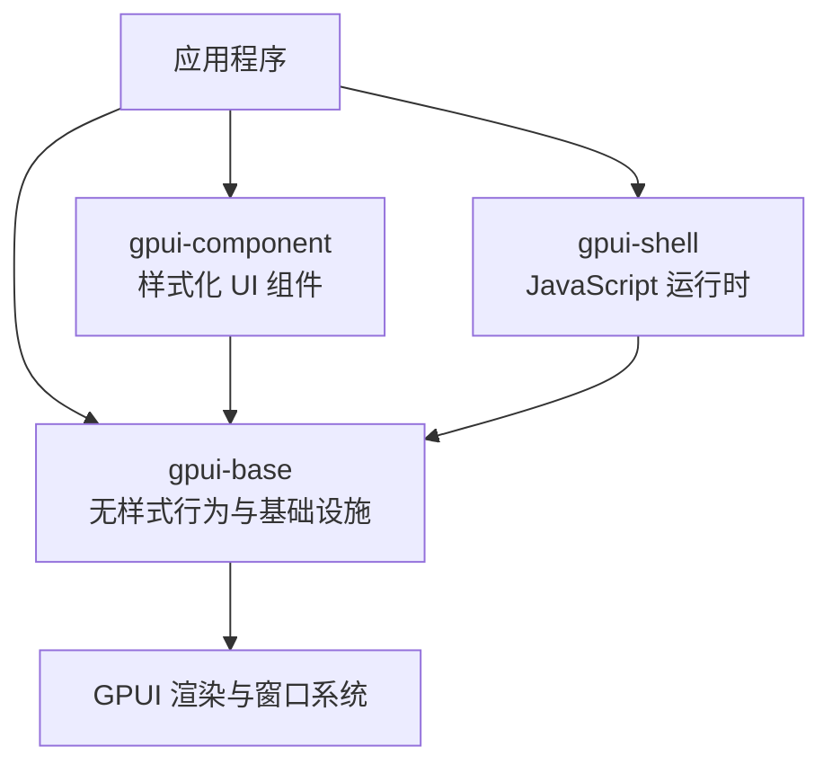

**图表来源**
- [README.md:67-87](file://README.md#L67-L87)
- [ARCHITECTURE.md:34-55](file://docs/ARCHITECTURE.md#L34-L55)

**章节来源**
- [README.md:22-31](file://README.md#L22-L31)
- [ARCHITECTURE.md:34-55](file://docs/ARCHITECTURE.md#L34-L55)

## 核心组件
- gpui-component：提供完整的样式化组件与主题系统，封装 base 的行为，面向应用快速构建一致界面。
- gpui-base：提供语义控件、复合行为根、状态系统与基础设施；不绑定产品视觉语言，保持行为可复用。
- gpui-shell：提供脚本运行环境、能力策略、组件注册表、宿主模块导出、存储与 Dock 面板持久化等。

初始化顺序体现层次依赖：
- component::init 会先初始化主题与全局状态，再调用 gpui_base::init，最后注册各子系统。
- shell::init 仅初始化 base 与样式反射表；带组件目录时通过 init_with_components 执行目录初始化器后再调用 init。

**章节来源**
- [component/lib.rs:127-151](file://crates/component/src/lib.rs#L127-L151)
- [base/lib.rs:238-256](file://crates/base/src/lib.rs#L238-L256)
- [shell/lib.rs:279-301](file://crates/shell/src/lib.rs#L279-L301)

## 架构总览
GPUI Kit 的架构遵循“行为属于基础，呈现属于应用”的原则。base 拥有可复用的行为与几何计算，presentation 层决定品牌色、排版、尺寸与动效。component 是 base 之上的适配层，shell 则把脚本能力安全地接入 Rust 宿主。

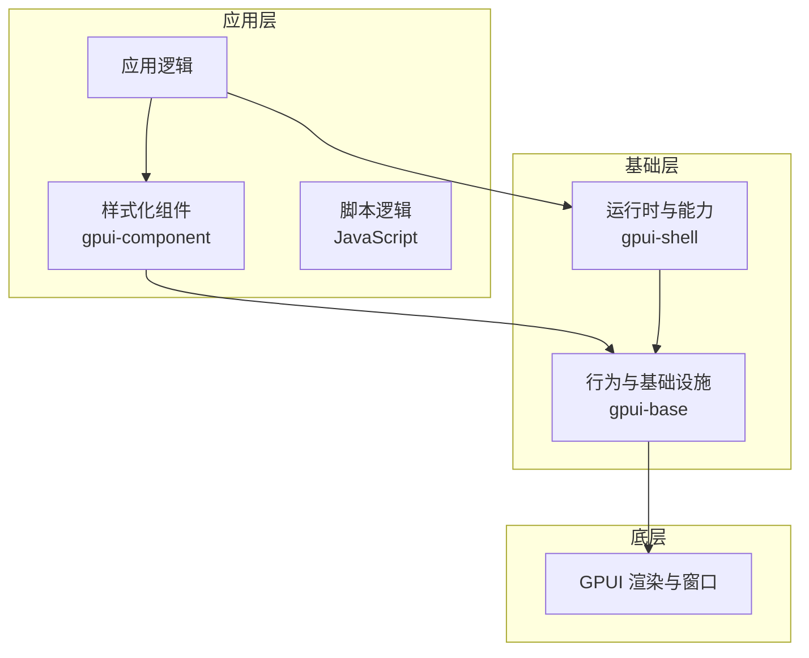

**图表来源**
- [ARCHITECTURE.md:18-33](file://docs/ARCHITECTURE.md#L18-L33)
- [ARCHITECTURE.md:637-650](file://docs/ARCHITECTURE.md#L637-L650)

## 详细组件分析

### Entity 系统与 Context 上下文管理
- Entity：GPUI 实体用于持有跨帧的状态与行为，base 中复杂模块使用 Entity<State> 实现观察、订阅与增量通知。
- Context：每个 Render 实现都接收 Window 与 Context<Self>，用于访问应用上下文、调度任务、订阅变化与触发重绘。
- Root：作为窗口内容宿主，维护插件注册、键盘动作、焦点陷阱与文本选择层，并在每帧按 prepare/style/decorate 三阶段参与渲染。

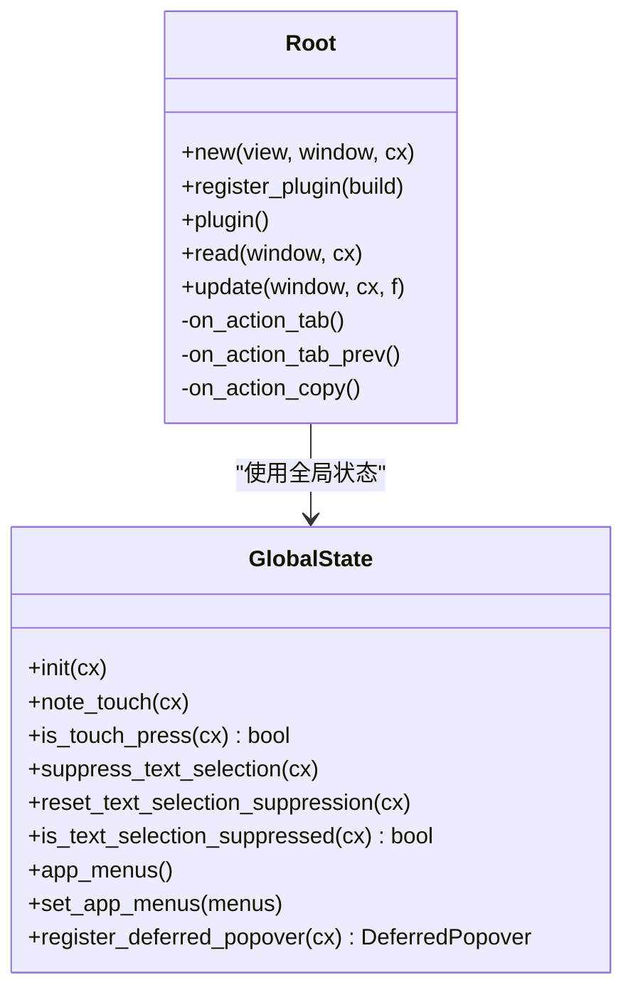

**图表来源**
- [base/root.rs:119-240](file://crates/base/src/root.rs#L119-L240)
- [base/global_state.rs:21-172](file://crates/base/src/global_state.rs#L21-L172)

**章节来源**
- [ARCHITECTURE.md:161-173](file://docs/ARCHITECTURE.md#L161-L173)
- [base/root.rs:42-51](file://crates/base/src/root.rs#L42-L51)
- [base/global_state.rs:67-101](file://crates/base/src/global_state.rs#L67-L101)

### Element 元素树结构与生命周期
- Element 生命周期包括 request_layout、prepaint、paint。VirtualList 展示了如何缓存 ItemSizeLayout、二分查找可见范围、延迟滚动到项，并在 prepaint 中裁剪绘制区域。
- Root 在 render 中依次执行插件 prepare、style、decorate，并将 TextSelectionLayer 与应用视图组合为最终元素树。

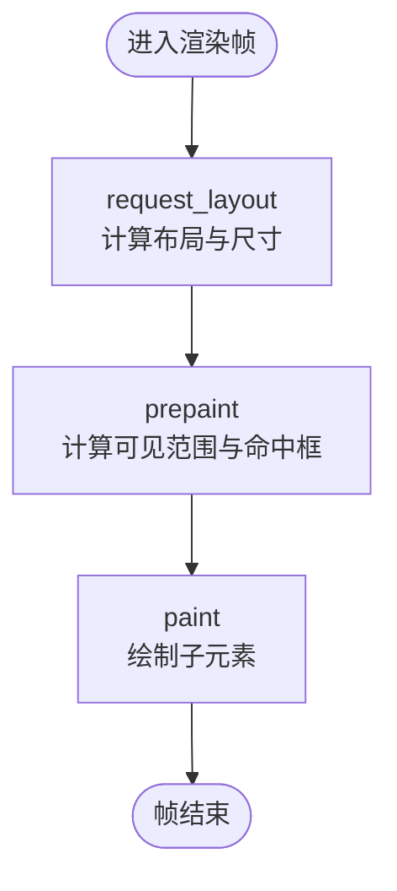

**图表来源**
- [base/virtual_list.rs:423-768](file://crates/base/src/virtual_list.rs#L423-L768)
- [base/root.rs:246-277](file://crates/base/src/root.rs#L246-L277)

**章节来源**
- [base/virtual_list.rs:435-599](file://crates/base/src/virtual_list.rs#L435-L599)
- [base/root.rs:246-277](file://crates/base/src/root.rs#L246-L277)

### 状态管理模式
- 受控值：组件接受当前值并报告变更意图，不直接修改应用状态。
- Handle 与显式共享状态：DialogHandle、ToastStackState 等协调单一逻辑行为。
- Entity-backed 状态：复杂模块使用 Entity<State> 进行观察与增量更新。
- Keyed element state：小片段临时状态通过 window.use_keyed_state 绑定稳定 ElementId。

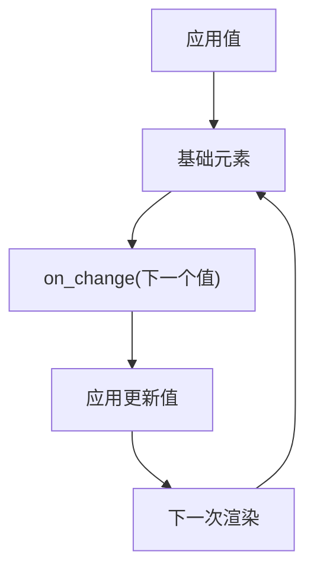

**图表来源**
- [ARCHITECTURE.md:133-150](file://docs/ARCHITECTURE.md#L133-L150)

**章节来源**
- [ARCHITECTURE.md:129-173](file://docs/ARCHITECTURE.md#L129-L173)

### 事件处理机制
- 滚动轴锁定：OngoingScrollExt.lock_axis 在非 WASM 平台限制滚动的优势轴，避免浏览器时间 API 缺失导致的崩溃。
- 双击事件：InteractiveElementExt.on_double_click 包装 ClickEvent 计数判断。
- Root 动作：Tab、TabPrev、Copy 等动作统一由 Root 分发，结合 FocusTrapElement 保证模态内焦点循环。

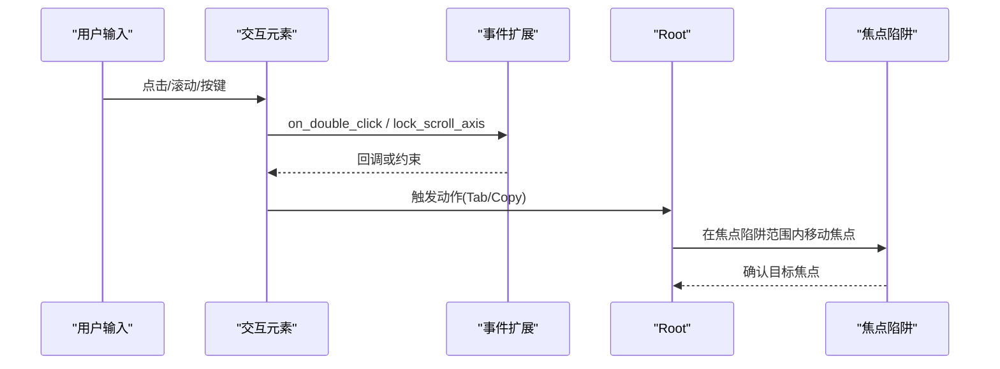

**图表来源**
- [base/event.rs:11-58](file://crates/base/src/event.rs#L11-L58)
- [base/root.rs:11-51](file://crates/base/src/root.rs#L11-L51)

**章节来源**
- [base/event.rs:11-58](file://crates/base/src/event.rs#L11-L58)
- [base/root.rs:18-40](file://crates/base/src/root.rs#L18-L40)

### 异步编程模型
- 跨平台通道：base/async_util 根据目标平台选择 smol 或 async_channel 的 Receiver/Sender/unbounded。
- Shell 异步函数：HostModule::async_function 将闭包返回 future 交给 GPUI 后台执行器，脚本侧获得 Promise。
- 动画帧请求：motion.transition/spring/animate_keyframes 在 Running/Delayed 状态请求 window.request_animation_frame。

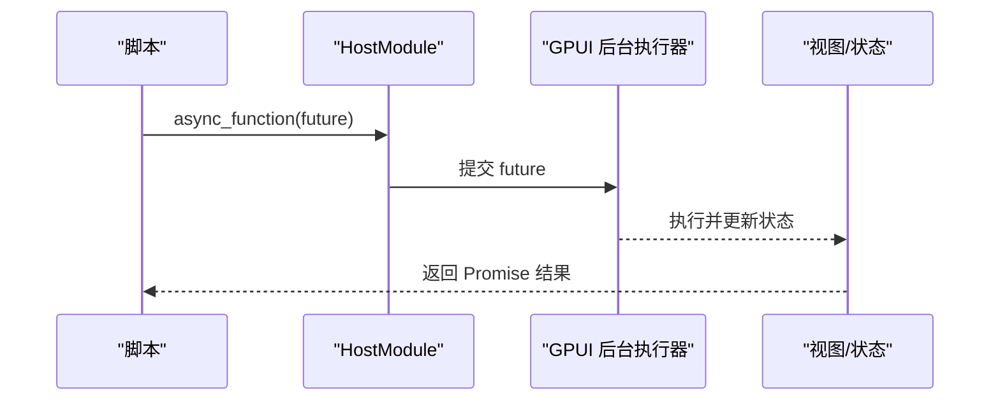

**图表来源**
- [base/async_util.rs:1-8](file://crates/base/src/async_util.rs#L1-L8)
- [shell/lib.rs:381-386](file://crates/shell/src/lib.rs#L381-L386)
- [base/motion.rs:357-360](file://crates/base/src/motion.rs#L357-L360)

**章节来源**
- [base/async_util.rs:1-8](file://crates/base/src/async_util.rs#L1-L8)
- [shell/lib.rs:351-399](file://crates/shell/src/lib.rs#L351-L399)
- [base/motion.rs:260-361](file://crates/base/src/motion.rs#L260-L361)

### 渲染流程
- VirtualList：计算内容尺寸、维护 item sizes 与前缀和 origins，二分查找可见范围，按需 layout_as_root 与 prepaint_at，最后 paint。
- Root：注册插件、应用默认样式、装饰外层包裹，确保 TextSelectionLayer 与应用视图在同一帧中正确层级。

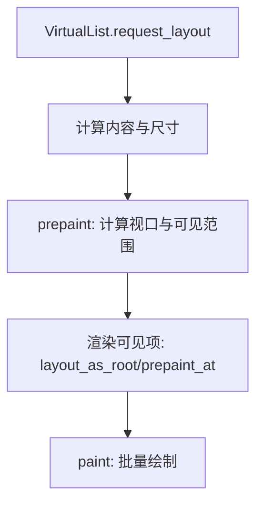

**图表来源**
- [base/virtual_list.rs:435-768](file://crates/base/src/virtual_list.rs#L435-L768)

**章节来源**
- [base/virtual_list.rs:435-768](file://crates/base/src/virtual_list.rs#L435-L768)
- [base/root.rs:246-277](file://crates/base/src/root.rs#L246-L277)

### 样式与主题
- base/styled：提供 h_flex/v_flex、paddings/margins、debug 边框、字体粗细快捷方法，以及 RoleOverride 控制可访问性角色。
- base/theme：定义 Theme、ScrollbarTheme、PlotTheme、ResizableTheme 等全局主题对象，支持非穷举字段与 builder 构造。
- component 与 base 的主题投影：component::init 会将自身主题映射到 base tokens 与基础设施默认值。

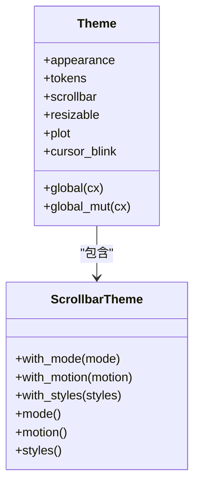

**图表来源**
- [base/theme.rs:10-46](file://crates/base/src/theme.rs#L10-L46)
- [base/theme.rs:60-102](file://crates/base/src/theme.rs#L60-L102)

**章节来源**
- [base/styled.rs:78-205](file://crates/base/src/styled.rs#L78-L205)
- [base/theme.rs:10-46](file://crates/base/src/theme.rs#L10-L46)
- [component/lib.rs:127-151](file://crates/component/src/lib.rs#L127-L151)

### 动效与生命周期
- motion.transition：CSS-like 过渡，按 TransitionId 键控状态，支持延迟、缓动、反向与减少动效模式。
- motion.spring：物理弹簧，保留速度与位置，支持 travel 暂停与 epsilon 收敛阈值。
- motion.animate_keyframes：关键帧播放，支持 Timing 与 MotionPhase。

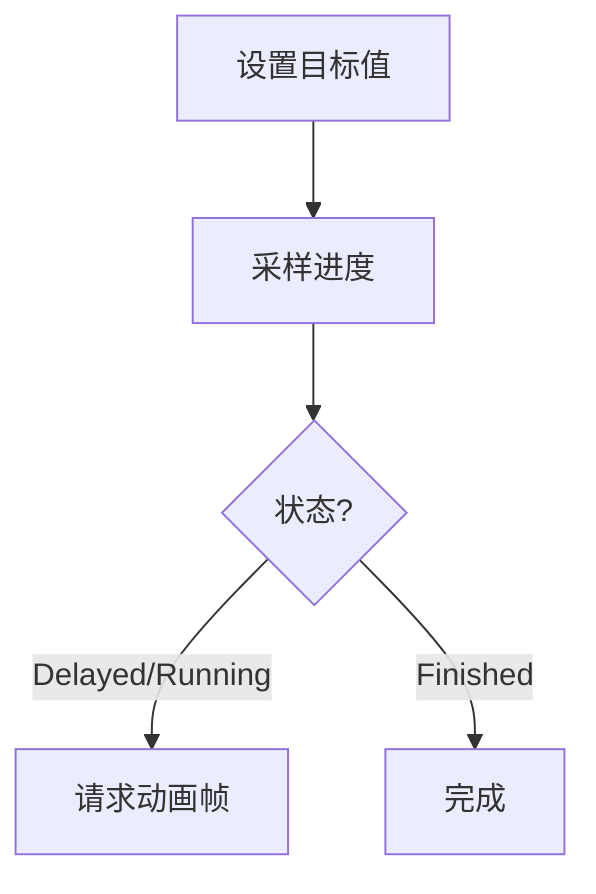

**图表来源**
- [base/motion.rs:260-361](file://crates/base/src/motion.rs#L260-L361)
- [base/motion.rs:570-653](file://crates/base/src/motion.rs#L570-L653)
- [base/motion.rs:374-410](file://crates/base/src/motion.rs#L374-L410)

**章节来源**
- [base/motion.rs:260-361](file://crates/base/src/motion.rs#L260-L361)
- [base/motion.rs:570-653](file://crates/base/src/motion.rs#L570-L653)
- [base/motion.rs:374-410](file://crates/base/src/motion.rs#L374-L410)

### 可访问性与测试辅助
- observe.TestSupportExt/ObservedElement：在不改变原生类型的前提下注册元素供 UI 查询。
- observe.TestTextExt：记录元素显示文本与图片替代文本，便于测试断言。
- root 的 Copy 动作：优先读取 TextSelection.selected_text，为空则传播动作。

**章节来源**
- [base/observe.rs:1-79](file://crates/base/src/observe.rs#L1-L79)
- [base/root.rs:230-239](file://crates/base/src/root.rs#L230-L239)

### 组件接口与通用特性
- Selectable：暴露 selected/open 状态，open 默认回退到 selected，便于下拉/弹出触发器复用。
- Disableable/FocusableExt/Collapsible：通用能力接口，承载状态而不绑定视觉。

**章节来源**
- [base/component_traits.rs:1-56](file://crates/base/src/component_traits.rs#L1-L56)

## 依赖关系分析
- 依赖方向：application → gpui-component/gpui-shell → gpui-base → GPUI。base 不得导入 component 的视觉类型。
- 初始化耦合：component::init 依赖 theme/global_state/root/input/dock 等子系统；shell::init 仅初始化 base 与样式反射表。
- 运行时能力：shell 通过 set_capabilities 授予脚本能力，export_module 暴露宿主模块给脚本。

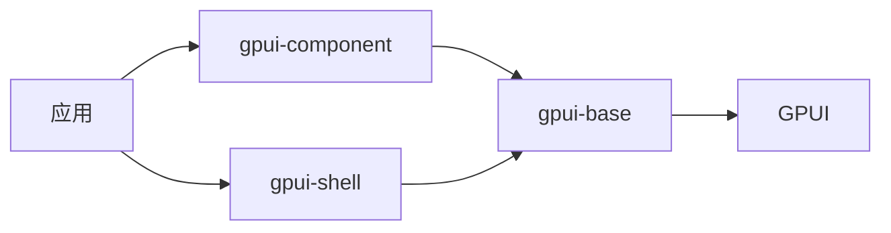

**图表来源**
- [ARCHITECTURE.md:34-55](file://docs/ARCHITECTURE.md#L34-L55)
- [component/lib.rs:127-151](file://crates/component/src/lib.rs#L127-L151)
- [shell/lib.rs:188-201](file://crates/shell/src/lib.rs#L188-L201)

**章节来源**
- [ARCHITECTURE.md:34-55](file://docs/ARCHITECTURE.md#L34-L55)
- [component/lib.rs:127-151](file://crates/component/src/lib.rs#L127-L151)
- [shell/lib.rs:188-201](file://crates/shell/src/lib.rs#L188-L201)

## 性能考量
- 虚拟列表：VirtualList 仅渲染可见范围，使用二分查找 origins/sizes 确定区间，避免全量布局与绘制。
- 滚动优化：lock_scroll_axis 与 ScrollableMask 避免轴冲突与误消费滚轮事件，提升横向滚动体验。
- 动画性能：transition/spring 在静止时不请求帧，reduce_motion 下立即到达目标，降低开销。
- 测量与调试：StyledExt.debug_* 仅在 debug_assertions 生效，避免发布构建额外成本。

[本节为一般性指导，无需具体文件分析]

## 故障排查指南
- 滚动崩溃（WASM）：OngoingScrollExt.lock_axis 在 WASM 平台为 no-op，避免 std::time::Instant 未实现导致的 panic。
- 焦点陷阱失效：检查 Root 是否注册了 focus_trap，并确保 Tab/TabPrev 动作被 Root 处理。
- 文本选择冲突：在自定义拖拽或按下交互中使用 GlobalState::suppress_text_selection，防止同时启动应用级文本选择。
- 脚本权限不足：确认已调用 set_capabilities 与 export_module，且模块名不在保留名称列表中。

**章节来源**
- [base/event.rs:6-23](file://crates/base/src/event.rs#L6-L23)
- [base/root.rs:18-40](file://crates/base/src/root.rs#L18-L40)
- [base/global_state.rs:75-93](file://crates/base/src/global_state.rs#L75-L93)
- [shell/lib.rs:351-399](file://crates/shell/src/lib.rs#L351-L399)

## 结论
GPUI Kit 通过清晰的三层架构与严格依赖方向，将行为与呈现解耦，使应用既能快速构建高质量界面，又能灵活定制视觉语言与安全扩展脚本。Entity 与 Context 提供稳定的状态与上下文，Element 生命周期与 VirtualList 保障高性能渲染，事件与异步模型覆盖常见交互场景。遵循“行为属于基础，呈现属于应用”的设计原则，开发者可以在不同层之间建立清晰的数据流与职责边界。

[本节为总结性内容，无需具体文件分析]

## 附录
- 最佳实践
  - 使用受控值与回调描述意图，避免组件直接持有应用状态。
  - 对需要跨帧的状态使用 Entity<State>，对小片段状态使用 keyed element state。
  - 在自定义交互中抑制文本选择，避免与系统选择冲突。
  - 在 WASM 平台注意滚动轴锁定与时间 API 的限制。
  - 通过 set_capabilities 精确授予脚本能力，避免过度开放。
  - 使用 VirtualList 渲染大数据集，并提供稳定的 item_sizes 与 id。

[本节为一般性指导，无需具体文件分析]