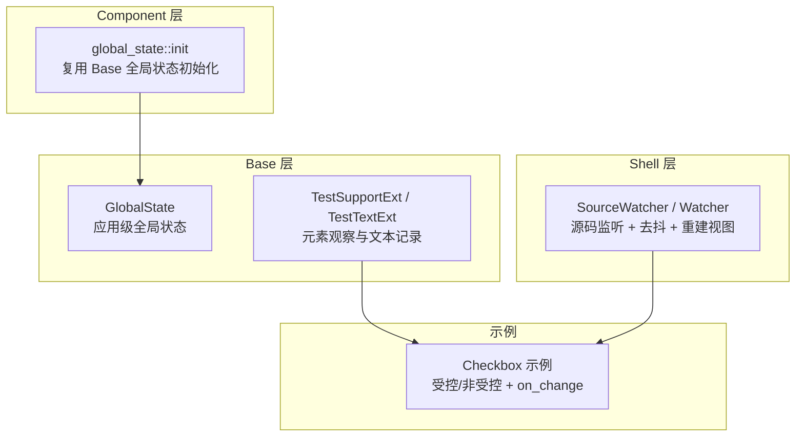
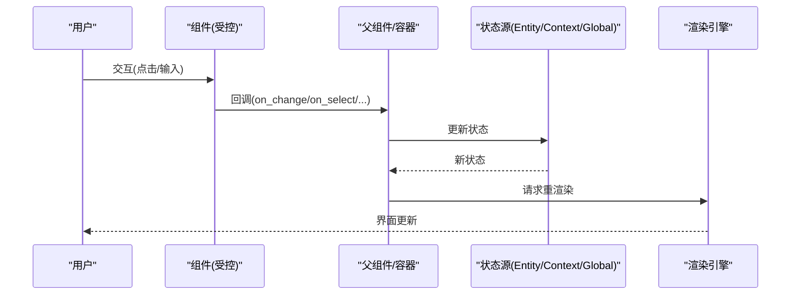
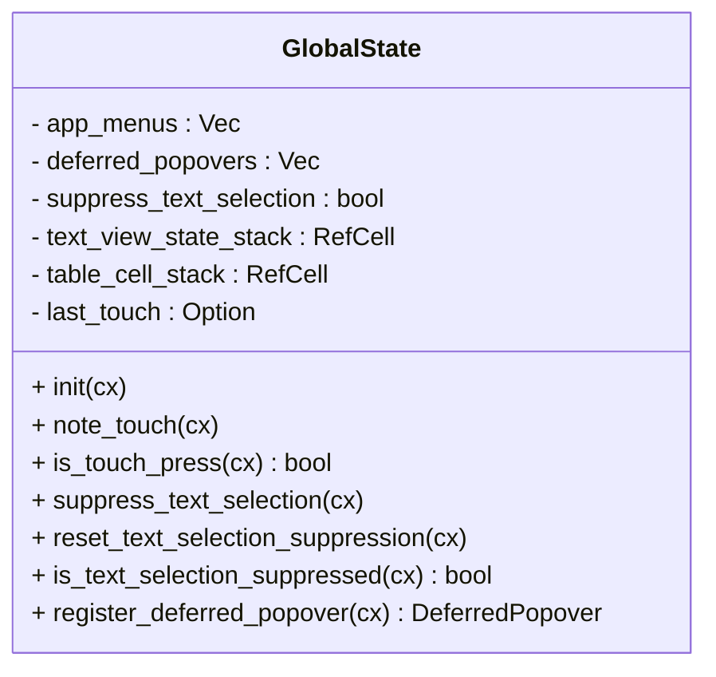
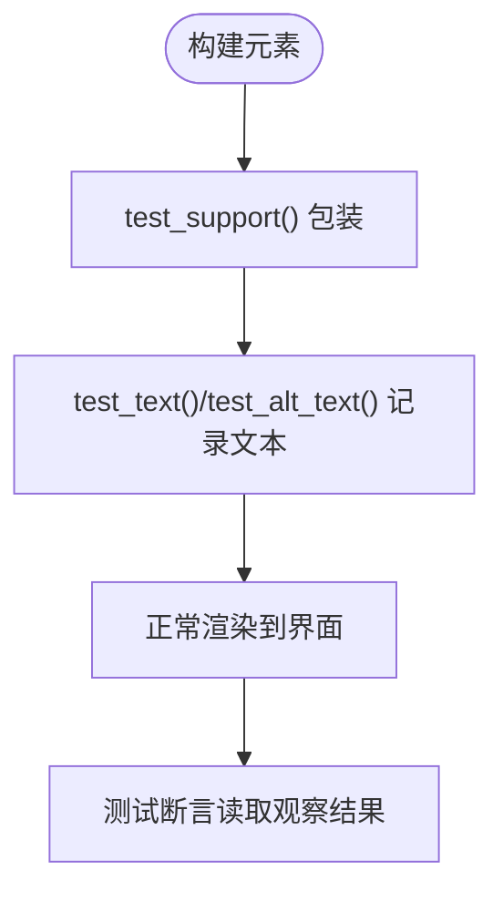
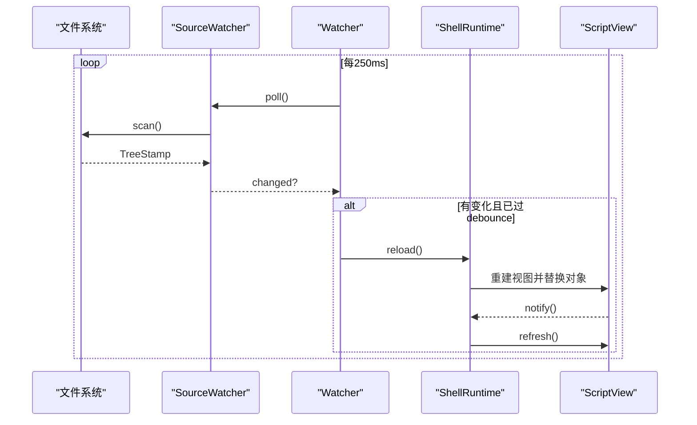
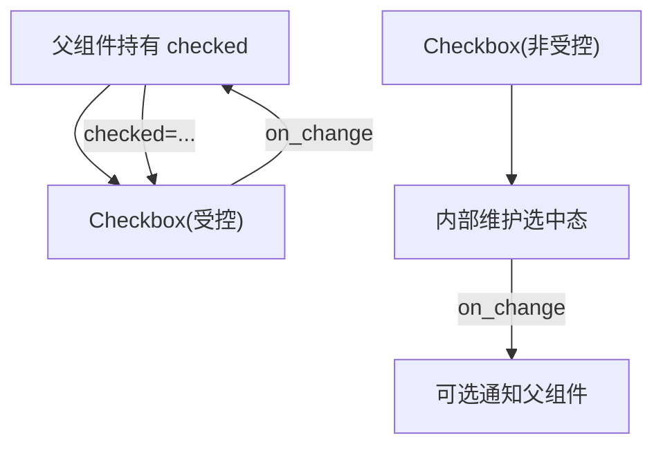
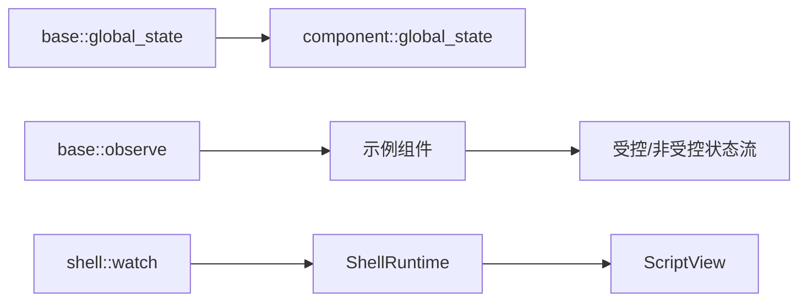

# 状态管理模式

<cite>
**本文引用的文件**   
- [crates/base/src/global_state.rs](file://crates/base/src/global_state.rs)
- [crates/component/src/global_state.rs](file://crates/component/src/global_state.rs)
- [crates/base/src/observe.rs](file://crates/base/src/observe.rs)
- [crates/shell/src/watch.rs](file://crates/shell/src/watch.rs)
- [crates/base/src/checkbox.rs](file://crates/base/src/checkbox.rs)
- [crates/base/examples/showcase/components/checkbox.rs](file://crates/base/examples/showcase/components/checkbox.rs)
</cite>

## 目录
1. [简介](#简介)
2. [项目结构](#项目结构)
3. [核心组件](#核心组件)
4. [架构总览](#架构总览)
5. [详细组件分析](#详细组件分析)
6. [依赖关系分析](#依赖关系分析)
7. [性能考量](#性能考量)
8. [故障排查指南](#故障排查指南)
9. [结论](#结论)
10. [附录](#附录)

## 简介
本文件系统性阐述 GPUI Kit 的状态管理模式，围绕受控与非受控组件、状态提升与单向数据流、状态同步机制（变更通知、重渲染触发、性能优化）、以及本地/共享/持久化/异步状态的实践展开。同时给出与 Entity、Context 的协作模式、大型应用中的状态架构设计建议，并提供可落地的最佳实践与调试技巧。

## 项目结构
GPUI Kit 在状态管理相关的关键位置包括：
- 全局状态与运行时上下文：base 层提供应用级全局状态；component 层复用 base 的全局状态初始化入口。
- 观察与测试辅助：base 层提供元素观察能力，便于 UI 测试与可观测性。
- 热重载与视图重建：shell 层提供源码监听、去抖、重建视图并安全替换对象，保证错误不导致宿主崩溃。
- 组件示例：checkbox 展示受控/非受控两种用法与 on_change 回调驱动的状态更新。

**图表来源**
- [crates/base/src/global_state.rs:22-172](file://crates/base/src/global_state.rs#L22-L172)
- [crates/component/src/global_state.rs:5-9](file://crates/component/src/global_state.rs#L5-L9)
- [crates/base/src/observe.rs:20-79](file://crates/base/src/observe.rs#L20-L79)
- [crates/shell/src/watch.rs:86-153](file://crates/shell/src/watch.rs#L86-L153)
- [crates/base/examples/showcase/components/checkbox.rs:1-35](file://crates/base/examples/showcase/components/checkbox.rs#L1-L35)

**章节来源**
- [crates/base/src/global_state.rs:22-172](file://crates/base/src/global_state.rs#L22-L172)
- [crates/component/src/global_state.rs:5-9](file://crates/component/src/global_state.rs#L5-L9)
- [crates/base/src/observe.rs:20-79](file://crates/base/src/observe.rs#L20-L79)
- [crates/shell/src/watch.rs:86-153](file://crates/shell/src/watch.rs#L86-L153)
- [crates/base/examples/showcase/components/checkbox.rs:1-35](file://crates/base/examples/showcase/components/checkbox.rs#L1-L35)

## 核心组件
- GlobalState（应用级全局状态）
  - 职责：维护应用级交互上下文（如延迟弹出菜单、文本选择抑制、触摸事件时间戳等），为多个子系统提供统一访问点。
  - 关键特性：通过 App 全局注册，生命周期由框架管理；提供 init、is_touch_press、suppress_text_selection 等方法。
- Component global_state 初始化
  - 职责：在 component 层暴露统一的初始化入口，内部委托给 base 层的 GlobalState::init，确保基元行为可用。
- 元素观察（TestSupportExt / TestTextExt）
  - 职责：在不改变原生元素类型的前提下，为 UI 测试提供“只读”的可观察属性与文本记录能力，避免测试值覆盖真实控件状态。
- Shell 热重载（SourceWatcher / Watcher）
  - 职责：轮询源码目录变化，去抖后重建视图并安全替换对象；失败时不崩溃宿主，仅上报错误。

**章节来源**
- [crates/base/src/global_state.rs:22-172](file://crates/base/src/global_state.rs#L22-L172)
- [crates/component/src/global_state.rs:5-9](file://crates/component/src/global_state.rs#L5-L9)
- [crates/base/src/observe.rs:20-79](file://crates/base/src/observe.rs#L20-L79)
- [crates/shell/src/watch.rs:86-153](file://crates/shell/src/watch.rs#L86-L153)

## 架构总览
GPUI Kit 的状态管理遵循“单向数据流 + 状态提升”的原则：
- 组件内部维护最小必要本地状态（例如输入框光标、下拉展开态）。
- 跨组件共享或需要被父组件控制的状态提升到父级或全局（通过 Entity、Context 或 GlobalState）。
- 用户交互产生事件，事件处理器更新状态，状态变更触发重渲染。
- 复杂副作用（网络、I/O、动画）以异步任务形式处理，完成后回写状态。

[本图为概念流程，不直接映射具体源码文件]

## 详细组件分析

### 全局状态 GlobalState
- 设计要点
  - 作为应用级单例，集中管理跨组件可见的交互上下文，避免分散的静态变量。
  - 使用 RefCell 维护绘制阶段的栈式上下文（如文本视图、表格单元格），保证绘制期间的一致性。
  - 提供延迟弹出菜单的弱引用登记机制，防止悬垂引用导致菜单永远“打开”。
- 典型方法
  - init：幂等初始化全局状态。
  - is_touch_press：判断最近一次按下是否为触摸。
  - suppress_text_selection / reset_text_selection_suppression：抑制窗口级文本选择。
  - register_deferred_popover：登记延迟弹出菜单的生命周期令牌。

**图表来源**
- [crates/base/src/global_state.rs:22-172](file://crates/base/src/global_state.rs#L22-L172)

**章节来源**
- [crates/base/src/global_state.rs:22-172](file://crates/base/src/global_state.rs#L22-L172)

### 组件层全局状态初始化
- 作用：对外暴露统一的初始化入口，内部调用 base 层的 GlobalState::init，保持与 legacy 初始化顺序兼容。
- 影响：确保在使用组件库之前，基础行为（如全局菜单、文本选择抑制）已就绪。

**章节来源**
- [crates/component/src/global_state.rs:5-9](file://crates/component/src/global_state.rs#L5-L9)

### 元素观察与可观测性
- 作用：在不侵入原生元素类型的前提下，为 UI 测试提供“只读”的观察接口，避免测试值覆盖真实控件状态。
- 关键点：
  - test_support：包装元素但不添加布局节点，保留原始类型。
  - test_text/test_alt_text：记录渲染文本，用于断言。

**图表来源**
- [crates/base/src/observe.rs:20-79](file://crates/base/src/observe.rs#L20-L79)

**章节来源**
- [crates/base/src/observe.rs:20-79](file://crates/base/src/observe.rs#L20-L79)

### Shell 热重载与视图重建
- 目标：在开发期监听源码变化，去抖后重建视图并安全替换对象，错误不导致宿主崩溃。
- 关键流程
  - SourceWatcher：扫描目录，计算 TreeStamp（最新修改时间、文件数、字节数），比较差异。
  - Watcher：定时轮询，去抖后触发 reload。
  - reload：先评估模块、构造新视图，成功后再替换旧对象并通知重绘。

**图表来源**
- [crates/shell/src/watch.rs:86-153](file://crates/shell/src/watch.rs#L86-L153)
- [crates/shell/src/watch.rs:287-397](file://crates/shell/src/watch.rs#L287-L397)
- [crates/shell/src/watch.rs:494-561](file://crates/shell/src/watch.rs#L494-L561)

**章节来源**
- [crates/shell/src/watch.rs:86-153](file://crates/shell/src/watch.rs#L86-L153)
- [crates/shell/src/watch.rs:287-397](file://crates/shell/src/watch.rs#L287-L397)
- [crates/shell/src/watch.rs:494-561](file://crates/shell/src/watch.rs#L494-L561)

### 受控与非受控组件：以 Checkbox 为例
- 受控组件
  - 外部持有 checked 状态，通过 on_change 回调接收状态变更，父组件决定最终值。
  - 优点：状态单一来源，易于调试与测试；适合表单联动、撤销/重做、服务端校验等场景。
- 非受控组件
  - 组件内部维护自身状态，对外仅提供事件回调；父组件无需持有状态。
  - 优点：实现简单，适合独立小部件；缺点：跨组件同步较难。

**图表来源**
- [crates/base/examples/showcase/components/checkbox.rs:1-35](file://crates/base/examples/showcase/components/checkbox.rs#L1-L35)

**章节来源**
- [crates/base/examples/showcase/components/checkbox.rs:1-35](file://crates/base/examples/showcase/components/checkbox.rs#L1-L35)

## 依赖关系分析
- GlobalState 是 base 层的核心，component 层通过其 init 复用该能力。
- observe.rs 提供测试辅助，与组件渲染解耦，不影响运行期性能。
- shell/watch.rs 与上层 ShellRuntime、ScriptView 耦合，负责开发期热重载，不影响生产状态逻辑。
- 示例 checkbox 展示了组件如何与外部状态协作，体现单向数据流。

**图表来源**
- [crates/base/src/global_state.rs:22-172](file://crates/base/src/global_state.rs#L22-L172)
- [crates/component/src/global_state.rs:5-9](file://crates/component/src/global_state.rs#L5-L9)
- [crates/base/src/observe.rs:20-79](file://crates/base/src/observe.rs#L20-L79)
- [crates/shell/src/watch.rs:287-397](file://crates/shell/src/watch.rs#L287-L397)
- [crates/base/examples/showcase/components/checkbox.rs:1-35](file://crates/base/examples/showcase/components/checkbox.rs#L1-L35)

**章节来源**
- [crates/base/src/global_state.rs:22-172](file://crates/base/src/global_state.rs#L22-L172)
- [crates/component/src/global_state.rs:5-9](file://crates/component/src/global_state.rs#L5-L9)
- [crates/base/src/observe.rs:20-79](file://crates/base/src/observe.rs#L20-L79)
- [crates/shell/src/watch.rs:287-397](file://crates/shell/src/watch.rs#L287-L397)
- [crates/base/examples/showcase/components/checkbox.rs:1-35](file://crates/base/examples/showcase/components/checkbox.rs#L1-L35)

## 性能考量
- 全局状态访问
  - GlobalState 通过 App 全局获取，避免重复分配；内部使用 RefCell 维护绘制栈，减少锁竞争。
- 热重载去抖
  - SourceWatcher 默认 200ms 去抖，合并编辑器批量写入，避免频繁重建视图。
- 扫描限制
  - 最大深度 8、最大文件数 4096，防止大仓库拖慢轮询；非源码目录跳过，降低 stat 开销。
- 渲染触发
  - 仅在状态变更后调用 cx.notify() 与 window.refresh()，避免无谓重绘。

**章节来源**
- [crates/base/src/global_state.rs:22-172](file://crates/base/src/global_state.rs#L22-L172)
- [crates/shell/src/watch.rs:59-80](file://crates/shell/src/watch.rs#L59-L80)
- [crates/shell/src/watch.rs:138-153](file://crates/shell/src/watch.rs#L138-L153)
- [crates/shell/src/watch.rs:179-240](file://crates/shell/src/watch.rs#L179-L240)
- [crates/shell/src/watch.rs:554-561](file://crates/shell/src/watch.rs#L554-L561)

## 故障排查指南
- 热重载失败不崩溃宿主
  - 当模块评估或视图构造抛出异常时，reload 返回错误并通过 Toast 提示，同时保留上一版本视图。
- 轮询停止
  - 若扫描目录不可用或超过限制，会记录错误日志并停止 watcher，需检查路径与文件大小。
- 全局状态未初始化
  - 确保在启动时调用 component::global_state::init，否则部分基元行为不可用。
- 测试断言失败
  - 使用 test_support/test_text 进行只读观察，避免测试值覆盖真实控件状态。

**章节来源**
- [crates/shell/src/watch.rs:350-380](file://crates/shell/src/watch.rs#L350-L380)
- [crates/shell/src/watch.rs:450-492](file://crates/shell/src/watch.rs#L450-L492)
- [crates/component/src/global_state.rs:5-9](file://crates/component/src/global_state.rs#L5-L9)
- [crates/base/src/observe.rs:20-79](file://crates/base/src/observe.rs#L20-L79)

## 结论
GPUI Kit 的状态管理以“单向数据流 + 状态提升”为核心，结合 GlobalState 提供的应用级上下文、组件层的统一初始化、可观测性与热重载能力，形成稳定、可测试、可扩展的状态体系。建议在大型应用中：
- 将跨组件共享状态提升至父组件或全局（Entity/Context/GlobalState）。
- 优先使用受控组件，保证状态单一来源与可追踪性。
- 对高频更新采用批处理与去抖策略，避免过度重绘。
- 利用测试辅助接口进行只读断言，提高稳定性。

## 附录
- 状态类型与管理模式速查
  - 本地状态：组件内部维护，适合瞬时 UI 态（如展开/收起、焦点）。
  - 共享状态：通过 Entity/Context/GlobalState 共享，适合跨组件业务态。
  - 持久化状态：与存储层对接，读写分离，避免阻塞渲染。
  - 异步状态：使用 Task/异步回调，完成后合并到状态树，避免竞态。
- 最佳实践
  - 状态结构设计：扁平化 + 按领域分片，避免深层嵌套。
  - 变更追踪：为关键状态增加版本号或时间戳，便于调试与撤销。
  - 冲突处理：以“最后写入者胜”或“操作合并”策略解决并发更新。
  - 性能优化：局部更新、惰性加载、虚拟列表、防抖节流。
- 与 Entity、Context 的协作
  - Entity 作为强类型实体承载业务状态，Context 提供注入与访问通道，GlobalState 承载应用级交互上下文。
  - 推荐：业务状态放 Entity，UI 交互上下文放 GlobalState，跨层级依赖通过 Context 注入。