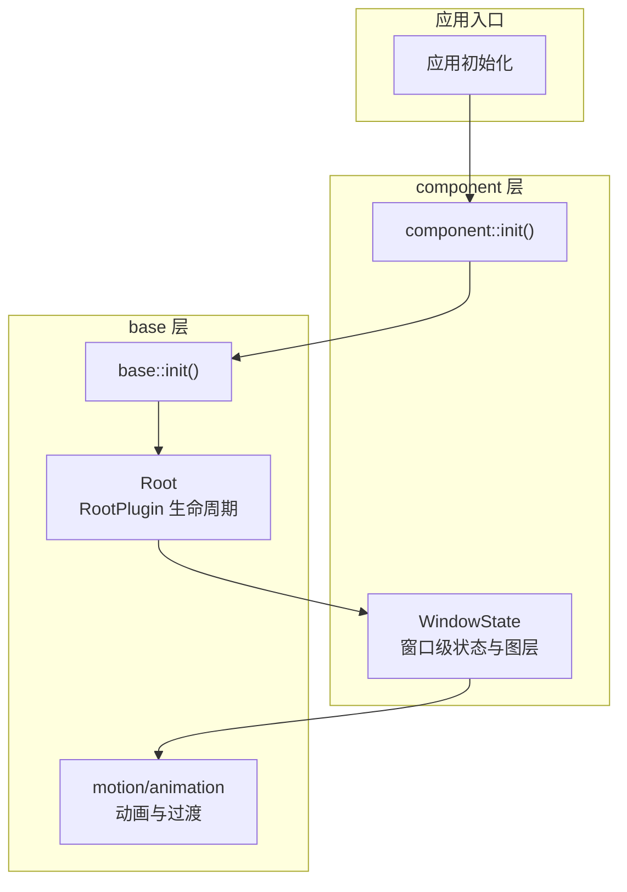
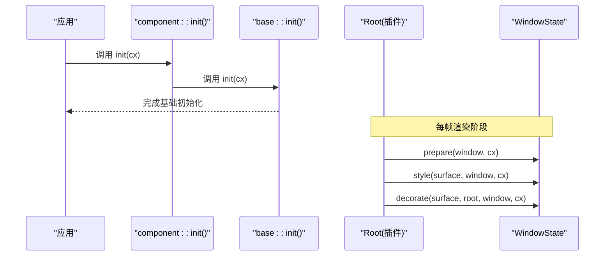
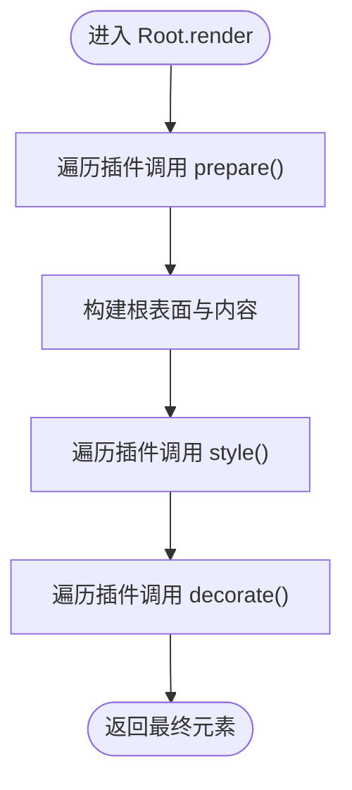
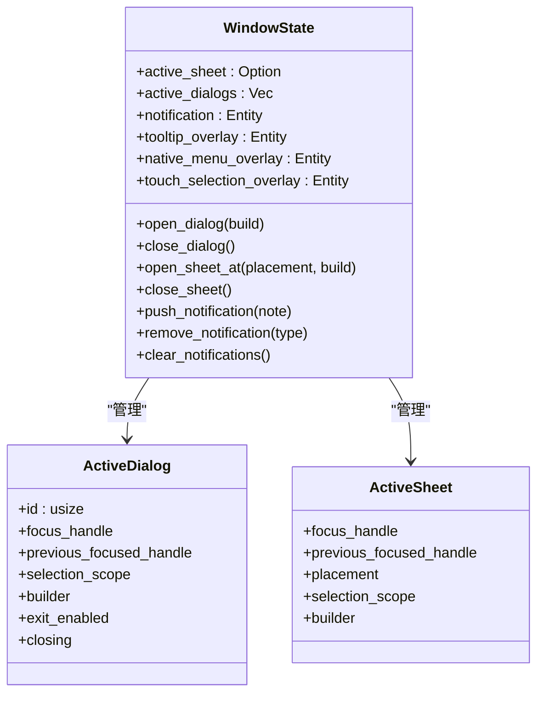
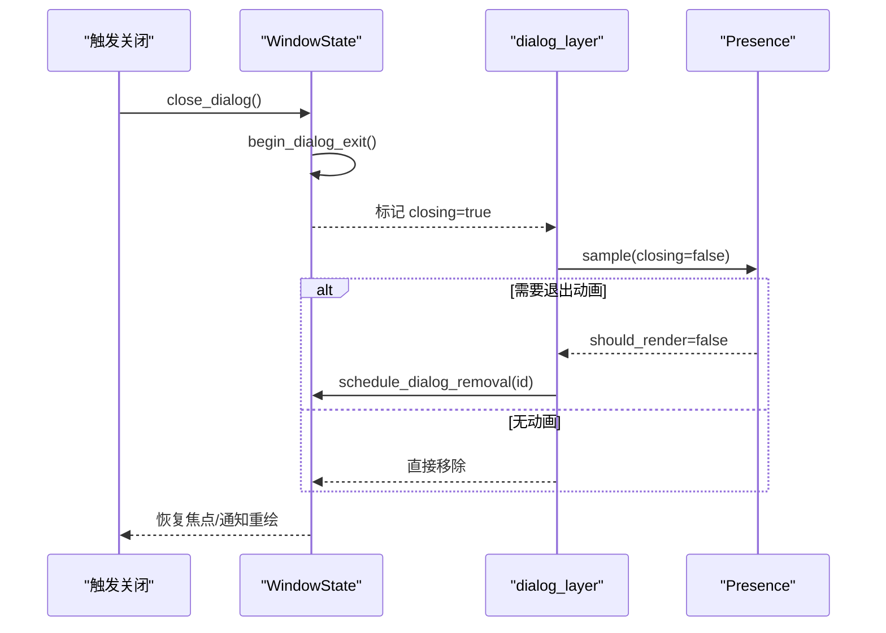
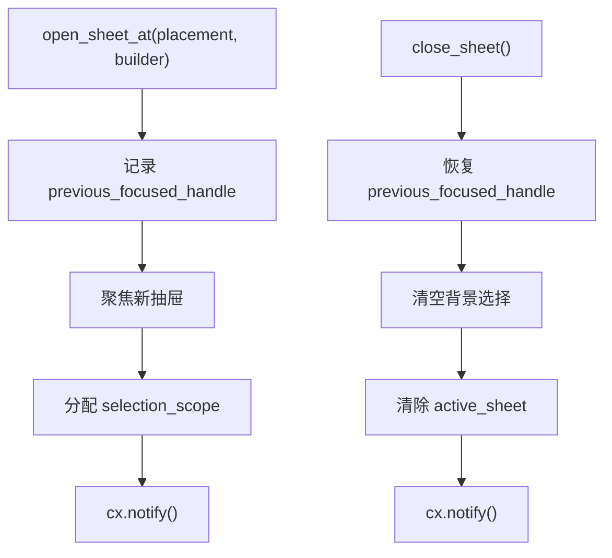
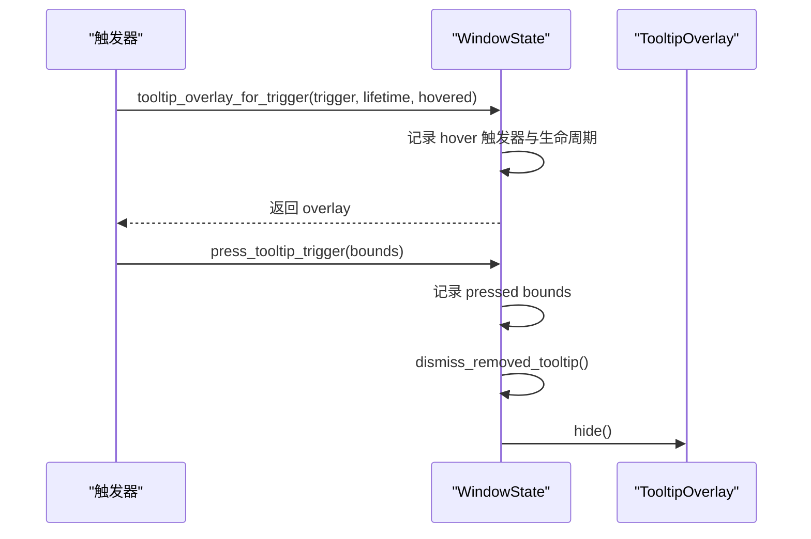
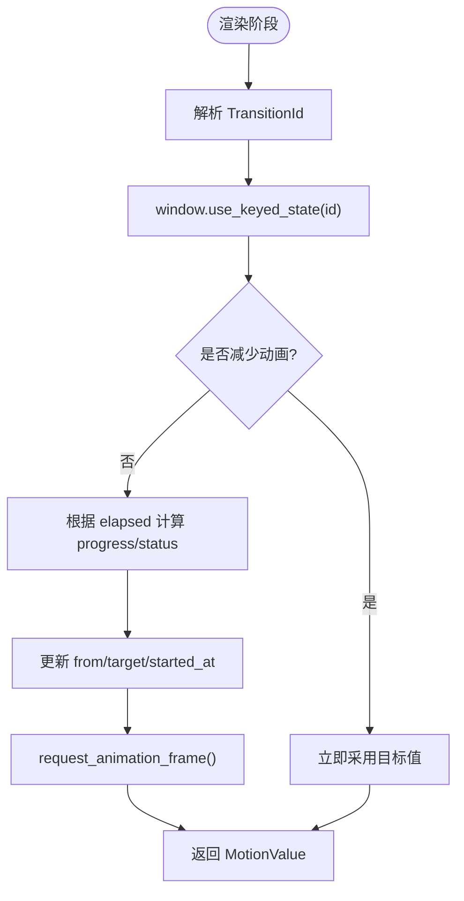
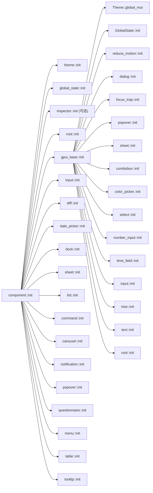

# 生命周期管理

<cite>
**本文引用的文件**   
- [crates/base/src/lib.rs](file://crates/base/src/lib.rs)
- [crates/base/src/root.rs](file://crates/base/src/root.rs)
- [crates/component/src/lib.rs](file://crates/component/src/lib.rs)
- [crates/component/src/root.rs](file://crates/component/src/root.rs)
- [crates/base/src/motion.rs](file://crates/base/src/motion.rs)
- [crates/base/src/animation.rs](file://crates/base/src/animation.rs)
</cite>

## 目录
1. [引言](#引言)
2. [项目结构](#项目结构)
3. [核心组件](#核心组件)
4. [架构总览](#架构总览)
5. [详细组件分析](#详细组件分析)
6. [依赖关系分析](#依赖关系分析)
7. [性能考量](#性能考量)
8. [故障排查指南](#故障排查指南)
9. [结论](#结论)
10. [附录](#附录)

## 引言
本文件系统性梳理 GPUI Kit 中“生命周期”的设计与实现，覆盖创建、初始化、更新、销毁等阶段；解释组件生命周期的钩子函数（如 on_mount、on_update、on_destroy）在框架中的对应机制；阐述动画生命周期、异步任务生命周期与资源清理模式；给出最佳实践与复杂场景下的协调策略。文档同时提供代码级图示，帮助读者将抽象概念映射到具体源码位置。

## 项目结构
GPUI Kit 的生命周期由两层协作完成：
- base 层：提供基础能力与根容器 RootPlugin 生命周期钩子 prepare/style/decorate，以及动画与运动系统。
- component 层：基于 base 的 RootPlugin 扩展窗口级状态（对话框、抽屉、通知、工具提示等），并在渲染阶段组织各层。

**图表来源**
- [crates/component/src/lib.rs:127-151](file://crates/component/src/lib.rs#L127-L151)
- [crates/base/src/lib.rs:238-256](file://crates/base/src/lib.rs#L238-L256)
- [crates/base/src/root.rs:74-103](file://crates/base/src/root.rs#L74-L103)
- [crates/component/src/root.rs:21-23](file://crates/component/src/root.rs#L21-L23)

**章节来源**
- [crates/component/src/lib.rs:127-151](file://crates/component/src/lib.rs#L127-L151)
- [crates/base/src/lib.rs:238-256](file://crates/base/src/lib.rs#L238-L256)

## 核心组件
- RootPlugin（base 层）：定义每个窗口渲染前的三个阶段 prepare、style、decorate，用于同步窗口设置、注入默认样式和包裹外层展示。
- WindowState（component 层）：作为 RootPlugin 的具体实现之一，负责对话框、抽屉、通知、工具提示、触摸选择等窗口级状态与图层组织。
- motion/animation（base 层）：提供值过渡、关键帧、弹簧等动画原语，驱动可见状态的平滑变化。

这些组件共同构成“创建→初始化→更新→销毁”的主干流程，并通过事件、状态与动画系统联动。

**章节来源**
- [crates/base/src/root.rs:74-103](file://crates/base/src/root.rs#L74-L103)
- [crates/component/src/root.rs:25-43](file://crates/component/src/root.rs#L25-L43)
- [crates/base/src/motion.rs:260-361](file://crates/base/src/motion.rs#L260-L361)

## 架构总览
下图展示应用启动时，组件层与基础层如何协同完成全局初始化，并注册 RootPlugin；随后在每帧渲染时，Root 依次调用插件的 prepare/style/decorate，Window 级状态在装饰阶段挂载各图层。

**图表来源**
- [crates/component/src/lib.rs:127-151](file://crates/component/src/lib.rs#L127-L151)
- [crates/base/src/lib.rs:238-256](file://crates/base/src/lib.rs#L238-L256)
- [crates/base/src/root.rs:246-277](file://crates/base/src/root.rs#L246-L277)
- [crates/component/src/root.rs:711-737](file://crates/component/src/root.rs#L711-L737)

## 详细组件分析

### RootPlugin 生命周期钩子
RootPlugin 暴露三个关键钩子：
- prepare：在构建元素前同步窗口相关设置（例如 rem 大小、文本选择作用域）。
- style：为根表面设置默认样式，实例样式会覆盖插件默认样式。
- decorate：对已完成的根表面进行包装，用于添加边框、遮罩或外部容器。

**图表来源**
- [crates/base/src/root.rs:246-277](file://crates/base/src/root.rs#L246-L277)
- [crates/base/src/root.rs:74-103](file://crates/base/src/root.rs#L74-L103)

**章节来源**
- [crates/base/src/root.rs:74-103](file://crates/base/src/root.rs#L74-L103)
- [crates/base/src/root.rs:246-277](file://crates/base/src/root.rs#L246-L277)

### WindowState 窗口级状态与图层
WindowState 是 component 层对 RootPlugin 的实现，维护：
- active_sheet：当前活动的抽屉及其焦点、定位、选择作用域与构建器。
- active_dialogs：活动对话框栈，包含稳定 id、焦点、选择作用域、退出动画状态。
- notification：通知列表实体。
- tooltip_overlay：工具提示覆盖层。
- native_menu_overlay：原生菜单回退覆盖层。
- touch_selection_overlay：触摸选择覆盖层。

渲染时按顺序挂载 sheet_layer → dialog_layer → notification_layer，确保正确的层级与交互隔离。

**图表来源**
- [crates/component/src/root.rs:25-43](file://crates/component/src/root.rs#L25-L43)
- [crates/component/src/root.rs:45-71](file://crates/component/src/root.rs#L45-L71)
- [crates/component/src/root.rs:739-749](file://crates/component/src/root.rs#L739-L749)

**章节来源**
- [crates/component/src/root.rs:25-43](file://crates/component/src/root.rs#L25-L43)
- [crates/component/src/root.rs:739-749](file://crates/component/src/root.rs#L739-L749)

### 对话框生命周期（打开/关闭/退出动画）
对话框的生命周期包括：
- 打开：分配稳定 id、焦点句柄、选择作用域，压入 active_dialogs，清空背景选择。
- 关闭：若存在退出动画则标记 closing 并延迟移除；否则直接移除。
- 退出动画：使用 Presence 采样控制可见性，完成后调度移除；期间保持遮罩与焦点恢复逻辑。

**图表来源**
- [crates/component/src/root.rs:375-408](file://crates/component/src/root.rs#L375-L408)
- [crates/component/src/root.rs:415-453](file://crates/component/src/root.rs#L415-L453)
- [crates/component/src/root.rs:350-373](file://crates/component/src/root.rs#L350-L373)
- [crates/component/src/root.rs:234-348](file://crates/component/src/root.rs#L234-L348)

**章节来源**
- [crates/component/src/root.rs:375-408](file://crates/component/src/root.rs#L375-L408)
- [crates/component/src/root.rs:415-453](file://crates/component/src/root.rs#L415-L453)
- [crates/component/src/root.rs:350-373](file://crates/component/src/root.rs#L350-L373)
- [crates/component/src/root.rs:234-348](file://crates/component/src/root.rs#L234-L348)

### 抽屉生命周期（打开/关闭/焦点恢复）
抽屉打开时保存上一个焦点句柄，分配新的选择作用域，并聚焦新抽屉；关闭时恢复之前的焦点，并清空背景选择。

**图表来源**
- [crates/component/src/root.rs:514-543](file://crates/component/src/root.rs#L514-L543)
- [crates/component/src/root.rs:545-558](file://crates/component/src/root.rs#L545-L558)

**章节来源**
- [crates/component/src/root.rs:514-543](file://crates/component/src/root.rs#L514-L543)
- [crates/component/src/root.rs:545-558](file://crates/component/src/root.rs#L545-L558)

### 工具提示生命周期（悬停/按下/隐藏）
工具提示通过 WindowState 管理：
- 悬停：记录触发元素 id 与生命周期弱引用，返回 overlay 实体。
- 按下：记录触发区域边界，直到指针移出才结束按压状态。
- 隐藏：在元素被移除后延迟检查，若触发器不再存在则隐藏 overlay。

**图表来源**
- [crates/component/src/root.rs:613-634](file://crates/component/src/root.rs#L613-L634)
- [crates/component/src/root.rs:659-699](file://crates/component/src/root.rs#L659-L699)
- [crates/component/src/root.rs:636-657](file://crates/component/src/root.rs#L636-L657)

**章节来源**
- [crates/component/src/root.rs:613-634](file://crates/component/src/root.rs#L613-L634)
- [crates/component/src/root.rs:659-699](file://crates/component/src/root.rs#L659-L699)
- [crates/component/src/root.rs:636-657](file://crates/component/src/root.rs#L636-L657)

### 动画生命周期与值过渡
动画系统提供两类主要机制：
- 值过渡 transition：以 TransitionId 为键，在元素渲染期间维护 from/target 与开始时间，计算进度并请求下一帧。
- 关键帧 animate_keyframes：基于 Timing 与 Keyframes 采样，支持延迟、活跃、结束阶段。
- 弹簧 spring：物理弹簧模型，保留速度与位置，支持中途重定向。

**图表来源**
- [crates/base/src/motion.rs:260-361](file://crates/base/src/motion.rs#L260-L361)
- [crates/base/src/motion.rs:374-410](file://crates/base/src/motion.rs#L374-L410)
- [crates/base/src/motion.rs:579-653](file://crates/base/src/motion.rs#L579-L653)

**章节来源**
- [crates/base/src/motion.rs:260-361](file://crates/base/src/motion.rs#L260-L361)
- [crates/base/src/motion.rs:374-410](file://crates/base/src/motion.rs#L374-L410)
- [crates/base/src/motion.rs:579-653](file://crates/base/src/motion.rs#L579-L653)

### 旧版 EffectTransition（兼容）
EffectTransition 提供 fade/slide/width/height 等效果组合，内部使用 GPUI Animation 驱动 delta，并将效果应用到 Styled 元素上。该类型仍保留但建议优先使用 motion 系列 API。

**章节来源**
- [crates/base/src/animation.rs:143-255](file://crates/base/src/animation.rs#L143-L255)

## 依赖关系分析
- component::init 先初始化主题、全局状态、inspector（可选）、root、base、input、diff、date_picker、dock、sheet、list、command、carousel、notification、popover、questionnaire、menu、table、tooltip。
- base::init 初始化主题、全局状态、reduce_motion、dialog、focus_trap、popover、sheet、combobox、color_picker、select、number_input、time_field、input、tree、text、root。
- RootPlugin 在 base 层注册，component 层的 WindowState 作为其实现之一。

**图表来源**
- [crates/component/src/lib.rs:127-151](file://crates/component/src/lib.rs#L127-L151)
- [crates/base/src/lib.rs:238-256](file://crates/base/src/lib.rs#L238-L256)

**章节来源**
- [crates/component/src/lib.rs:127-151](file://crates/component/src/lib.rs#L127-L151)
- [crates/base/src/lib.rs:238-256](file://crates/base/src/lib.rs#L238-L256)

## 性能考量
- 避免在 prepare/style 中触发 notify，以免引起重复渲染；仅在 decorate 之后或回调中通知。
- 使用 Presence 与 TransitionId 稳定标识，避免不必要的重建与重新计算。
- 在 reduce_motion 模式下，动画应快速收敛到目标值，减少帧请求。
- 对话框退出动画结束后再移除实体，避免在渲染过程中更新仍在栈上的实体。
- 工具提示与按压状态使用 Weak 引用与延迟检查，防止悬挂监听与内存泄漏。

[本节为通用指导，不直接分析具体文件]

## 故障排查指南
- 对话框未关闭或残留：检查是否在动画期间错误地再次打开新对话框导致焦点链混乱；确认 schedule_dialog_removal 是否被调用且成功触发 notify。
- 工具提示不消失：检查触发器的生命周期弱引用是否仍有效；确认 dismiss_removed_tooltip 的延迟检查逻辑是否被执行。
- 动画不播放或卡顿：确认 TransitionId 是否稳定；检查是否在 reduce_motion 模式下；验证 request_animation_frame 是否被正确调用。
- 焦点丢失或循环：检查 focus_trap 与窗口级焦点恢复逻辑；确认在关闭对话框/抽屉时是否正确恢复 previous_focused_handle。

**章节来源**
- [crates/component/src/root.rs:350-373](file://crates/component/src/root.rs#L350-L373)
- [crates/component/src/root.rs:636-657](file://crates/component/src/root.rs#L636-L657)
- [crates/base/src/motion.rs:260-361](file://crates/base/src/motion.rs#L260-L361)

## 结论
GPUI Kit 的生命周期管理以 RootPlugin 为核心钩子，结合 component 层的 WindowState 与 base 层的动画系统，形成清晰的创建、初始化、更新、销毁流程。通过稳定的标识符、延迟调度与弱引用，系统在复杂交互（对话框、抽屉、工具提示）下仍能保持可预测的行为与良好的性能。遵循本文的最佳实践，可有效避免资源泄漏、提升渲染效率，并在复杂应用中实现一致的生命周期协调。

[本节为总结性内容，不直接分析具体文件]

## 附录
- 生命周期钩子对照：
  - on_mount：对应 RootPlugin.prepare 与 WindowState.new 的初始化逻辑。
  - on_update：对应 Root.render 中 prepare/style/decorate 的每帧执行。
  - on_destroy：对应对话框/抽屉关闭后的延迟移除与资源清理。
- 异步任务生命周期：
  - 使用 window.defer 与 spawn_in 在动画结束后恢复焦点或清理状态。
- 资源清理最佳实践：
  - 使用 Weak 引用持有触发器生命周期，避免强引用导致的悬挂。
  - 在关闭模态时清空背景选择，避免数据泄露与误操作。

[本节为补充说明，不直接分析具体文件]