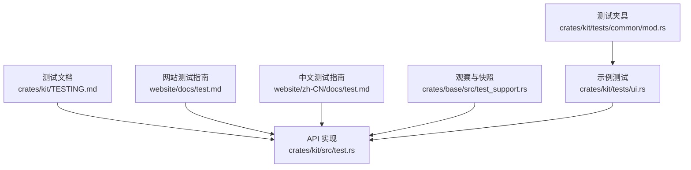
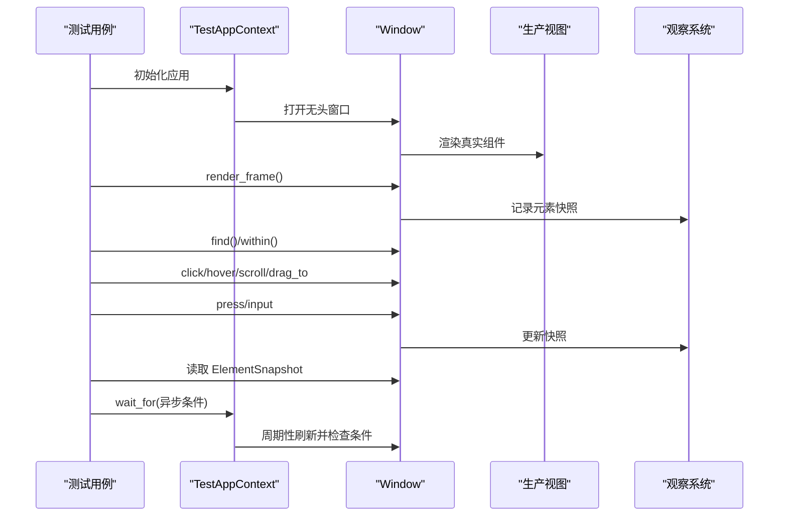
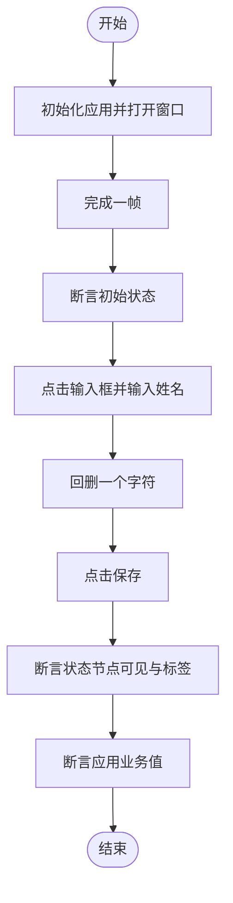
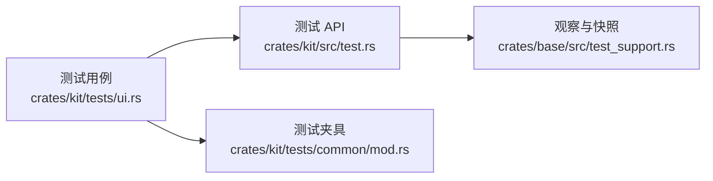

# 测试指南

<cite>
**本文引用的文件**   
- [crates/kit/TESTING.md](file://crates/kit/TESTING.md)
- [website/docs/test.md](file://website/docs/test.md)
- [website/zh-CN/docs/test.md](file://website/zh-CN/docs/test.md)
- [crates/kit/src/test.rs](file://crates/kit/src/test.rs)
- [crates/base/src/test_support.rs](file://crates/base/src/test_support.rs)
- [crates/kit/tests/ui.rs](file://crates/kit/tests/ui.rs)
- [crates/kit/tests/common/mod.rs](file://crates/kit/tests/common/mod.rs)
</cite>

## 目录
1. [引言](#引言)
2. [项目结构](#项目结构)
3. [核心组件](#核心组件)
4. [架构总览](#架构总览)
5. [详细组件分析](#详细组件分析)
6. [依赖关系分析](#依赖关系分析)
7. [性能与稳定性考虑](#性能与稳定性考虑)
8. [故障排查指南](#故障排查指南)
9. [结论](#结论)
10. [附录：CI 与覆盖率建议](#附录ci-与覆盖率建议)

## 引言
本指南面向 GPUI Kit 的测试实践，覆盖单元测试、组件测试、UI 集成测试和端到端验证策略。重点包括：
- 在无头窗口中渲染真实组件，模拟指针、键盘、滚动与拖拽，断言状态、焦点、布局与应用回调。
- 使用 `#[gpui_kit::test]` 与 `TestAppContext` 构建测试上下文，通过 `gpui_kit::test` 提供的 API 操作界面。
- 基于 AccessKit 无障碍属性进行稳定查询与断言，避免对像素或本地化文本的脆弱依赖。
- 处理异步任务、延迟提交、动画与外部依赖，确保可重复且可定位的失败信息。
- 在 CI 中运行交互与布局测试；在 macOS/Linux 上可选运行离屏渲染检查。

## 项目结构
仓库中与测试直接相关的代码与文档分布如下：
- 测试文档与规范：`crates/kit/TESTING.md`、`website/docs/test.md`、`website/zh-CN/docs/test.md`
- UI 集成测试运行时与 API：`crates/kit/src/test.rs`
- 元素快照与观察基础设施：`crates/base/src/test_support.rs`
- 示例集成测试与测试夹具：`crates/kit/tests/ui.rs`、`crates/kit/tests/common/mod.rs`

**图示来源**
- [crates/kit/TESTING.md:1-220](file://crates/kit/TESTING.md#L1-L220)
- [website/docs/test.md:1-611](file://website/docs/test.md#L1-L611)
- [website/zh-CN/docs/test.md:1-518](file://website/zh-CN/docs/test.md#L1-L518)
- [crates/kit/src/test.rs:1-618](file://crates/kit/src/test.rs#L1-L618)
- [crates/base/src/test_support.rs:1-739](file://crates/base/src/test_support.rs#L1-L739)
- [crates/kit/tests/ui.rs:1-99](file://crates/kit/tests/ui.rs#L1-L99)
- [crates/kit/tests/common/mod.rs:1-43](file://crates/kit/tests/common/mod.rs#L1-L43)

**章节来源**
- [crates/kit/TESTING.md:1-220](file://crates/kit/TESTING.md#L1-L220)
- [website/docs/test.md:1-611](file://website/docs/test.md#L1-L611)
- [website/zh-CN/docs/test.md:1-518](file://website/zh-CN/docs/test.md#L1-L518)

## 核心组件
- `#[gpui_kit::test]`：测试入口，提供 GPUI 测试上下文。
- `TestWindowExt`：窗口级交互与查询 API，包括点击、悬停、滚动、拖拽、按键、输入与作用域操作。
- `ElementSnapshot`：不可变的元素快照，读取角色、可见性、边界、焦点、禁用、标签、描述、占位符、值等无障碍属性。
- `TestQueryExt`：按无障碍标签与角色查询已观测元素。
- `TestEventExt`：分步派发指针与键盘事件，支持修饰键保持与自动重复。
- `TestInput`：桥接显式 `InputHandler`，用于 IME 预编辑、提交与取消等组合输入流程。
- `TestAppContextExt::wait_for`：基于测试执行器时钟的有界条件等待，适合异步 UI。
- `Observed` / `ObservedText`：透明包装元素，注册无障碍信息与绘制文本，不引入额外布局容器。

**章节来源**
- [crates/kit/src/test.rs:1-618](file://crates/kit/src/test.rs#L1-L618)
- [crates/base/src/test_support.rs:1-739](file://crates/base/src/test_support.rs#L1-L739)

## 架构总览
UI 集成测试的整体流程如下：
1. 使用 `#[gpui_kit::test]` 启动测试并初始化应用。
2. 通过公开 API 打开无头窗口，渲染生产视图。
3. 调用 `render_frame` 完成一帧，使元素快照可用。
4. 使用 `find` / `within` / `try_find` / `find_all` 定位控件。
5. 通过 `click` / `hover` / `scroll` / `drag_to` / `press` / `input` 模拟用户行为。
6. 读取 `ElementSnapshot` 断言无障碍属性与布局。
7. 对异步工作使用 `wait_for`，对外部依赖提供受控响应。
8. 必要时使用离屏渲染器进行像素检查。

**图示来源**
- [crates/kit/src/test.rs:33-75](file://crates/kit/src/test.rs#L33-L75)
- [crates/kit/src/test.rs:331-423](file://crates/kit/src/test.rs#L331-L423)
- [crates/kit/src/test.rs:571-618](file://crates/kit/src/test.rs#L571-L618)
- [crates/base/src/test_support.rs:297-395](file://crates/base/src/test_support.rs#L297-L395)

## 详细组件分析

### 测试环境与窗口设置
- 启用 `test-support` feature，无需 fork 或补丁即可使用 UI 集成测试能力。
- 使用公开的 `open_window` 创建固定尺寸的无头窗口，并用 `Root` 作为根视图，保证浮层正确渲染。
- 测试夹具封装了窗口尺寸、窗口选项与内容实体返回，便于复用。

最佳实践：
- 将 `test-support` 放在开发依赖中，避免影响普通构建。
- 使用确定性窗口尺寸，减少布局差异。
- 首次查询前调用 `render_frame`，确保快照可用。

**章节来源**
- [website/docs/test.md:45-120](file://website/docs/test.md#L45-L120)
- [website/zh-CN/docs/test.md:39-93](file://website/zh-CN/docs/test.md#L39-L93)
- [crates/kit/tests/common/mod.rs:1-43](file://crates/kit/tests/common/mod.rs#L1-L43)

### 元素快照与无障碍断言
- `ElementSnapshot` 是不可变快照，包含角色、路径、可见性、边界、焦点、禁用、标签、描述、占位符、值等。
- 所有布尔状态返回 `Option<bool>`：`None` 表示无法取得，不等于 false。
- 标签是无障碍名称，不是屏幕文字；值是无障碍值，不是像素。
- 禁用状态仅在原生节点暴露禁用标志时返回 `Some(true)`，否则为 `None`。

断言建议：
- 同时断言无障碍属性与应用结果，例如保存后状态节点的 label 与业务值。
- 不要仅用 `disabled().is_none()` 证明控件可用；应尝试交互并断言预期结果。
- 对 Input、Textarea、Editor，优先使用组件 ID 查询，保留外框路径与可见性。

**章节来源**
- [crates/base/src/test_support.rs:17-133](file://crates/base/src/test_support.rs#L17-L133)
- [website/docs/test.md:189-220](file://website/docs/test.md#L189-L220)
- [website/zh-CN/docs/test.md:156-181](file://website/zh-CN/docs/test.md#L156-L181)

### 查询与作用域
- `find` 要求目标存在，缺失会 panic 并列出已注册路径。
- `try_find` 允许缺失，但歧义仍会 panic。
- `find_all` 返回所有匹配项，包括不可见元素，按当前帧几何排序。
- `within` 限制到 GPUI 身份作用域，不需要额外布局容器。
- 作用域内键盘操作需要已观察的焦点绑定，否则会报错。

建议：
- 使用现有父级作用域，避免添加测试容器。
- 列表使用复合 ID，如 `("row", record_id)`，保持重排后的身份稳定。
- 对重复控件使用 `within`，并在打开另一层后重新解析父作用域。

**章节来源**
- [crates/kit/src/test.rs:140-172](file://crates/kit/src/test.rs#L140-L172)
- [crates/base/src/test_support.rs:297-381](file://crates/base/src/test_support.rs#L297-L381)
- [website/docs/test.md:221-234](file://website/docs/test.md#L221-L234)
- [website/zh-CN/docs/test.md:183-193](file://website/zh-CN/docs/test.md#L183-L193)

### 指针、键盘与手势
- 点击、右键、双击、悬停、滚动、拖拽均通过原生命中测试派发。
- `click_with_options` 支持偏移、按钮、点击次数与修饰键，结束后恢复修饰键状态。
- `press` 解析命名键或快捷键，Enter 与 Tab 只触发绑定，不注入 IME 换行。
- `input` 向当前焦点逐字符输入，不自动聚焦或替换整个值。
- 分步手势可通过 `pointer_down` / `pointer_move` / `pointer_up` 精确控制中间状态。

注意：
- 坐标使用窗口内逻辑像素。
- 修饰键变化会发送 `ModifiersChangedEvent`，并保持 Caps Lock。
- 每个步骤前后会刷新帧，确保后续断言读到最新状态。

**章节来源**
- [crates/kit/src/test.rs:174-331](file://crates/kit/src/test.rs#L174-L331)
- [crates/kit/src/test.rs:425-521](file://crates/kit/src/test.rs#L425-L521)
- [website/docs/test.md:235-289](file://website/docs/test.md#L235-L289)
- [website/zh-CN/docs/test.md:195-245](file://website/zh-CN/docs/test.md#L195-L245)

### 异步测试与延迟提交
- 同步交互方法会在派发过程中刷新帧，但不能完成需要释放外层 window update 借用的延迟回调。
- 异步工作或延迟提交应在 async `#[gpui_kit::test]` 中，使用 `wait_for` 在 window update 外部等待。
- `wait_for` 每 10ms 刷新一次并检查条件，超时错误包含已注册路径。
- `dispatch_action` 排队的工作需先完成派发，再修改 action 将读取的值。

建议：
- 对外部依赖提供可控响应，而不是依赖真实网络或服务。
- 对旧版非同步动画，等待真实入场时长或使用减少动效偏好。

**章节来源**
- [crates/kit/src/test.rs:571-618](file://crates/kit/src/test.rs#L571-L618)
- [website/docs/test.md:396-441](file://website/docs/test.md#L396-L441)
- [website/zh-CN/docs/test.md:298-340](file://website/zh-CN/docs/test.md#L298-L340)

### 文本组合与 IME
- `TestInput` 桥接显式 `InputHandler`，用于测试预编辑、提交与取消。
- 替换范围与选区使用 UTF-16 code unit，不是 UTF-8 字节偏移。
- 普通文本输入使用 `window.input`；IME 候选窗口、焦点路由与系统 IME 集成仍需原生测试。

**章节来源**
- [crates/kit/TESTING.md:122-143](file://crates/kit/TESTING.md#L122-L143)
- [website/docs/test.md:354-375](file://website/docs/test.md#L354-L375)
- [website/zh-CN/docs/test.md:265-281](file://website/zh-CN/docs/test.md#L265-L281)

### 示例测试：保存个人资料
示例测试展示了完整流程：
- 初始化应用并打开窗口。
- 断言初始状态节点的角色与标签。
- 点击输入框，输入 Unicode 姓名，回删一个字符。
- 点击保存，断言状态节点可见、label 更新、布局合理。
- 最后断言应用持有的业务值。

**图示来源**
- [crates/kit/tests/ui.rs:58-99](file://crates/kit/tests/ui.rs#L58-L99)

**章节来源**
- [crates/kit/tests/ui.rs:1-99](file://crates/kit/tests/ui.rs#L1-L99)
- [crates/kit/tests/common/mod.rs:1-43](file://crates/kit/tests/common/mod.rs#L1-L43)

## 依赖关系分析
- `crates/kit/src/test.rs` 暴露 `TestWindowExt`、`TestQueryExt`、`TestEventExt`、`TestInput` 等 API。
- `crates/base/src/test_support.rs` 提供 `ElementSnapshot`、`Observed`、`ObservedText` 与查询辅助。
- 示例测试 `crates/kit/tests/ui.rs` 依赖 `gpui_kit::test` 与公共窗口 API。
- 测试夹具 `crates/kit/tests/common/mod.rs` 封装窗口创建与内容更新。

**图示来源**
- [crates/kit/tests/ui.rs:1-99](file://crates/kit/tests/ui.rs#L1-L99)
- [crates/kit/src/test.rs:1-618](file://crates/kit/src/test.rs#L1-L618)
- [crates/base/src/test_support.rs:1-739](file://crates/base/src/test_support.rs#L1-L739)
- [crates/kit/tests/common/mod.rs:1-43](file://crates/kit/tests/common/mod.rs#L1-L43)

**章节来源**
- [crates/kit/src/test.rs:1-618](file://crates/kit/src/test.rs#L1-L618)
- [crates/base/src/test_support.rs:1-739](file://crates/base/src/test_support.rs#L1-L739)
- [crates/kit/tests/ui.rs:1-99](file://crates/kit/tests/ui.rs#L1-L99)
- [crates/kit/tests/common/mod.rs:1-43](file://crates/kit/tests/common/mod.rs#L1-L43)

## 性能与稳定性考虑
- 大列表用例验证正确性而非渲染性能；虚拟行在滚动后实际绘制时才进入查询结果。
- 观察依赖 feature，测试构建与生产构建并非逐字节相同；透明包装不增加布局盒子，但可见性检查会额外计算样式。
- 离屏渲染检查在 macOS 使用 Metal，在 Linux 使用 WGPU；Windows 明确跳过像素验证。
- 快照永不原地更新；缓存视图保留绘制事实直到失效并重绘。

**章节来源**
- [website/docs/test.md:539-580](file://website/docs/test.md#L539-L580)
- [website/zh-CN/docs/test.md:458-494](file://website/zh-CN/docs/test.md#L458-L494)
- [crates/kit/TESTING.md:195-220](file://crates/kit/TESTING.md#L195-L220)

## 故障排查指南
常见问题与优先检查项：
- 找不到测试夹具：复制 `tests/common/mod.rs` 或使用应用的窗口设置代码。
- `find` 列不出匹配路径：检查 `test-support`、控件 ID、`.test_support()` 与首次 `render_frame`。
- 查询结果不唯一：用 `within` 定位已有父级，再查询子控件 ID。
- `focused()` 提示遗漏绑定或作用域 `input` 报错：在 `.track_focus(&handle)` 前观察元素，输入前点击正确的输入框。
- 断言仍读到旧状态：完成帧后重新查询快照；若工作已排队，离开 `update_window` 并使用 `wait_for`。
- 目标可见却收不到点击：检查裁剪与浮层顺序；指针辅助方法使用原生命中测试。

**章节来源**
- [website/docs/test.md:527-538](file://website/docs/test.md#L527-L538)
- [website/zh-CN/docs/test.md:447-457](file://website/zh-CN/docs/test.md#L447-L457)
- [crates/kit/TESTING.md:164-187](file://crates/kit/TESTING.md#L164-L187)

## 结论
GPUI Kit 的测试体系以真实组件和无头窗口为核心，通过无障碍属性进行稳定断言，结合指针、键盘、滚动与拖拽模拟用户行为。它强调：
- 使用 `#[gpui_kit::test]` 与 `TestAppContext` 管理测试上下文。
- 使用 `ElementSnapshot` 读取原生无障碍属性，避免对像素或本地化文本的脆弱依赖。
- 使用 `wait_for` 处理异步 UI，对外部依赖提供可控响应。
- 在 CI 中运行交互与布局测试，并在 macOS/Linux 上可选运行离屏渲染检查。
- 对复杂交互补充回归用例，减少手工检查成本。

## 附录：CI 与覆盖率建议
- CI 最小配置：在 macOS 上安装平台依赖，运行 `cargo test -p gpui-kit --features test-support --locked`，并显式运行 `--test rendering --locked`。
- 应用仓库：在测试 package 中运行 `cargo test --test ui --locked`，并将锁定版本的 Kit 源码放到 manifest 声明的路径。
- 覆盖率统计：可使用 Rust 生态工具（如 `cargo-tarpaulin`）收集覆盖率，并结合仓库已有的交互与布局测试矩阵。由于 UI 测试依赖原生平台，建议在 macOS、Linux、Windows 三个平台上分别报告。

**章节来源**
- [website/docs/test.md:581-611](file://website/docs/test.md#L581-L611)
- [website/zh-CN/docs/test.md:496-518](file://website/zh-CN/docs/test.md#L496-L518)