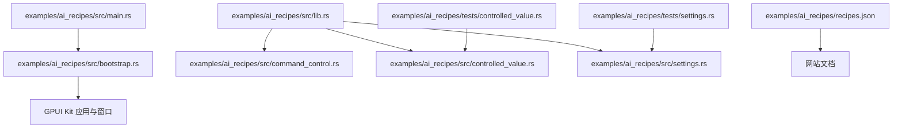
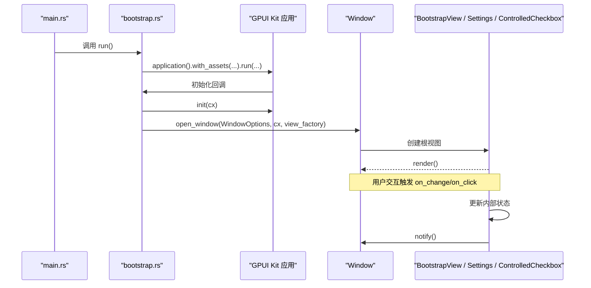
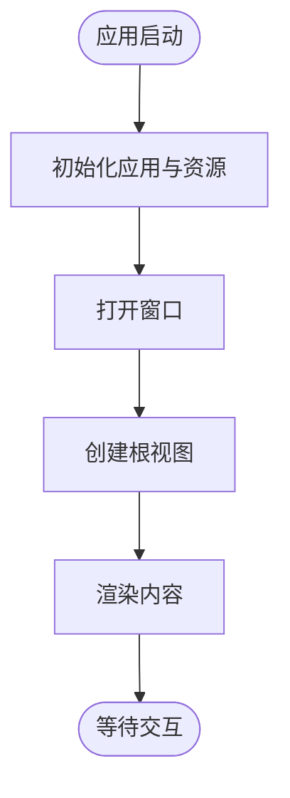
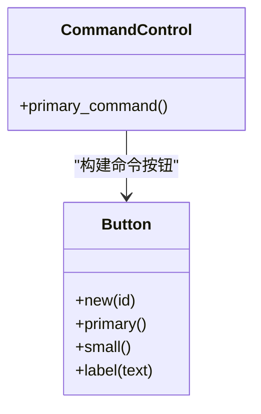
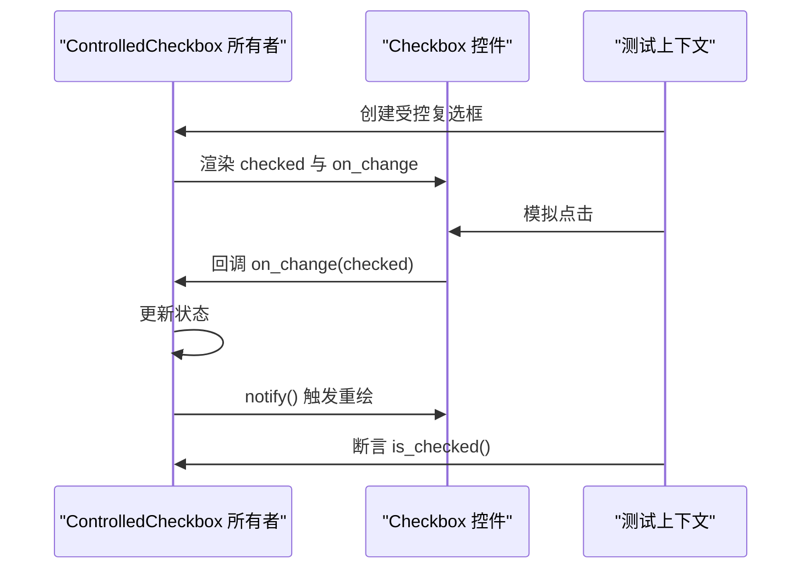
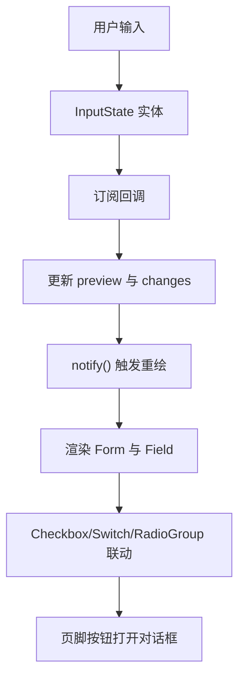
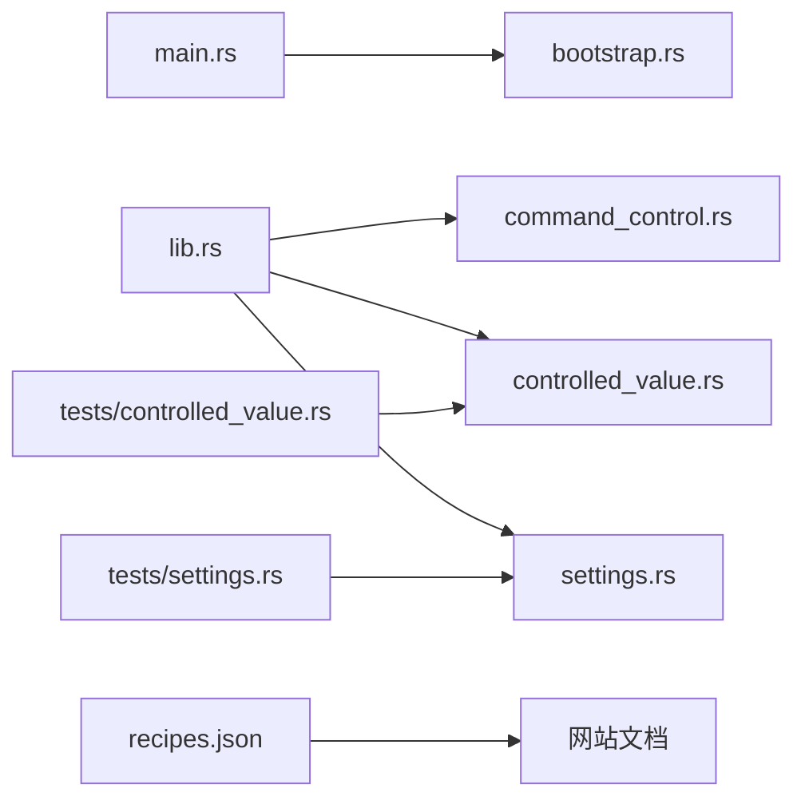
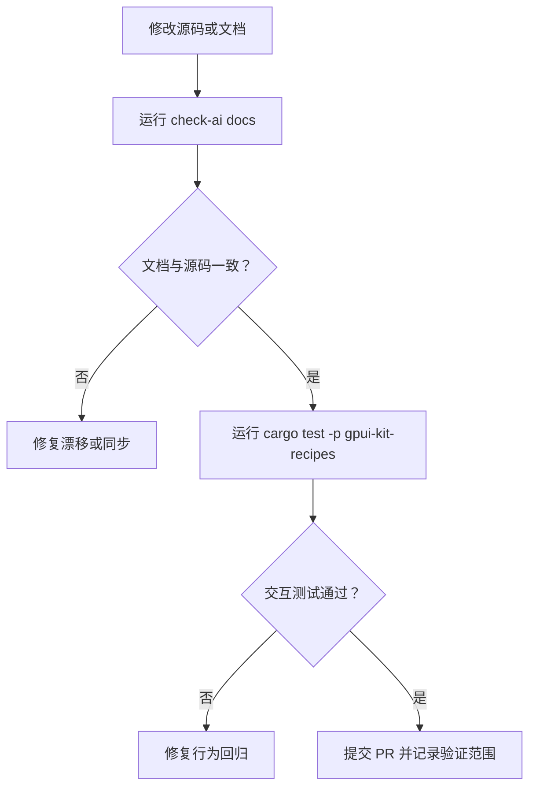
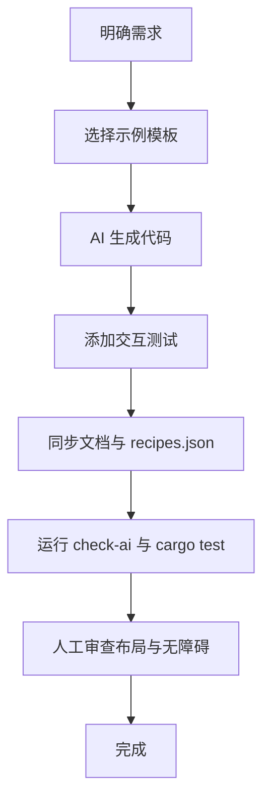

# AI 辅助开发食谱

<cite>
**本文引用的文件**   
- [examples/ai_recipes/README.md](file://examples/ai_recipes/README.md)
- [examples/ai_recipes/src/lib.rs](file://examples/ai_recipes/src/lib.rs)
- [examples/ai_recipes/src/main.rs](file://examples/ai_recipes/src/main.rs)
- [examples/ai_recipes/src/bootstrap.rs](file://examples/ai_recipes/src/bootstrap.rs)
- [examples/ai_recipes/src/command_control.rs](file://examples/ai_recipes/src/command_control.rs)
- [examples/ai_recipes/src/controlled_value.rs](file://examples/ai_recipes/src/controlled_value.rs)
- [examples/ai_recipes/src/settings.rs](file://examples/ai_recipes/src/settings.rs)
- [examples/ai_recipes/tests/controlled_value.rs](file://examples/ai_recipes/tests/controlled_value.rs)
- [examples/ai_recipes/tests/settings.rs](file://examples/ai_recipes/tests/settings.rs)
- [examples/ai_recipes/recipes.json](file://examples/ai_recipes/recipes.json)
- [script/tests/test_ai_recipes.py](file://script/tests/test_ai_recipes.py)
</cite>

## 目录
1. [引言](#引言)
2. [项目结构](#项目结构)
3. [核心组件](#核心组件)
4. [架构总览](#架构总览)
5. [详细组件分析](#详细组件分析)
6. [依赖关系分析](#依赖关系分析)
7. [性能与可维护性](#性能与可维护性)
8. [测试策略与质量保证](#测试策略与质量保证)
9. [AI 辅助开发工作流](#ai-辅助开发工作流)
10. [验收检查清单](#验收检查清单)
11. [结论](#结论)

## 引言
本指南面向使用 AI 工具进行 GPUI Kit 应用开发的工程师，聚焦三类常见模式：受控值管理、命令控制、设置管理。仓库中的 `examples/ai_recipes` 提供了可直接编译和交互的最小示例，并通过测试与文档同步机制保证“代码即文档”的可信度。本文从系统架构、数据流、测试策略和验收标准出发，帮助你在 AI 生成或修改代码时，保持行为稳定、边界清晰、可验证。

## 项目结构
`examples/ai_recipes` 是一个消费端示例 crate，仅依赖 `gpui_kit`，用于演示公共所有权模式、初始化序列、状态订阅和 UI 组合方式。其关键组织如下：
- `src/lib.rs`：暴露模块入口，导出 `Settings`。
- `src/main.rs`：应用入口，调用引导函数启动窗口。
- `src/bootstrap.rs`：最小化应用启动流程，展示如何初始化并打开根窗口。
- `src/command_control.rs`：命令式按钮的构造示例。
- `src/controlled_value.rs`：受控复选框的状态与回调绑定。
- `src/settings.rs`：包含表单、输入、开关、单选组等设置页，演示跨实体订阅与通知刷新。
- `tests/`：基于 GPUI 测试上下文的行为测试，覆盖点击、键盘输入、重绘后状态一致性。
- `recipes.json`：将源码片段映射到网站文档位置，驱动文档同步与校验。

**图表来源**
- [examples/ai_recipes/src/main.rs:1-4](file://examples/ai_recipes/src/main.rs#L1-L4)
- [examples/ai_recipes/src/bootstrap.rs:1-27](file://examples/ai_recipes/src/bootstrap.rs#L1-L27)
- [examples/ai_recipes/src/lib.rs:1-7](file://examples/ai_recipes/src/lib.rs#L1-L7)
- [examples/ai_recipes/src/command_control.rs:1-10](file://examples/ai_recipes/src/command_control.rs#L1-L10)
- [examples/ai_recipes/src/controlled_value.rs:1-29](file://examples/ai_recipes/src/controlled_value.rs#L1-L29)
- [examples/ai_recipes/src/settings.rs:1-120](file://examples/ai_recipes/src/settings.rs#L1-L120)
- [examples/ai_recipes/tests/controlled_value.rs:1-20](file://examples/ai_recipes/tests/controlled_value.rs#L1-L20)
- [examples/ai_recipes/tests/settings.rs:1-31](file://examples/ai_recipes/tests/settings.rs#L1-L31)
- [examples/ai_recipes/recipes.json:1-40](file://examples/ai_recipes/recipes.json#L1-L40)

**章节来源**
- [examples/ai_recipes/README.md:1-41](file://examples/ai_recipes/README.md#L1-L41)
- [examples/ai_recipes/src/lib.rs:1-7](file://examples/ai_recipes/src/lib.rs#L1-L7)
- [examples/ai_recipes/src/main.rs:1-4](file://examples/ai_recipes/src/main.rs#L1-L4)

## 核心组件
本节概述四个关键示例的职责与协作方式：
- 引导（Bootstrap）：负责应用初始化、资源加载、窗口创建与根视图挂载。
- 命令控制（Command Control）：以按钮为例，展示命令式 UI 元素的构建与样式组合。
- 受控值（Controlled Value）：以复选框为例，展示外部状态持有、回调更新与渲染刷新。
- 设置（Settings）：以表单为中心，整合输入、开关、单选组，演示跨实体订阅、预览更新与通知刷新。

这些组件共同体现“状态在所有者中、UI 只读渲染、事件通过回调回写”的模式，便于 AI 生成一致且可测试的代码。

**章节来源**
- [examples/ai_recipes/src/bootstrap.rs:1-27](file://examples/ai_recipes/src/bootstrap.rs#L1-L27)
- [examples/ai_recipes/src/command_control.rs:1-10](file://examples/ai_recipes/src/command_control.rs#L1-L10)
- [examples/ai_recipes/src/controlled_value.rs:1-29](file://examples/ai_recipes/src/controlled_value.rs#L1-L29)
- [examples/ai_recipes/src/settings.rs:1-120](file://examples/ai_recipes/src/settings.rs#L1-L120)

## 架构总览
下图展示了应用启动、窗口创建、视图渲染以及用户交互的基本流程。该流程强调“初始化一次、窗口独立、视图自管状态、事件驱动刷新”。

**图表来源**
- [examples/ai_recipes/src/main.rs:1-4](file://examples/ai_recipes/src/main.rs#L1-L4)
- [examples/ai_recipes/src/bootstrap.rs:1-27](file://examples/ai_recipes/src/bootstrap.rs#L1-L27)
- [examples/ai_recipes/src/controlled_value.rs:18-27](file://examples/ai_recipes/src/controlled_value.rs#L18-L27)
- [examples/ai_recipes/src/settings.rs:59-118](file://examples/ai_recipes/src/settings.rs#L59-L118)

## 详细组件分析

### 引导组件（Bootstrap）
职责：
- 初始化应用与资源。
- 打开窗口并挂载根视图。
- 提供最小可运行入口，便于扩展为完整应用。

关键点：
- 使用应用生命周期钩子完成初始化。
- 通过窗口选项创建窗口，并在闭包中返回根视图。
- 根视图负责承载对话框、抽屉、通知等层级。

**图表来源**
- [examples/ai_recipes/src/bootstrap.rs:6-17](file://examples/ai_recipes/src/bootstrap.rs#L6-L17)
- [examples/ai_recipes/src/bootstrap.rs:20-26](file://examples/ai_recipes/src/bootstrap.rs#L20-L26)

**章节来源**
- [examples/ai_recipes/src/bootstrap.rs:1-27](file://examples/ai_recipes/src/bootstrap.rs#L1-L27)

### 命令控制（Command Control）
职责：
- 展示命令式 UI 元素（如按钮）的构建与样式组合。
- 作为“命令入口”的示例，后续可扩展动作处理。

关键点：
- 使用组件库提供的按钮 API 构建元素。
- 通过链式方法设置变体与尺寸。
- 返回值实现元素接口，便于嵌入更高层布局。

**图表来源**
- [examples/ai_recipes/src/command_control.rs:1-10](file://examples/ai_recipes/src/command_control.rs#L1-L10)

**章节来源**
- [examples/ai_recipes/src/command_control.rs:1-10](file://examples/ai_recipes/src/command_control.rs#L1-L10)

### 受控值（Controlled Value）
职责：
- 将 UI 控件的状态交由外部所有者持有。
- 通过回调更新状态并触发重绘。

关键点：
- 组件自身不持有可变状态，而是由所有者管理。
- 在 `on_change` 中更新所有者状态并调用通知。
- 测试模拟点击并断言所有者状态已更新。

**图表来源**
- [examples/ai_recipes/src/controlled_value.rs:4-27](file://examples/ai_recipes/src/controlled_value.rs#L4-L27)
- [examples/ai_recipes/tests/controlled_value.rs:5-19](file://examples/ai_recipes/tests/controlled_value.rs#L5-L19)

**章节来源**
- [examples/ai_recipes/src/controlled_value.rs:1-29](file://examples/ai_recipes/src/controlled_value.rs#L1-L29)
- [examples/ai_recipes/tests/controlled_value.rs:1-20](file://examples/ai_recipes/tests/controlled_value.rs#L1-L20)

### 设置（Settings）
职责：
- 聚合多种表单控件，演示跨实体订阅、预览更新、通知刷新。
- 分离字段与页脚，保持布局与逻辑清晰。
- 通过对话框等原生能力增强用户体验。

关键点：
- 使用 `InputState` 实体并通过 `cx.subscribe_in` 监听变化。
- 在回调中更新预览文本与变更计数，并通知重绘。
- 使用 `Form`、`Field`、`Checkbox`、`Switch`、`RadioGroup` 组合表单。
- 在页脚按钮中打开对话框，展示窗口级能力。

**图表来源**
- [examples/ai_recipes/src/settings.rs:15-57](file://examples/ai_recipes/src/settings.rs#L15-L57)
- [examples/ai_recipes/src/settings.rs:59-118](file://examples/ai_recipes/src/settings.rs#L59-L118)

**章节来源**
- [examples/ai_recipes/src/settings.rs:1-120](file://examples/ai_recipes/src/settings.rs#L1-L120)
- [examples/ai_recipes/tests/settings.rs:1-31](file://examples/ai_recipes/tests/settings.rs#L1-L31)

## 依赖关系分析
- 应用入口依赖引导模块；引导模块依赖 GPUI Kit 的应用与窗口 API。
- 受控值与设置模块依赖组件库的控件与主题能力。
- 测试模块依赖组件库的测试上下文与模拟交互能力。
- `recipes.json` 将源码与文档目标关联，驱动文档同步与校验。

**图表来源**
- [examples/ai_recipes/src/main.rs:1-4](file://examples/ai_recipes/src/main.rs#L1-L4)
- [examples/ai_recipes/src/lib.rs:1-7](file://examples/ai_recipes/src/lib.rs#L1-L7)
- [examples/ai_recipes/src/bootstrap.rs:1-27](file://examples/ai_recipes/src/bootstrap.rs#L1-L27)
- [examples/ai_recipes/src/command_control.rs:1-10](file://examples/ai_recipes/src/command_control.rs#L1-L10)
- [examples/ai_recipes/src/controlled_value.rs:1-29](file://examples/ai_recipes/src/controlled_value.rs#L1-L29)
- [examples/ai_recipes/src/settings.rs:1-120](file://examples/ai_recipes/src/settings.rs#L1-L120)
- [examples/ai_recipes/tests/controlled_value.rs:1-20](file://examples/ai_recipes/tests/controlled_value.rs#L1-L20)
- [examples/ai_recipes/tests/settings.rs:1-31](file://examples/ai_recipes/tests/settings.rs#L1-L31)
- [examples/ai_recipes/recipes.json:1-40](file://examples/ai_recipes/recipes.json#L1-L40)

**章节来源**
- [examples/ai_recipes/recipes.json:1-40](file://examples/ai_recipes/recipes.json#L1-L40)

## 性能与可维护性
- 渲染优化：仅在状态变化时调用通知，避免不必要的重绘。
- 订阅管理：在设置组件中显式保存订阅引用，确保生命周期正确。
- 组件拆分：将表单字段与页脚分离，提升可读性与可测试性。
- 文档同步：通过 `recipes.json` 与标记围栏，保证源码与文档一致，减少漂移。

[本节为通用指导，不直接分析具体文件]

## 测试策略与质量保证
- 行为测试优先：对受控值和设置页面分别编写交互测试，覆盖点击、键盘输入、重绘后状态一致性。
- 测试上下文：使用 GPUI 测试上下文模拟窗口绘制、点击与按键，断言所有者状态。
- 文档契约：通过 Python 测试脚本校验 `recipes.json` 的完整性、信任标签、目的地存在性、重复 ID 与标记围栏一致性。
- 验收标准：
  - 发布文档片段需通过文档同步检查。
  - Rust 应用示例需编译并通过交互测试。
  - 组件约定需通过合约测试。
  - Shell 运行时与生成类型需通过渲染与绑定测试。
  - 跨领域变更需运行全量检查与示例测试。

**图表来源**
- [examples/ai_recipes/README.md:26-40](file://examples/ai_recipes/README.md#L26-L40)
- [script/tests/test_ai_recipes.py:1-88](file://script/tests/test_ai_recipes.py#L1-L88)

**章节来源**
- [examples/ai_recipes/tests/controlled_value.rs:1-20](file://examples/ai_recipes/tests/controlled_value.rs#L1-L20)
- [examples/ai_recipes/tests/settings.rs:1-31](file://examples/ai_recipes/tests/settings.rs#L1-L31)
- [script/tests/test_ai_recipes.py:1-88](file://script/tests/test_ai_recipes.py#L1-L88)
- [examples/ai_recipes/README.md:26-40](file://examples/ai_recipes/README.md#L26-L40)

## AI 辅助开发工作流
建议的工作流如下：
- 明确需求：确定需要实现的模式（受控值、命令控制、设置管理）。
- 选择模板：参考对应示例源码，理解状态所有权与回调约定。
- 生成代码：让 AI 基于模板生成新组件或页面，保持命名与结构一致。
- 添加测试：为新行为编写交互测试，覆盖点击、输入、重绘场景。
- 同步文档：如需公开片段，更新 `recipes.json` 并在文档中添加标记围栏。
- 运行检查：执行文档同步检查与示例测试，确保无漂移与回归。
- 人工审查：对布局、焦点、无障碍进行原生平台验证。

[本节为概念性工作流，不直接映射具体文件]

## 验收检查清单
- 源码与文档一致性：
  - `recipes.json` 中每个条目具备唯一 ID、有效源路径、至少一个文档目标与可信标签。
  - 文档中包含匹配的标记围栏，且内容未丢失或重复。
- 行为测试覆盖：
  - 受控值：点击后所有者状态更新。
  - 设置：输入后预览与变更计数更新，且在无关重绘后仍保持一致。
- 构建与运行：
  - 示例 crate 能独立编译并运行。
  - 交互测试通过。
- 质量门禁：
  - 文档同步检查通过。
  - 组件约定与 Shell 相关检查通过（如涉及）。
- 人工验证：
  - 受影响交互、焦点、布局与无障碍在原生平台验证。

**章节来源**
- [examples/ai_recipes/README.md:26-40](file://examples/ai_recipes/README.md#L26-L40)
- [examples/ai_recipes/recipes.json:1-40](file://examples/ai_recipes/recipes.json#L1-L40)
- [script/tests/test_ai_recipes.py:28-73](file://script/tests/test_ai_recipes.py#L28-L73)

## 结论
通过将常见开发模式沉淀为可编译、可交互、可测试的示例，并结合文档同步与契约校验，AI 辅助开发可以在保证行为稳定的前提下显著提升效率。建议在团队内推广“状态外置、回调更新、通知刷新”的统一模式，并以测试与验收清单作为质量底线，使 AI 生成的代码既高效又可靠。