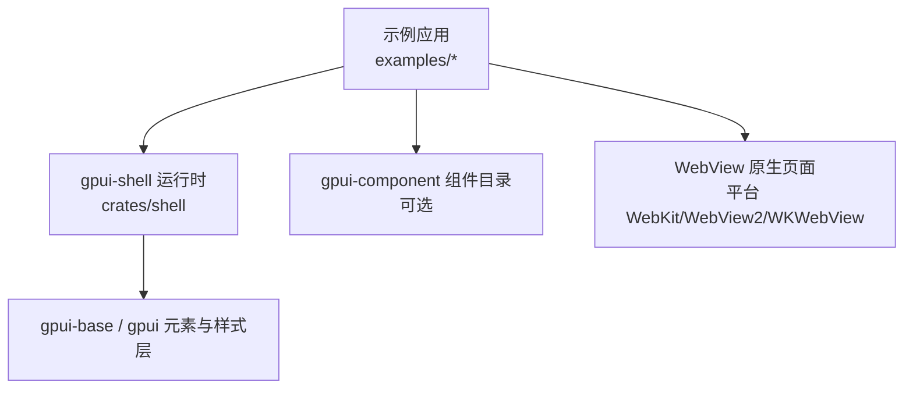
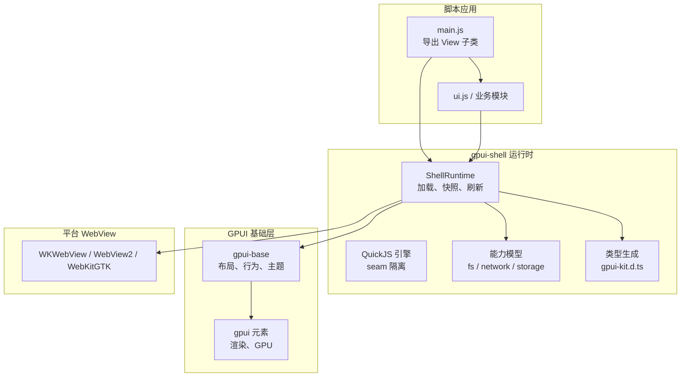
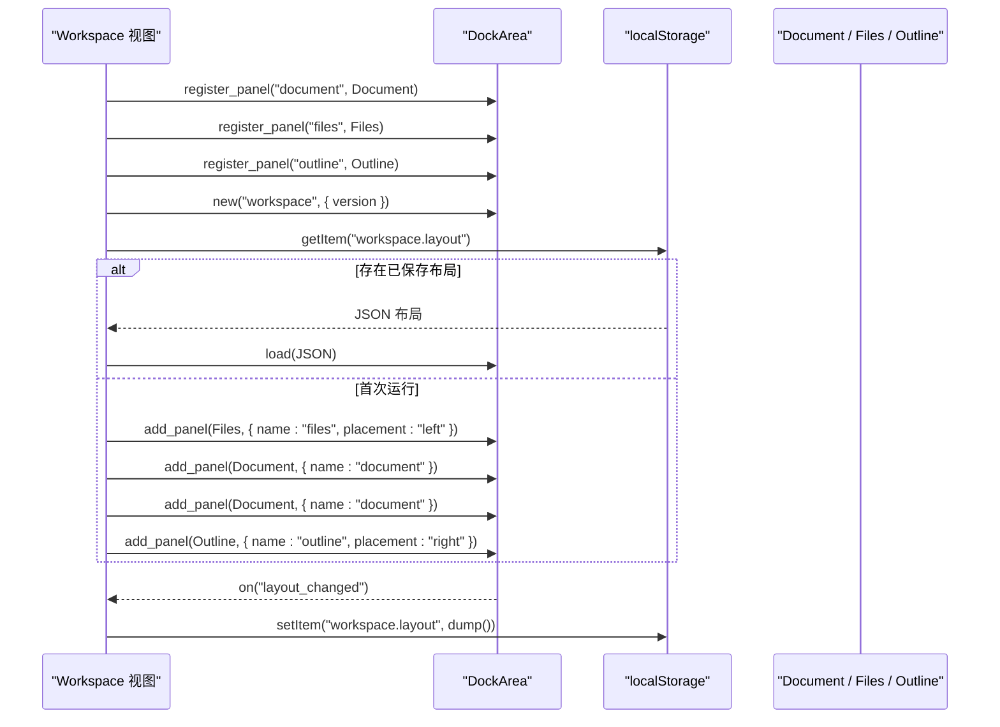
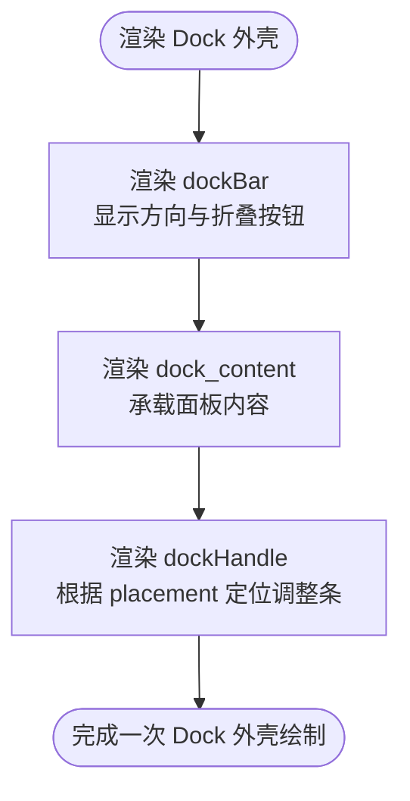
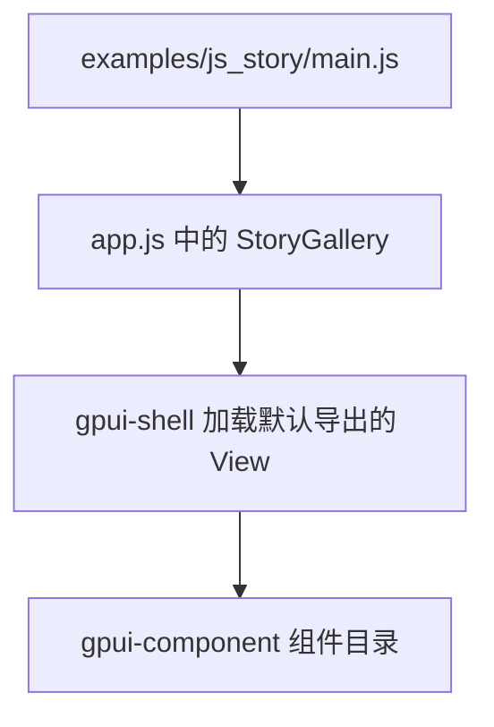
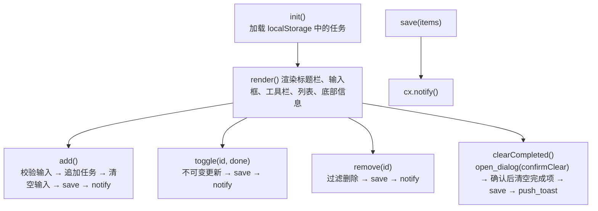
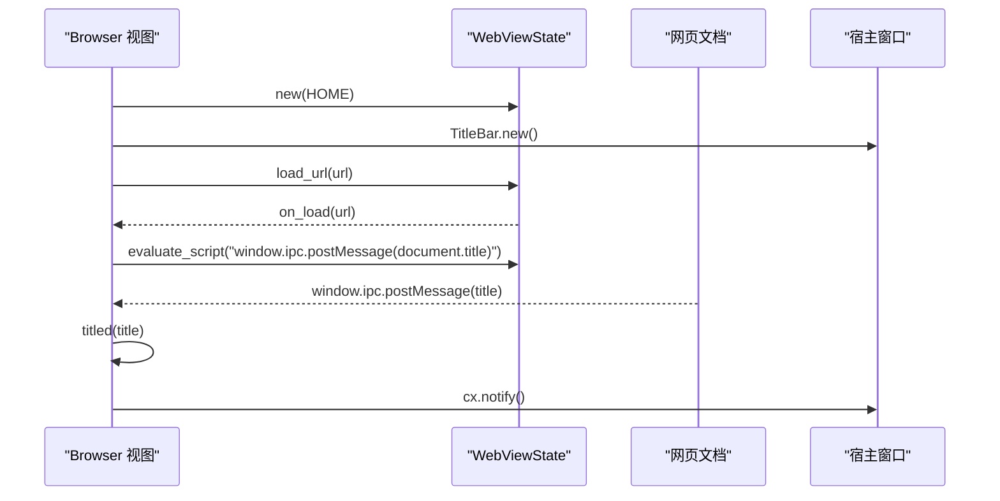
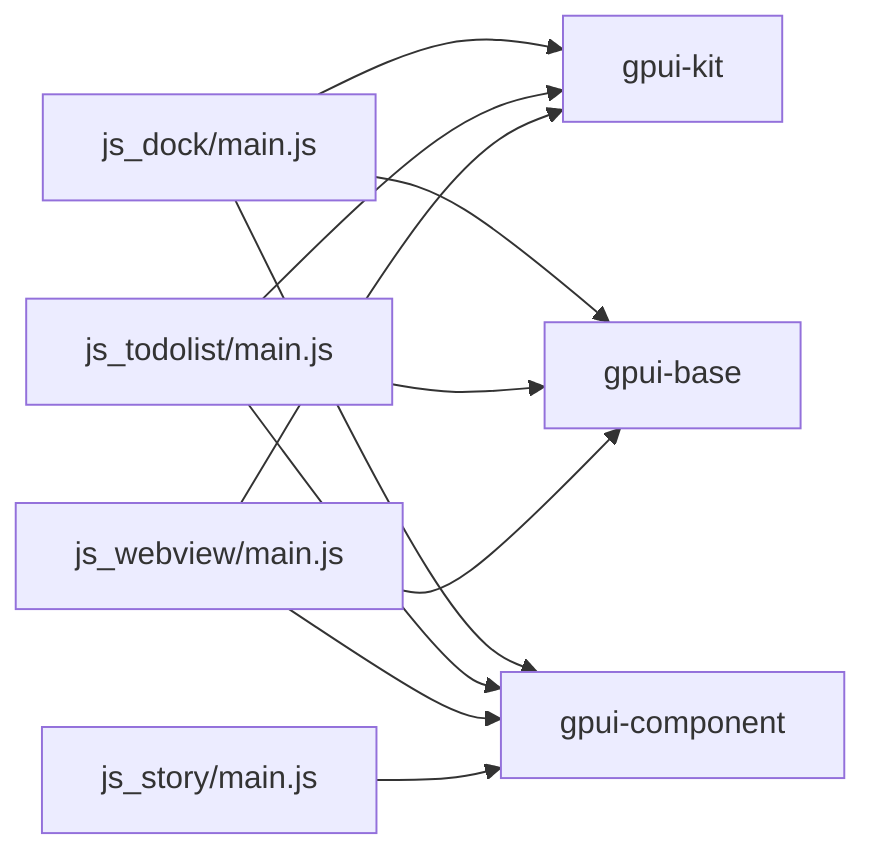

# JavaScript 集成示例

<cite>
**本文引用的文件**   
- [crates/shell/README.md](file://crates/shell/README.md)
- [docs/gpui-shell.md](file://docs/gpui-shell.md)
- [examples/js_dock/main.js](file://examples/js_dock/main.js)
- [examples/js_dock/ui.js](file://examples/js_dock/ui.js)
- [examples/js_story/main.js](file://examples/js_story/main.js)
- [examples/js_todolist/main.js](file://examples/js_todolist/main.js)
- [examples/js_webview/main.js](file://examples/js_webview/main.js)
</cite>

## 目录
1. [引言](#引言)
2. [项目结构](#项目结构)
3. [核心组件](#核心组件)
4. [架构总览](#架构总览)
5. [详细组件分析](#详细组件分析)
6. [依赖关系分析](#依赖关系分析)
7. [性能与运行时特性](#性能与运行时特性)
8. [故障排查指南](#故障排查指南)
9. [结论](#结论)

## 引言
本文件面向希望在 Rust + GPUI 应用中通过 JavaScript 扩展界面、布局与业务逻辑的开发者。仓库中的 `gpui-shell` 提供“脚本即应用层”的能力：Rust 负责渲染、布局、输入和系统能力，JavaScript 负责组合、呈现和业务逻辑。文档围绕四个典型场景展开：Dock 布局、故事展示、待办事项列表、WebView 集成，并说明 JavaScript API、插件开发与跨语言通信机制。

## 项目结构
仓库中与 JavaScript 集成直接相关的代码集中在以下位置：
- 运行时与文档：`crates/shell` 与 `docs/gpui-shell.md`
- Dock 示例：`examples/js_dock`
- 故事展示入口：`examples/js_story`
- 待办事项示例：`examples/js_todolist`
- WebView 示例：`examples/js_webview`

**图示来源**
- [crates/shell/README.md:1-30](file://crates/shell/README.md#L1-L30)
- [docs/gpui-shell.md:15-53](file://docs/gpui-shell.md#L15-L53)

**章节来源**
- [crates/shell/README.md:1-30](file://crates/shell/README.md#L1-L30)
- [docs/gpui-shell.md:15-53](file://docs/gpui-shell.md#L15-L53)

## 核心组件
本节从“运行时契约”“脚本视图模型”“能力与 I/O”“类型与开发体验”四个维度总结 JavaScript 集成的关键概念。

- 运行时契约
  - Rust 持有渲染、布局、文本编辑、焦点、覆盖层与系统访问；脚本持有组合、呈现与业务逻辑。
  - 脚本不进入布局或绘制路径；脚本描述在状态变化时发布为快照，后续帧由 Rust 回放。
  - 引擎侧是 QuickJS，但架构将引擎隔离在 seam 之下，上层只关心描述、主题、能力、实体等抽象。

- 脚本视图模型
  - 应用入口导出一个继承自 `View` 的类；`init` 初始化状态，`render` 返回元素描述。
  - 元素是单次使用的描述对象；事件回调中修改状态后调用 `cx.notify()` 触发重绘。
  - 保留状态使用 `InputState` 等实体句柄；嵌套视图可通过 `.child(handle)` 挂载。

- 能力与异步 I/O
  - 文件系统、网络、剪贴板、存储等能力默认关闭，需通过清单声明。
  - 标准运行时提供 `fs/promises`、`process`、`fetch`、WebSocket 等受控能力。
  - 资源上限、超时、消息大小限制在运行时边界执行，避免脚本阻塞 UI。

- 类型与开发体验
  - 运行、检查、生成类型时会写入 `gpui-kit.d.ts`，编辑器可获得方法签名与样式方法提示。
  - Git 依赖在安装阶段拉取，并在首次启动时链接到应用的 `node_modules`，使编辑器可解析。

**章节来源**
- [docs/gpui-shell.md:15-53](file://docs/gpui-shell.md#L15-L53)
- [docs/gpui-shell.md:376-406](file://docs/gpui-shell.md#L376-L406)
- [docs/gpui-shell.md:548-590](file://docs/gpui-shell.md#L548-L590)
- [crates/shell/README.md:210-301](file://crates/shell/README.md#L210-L301)
- [crates/shell/README.md:422-546](file://crates/shell/README.md#L422-L546)
- [crates/shell/README.md:599-700](file://crates/shell/README.md#L599-L700)

## 架构总览
下图展示脚本应用、gpui-shell 运行时、gpui-base 元素层与平台 WebView 的关系。

**图示来源**
- [docs/gpui-shell.md:214-241](file://docs/gpui-shell.md#L214-L241)
- [docs/gpui-shell.md:376-406](file://docs/gpui-shell.md#L376-L406)
- [crates/shell/README.md:210-301](file://crates/shell/README.md#L210-L301)

## 详细组件分析

### Dock 布局示例：可停靠工作区
该示例展示了如何用纯脚本构建 Dock 区域、标签页、工具栏、面板边框、拖放提示与侧边栏折叠控制。

- 设计要点
  - `DockArea` 提供布局、分组、拖拽、缩放与持久化数据；它本身不绘制 chrome，视觉样式由脚本实现。
  - 面板是普通 `View`，通过 `DockArea.register_panel` 注册名称，以便恢复布局时重建实例。
  - 布局状态通过 `localStorage` 保存，监听 `layout_changed` 事件进行节流写入。
  - 左侧与右侧 Dock 通过工具栏按钮切换打开/关闭，避免侧边栏折叠后失去打开入口。

- 关键流程
  - 初始化时注册面板类型，创建 `DockArea`，优先从本地存储恢复布局，否则创建初始面板集合。
  - 渲染时组合标题栏、工具栏与 `dock_area(...)`，并通过回调自定义标签栏、空组、拖放指示器与 Dock 外壳。
  - 工具栏提供新增文档、重置布局、切换左右 Dock 的功能。

**图示来源**
- [examples/js_dock/main.js:115-153](file://examples/js_dock/main.js#L115-L153)
- [examples/js_dock/main.js:155-216](file://examples/js_dock/main.js#L155-L216)
- [examples/js_dock/main.js:256-307](file://examples/js_dock/main.js#L256-L307)

- 可视化辅助函数
  - `ui.js` 提供标签项、Dock 标题条、调整手柄、空组提示与拖放高亮等纯展示函数，统一读取 `cx.theme().colors`。

**图示来源**
- [examples/js_dock/ui.js:89-129](file://examples/js_dock/ui.js#L89-L129)

**章节来源**
- [examples/js_dock/main.js:1-309](file://examples/js_dock/main.js#L1-L309)
- [examples/js_dock/ui.js:1-160](file://examples/js_dock/ui.js#L1-L160)

### 故事展示示例：组件画廊入口
故事展示示例是一个 JavaScript 入口，用于在启用 `components` 功能时加载 `StoryGallery`，从而演示 gpui-component 提供的组件目录。

- 入口职责
  - 仅导入并默认导出 `StoryGallery`，由 gpui-shell 在启用组件目录时将其作为根视图挂载。
  - 该示例强调“脚本拥有呈现”，即使使用组件目录，样式与组合仍由脚本决定。

**图示来源**
- [examples/js_story/main.js:1-7](file://examples/js_story/main.js#L1-L7)
- [crates/shell/README.md:66-73](file://crates/shell/README.md#L66-L73)

**章节来源**
- [examples/js_story/main.js:1-7](file://examples/js_story/main.js#L1-L7)
- [crates/shell/README.md:66-73](file://crates/shell/README.md#L66-L73)

### 待办事项列表示例：完整运行时练习
待办事项示例覆盖了保留输入状态、受控复选框、对话框、Toast、过滤状态、持久化存储与能力降级等运行时能力。

- 状态管理
  - 使用 `InputState` 管理输入框；提交事件触发添加任务。
  - 任务列表、过滤器、下一个 ID、是否已持久化都保存在视图实例上。
  - 所有变更都会调用 `save` 并通知重绘。

- 用户交互
  - 添加任务、切换完成状态、删除任务、清空已完成任务。
  - 清空操作通过 `window.open_dialog` 弹出确认对话框，成功后再更新列表并显示 Toast。

- 持久化与能力
  - 通过 `storage.js` 封装读写；当未授予存储能力时，数据仅在当前进程存活。
  - 底部状态栏显示是否已保存以及未完成/已完成数量。

**图示来源**
- [examples/js_todolist/main.js:39-76](file://examples/js_todolist/main.js#L39-L76)
- [examples/js_todolist/main.js:78-125](file://examples/js_todolist/main.js#L78-L125)
- [examples/js_todolist/main.js:127-165](file://examples/js_todolist/main.js#L127-L165)

**章节来源**
- [examples/js_todolist/main.js:1-274](file://examples/js_todolist/main.js#L1-L274)

### WebView 集成示例：脚本与网页双向通信
WebView 示例展示如何在脚本视图中嵌入网页，并通过 `WebViewState` 与 `WebView` 控制导航、缩放、主题，以及脚本与网页之间的消息传递。

- 生命周期
  - `WebViewState.new(url)` 持有页面历史、滚动位置与文档；`WebView.new(state)` 将其放入布局。
  - 页面加载完成后触发 `on_load`，脚本可调用 `evaluate_script` 获取页面标题。
  - 网页通过 `window.ipc.postMessage(title)` 发送消息，脚本在 `on_message` 中接收并更新标题。

- 导航与控制
  - 地址栏支持手动输入 URL，自动补全 `https://`。
  - 后退、前进、重载按钮分别调用 `page.back()`、`page.forward()`、`page.reload()`。
  - 页面加载失败时捕获异常并输出错误日志。

**图示来源**
- [examples/js_webview/main.js:32-68](file://examples/js_webview/main.js#L32-L68)
- [examples/js_webview/main.js:70-127](file://examples/js_webview/main.js#L70-L127)

**章节来源**
- [examples/js_webview/main.js:1-128](file://examples/js_webview/main.js#L1-L128)

## 依赖关系分析
JavaScript 示例对运行时与组件库的依赖如下：

**图示来源**
- [examples/js_dock/main.js:10-13](file://examples/js_dock/main.js#L10-L13)
- [examples/js_todolist/main.js:10-13](file://examples/js_todolist/main.js#L10-L13)
- [examples/js_webview/main.js:14-26](file://examples/js_webview/main.js#L14-L26)
- [examples/js_story/main.js:1-7](file://examples/js_story/main.js#L1-L7)

**章节来源**
- [examples/js_dock/main.js:10-13](file://examples/js_dock/main.js#L10-L13)
- [examples/js_todolist/main.js:10-13](file://examples/js_todolist/main.js#L10-L13)
- [examples/js_webview/main.js:14-26](file://examples/js_webview/main.js#L14-L26)
- [examples/js_story/main.js:1-7](file://examples/js_story/main.js#L1-L7)

## 性能与运行时特性
- 渲染路径隔离
  - 脚本不进入布局或绘制路径；`render` 只在视图失效时运行，之后每帧由 Rust 回放快照。
  - 悬停、滚动、光标闪烁、动画等通常不会重新进入 VM，脚本成本与应用实际行为相关，而非帧率。

- 异步与调度
  - QuickJS 需要主机排空任务队列；运行时在快照构建时检测并移交前台执行器，避免阻塞渲染路径。
  - 事件处理回调中恢复自身 `await` 会立即执行，符合作者预期。

- 资源与限制
  - 模块大小、资产大小、请求响应体、WebSocket 消息、文件系统读取条目数等均有上限。
  - 网络请求有超时与重定向授权限制；图片加载也有独立策略与缓存隔离。

- 类型与编辑器体验
  - 每次运行、检查或生成类型都会刷新 `gpui-kit.d.ts`，并提供样式方法与颜色 token 的类型。
  - Git 依赖会被链接到应用的 `node_modules`，编辑器可解析 JSDoc 与导出类型。

**章节来源**
- [crates/shell/README.md:399-420](file://crates/shell/README.md#L399-L420)
- [crates/shell/README.md:422-546](file://crates/shell/README.md#L422-L546)
- [crates/shell/README.md:599-700](file://crates/shell/README.md#L599-L700)
- [docs/gpui-shell.md:729-743](file://docs/gpui-shell.md#L729-L743)

## 故障排查指南
- 无法加载页面或脚本报错
  - WebView 仅允许 `http` 与 `https`；Linux Wayland 下可能需要设置环境变量回退到 XWayland。
  - 检查 URL 格式与协议前缀，确保不是相对路径或不受支持的 scheme。

- 布局或样式异常
  - 元素是单次使用的描述对象，不要将元素保存到实例字段并复用。
  - 样式方法名保持 Rust snake_case；未知样式名会在调用时报错，而不是静默忽略。

- 状态未更新
  - 事件回调中修改状态后必须调用 `cx.notify()`；不要在 `render` 中调用。
  - 对于 Dock 布局，修改布局后应监听 `layout_changed` 并节流保存。

- 持久化未生效
  - 检查是否授予了存储能力；未授予时 `localStorage` 可能退化到内存。
  - 检查 `save` 返回值与底部状态提示，确认是否成功持久化。

- 类型提示缺失
  - 运行 `cargo run -p gpui-shell -- types path/to/app` 生成 `gpui-kit.d.ts`。
  - 确保应用目录包含 `jsconfig.json`，以便编辑器解析 Git 依赖。

**章节来源**
- [examples/js_webview/main.js:1-13](file://examples/js_webview/main.js#L1-L13)
- [examples/js_webview/main.js:44-53](file://examples/js_webview/main.js#L44-L53)
- [crates/shell/README.md:246-293](file://crates/shell/README.md#L246-L293)
- [crates/shell/README.md:399-420](file://crates/shell/README.md#L399-L420)
- [crates/shell/README.md:599-700](file://crates/shell/README.md#L599-L700)

## 结论
通过 `gpui-shell`，JavaScript 可以在 Rust 应用中承担完整的 UI 应用层职责：组合元素、表达样式、管理状态、调用系统能力，并与原生 WebView 双向通信。Dock 示例展示了复杂布局的可维护性，故事示例展示了组件目录的集成方式，待办事项示例覆盖了运行时能力的常见用法，WebView 示例则体现了脚本与网页之间的安全通信通道。对于插件开发，建议遵循“能力最小化、状态显式、描述单次使用、快照驱动重绘”的原则，以获得稳定且高性能的跨语言集成体验。