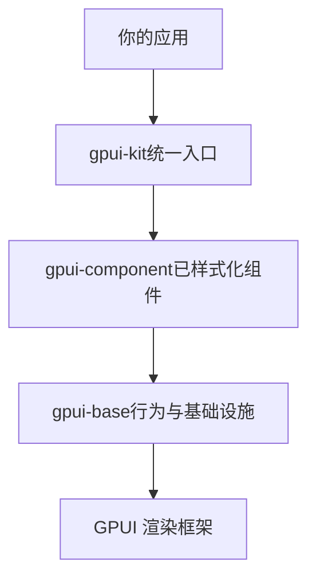
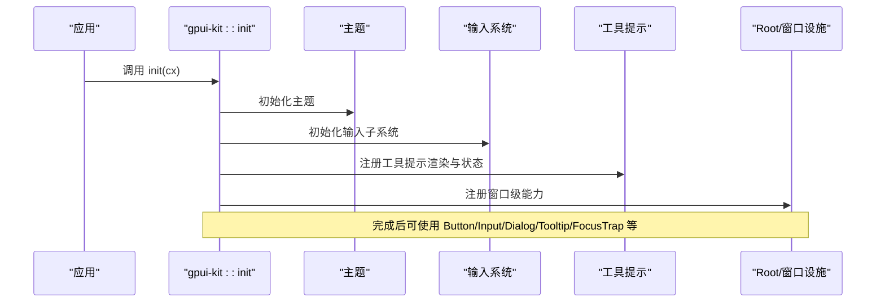
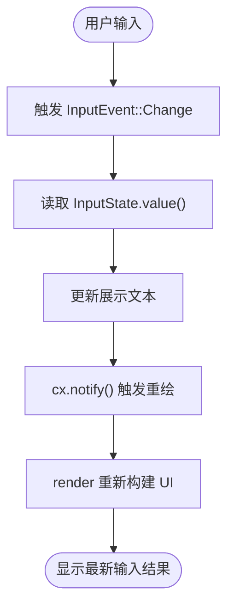
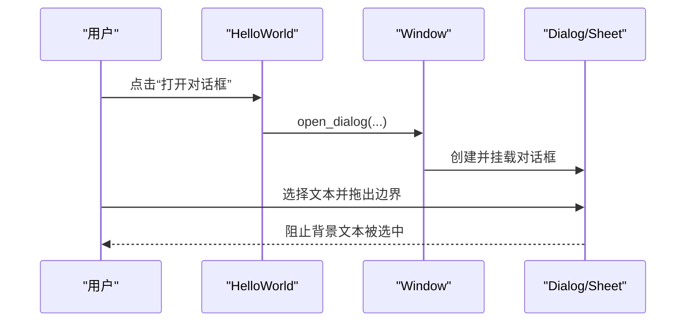
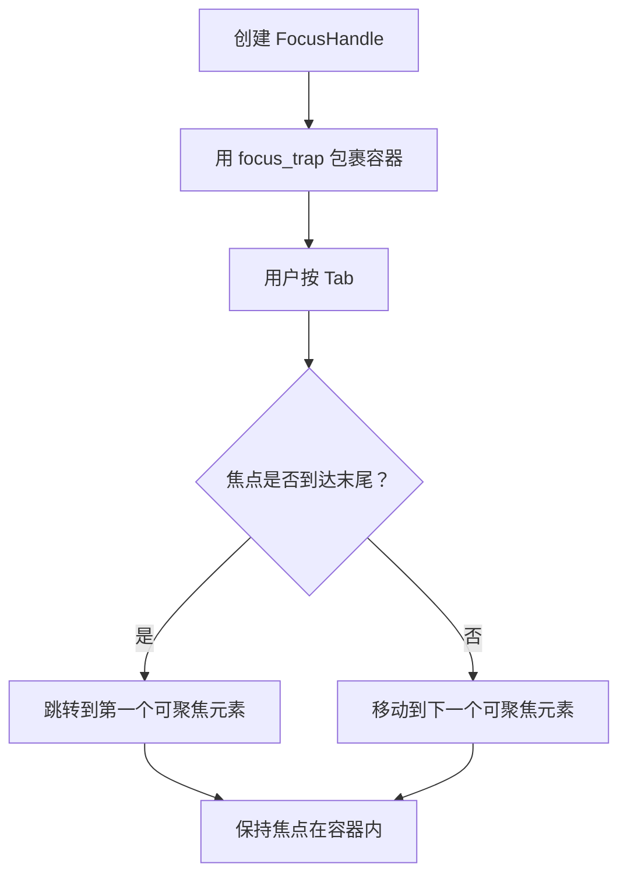
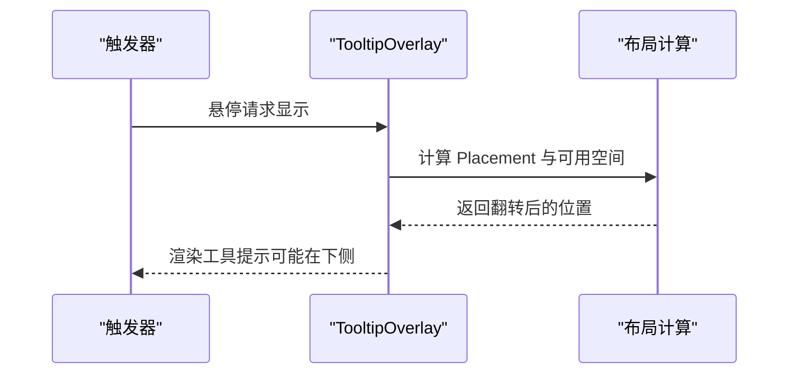
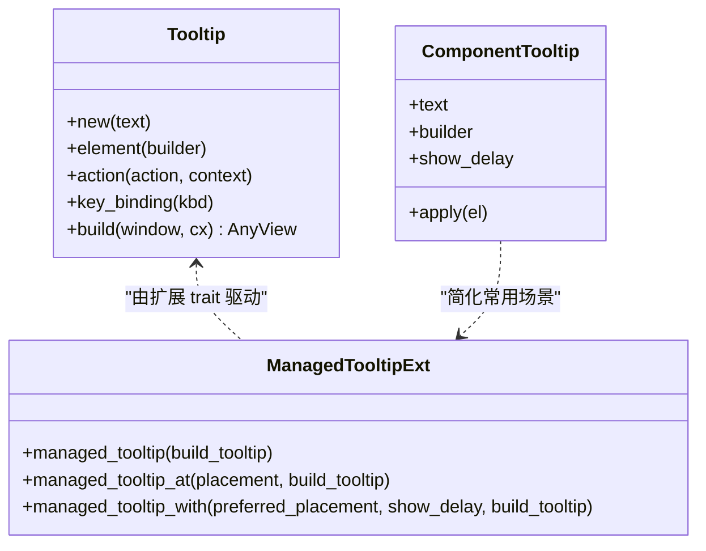
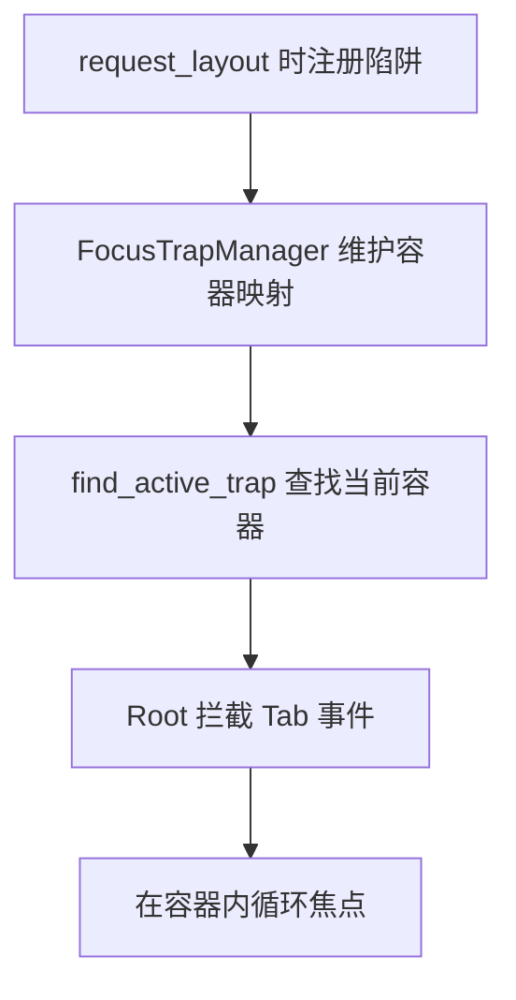
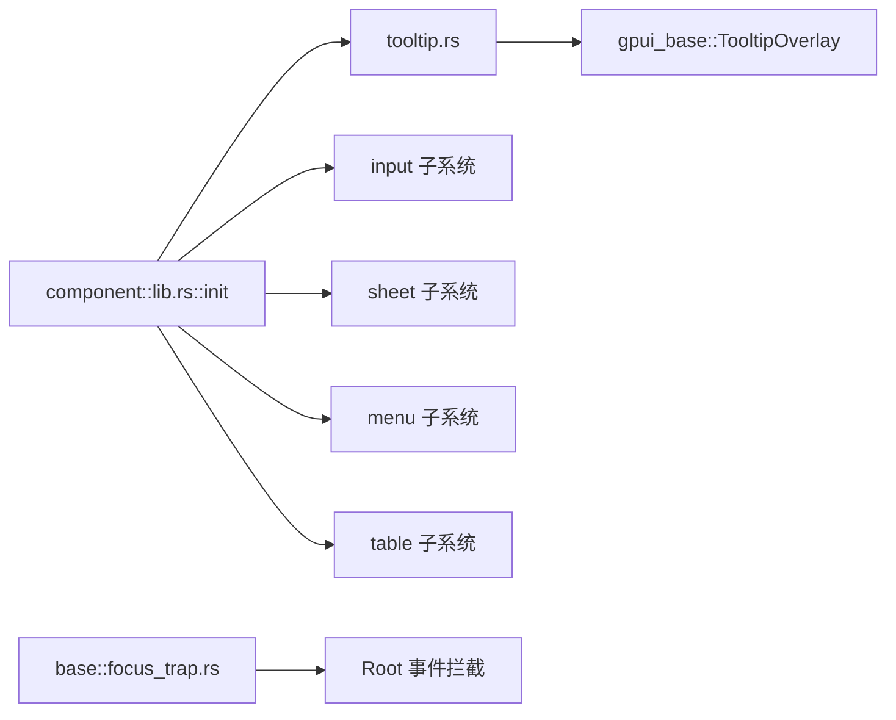

# UI 组件示例

<cite>
**本文引用的文件**   
- [README.md](file://README.md)
- [lib.rs](file://crates/component/src/lib.rs)
- [input.rs](file://examples/input/src/main.rs)
- [dialog_overlay.rs](file://examples/dialog_overlay/src/main.rs)
- [focus_trap.rs](file://examples/focus_trap/src/main.rs)
- [tooltip_top_edge.rs](file://examples/tooltip_top_edge/src/main.rs)
- [tooltip.rs](file://crates/component/src/tooltip.rs)
- [focus_trap_base.rs](file://crates/base/src/focus_trap.rs)
</cite>

## 目录
1. [简介](#简介)
2. [项目结构](#项目结构)
3. [核心组件](#核心组件)
4. [架构总览](#架构总览)
5. [详细组件分析](#详细组件分析)
6. [依赖关系分析](#依赖关系分析)
7. [性能与可访问性](#性能与可访问性)
8. [故障排查指南](#故障排查指南)
9. [结论](#结论)
10. [附录：示例清单与运行方式](#附录示例清单与运行方式)

## 简介
本文件面向希望快速上手 GPUI Kit UI 组件的开发者，提供输入框、对话框、焦点管理、工具提示等常用组件的完整使用示例与最佳实践。内容覆盖属性配置、事件处理、样式定制、组合模式与常见问题排查，帮助你在真实应用中稳定地复用这些能力。

## 项目结构
仓库采用三层架构：应用层通过 `gpui-kit` 引入；组件层 `gpui-component` 提供已样式化的控件；基础行为与基础设施由 `gpui-base` 提供。示例位于 `examples` 目录，每个示例是一个独立 crate，便于单独运行和验证。

图表来源
- [README.md:52-95](file://README.md#L52-L95)

章节来源
- [README.md:52-95](file://README.md#L52-L95)

## 核心组件
本节聚焦四个高频场景：输入框、对话框/面板、焦点陷阱、工具提示。每个示例都展示如何初始化、绑定状态、处理事件以及进行样式定制。

- 输入框示例：演示受控状态、事件订阅与实时显示。
- 对话框与面板示例：演示窗口级弹窗、选择文本隔离与上下文菜单。
- 焦点陷阱示例：演示 Tab 键在容器内循环，防止焦点逃逸。
- 工具提示示例：演示顶部边缘翻转与位置策略。

章节来源
- [input.rs:1-74](file://examples/input/src/main.rs#L1-L74)
- [dialog_overlay.rs:1-117](file://examples/dialog_overlay/src/main.rs#L1-L117)
- [focus_trap.rs:1-150](file://examples/focus_trap/src/main.rs#L1-L150)
- [tooltip_top_edge.rs:1-53](file://examples/tooltip_top_edge/src/main.rs#L1-L53)

## 架构总览
组件库在应用启动时集中初始化，注册主题、全局状态、输入系统、列表、命令、通知、弹出层、表格、工具提示等子系统。Tooltip 与 FocusTrap 分别由组件层与基础层实现，并通过扩展 trait 暴露给上层元素。

图表来源
- [lib.rs:127-151](file://crates/component/src/lib.rs#L127-L151)

章节来源
- [lib.rs:127-151](file://crates/component/src/lib.rs#L127-L151)

## 详细组件分析

### 输入框：受控状态与事件处理
该示例展示了如何使用 `InputState` 作为受控数据源，订阅 `InputEvent::Change`，并将输入值映射到界面显示。要点包括：
- 使用 `Entity<InputState>` 持有输入状态。
- 通过 `cx.subscribe_in` 订阅变化事件，避免内存泄漏。
- 将输入值转换为展示文本并触发重绘。

图表来源
- [input.rs:20-40](file://examples/input/src/main.rs#L20-L40)
- [input.rs:43-54](file://examples/input/src/main.rs#L43-L54)

章节来源
- [input.rs:1-74](file://examples/input/src/main.rs#L1-L74)

### 对话框与面板：模态交互与选择隔离
该示例演示了：
- 打开对话框与侧边面板。
- 对话框内部的可选择文本不会穿透到背景区域。
- 按钮点击回调中调用窗口级 API 打开弹窗。
- 使用上下文菜单增强交互。

图表来源
- [dialog_overlay.rs:10-21](file://examples/dialog_overlay/src/main.rs#L10-L21)
- [dialog_overlay.rs:23-34](file://examples/dialog_overlay/src/main.rs#L23-L34)
- [dialog_overlay.rs:37-103](file://examples/dialog_overlay/src/main.rs#L37-L103)

章节来源
- [dialog_overlay.rs:1-117](file://examples/dialog_overlay/src/main.rs#L1-L117)

### 焦点陷阱：Tab 键在容器内循环
该示例展示了如何在多个区域启用焦点陷阱，使 Tab 键仅在容器内循环，不逃逸到外部元素。关键点：
- 为每个容器分配独立的 `FocusHandle`。
- 使用 `.focus_trap(id, &handle)` 包裹目标容器。
- 在网格或水平布局中均可正常工作。

图表来源
- [focus_trap.rs:9-14](file://examples/focus_trap/src/main.rs#L9-L14)
- [focus_trap.rs:76-77](file://examples/focus_trap/src/main.rs#L76-L77)
- [focus_trap.rs:109-124](file://examples/focus_trap/src/main.rs#L109-L124)

章节来源
- [focus_trap.rs:1-150](file://examples/focus_trap/src/main.rs#L1-L150)

### 工具提示：顶部边缘翻转与延迟显示
该示例演示了当触发器靠近窗口顶部时，工具提示自动翻转到下方，同时保持视觉间距不变。要点：
- 使用 `Placement::Top` 指定首选方向。
- 工具提示会在空间不足时自动翻转。
- 可通过 `tooltip_show_delay` 控制显示延迟。

图表来源
- [tooltip_top_edge.rs:14-20](file://examples/tooltip_top_edge/src/main.rs#L14-L20)
- [tooltip.rs:246-343](file://crates/component/src/tooltip.rs#L246-L343)

章节来源
- [tooltip_top_edge.rs:1-53](file://examples/tooltip_top_edge/src/main.rs#L1-L53)
- [tooltip.rs:1-800](file://crates/component/src/tooltip.rs#L1-L800)

### 工具提示内部机制与生命周期
Tooltip 通过扩展 trait 为任意可交互元素附加托管式提示，包含以下关键流程：
- 记录触发器的全局 ID 与边界。
- 监听 hover/mouse_down 事件，维护触发器按下状态。
- 向 `BaseTooltipOverlay` 发送显示/隐藏请求，支持延迟与位置策略。
- 在元素移除或缓存重建时正确清理，避免悬挂提示。

图表来源
- [tooltip.rs:37-89](file://crates/component/src/tooltip.rs#L37-L89)
- [tooltip.rs:199-232](file://crates/component/src/tooltip.rs#L199-L232)
- [tooltip.rs:246-343](file://crates/component/src/tooltip.rs#L246-L343)

章节来源
- [tooltip.rs:1-800](file://crates/component/src/tooltip.rs#L1-L800)

### 焦点陷阱基础实现
FocusTrap 的基础实现提供了全局管理器与扩展 trait，负责：
- 注册/查找当前激活的焦点陷阱容器。
- 在 Tab/Shift-Tab 时拦截焦点移动，实现容器内循环。
- 清理失效的弱引用，避免内存泄漏。

图表来源
- [focus_trap_base.rs:8-11](file://crates/base/src/focus_trap.rs#L8-L11)
- [focus_trap_base.rs:52-110](file://crates/base/src/focus_trap.rs#L52-L110)
- [focus_trap_base.rs:201-212](file://crates/base/src/focus_trap.rs#L201-L212)
- [focus_trap_base.rs:249-253](file://crates/base/src/focus_trap.rs#L249-L253)

章节来源
- [focus_trap_base.rs:1-288](file://crates/base/src/focus_trap.rs#L1-L288)

## 依赖关系分析
- 组件入口 `lib.rs` 在应用启动时集中初始化各子系统，确保 Tooltip、Input、Sheet、Menu、Table 等能力可用。
- Tooltip 依赖 `gpui_base::TooltipOverlay` 与动画系统，提供平滑过渡与位置翻转。
- FocusTrap 依赖全局管理器与 Root 的事件拦截，保证 Tab 行为符合预期。
- 示例均通过 `gpui_kit::init` 完成初始化，再使用 `open_window` 打开窗口。

图表来源
- [lib.rs:127-151](file://crates/component/src/lib.rs#L127-L151)
- [tooltip.rs:1-28](file://crates/component/src/tooltip.rs#L1-L28)
- [focus_trap_base.rs:8-11](file://crates/base/src/focus_trap.rs#L8-L11)

章节来源
- [lib.rs:127-151](file://crates/component/src/lib.rs#L127-L151)
- [tooltip.rs:1-28](file://crates/component/src/tooltip.rs#L1-L28)
- [focus_trap_base.rs:8-11](file://crates/base/src/focus_trap.rs#L8-L11)

## 性能与可访问性
- 工具提示使用轻量动画与延迟显示，避免频繁重绘；在相邻触发器切换时采用滑动过渡，提升体验。
- 焦点陷阱通过全局管理器维护弱引用，并在布局阶段注册，减少运行时开销。
- 所有组件遵循 AccessKit 语义，确保辅助技术可识别角色、名称与状态。

[本节为通用指导，不直接分析具体文件]

## 故障排查指南
- 工具提示不显示
  - 确认已调用 `gpui_kit::init(cx)`。
  - 检查触发器是否在可视区域内且未被其他元素遮挡。
  - 若使用缓存子树，确保触发器重建后仍保留全局 ID。
- 工具提示在点击后一直显示
  - 检查是否在触发器上按住鼠标时误触发了悬停逻辑；按下时应隐藏提示，离开后再恢复。
- 焦点未循环或逃逸
  - 确认容器使用了 `.focus_trap(id, &handle)`，且 handle 与容器生命周期一致。
  - 检查是否有嵌套容器导致焦点捕获顺序异常。
- 对话框内文本选择穿透到背景
  - 确保对话框内容设置了可选择属性，并由窗口级弹窗系统接管选择范围。

章节来源
- [tooltip.rs:274-343](file://crates/component/src/tooltip.rs#L274-L343)
- [focus_trap_base.rs:201-212](file://crates/base/src/focus_trap.rs#L201-L212)
- [dialog_overlay.rs:65-76](file://examples/dialog_overlay/src/main.rs#L65-L76)

## 结论
通过上述示例与底层机制说明，你可以：
- 以最小样板代码集成输入框、对话框、焦点陷阱与工具提示。
- 利用托管式 Tooltip 与 FocusTrap 扩展 trait，获得一致的交互体验。
- 在复杂布局与缓存场景中保持正确的生命周期与可访问性。
建议在实际项目中优先使用受控状态、明确的事件处理与主题 token，以获得可维护且高性能的界面。

[本节为总结性内容，不直接分析具体文件]

## 附录：示例清单与运行方式
- 输入框示例：`examples/input`
- 对话框与面板示例：`examples/dialog_overlay`
- 焦点陷阱示例：`examples/focus_trap`
- 工具提示顶部边缘示例：`examples/tooltip_top_edge`

运行方式参考仓库根 README 中的 Examples 部分，使用 `cargo run -p example-<name>` 启动对应示例。

章节来源
- [README.md:219-248](file://README.md#L219-L248)