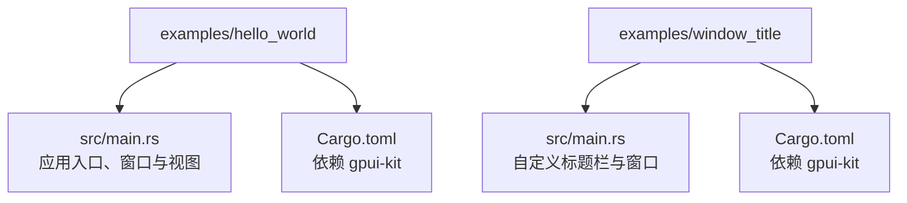
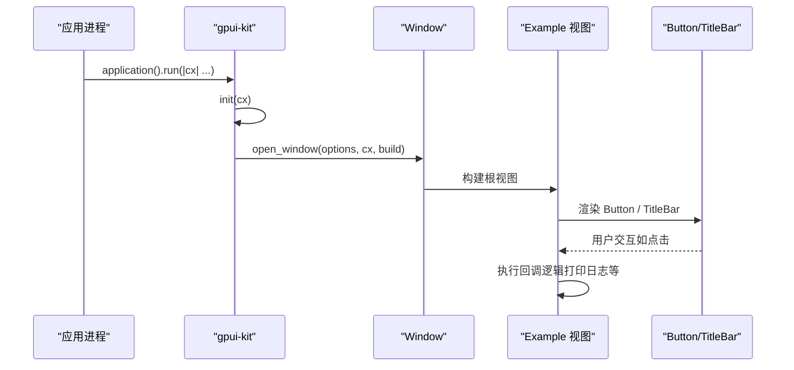
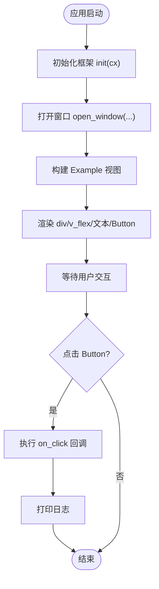
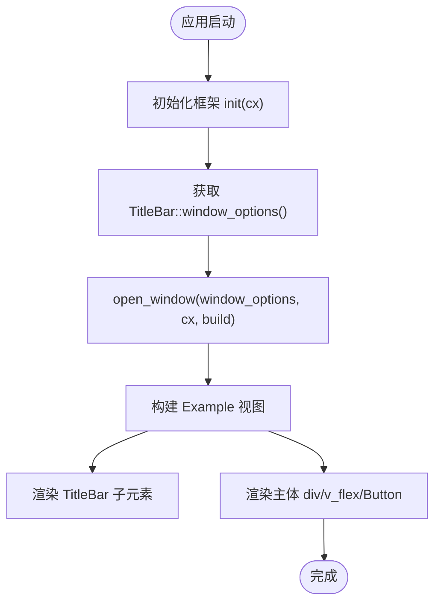
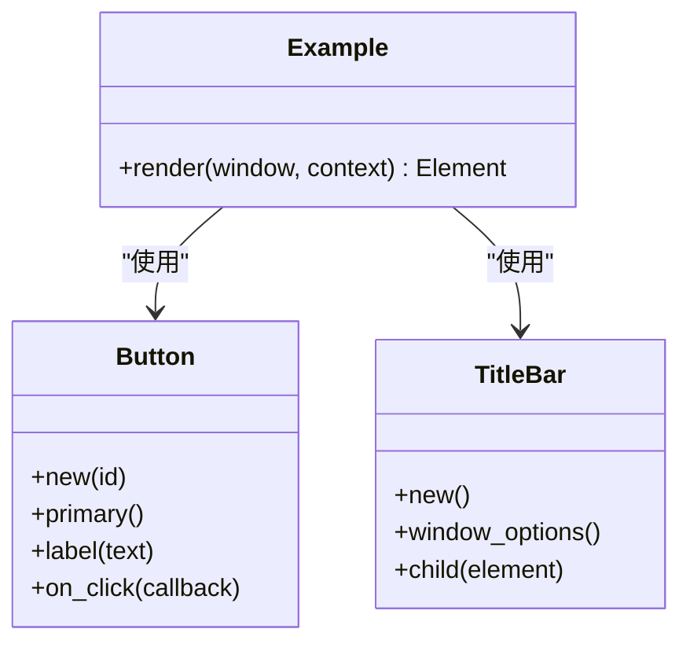
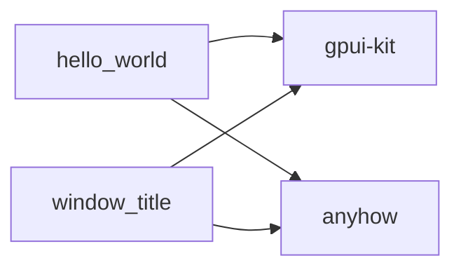

# 入门示例

<cite>
**本文引用的文件**   
- [examples/hello_world/src/main.rs](file://examples/hello_world/src/main.rs)
- [examples/hello_world/Cargo.toml](file://examples/hello_world/Cargo.toml)
- [examples/window_title/src/main.rs](file://examples/window_title/src/main.rs)
- [examples/window_title/Cargo.toml](file://examples/window_title/Cargo.toml)
- [website/base/getting-started.md](file://website/base/getting-started.md)
</cite>

## 目录
1. [简介](#简介)
2. [项目结构](#项目结构)
3. [核心组件](#核心组件)
4. [架构总览](#架构总览)
5. [详细示例分析](#详细示例分析)
6. [依赖关系分析](#依赖关系分析)
7. [性能与可维护性建议](#性能与可维护性建议)
8. [故障排查指南](#故障排查指南)
9. [结论](#结论)

## 简介
本教程面向初学者，带你快速上手 GPUI Kit。你将通过两个最小化示例：
- Hello World 应用：创建窗口、渲染文本和按钮、处理点击事件。
- 自定义标题栏示例：使用 TitleBar 配置原生窗口标题栏区域。

每个示例都包含完整的源代码路径、逐步说明和运行指导，帮助你理解基本组件用法与事件处理机制。

## 项目结构
仓库中包含多个示例工程，其中与本教程直接相关的示例位于 examples 目录下：
- hello_world：最简应用，展示如何初始化应用、打开窗口、渲染基础 UI 并处理点击事件。
- window_title：在窗口顶部渲染自定义标题栏，演示 TitleBar 的基本用法。

**图表来源**
- [examples/hello_world/src/main.rs:1-35](file://examples/hello_world/src/main.rs#L1-L35)
- [examples/hello_world/Cargo.toml:1-17](file://examples/hello_world/Cargo.toml#L1-L17)
- [examples/window_title/src/main.rs:1-55](file://examples/window_title/src/main.rs#L1-L55)
- [examples/window_title/Cargo.toml:1-17](file://examples/window_title/Cargo.toml#L1-L17)

**章节来源**
- [examples/hello_world/src/main.rs:1-35](file://examples/hello_world/src/main.rs#L1-L35)
- [examples/window_title/src/main.rs:1-55](file://examples/window_title/src/main.rs#L1-L55)

## 核心组件
在本教程中，你将接触以下核心概念与组件：
- 应用生命周期：通过 application().run(...) 启动应用，并在回调中初始化框架。
- 窗口管理：open_window(...) 创建窗口，传入 WindowOptions 或 TitleBar::window_options()。
- 视图与布局：div、v_flex、h_flex 等布局元素组合界面。
- 交互组件：Button 提供 on_click 回调处理用户点击。
- 标题栏：TitleBar 用于自定义窗口标题栏区域。

这些能力由 gpui-kit 提供，示例代码展示了如何在应用中组合使用它们。

**章节来源**
- [examples/hello_world/src/main.rs:1-35](file://examples/hello_world/src/main.rs#L1-L35)
- [examples/window_title/src/main.rs:1-55](file://examples/window_title/src/main.rs#L1-L55)

## 架构总览
下图展示了从应用启动到窗口渲染的调用流程，以及示例中涉及的关键模块。

**图表来源**
- [examples/hello_world/src/main.rs:24-33](file://examples/hello_world/src/main.rs#L24-L33)
- [examples/window_title/src/main.rs:42-53](file://examples/window_title/src/main.rs#L42-L53)

## 详细示例分析

### 示例一：Hello World 应用
目标：创建一个最小化的窗口，显示“Hello, World!”和一个可点击的按钮。

步骤说明：
1. 引入必要的模块：组件库、布局与按钮。
2. 定义一个 Example 视图，实现 Render trait，返回布局元素。
3. 在 main 函数中：
   - 启动应用：application().run(...)
   - 初始化框架：init(cx)
   - 打开窗口：open_window(WindowOptions::default(), cx, build)
4. 在视图中：
   - 使用 div + v_flex 居中布局。
   - 添加文本节点和 Button 组件。
   - 为 Button 设置 primary 样式与 label。
   - 绑定 on_click 回调，打印日志。

运行指导：
- 进入示例目录：cd examples/hello_world
- 运行应用：cargo run
- 预期结果：弹出窗口，显示“Hello, World!”和一个主按钮；点击按钮后控制台输出点击日志。

关键点：
- 必须先调用 init(cx)，再打开窗口，以确保组件功能可用。
- open_window 的第一个参数是窗口选项，这里使用默认选项。
- Button 的 on_click 回调接收上下文参数，适合扩展后续状态更新。

**章节来源**
- [examples/hello_world/src/main.rs:1-35](file://examples/hello_world/src/main.rs#L1-L35)
- [examples/hello_world/Cargo.toml:1-17](file://examples/hello_world/Cargo.toml#L1-L17)

#### 流程图：Hello World 渲染与点击

**图表来源**
- [examples/hello_world/src/main.rs:6-22](file://examples/hello_world/src/main.rs#L6-L22)
- [examples/hello_world/src/main.rs:24-33](file://examples/hello_world/src/main.rs#L24-L33)

### 示例二：自定义标题栏
目标：在窗口顶部渲染自定义标题栏，替换系统默认标题栏区域。

步骤说明：
1. 引入必要模块：TitleBar、Button、布局元素。
2. 定义 Example 视图：
   - 顶部使用 TitleBar::new().child(...) 渲染自定义标题内容。
   - 主体区域继续使用 div + v_flex 布局，显示文本与按钮。
3. 在 main 函数中：
   - 启动应用：application().with_assets(...).run(...)
   - 初始化框架：init(cx)
   - 获取自定义标题栏窗口选项：TitleBar::window_options()
   - 打开窗口：open_window(window_options, cx, build)

运行指导：
- 进入示例目录：cd examples/window_title
- 运行应用：cargo run
- 预期结果：窗口顶部出现自定义标题栏区域，主体内容与 Hello World 类似。

关键点：
- 使用 TitleBar::window_options() 作为 open_window 的窗口选项，以启用自定义标题栏。
- TitleBar 内部可以放置任意子元素，常用于放置应用名称、右侧工具项等。
- 若需要资源（图标、字体等），可通过 with_assets 注入。

**章节来源**
- [examples/window_title/src/main.rs:1-55](file://examples/window_title/src/main.rs#L1-L55)
- [examples/window_title/Cargo.toml:1-17](file://examples/window_title/Cargo.toml#L1-L17)

#### 流程图：自定义标题栏窗口构建

**图表来源**
- [examples/window_title/src/main.rs:8-40](file://examples/window_title/src/main.rs#L8-L40)
- [examples/window_title/src/main.rs:42-53](file://examples/window_title/src/main.rs#L42-L53)

### 概念总览：组件与事件处理
- 组件：GPUI Kit 提供丰富的 UI 组件，如 Button、TitleBar、布局容器等。
- 事件处理：通过 on_click 等回调函数响应用户操作，可在回调中更新状态或触发副作用。
- 布局：使用 div、v_flex、h_flex 等组合出灵活的界面结构。
- 主题与样式：通过组件提供的样式方法（如 primary）快速获得一致的视觉风格。

**图表来源**
- [examples/hello_world/src/main.rs:6-22](file://examples/hello_world/src/main.rs#L6-L22)
- [examples/window_title/src/main.rs:8-40](file://examples/window_title/src/main.rs#L8-L40)

## 依赖关系分析
两个示例均依赖 gpui-kit，并通过 Cargo.toml 声明依赖。hello_world 与 window_title 的结构相似，区别在于 window_title 额外使用了 TitleBar 来定制窗口标题栏。

**图表来源**
- [examples/hello_world/Cargo.toml:1-17](file://examples/hello_world/Cargo.toml#L1-L17)
- [examples/window_title/Cargo.toml:1-17](file://examples/window_title/Cargo.toml#L1-L17)

**章节来源**
- [examples/hello_world/Cargo.toml:1-17](file://examples/hello_world/Cargo.toml#L1-L17)
- [examples/window_title/Cargo.toml:1-17](file://examples/window_title/Cargo.toml#L1-L17)

## 性能与可维护性建议
- 保持元素 ID 稳定：在复杂视图中，稳定的 ElementId 有助于 GPUI 保留焦点与状态，提升交互体验。
- 控制型组件：对于 Checkbox、Switch、Radio、Toggle 等受控组件，应在回调中保存下一个值并回传给下一次渲染。
- 主题与语义色：通过 ColorTokens 与 Theme 管理语义色，便于统一外观与切换明暗主题。
- 资源加载：如需图标或字体，建议使用 with_assets 注入，避免运行时缺失。

上述建议参考了官方入门文档中的最佳实践与主题配置说明。

**章节来源**
- [website/base/getting-started.md:37-89](file://website/base/getting-started.md#L37-L89)

## 故障排查指南
- 未初始化框架：如果未在 open_window 前调用 init(cx)，可能导致组件功能不可用。确保在应用回调中先 init 再 open_window。
- 窗口选项错误：使用自定义标题栏时，必须传入 TitleBar::window_options()，否则不会生效。
- 依赖缺失：确保 Cargo.toml 中已声明 gpui-kit 依赖，且版本与工作区一致。
- 资源问题：若使用 with_assets，请确认资源路径正确且可访问。

**章节来源**
- [examples/hello_world/src/main.rs:24-33](file://examples/hello_world/src/main.rs#L24-L33)
- [examples/window_title/src/main.rs:42-53](file://examples/window_title/src/main.rs#L42-L53)

## 结论
通过这两个入门示例，你已经掌握了：
- 如何初始化 GPUI Kit 并打开窗口。
- 如何使用布局元素与 Button 组件构建简单界面。
- 如何处理用户点击事件。
- 如何使用 TitleBar 定制窗口标题栏。

你可以在此基础上继续探索更多组件与高级特性，逐步构建更复杂的桌面应用。