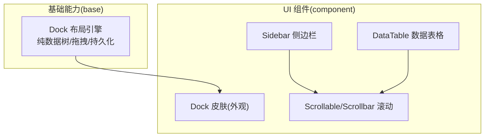
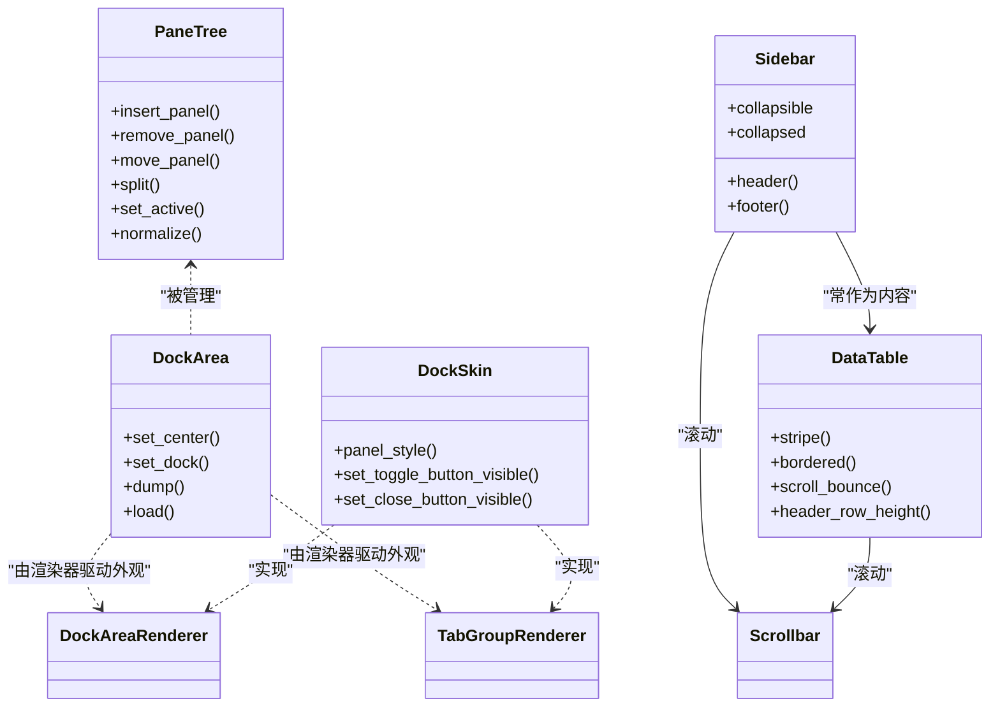
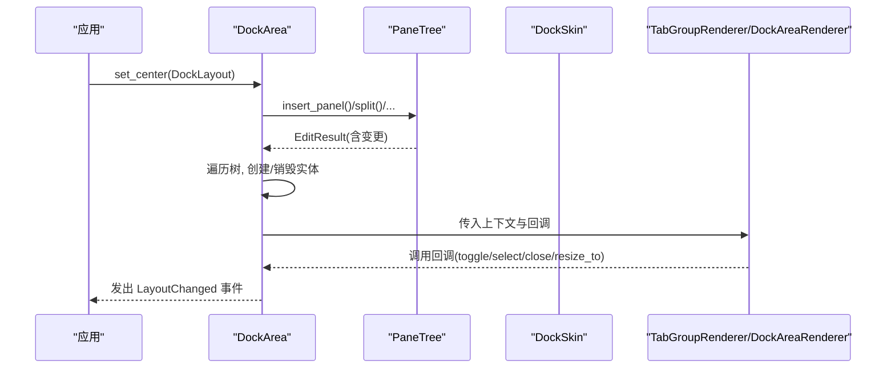
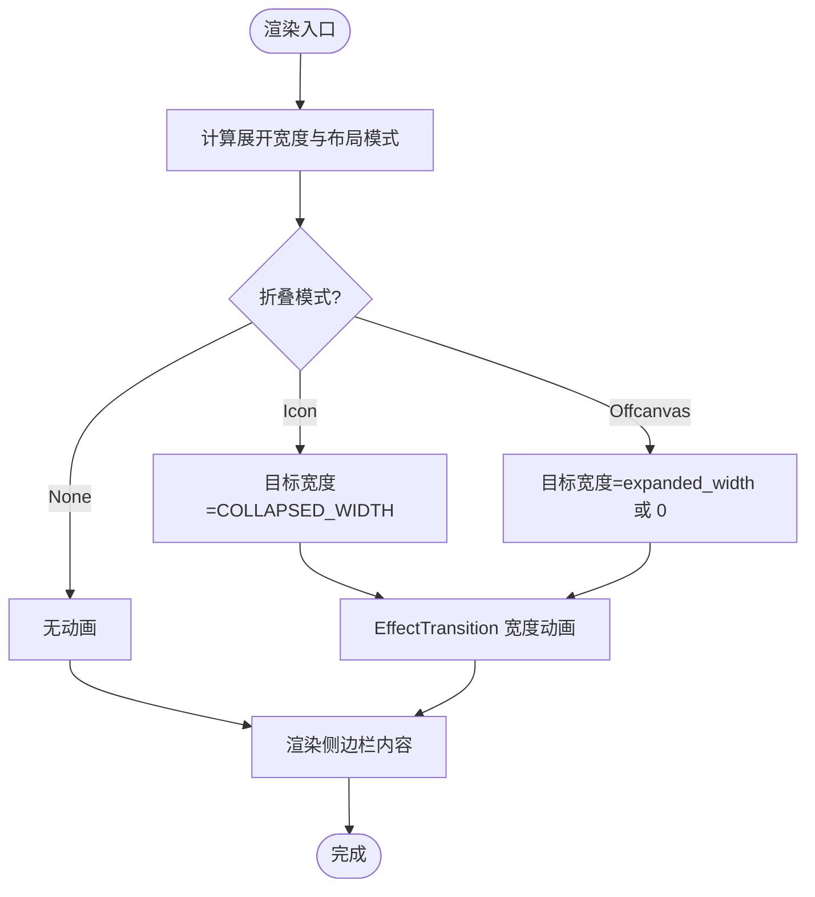
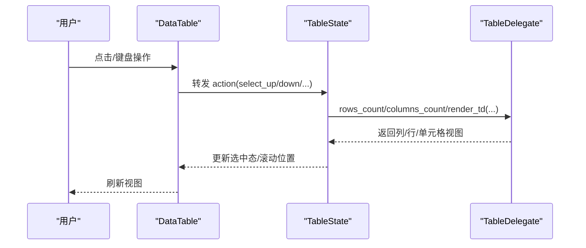
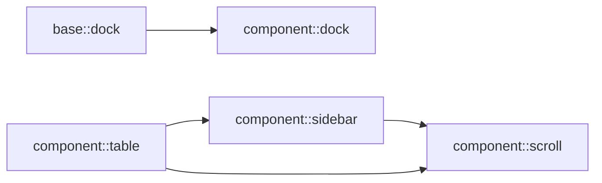

# 布局示例

<cite>
**本文引用的文件**   
- [crates/base/src/dock/mod.rs](file://crates/base/src/dock/mod.rs)
- [crates/component/src/dock/mod.rs](file://crates/component/src/dock/mod.rs)
- [crates/component/src/sidebar/mod.rs](file://crates/component/src/sidebar/mod.rs)
- [crates/component/src/table/mod.rs](file://crates/component/src/table/mod.rs)
- [crates/component/src/table/data_table.rs](file://crates/component/src/table/data_table.rs)
- [crates/component/src/scroll/mod.rs](file://crates/component/src/scroll/mod.rs)
</cite>

## 目录
1. [简介](#简介)
2. [项目结构](#项目结构)
3. [核心组件](#核心组件)
4. [架构总览](#架构总览)
5. [详细组件分析](#详细组件分析)
6. [依赖关系分析](#依赖关系分析)
7. [性能与优化](#性能与优化)
8. [故障排查指南](#故障排查指南)
9. [结论](#结论)
10. [附录：实战组合模式](#附录实战组合模式)

## 简介
本教程面向需要构建复杂桌面/跨平台界面的开发者，围绕 Dock 面板、侧边栏、表格滚动等高级布局模式，给出可复用的组合方式、响应式设计与性能优化实践。文档以仓库中已实现的组件为基础，强调“行为与外观分离”的架构思想，帮助你在不侵入底层引擎的前提下，快速拼装出专业级界面。

## 项目结构
本仓库采用多 crate 组织，与布局相关的关键代码分布如下：
- base 层提供 Dock 布局引擎（纯数据树、拖拽、持久化），不包含任何外观绘制。
- component 层提供 UI 皮肤与常用控件：Dock 皮肤、Sidebar 侧边栏、DataTable 数据表格、Scrollable 滚动能力。
- 通过 re-export 与 trait 抽象，将“布局行为”和“视觉呈现”解耦，便于替换主题或实现自定义渲染。

图表来源
- [crates/base/src/dock/mod.rs:1-203](file://crates/base/src/dock/mod.rs#L1-L203)
- [crates/component/src/dock/mod.rs:1-60](file://crates/component/src/dock/mod.rs#L1-L60)
- [crates/component/src/sidebar/mod.rs:1-30](file://crates/component/src/sidebar/mod.rs#L1-L30)
- [crates/component/src/table/mod.rs:1-19](file://crates/component/src/table/mod.rs#L1-L19)
- [crates/component/src/scroll/mod.rs:1-32](file://crates/component/src/scroll/mod.rs#L1-L32)

章节来源
- [crates/base/src/dock/mod.rs:1-203](file://crates/base/src/dock/mod.rs#L1-L203)
- [crates/component/src/dock/mod.rs:1-60](file://crates/component/src/dock/mod.rs#L1-L60)
- [crates/component/src/sidebar/mod.rs:1-30](file://crates/component/src/sidebar/mod.rs#L1-L30)
- [crates/component/src/table/mod.rs:1-19](file://crates/component/src/table/mod.rs#L1-L19)
- [crates/component/src/scroll/mod.rs:1-32](file://crates/component/src/scroll/mod.rs#L1-L32)

## 核心组件
- Dock 布局引擎（base）
  - 以 PaneTree 为唯一真相源，节点 ID 稳定，支持插入/移动/分割/激活等操作，并自动规范化保持自洽。
  - 通过 DockArea 将树映射到实体，渲染器仅负责外观；无渲染器时仍可运行逻辑。
- Dock 皮肤（component）
  - 实现基座的两类渲染器接口，提供标签页、分隔条、停靠区 chrome 等外观。
  - 暴露 DockSkin 配置项（面板样式、关闭按钮可见性、切换按钮可见性等）。
- Sidebar 侧边栏
  - 支持图标折叠、Offcanvas 滑出、固定宽度三种折叠模式，带平滑动画与内容延迟卸载。
  - 内部使用列表+弹性布局，结合 ScrollBounce 与垂直滚动条。
- DataTable 数据表格
  - 支持行列单元格选择、虚拟滚动、列宽调整、固定列、排序、右键菜单等。
  - 键盘导航完善，具备无障碍角色与属性。
- Scrollable/Scrollbar
  - 统一滚动能力与滚动条样式，供 Sidebar、DataTable 等复用。

章节来源
- [crates/base/src/dock/mod.rs:1-203](file://crates/base/src/dock/mod.rs#L1-L203)
- [crates/component/src/dock/mod.rs:1-60](file://crates/component/src/dock/mod.rs#L1-L60)
- [crates/component/src/sidebar/mod.rs:27-112](file://crates/component/src/sidebar/mod.rs#L27-L112)
- [crates/component/src/table/data_table.rs:62-177](file://crates/component/src/table/data_table.rs#L62-L177)
- [crates/component/src/scroll/mod.rs:1-32](file://crates/component/src/scroll/mod.rs#L1-L32)

## 架构总览
Dock 采用“行为与外观分离”的双层设计：base 提供布局与交互行为，component 提供皮肤与控件。Sidebar 与 DataTable 作为内容容器，通过 Scrollable 提供滚动体验。

图表来源
- [crates/base/src/dock/mod.rs:1-203](file://crates/base/src/dock/mod.rs#L1-L203)
- [crates/component/src/dock/mod.rs:1-60](file://crates/component/src/dock/mod.rs#L1-L60)
- [crates/component/src/sidebar/mod.rs:220-298](file://crates/component/src/sidebar/mod.rs#L220-L298)
- [crates/component/src/table/data_table.rs:99-177](file://crates/component/src/table/data_table.rs#L99-L177)

## 详细组件分析

### Dock 面板（行为与外观）
- 行为层（base）
  - 以 PaneTree 为纯数据模型，所有变更都经过规范化保证一致性。
  - DockArea 负责将树映射为实体，并在变更后触发布局事件。
  - 渲染器只负责外观，不处理拖拽命中测试等交互细节。
- 外观层（component）
  - DockSkin 实现渲染器接口，提供标签栏、分隔条、停靠区 chrome。
  - 通过 SkinShared 共享设置（面板样式、按钮可见性等），避免重复状态。

图表来源
- [crates/base/src/dock/mod.rs:24-47](file://crates/base/src/dock/mod.rs#L24-L47)
- [crates/component/src/dock/mod.rs:1-60](file://crates/component/src/dock/mod.rs#L1-L60)

章节来源
- [crates/base/src/dock/mod.rs:1-203](file://crates/base/src/dock/mod.rs#L1-L203)
- [crates/component/src/dock/mod.rs:1-60](file://crates/component/src/dock/mod.rs#L1-L60)

### Sidebar 侧边栏（折叠与动画）
- 折叠模式
  - Icon：收缩到图标宽度，保留布局空间。
  - Offcanvas：完全滑出，释放布局空间，内容在动画结束后卸载。
  - None：禁用折叠。
- 动画策略
  - 使用 EffectTransition 对包装器宽度做插值，内容区域按目标宽度直接渲染，避免每帧重排。
  - Offcanvas 模式下，通过延迟卸载隐藏控制元素，确保不可见时不参与焦点顺序。
- 内容滚动
  - 内部使用列表+ScrollBounce+垂直滚动条，首尾内边距根据是否折叠动态调整。

图表来源
- [crates/component/src/sidebar/mod.rs:69-112](file://crates/component/src/sidebar/mod.rs#L69-L112)
- [crates/component/src/sidebar/mod.rs:416-555](file://crates/component/src/sidebar/mod.rs#L416-L555)

章节来源
- [crates/component/src/sidebar/mod.rs:27-112](file://crates/component/src/sidebar/mod.rs#L27-L112)
- [crates/component/src/sidebar/mod.rs:388-557](file://crates/component/src/sidebar/mod.rs#L388-L557)

### DataTable 数据表格（滚动与交互）
- 功能特性
  - 行/列/单元格选择、键盘导航、虚拟滚动、列宽调整、固定列、排序、右键菜单。
  - 无障碍：当启用行或单元格选择时，role 设为 Grid，否则为 Table；提供 aria_row_count/aria_column_count。
- 滚动与边界回弹
  - 可通过 scroll_bounce 控制边界回弹效果，适配不同平台体验。
- 样式与尺寸
  - stripe/bordered/fixed_cols_border/header_row_height/size 等选项，满足多样化视觉需求。

图表来源
- [crates/component/src/table/data_table.rs:17-31](file://crates/component/src/table/data_table.rs#L17-L31)
- [crates/component/src/table/data_table.rs:203-265](file://crates/component/src/table/data_table.rs#L203-L265)

章节来源
- [crates/component/src/table/data_table.rs:62-177](file://crates/component/src/table/data_table.rs#L62-L177)
- [crates/component/src/table/data_table.rs:203-265](file://crates/component/src/table/data_table.rs#L203-L265)

### 滚动能力（Scrollable/Scrollbar）
- 提供统一的滚动条样式与轴控制，供 Sidebar、DataTable 等复用。
- 与 base 层的 AutoScroll/ScrollableMask 配合，形成一致的滚动语义。

章节来源
- [crates/component/src/scroll/mod.rs:1-32](file://crates/component/src/scroll/mod.rs#L1-L32)

## 依赖关系分析
- base::dock 是 Dock 行为的权威来源，component::dock 仅做外观封装与 re-export。
- Sidebar 与 DataTable 均依赖 Scrollable/Scrollbar 提供滚动体验。
- component::table 模块初始化键盘绑定，DataTable 通过 TableState 与 TableDelegate 协作。

图表来源
- [crates/base/src/dock/mod.rs:1-203](file://crates/base/src/dock/mod.rs#L1-L203)
- [crates/component/src/dock/mod.rs:1-60](file://crates/component/src/dock/mod.rs#L1-L60)
- [crates/component/src/sidebar/mod.rs:1-30](file://crates/component/src/sidebar/mod.rs#L1-L30)
- [crates/component/src/table/mod.rs:1-19](file://crates/component/src/table/mod.rs#L1-L19)
- [crates/component/src/scroll/mod.rs:1-32](file://crates/component/src/scroll/mod.rs#L1-L32)

章节来源
- [crates/base/src/dock/mod.rs:1-203](file://crates/base/src/dock/mod.rs#L1-L203)
- [crates/component/src/dock/mod.rs:1-60](file://crates/component/src/dock/mod.rs#L1-L60)
- [crates/component/src/sidebar/mod.rs:1-30](file://crates/component/src/sidebar/mod.rs#L1-L30)
- [crates/component/src/table/mod.rs:1-19](file://crates/component/src/table/mod.rs#L1-L19)
- [crates/component/src/scroll/mod.rs:1-32](file://crates/component/src/scroll/mod.rs#L1-L32)

## 性能与优化
- Dock 布局
  - 使用稳定的 NodeId/PanelId，稳态 reconcile 不创建/销毁实体，拖拽不影响未触碰面板。
  - normalize 幂等，持久化格式规范，比较/克隆/序列化开销低。
- Sidebar 侧边栏
  - 动画期间内容按目标宽度直接渲染，避免每帧重排；Offcanvas 模式在动画完成后卸载内容，减少 DOM/视图树体积。
  - 使用 keyed state 存储动画状态，跨重绘保持稳定。
- DataTable 数据表格
  - 虚拟滚动与按需渲染单元格，适合大数据集。
  - 合理设置 header_row_height 与 size，减少不必要的测量与重绘。
- 滚动
  - 使用统一的 Scrollbar/Scrollable，避免重复实现滚动逻辑；必要时开启 scroll_bounce 提升交互反馈。

章节来源
- [crates/base/src/dock/mod.rs:82-111](file://crates/base/src/dock/mod.rs#L82-L111)
- [crates/component/src/sidebar/mod.rs:416-555](file://crates/component/src/sidebar/mod.rs#L416-L555)
- [crates/component/src/table/data_table.rs:62-177](file://crates/component/src/table/data_table.rs#L62-L177)

## 故障排查指南
- Dock 面板
  - 若出现布局错乱，检查是否在多次编辑后触发了 normalize；确认 PanelId/NodeId 是否稳定。
  - 若渲染异常但交互正常，确认是否实现了必要的渲染器钩子；缺少钩子会回退到最小外观。
- Sidebar 侧边栏
  - 折叠后内容仍占用空间：检查是否使用了非像素宽度导致无法动画；Offcanvas 模式下确认内容卸载时机。
  - 动画卡顿：确认是否频繁修改 collapsed/expansion 状态，建议批量更新。
- DataTable 数据表格
  - 键盘导航无效：确认已调用 init 注册键绑定，且焦点落在表格上。
  - 无障碍读屏异常：检查 role 是否为 Grid/Table，以及 aria_row_count/aria_column_count 是否正确。
- 滚动
  - 滚动条不显示：检查 Scrollbar 的 visibility 配置与父容器 overflow 设置。

章节来源
- [crates/base/src/dock/mod.rs:49-81](file://crates/base/src/dock/mod.rs#L49-L81)
- [crates/component/src/sidebar/mod.rs:416-555](file://crates/component/src/sidebar/mod.rs#L416-L555)
- [crates/component/src/table/data_table.rs:17-31](file://crates/component/src/table/data_table.rs#L17-L31)
- [crates/component/src/table/data_table.rs:203-265](file://crates/component/src/table/data_table.rs#L203-L265)
- [crates/component/src/scroll/mod.rs:1-32](file://crates/component/src/scroll/mod.rs#L1-L32)

## 结论
通过 base 与 component 的职责分离，Dock/Sidebar/DataTable/Scrollable 可以灵活组合，既保证了高性能的布局与滚动，又提供了丰富的外观定制能力。建议在复杂应用中优先使用 PaneTree 描述布局，用 DockSkin 控制外观，并结合 Sidebar 与 DataTable 承载业务内容，以获得一致的用户体验与良好的可维护性。

## 附录：实战组合模式
- 典型布局：左侧 Sidebar + 中央 DockArea + 底部 Dock（终端/输出）
  - Sidebar 用于导航与分组，DockArea 承载可拖拽重组的标签页，底部 Dock 展示日志或终端。
  - 响应式：在小屏下 Sidebar 切换为 Offcanvas，Dock 默认收起，用户可手动打开。
- 表格在可滚动容器中的表现
  - 将 DataTable 放入 Scrollable 或 Sidebar 的内容区，利用其虚拟滚动与滚动条样式，保证大数据流畅浏览。
- 用户体验要点
  - 为 Dock 提供明确的打开/关闭提示（如 DockToggleEvent）。
  - 为 DataTable 提供清晰的键盘导航与焦点环，增强可访问性。
  - 为 Sidebar 提供平滑过渡与合理的初始宽度，避免布局抖动。

[本节为概念性总结，不直接分析具体文件]