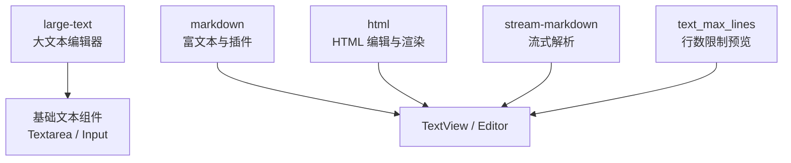
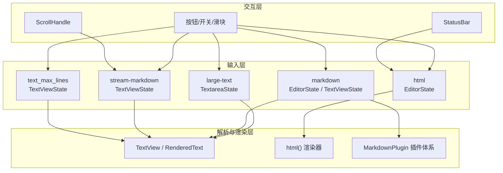
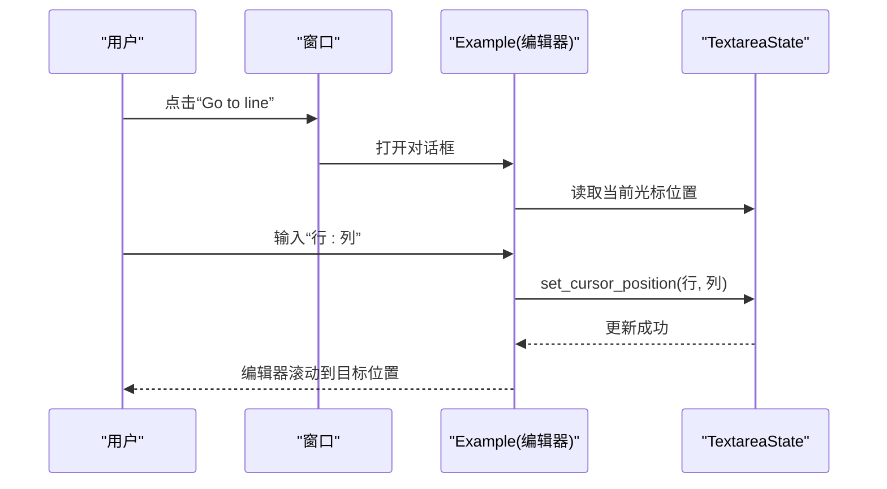
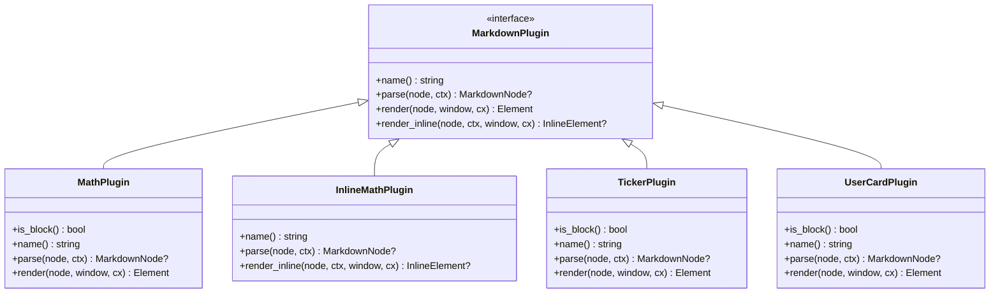
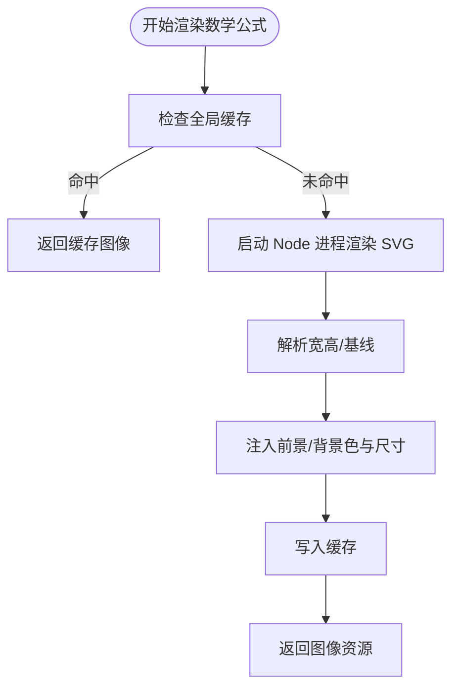
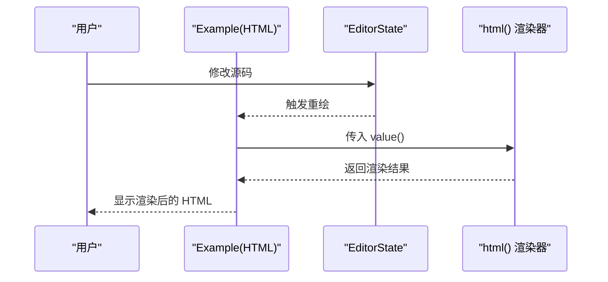
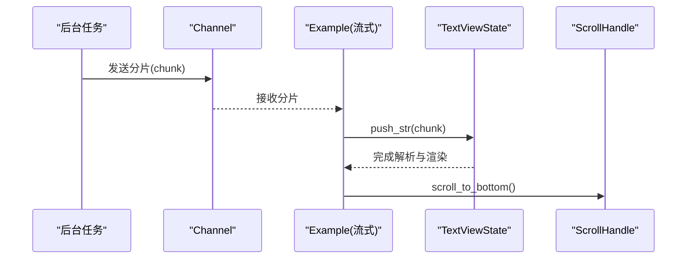
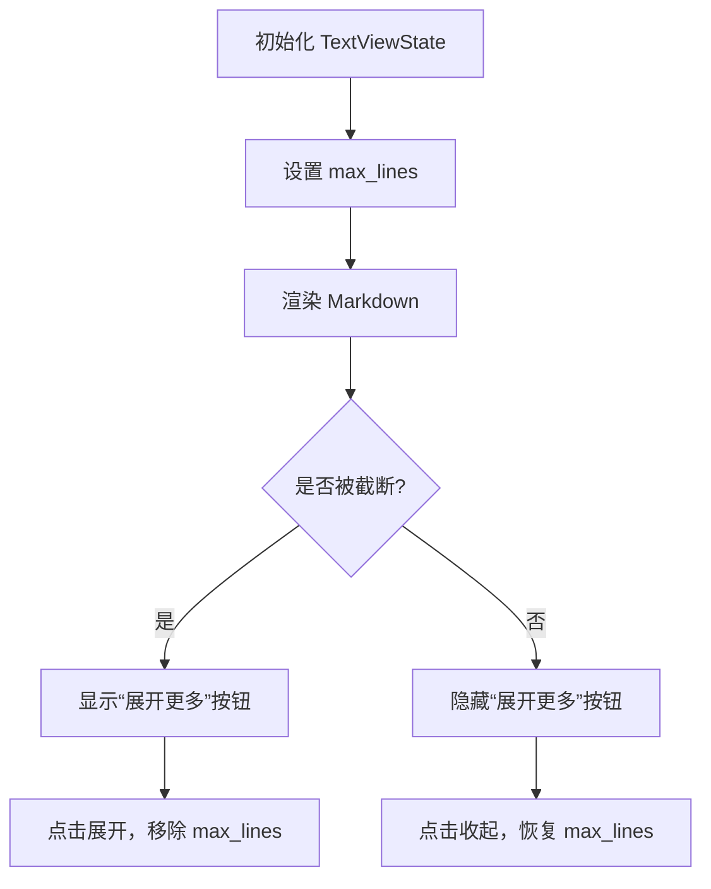
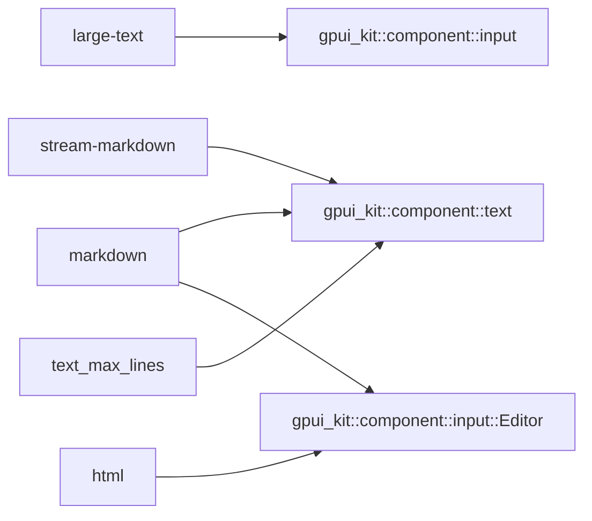
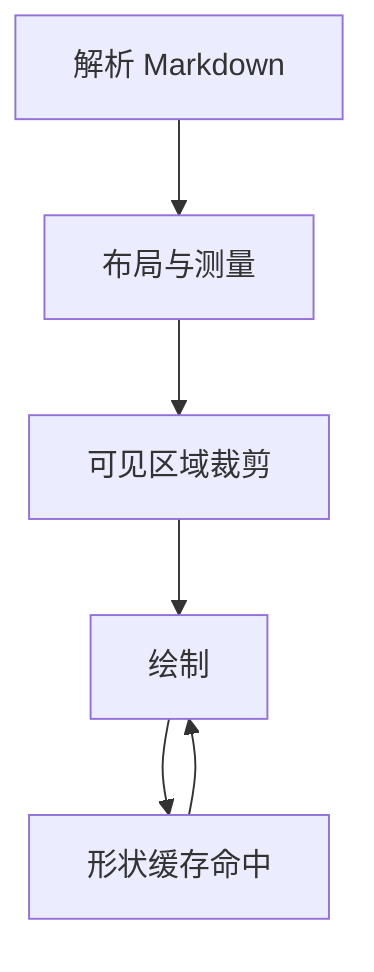

# 数据展示示例

<cite>
**本文引用的文件**   
- [examples/large-text/src/main.rs](file://examples/large-text/src/main.rs)
- [examples/markdown/src/main.rs](file://examples/markdown/src/main.rs)
- [examples/markdown/src/mention.rs](file://examples/markdown/src/mention.rs)
- [examples/html/src/main.rs](file://examples/html/src/main.rs)
- [examples/stream-markdown/src/main.rs](file://examples/stream-markdown/src/main.rs)
- [examples/text_max_lines/src/main.rs](file://examples/text_max_lines/src/main.rs)
- [crates/base/benches/text_view_scroll.rs](file://crates/base/benches/text_view_scroll.rs)
</cite>

## 目录
1. [简介](#简介)
2. [项目结构](#项目结构)
3. [核心组件](#核心组件)
4. [架构总览](#架构总览)
5. [详细组件分析](#详细组件分析)
6. [依赖关系分析](#依赖关系分析)
7. [性能与内存优化](#性能与内存优化)
8. [故障排查指南](#故障排查指南)
9. [结论](#结论)

## 简介
本文件围绕“数据展示”主题，整理并讲解仓库中与大量文本、Markdown 渲染、HTML 显示、流式 Markdown、以及行数限制预览等场景相关的示例实现。重点覆盖：
- 大文本编辑与软换行
- 富文本与自定义 Markdown 插件（数学公式、股票行情卡片、用户卡片、@提及）
- HTML 源码编辑与渲染
- 流式增量解析与滚动体验
- 按整行截断的“展开/收起”预览
- 性能基准与内存管理最佳实践

## 项目结构
以下示例均位于 examples 目录下，每个示例为一个独立的可运行应用，聚焦单一展示能力：
- large-text：大文本编辑器（Textarea），支持软换行、光标定位、跳转行号
- markdown：完整 Markdown 渲染器，包含多种自定义插件与数学公式 SVG 渲染
- html：HTML 源码编辑器 + HTML 渲染视图
- stream-markdown：流式 Markdown 增量解析与自动滚动
- text_max_lines：基于 TextView 的行数上限预览与展开交互

图表来源
- [examples/large-text/src/main.rs:1-159](file://examples/large-text/src/main.rs#L1-L159)
- [examples/markdown/src/main.rs:1-800](file://examples/markdown/src/main.rs#L1-L800)
- [examples/html/src/main.rs:1-120](file://examples/html/src/main.rs#L1-L120)
- [examples/stream-markdown/src/main.rs:1-150](file://examples/stream-markdown/src/main.rs#L1-L150)
- [examples/text_max_lines/src/main.rs:1-259](file://examples/text_max_lines/src/main.rs#L1-L259)

章节来源
- [examples/large-text/src/main.rs:1-159](file://examples/large-text/src/main.rs#L1-L159)
- [examples/markdown/src/main.rs:1-800](file://examples/markdown/src/main.rs#L1-L800)
- [examples/html/src/main.rs:1-120](file://examples/html/src/main.rs#L1-L120)
- [examples/stream-markdown/src/main.rs:1-150](file://examples/stream-markdown/src/main.rs#L1-L150)
- [examples/text_max_lines/src/main.rs:1-259](file://examples/text_max_lines/src/main.rs#L1-L259)

## 核心组件
- TextareaState / EditorState：用于承载大段文本或代码编辑状态，提供光标位置、软换行、Tab 大小等能力
- TextViewState：Markdown 解析与渲染状态，支持流式 push_str、选择格式、最大行数限制、是否被截断等
- SelectionFormat：控制复制选择内容时的输出形式（纯文本、源码、跨样式源码）
- MarkdownPlugin：扩展点，允许在 Markdown AST 中插入自定义节点并在渲染阶段替换为 UI 元素
- InlineElement / InlineRenderContext：内联渲染上下文，用于在行内嵌入复杂 UI（如图片、卡片）

章节来源
- [examples/large-text/src/main.rs:1-159](file://examples/large-text/src/main.rs#L1-L159)
- [examples/markdown/src/main.rs:1-800](file://examples/markdown/src/main.rs#L1-L800)
- [examples/html/src/main.rs:1-120](file://examples/html/src/main.rs#L1-L120)
- [examples/stream-markdown/src/main.rs:1-150](file://examples/stream-markdown/src/main.rs#L1-L150)
- [examples/text_max_lines/src/main.rs:1-259](file://examples/text_max_lines/src/main.rs#L1-L259)

## 架构总览
下图展示了各示例如何组合基础文本与 Markdown 渲染能力，形成从“输入—解析—渲染—交互”的闭环。

图表来源
- [examples/large-text/src/main.rs:1-159](file://examples/large-text/src/main.rs#L1-L159)
- [examples/markdown/src/main.rs:1-800](file://examples/markdown/src/main.rs#L1-L800)
- [examples/html/src/main.rs:1-120](file://examples/html/src/main.rs#L1-L120)
- [examples/stream-markdown/src/main.rs:1-150](file://examples/stream-markdown/src/main.rs#L1-L150)
- [examples/text_max_lines/src/main.rs:1-259](file://examples/text_max_lines/src/main.rs#L1-L259)

## 详细组件分析

### 大文本处理（large-text）
- 目标：演示万行级文本的编辑与浏览，包括软换行切换、光标行列显示、跳转到指定行列
- 关键点：
  - 使用 TextareaState 初始化默认值与 Tab 设置
  - 通过订阅事件触发重绘
  - 打开对话框获取用户输入，解析“行:列”，调用 set_cursor_position 定位
  - 软换行通过 state.set_soft_wrap 动态切换

图表来源
- [examples/large-text/src/main.rs:51-97](file://examples/large-text/src/main.rs#L51-L97)

章节来源
- [examples/large-text/src/main.rs:1-159](file://examples/large-text/src/main.rs#L1-L159)

### Markdown 渲染与插件（markdown）
- 目标：展示完整的 Markdown 渲染能力，包括数学公式、股票行情卡片、用户卡片、@提及等
- 关键能力：
  - 自定义 MarkdownPlugin：MathPlugin、TickerPlugin、UserCardPlugin、InlineMathPlugin
  - 数学公式通过 Node.js + MathJax 生成 SVG，并进行尺寸与背景注入
  - 内联数学公式缓存与异步渲染，避免布局阶段阻塞
  - @提及插件将特定链接转换为可交互的用户信息浮层

图表来源
- [examples/markdown/src/main.rs:192-239](file://examples/markdown/src/main.rs#L192-L239)
- [examples/markdown/src/main.rs:259-368](file://examples/markdown/src/main.rs#L259-L368)
- [examples/markdown/src/main.rs:389-508](file://examples/markdown/src/main.rs#L389-L508)
- [examples/markdown/src/main.rs:510-606](file://examples/markdown/src/main.rs#L510-L606)

图表来源
- [examples/markdown/src/main.rs:638-735](file://examples/markdown/src/main.rs#L638-L735)

章节来源
- [examples/markdown/src/main.rs:1-800](file://examples/markdown/src/main.rs#L1-L800)
- [examples/markdown/src/mention.rs:1-147](file://examples/markdown/src/mention.rs#L1-L147)

### HTML 显示（html）
- 目标：左侧编辑 HTML 源码，右侧实时渲染；底部状态栏切换复制选择内容的格式
- 关键点：
  - 使用 EditorState 加载示例 HTML 并高亮语言
  - 使用 html() 渲染器将字符串渲染为 HTML 片段
  - 通过 SelectionFormat 切换 Plain/Source/SourceAcrossStyles

图表来源
- [examples/html/src/main.rs:23-48](file://examples/html/src/main.rs#L23-L48)
- [examples/html/src/main.rs:55-107](file://examples/html/src/main.rs#L55-L107)

章节来源
- [examples/html/src/main.rs:1-120](file://examples/html/src/main.rs#L1-L120)

### 流式 Markdown（stream-markdown）
- 目标：模拟流式增量解析，逐步追加 Markdown 文本并自动滚动到底部
- 关键点：
  - 使用 smol::channel 发送分片数据
  - TextViewState.push_str 增量更新，自动重新解析与渲染
  - ScrollHandle.scroll_to_bottom 保持可见区域在末尾

图表来源
- [examples/stream-markdown/src/main.rs:24-57](file://examples/stream-markdown/src/main.rs#L24-L57)
- [examples/stream-markdown/src/main.rs:67-86](file://examples/stream-markdown/src/main.rs#L67-L86)
- [examples/stream-markdown/src/main.rs:89-133](file://examples/stream-markdown/src/main.rs#L89-L133)

章节来源
- [examples/stream-markdown/src/main.rs:1-150](file://examples/stream-markdown/src/main.rs#L1-L150)

### 行数限制预览（text_max_lines）
- 目标：将 Markdown 渲染结果限制为若干整行，并提供“展开/收起”交互
- 关键点：
  - TextView.max_lines 限制渲染行数
  - is_clamped 判断上一帧是否发生截断，决定是否显示“展开更多”
  - Slider 动态调整预算行数

图表来源
- [examples/text_max_lines/src/main.rs:72-103](file://examples/text_max_lines/src/main.rs#L72-L103)
- [examples/text_max_lines/src/main.rs:124-232](file://examples/text_max_lines/src/main.rs#L124-L232)

章节来源
- [examples/text_max_lines/src/main.rs:1-259](file://examples/text_max_lines/src/main.rs#L1-L259)

## 依赖关系分析
- 示例之间相互独立，但共享基础库能力：
  - large-text 依赖 TextareaState 与 InputState
  - markdown 依赖 TextViewState、EditorState、MarkdownPlugin 体系
  - html 依赖 EditorState 与 html() 渲染器
  - stream-markdown 依赖 TextViewState 与通道机制
  - text_max_lines 依赖 TextViewState 与 is_clamped 行为
- 外部依赖：
  - markdown 示例通过 Node.js 调用 MathJax 生成 SVG
  - text_max_lines 示例需要 HTTP 客户端以加载远程图片

图表来源
- [examples/large-text/src/main.rs:1-159](file://examples/large-text/src/main.rs#L1-L159)
- [examples/markdown/src/main.rs:1-800](file://examples/markdown/src/main.rs#L1-L800)
- [examples/html/src/main.rs:1-120](file://examples/html/src/main.rs#L1-L120)
- [examples/stream-markdown/src/main.rs:1-150](file://examples/stream-markdown/src/main.rs#L1-L150)
- [examples/text_max_lines/src/main.rs:1-259](file://examples/text_max_lines/src/main.rs#L1-L259)

章节来源
- [examples/large-text/src/main.rs:1-159](file://examples/large-text/src/main.rs#L1-L159)
- [examples/markdown/src/main.rs:1-800](file://examples/markdown/src/main.rs#L1-L800)
- [examples/html/src/main.rs:1-120](file://examples/html/src/main.rs#L1-L120)
- [examples/stream-markdown/src/main.rs:1-150](file://examples/stream-markdown/src/main.rs#L1-L150)
- [examples/text_max_lines/src/main.rs:1-259](file://examples/text_max_lines/src/main.rs#L1-L259)

## 性能与内存优化
- 文本布局与测量
  - 长文档滚动时，每帧仅对可见段落进行排版与绘制，形状缓存复用已测过的字形
  - 基准测试验证了连续滚动场景下的性能表现
- 数学公式渲染
  - 全局缓存 SVG 结果，避免重复计算
  - 内联公式采用异步渲染与占位回退，减少布局阻塞
  - 按需注入背景与透明度，降低不必要的重绘
- 流式解析
  - 增量 push_str 配合自动重排，避免一次性全量解析
  - 滚动句柄保证新内容进入视口后自动滚动
- 行数限制预览
  - 通过 max_lines 限制渲染范围，减少大图与长列表的开销
  - is_clamped 驱动 UI 状态，避免额外测量

图表来源
- [crates/base/benches/text_view_scroll.rs:1-132](file://crates/base/benches/text_view_scroll.rs#L1-L132)
- [examples/markdown/src/main.rs:638-735](file://examples/markdown/src/main.rs#L638-L735)
- [examples/stream-markdown/src/main.rs:24-57](file://examples/stream-markdown/src/main.rs#L24-L57)
- [examples/text_max_lines/src/main.rs:124-232](file://examples/text_max_lines/src/main.rs#L124-L232)

章节来源
- [crates/base/benches/text_view_scroll.rs:1-132](file://crates/base/benches/text_view_scroll.rs#L1-L132)
- [examples/markdown/src/main.rs:638-735](file://examples/markdown/src/main.rs#L638-L735)
- [examples/stream-markdown/src/main.rs:24-57](file://examples/stream-markdown/src/main.rs#L24-L57)
- [examples/text_max_lines/src/main.rs:124-232](file://examples/text_max_lines/src/main.rs#L124-L232)

## 故障排查指南
- 数学公式无法渲染
  - 检查 Node.js 环境是否能执行 MathJax 脚本
  - 确认环境变量 GPUI_MATHJAX_ROOT 指向正确的 mathjax-full 路径
  - 若失败，会回退为文本显示
- 远程图片不加载
  - 确保设置了 HTTP 客户端（例如 reqwest_client）
  - 检查网络与代理配置
- 流式 Markdown 不滚动
  - 确认 ScrollHandle 正确绑定到容器
  - 检查 channel 是否持续推送分片数据
- HTML 渲染异常
  - 检查输入是否为合法 HTML
  - 切换 SelectionFormat 观察复制行为是否符合预期

章节来源
- [examples/markdown/src/main.rs:754-766](file://examples/markdown/src/main.rs#L754-L766)
- [examples/text_max_lines/src/main.rs:235-257](file://examples/text_max_lines/src/main.rs#L235-L257)
- [examples/stream-markdown/src/main.rs:89-133](file://examples/stream-markdown/src/main.rs#L89-L133)
- [examples/html/src/main.rs:85-107](file://examples/html/src/main.rs#L85-L107)

## 结论
本组示例覆盖了数据展示的核心场景：大文本编辑、富文本与插件化 Markdown、HTML 渲染、流式增量解析与行数限制预览。通过合理的缓存策略、异步渲染、可见区域裁剪与增量更新，能够在保证用户体验的同时有效控制性能与内存占用。建议在实际项目中：
- 优先使用 TextViewState 的流式 API 处理长文档
- 对昂贵渲染（如数学公式、图片）实施缓存与懒加载
- 使用 max_lines 控制预览体积，结合 is_clamped 驱动交互
- 为 HTML 与 Markdown 设置合适的选择格式，提升可用性