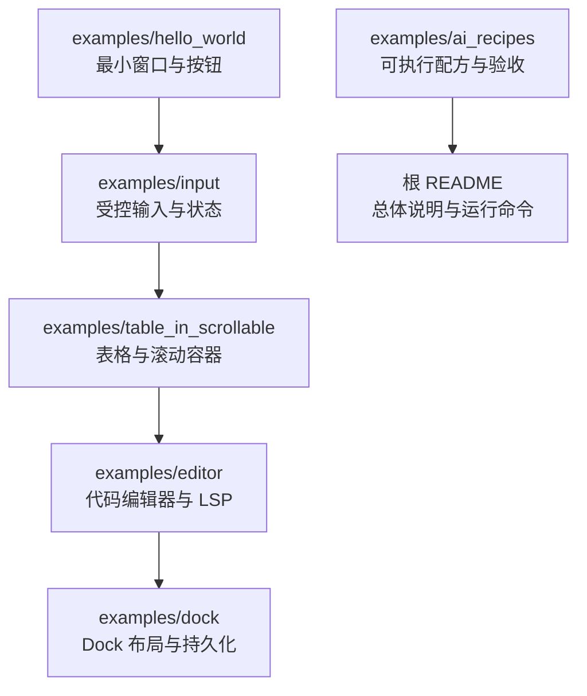
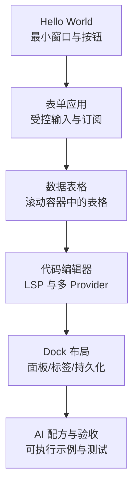
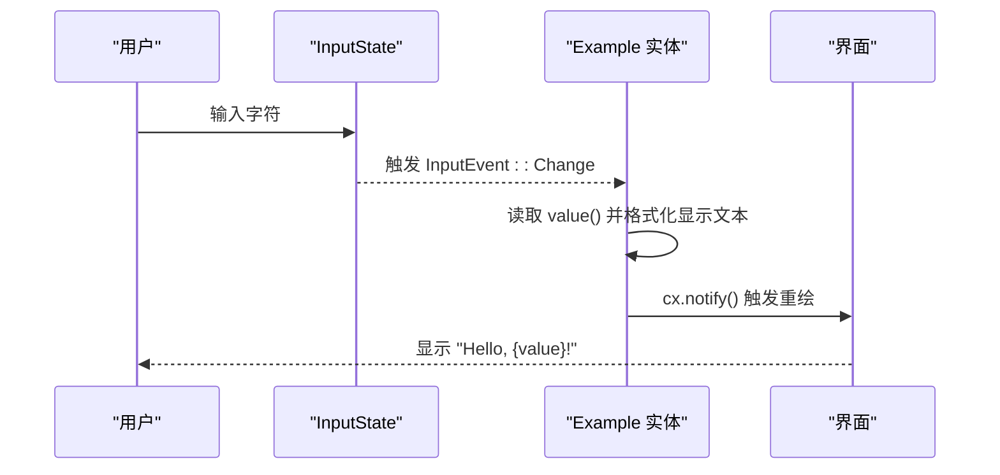
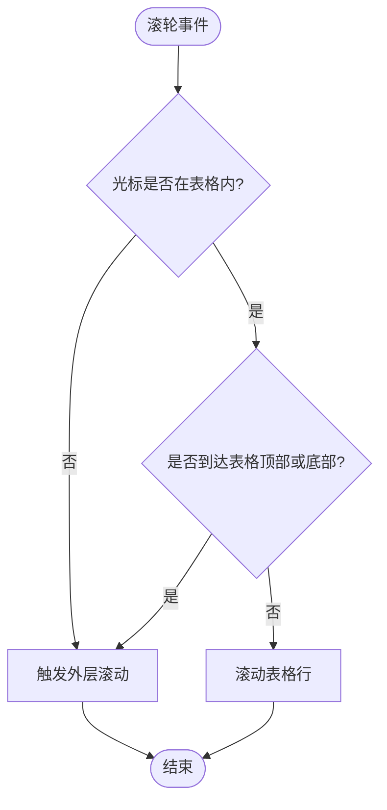
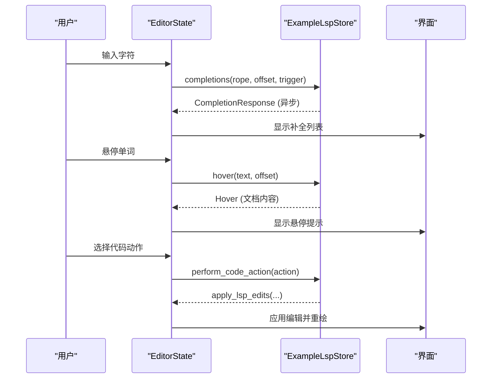
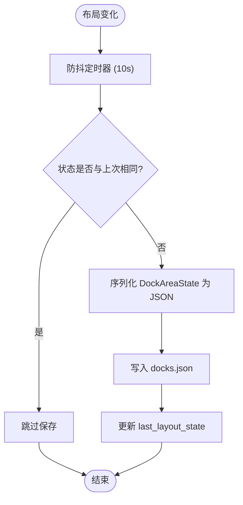
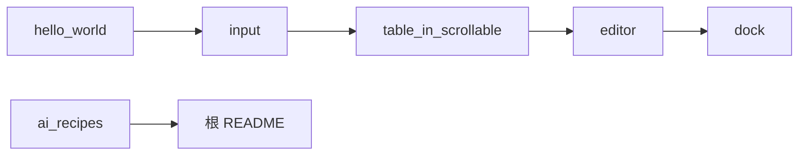

# 示例与教程

<cite>
**本文引用的文件**   
- [README.md](file://README.md)
- [examples/hello_world/src/main.rs](file://examples/hello_world/src/main.rs)
- [examples/input/src/main.rs](file://examples/input/src/main.rs)
- [examples/table_in_scrollable/src/main.rs](file://examples/table_in_scrollable/src/main.rs)
- [examples/editor/src/main.rs](file://examples/editor/src/main.rs)
- [examples/dock/src/main.rs](file://examples/dock/src/main.rs)
- [examples/ai_recipes/README.md](file://examples/ai_recipes/README.md)
- [examples/ai_recipes/src/main.rs](file://examples/ai_recipes/src/main.rs)
</cite>

## 目录
1. [引言](#引言)
2. [项目结构](#项目结构)
3. [核心组件](#核心组件)
4. [架构总览](#架构总览)
5. [详细组件分析](#详细组件分析)
6. [依赖关系分析](#依赖关系分析)
7. [性能注意事项](#性能注意事项)
8. [故障排除指南](#故障排除指南)
9. [结论](#结论)
10. [附录：渐进式学习路径与验收清单](#附录渐进式学习路径与验收清单)

## 引言
本教程面向希望从零开始使用 GPUI Kit 构建桌面应用的开发者，提供从“Hello World”到表单、数据表格、代码编辑器、Dock 布局的完整学习路径。每个示例都包含运行方式、关键实现说明、状态管理最佳实践和性能优化建议，并附带 AI 辅助开发的工作流程与验收检查。

GPUI Kit 是一个基于 Rust 与 GPUI 的高性能桌面应用框架，提供 75+ 文档化组件、WebAssembly 支持、无障碍访问、UI 集成测试、可序列化 Dock 布局、虚拟列表、代码编辑器等能力。仓库根 README 提供了整体特性、三层架构（gpui-component / gpui-base / gpui-shell）、基本用法、图标配置、AI Skills 安装以及示例运行命令。

**章节来源**
- [README.md:11-50](file://README.md#L11-L50)
- [README.md:52-106](file://README.md#L52-L106)
- [README.md:118-186](file://README.md#L118-L186)
- [README.md:196-249](file://README.md#L196-L249)

## 项目结构
示例位于 `examples` 目录下，每个示例都是一个独立的 Cargo crate，便于单独编译、运行和测试。本教程重点覆盖以下示例：
- Hello World：最小窗口与按钮交互
- 表单应用：受控输入、订阅事件、状态同步
- 数据表格：在滚动容器中嵌套 DataTable，处理滚动穿透
- 代码编辑器：语言高亮、补全、悬停、定义跳转、代码动作
- Dock 布局：面板、分割区、标签页、侧边栏、底部栏、状态持久化

**图表来源**
- [examples/hello_world/src/main.rs:1-35](file://examples/hello_world/src/main.rs#L1-L35)
- [examples/input/src/main.rs:1-74](file://examples/input/src/main.rs#L1-L74)
- [examples/table_in_scrollable/src/main.rs:1-125](file://examples/table_in_scrollable/src/main.rs#L1-L125)
- [examples/editor/src/main.rs:1-800](file://examples/editor/src/main.rs#L1-L800)
- [examples/dock/src/main.rs:1-609](file://examples/dock/src/main.rs#L1-L609)
- [examples/ai_recipes/README.md:1-41](file://examples/ai_recipes/README.md#L1-L41)
- [README.md:219-249](file://README.md#L219-L249)

**章节来源**
- [README.md:219-249](file://README.md#L219-L249)

## 核心组件
本节概述各示例使用的核心组件与模式：
- 窗口与初始化：通过 `application().run(...)` 启动应用，调用 `init(cx)` 注册组件层，再用 `open_window(...)` 打开窗口并挂载 Root。
- 受控状态：使用 `Entity<InputState>` 作为受控输入的状态源，通过 `cx.subscribe_in` 订阅 `InputEvent::Change`，将值同步到显示文本。
- 数据表格：使用 `DataTable` + `TableDelegate` 定义列与行渲染；当表格嵌套在滚动页面中时，需让表格拥有独立滚动条，并在边缘处透传给外层滚动。
- 代码编辑器：使用 `EditorState` 配合 `LanguageRegistry`、`CompletionProvider`、`HoverProvider`、`DefinitionProvider`、`CodeActionProvider`、`DocumentColorProvider` 实现语法高亮、补全、悬停、跳转、代码动作与颜色信息。
- Dock 布局：使用 `DockArea`、`DockLayout`、`DockSkin` 构建中心区域与左/右/下 Dock，支持面板拖拽、标签页、缩放、折叠、可见性切换，并通过 JSON 持久化布局。

**章节来源**
- [examples/hello_world/src/main.rs:24-34](file://examples/hello_world/src/main.rs#L24-L34)
- [examples/input/src/main.rs:8-40](file://examples/input/src/main.rs#L8-L40)
- [examples/table_in_scrollable/src/main.rs:15-62](file://examples/table_in_scrollable/src/main.rs#L15-L62)
- [examples/editor/src/main.rs:71-138](file://examples/editor/src/main.rs#L71-L138)
- [examples/dock/src/main.rs:56-63](file://examples/dock/src/main.rs#L56-L63)

## 架构总览
下图展示示例之间的演进关系与共享概念：从最小窗口到复杂布局，逐步引入状态管理、异步 LSP、Dock 布局与持久化。

[无需图表来源：该图为概念性演进示意，不直接映射具体源码结构]

## 详细组件分析

### Hello World 示例
目标：快速创建一个窗口，显示欢迎文本和一个主按钮，点击后打印日志。

关键点：
- 使用 `gpui_kit::application().run(...)` 启动应用。
- 在回调中调用 `gpui_kit::init(cx)` 初始化组件层。
- 使用 `gpui_kit::open_window(...)` 打开窗口并挂载自定义视图。
- 使用 `Button::new(...).primary().label(...).on_click(...)` 创建主按钮并绑定点击事件。

运行方式：
- 在项目根目录执行：`cargo run -p hello_world`

常见错误：
- 忘记调用 `gpui_kit::init(cx)` 导致组件功能不可用。
- 未正确导入 `gpui_kit::component::*` 或按钮相关类型。

最佳实践：
- 保持 main 函数简洁，业务逻辑放在视图结构中。
- 使用语义化的元素组合（如 `div().v_flex().gap_2().size_full()`）组织布局。

**章节来源**
- [examples/hello_world/src/main.rs:1-35](file://examples/hello_world/src/main.rs#L1-L35)
- [README.md:147-186](file://README.md#L147-L186)

### 表单应用示例
目标：演示受控输入、事件订阅、状态同步与内存安全。

关键点：
- 使用 `Entity<InputState>` 持有受控输入状态。
- 通过 `cx.subscribe_in(&input_state, window, ...)` 订阅 `InputEvent::Change`，更新显示文本。
- 保存 `_subscriptions` 以避免订阅被提前释放造成内存泄漏。
- 使用 `SharedString` 存储显示文本，避免频繁分配。

运行方式：
- 在项目根目录执行：`cargo run -p input`

状态管理要点：
- 受控组件：所有输入由外部状态驱动，组件只负责渲染与派发事件。
- 订阅生命周期：订阅必须与宿主实体同生命周期，确保销毁时自动释放。
- 响应式更新：在回调中调用 `cx.notify()` 触发重绘。

性能优化：
- 使用 `SharedString` 减少字符串拷贝。
- 仅在必要时更新显示文本，避免无意义重绘。

**章节来源**
- [examples/input/src/main.rs:1-74](file://examples/input/src/main.rs#L1-L74)

#### 状态订阅流程图

**图表来源**
- [examples/input/src/main.rs:20-40](file://examples/input/src/main.rs#L20-L40)

### 数据表格示例
目标：在可滚动页面中嵌入 DataTable，正确处理滚动穿透与表格自身滚动。

关键点：
- 使用 `TableDelegate` 定义列数、行数与单元格渲染。
- 使用 `DataTable::new(&self.table).stripe(true).bordered(true)` 渲染表格。
- 外层使用 `div().overflow_y_scrollbar()` 包裹内容，表格内部有独立滚动条。
- 鼠标滚轮在表格内优先滚动表格，到达边缘后透传到外层。

运行方式：
- 在项目根目录执行：`cargo run -p table_in_scrollable`

常见问题：
- 表格与外层滚动冲突：确保表格高度固定且启用自身滚动条。
- 列宽与内容溢出：为每列设置合适宽度或使用自适应策略。

性能优化：
- 使用虚拟列表或分页加载大数据集。
- 避免在 `render_td` 中进行昂贵计算，预计算或缓存结果。

**章节来源**
- [examples/table_in_scrollable/src/main.rs:1-125](file://examples/table_in_scrollable/src/main.rs#L1-L125)

#### 表格滚动决策流程

**图表来源**
- [examples/table_in_scrollable/src/main.rs:1-7](file://examples/table_in_scrollable/src/main.rs#L1-L7)
- [examples/table_in_scrollable/src/main.rs:90-105](file://examples/table_in_scrollable/src/main.rs#L90-L105)

### 代码编辑器示例
目标：构建一个具备语法高亮、补全、悬停、定义跳转、代码动作与颜色信息的代码编辑器。

关键点：
- 使用 `EditorState::new(...)` 创建编辑器实例，配置语言、缩进、软换行、默认文本等。
- 注册 `LanguageRegistry` 以支持多种语言（包括外部语言如 navi）。
- 实现 `CompletionProvider`、`HoverProvider`、`DefinitionProvider`、`CodeActionProvider`、`DocumentColorProvider` 以扩展编辑器能力。
- 使用 `Rc` 与 `Arc` 共享 LSP Store，避免重复创建。
- 使用 `window.defer(...)` 在启动时聚焦编辑器，使快捷键能冒泡到编辑器。

运行方式：
- 在项目根目录执行：`cargo run -p example-editor`

性能优化：
- 异步补全：使用 `cx.background_spawn` 模拟延迟补全，避免阻塞 UI。
- 增量更新：仅对变更区域进行诊断与高亮。
- 缓存结果：对补全项、诊断结果进行缓存，避免重复计算。

**章节来源**
- [examples/editor/src/main.rs:1-800](file://examples/editor/src/main.rs#L1-L800)

#### 编辑器 LSP 交互序列图

**图表来源**
- [examples/editor/src/main.rs:160-261](file://examples/editor/src/main.rs#L160-L261)
- [examples/editor/src/main.rs:318-351](file://examples/editor/src/main.rs#L318-L351)
- [examples/editor/src/main.rs:430-621](file://examples/editor/src/main.rs#L430-L621)

### Dock 布局示例
目标：构建一个可持久化的 Dock 布局，支持中心区域、左右下 Dock、面板添加、可见性切换、缩放与折叠。

关键点：
- 使用 `DockSkin::dock_area(...)` 创建 DockArea 与皮肤。
- 使用 `DockLayout::tabs()` 与 `DockLayout::v_split()` 构建标签页与垂直分割。
- 使用 `panel_handle(StoryContainer::panel::<...>(window, cx))` 插入面板。
- 监听 `DockEvent::LayoutChanged` 异步保存布局到 JSON 文件。
- 应用退出时再次保存布局，确保状态不丢失。
- 支持动态添加面板、切换 Dock 可见性、隐藏/显示特定面板。

运行方式：
- 在项目根目录执行：`cargo run -p example-dock`

性能优化：
- 使用 `cx.spawn_in` 与定时器延迟保存，避免频繁 I/O。
- 比较布局状态后再写入，减少不必要的磁盘操作。
- 使用 `WeakEntity` 避免循环引用。

**章节来源**
- [examples/dock/src/main.rs:1-609](file://examples/dock/src/main.rs#L1-L609)

#### Dock 布局状态持久化流程

**图表来源**
- [examples/dock/src/main.rs:184-217](file://examples/dock/src/main.rs#L184-L217)

## 依赖关系分析
各示例之间的依赖关系如下：
- Hello World 是最小依赖示例，仅依赖基础组件。
- 表单应用依赖输入组件与状态管理。
- 数据表格依赖表格组件与滚动容器。
- 代码编辑器依赖语言注册、LSP Provider 与编辑器状态。
- Dock 布局依赖 Dock 组件、面板容器与持久化逻辑。

**图表来源**
- [examples/hello_world/src/main.rs:1-35](file://examples/hello_world/src/main.rs#L1-L35)
- [examples/input/src/main.rs:1-74](file://examples/input/src/main.rs#L1-L74)
- [examples/table_in_scrollable/src/main.rs:1-125](file://examples/table_in_scrollable/src/main.rs#L1-L125)
- [examples/editor/src/main.rs:1-800](file://examples/editor/src/main.rs#L1-L800)
- [examples/dock/src/main.rs:1-609](file://examples/dock/src/main.rs#L1-L609)
- [examples/ai_recipes/README.md:1-41](file://examples/ai_recipes/README.md#L1-L41)
- [README.md:219-249](file://README.md#L219-L249)

**章节来源**
- [README.md:219-249](file://README.md#L219-L249)

## 性能注意事项
- 虚拟列表与表格：对于大数据集，优先使用虚拟列表或分页加载，避免一次性渲染所有行。
- 异步操作：使用 `cx.background_spawn` 或 `Task` 执行耗时任务，避免阻塞 UI 线程。
- 状态更新：仅在必要时调用 `cx.notify()`，避免频繁重绘。
- 资源管理：使用 `Entity` 与 `Subscription` 管理生命周期，避免内存泄漏。
- I/O 操作：使用防抖与批量写入，减少磁盘 I/O 频率。

[无需章节来源：本节为通用性能建议，不直接分析具体文件]

## 故障排除指南
- 组件未初始化：确保在 `main` 中调用 `gpui_kit::init(cx)`。
- 订阅泄漏：确保 `_subscriptions` 字段持有订阅，避免提前释放。
- 表格滚动异常：检查表格高度与外层滚动容器的配置，确保滚动穿透正确。
- 编辑器无响应：检查 LSP Provider 是否正确注册，异步任务是否完成。
- Dock 布局未保存：检查 `DockEvent::LayoutChanged` 是否监听，JSON 写入是否成功。

**章节来源**
- [examples/hello_world/src/main.rs:24-34](file://examples/hello_world/src/main.rs#L24-L34)
- [examples/input/src/main.rs:12-17](file://examples/input/src/main.rs#L12-L17)
- [examples/table_in_scrollable/src/main.rs:1-7](file://examples/table_in_scrollable/src/main.rs#L1-L7)
- [examples/editor/src/main.rs:71-138](file://examples/editor/src/main.rs#L71-L138)
- [examples/dock/src/main.rs:86-106](file://examples/dock/src/main.rs#L86-L106)

## 结论
本教程通过五个渐进式示例，展示了如何使用 GPUI Kit 构建从简单到复杂的桌面应用。每个示例都强调了状态管理、性能优化与最佳实践。结合 AI 辅助开发与验收检查，开发者可以快速上手并构建高质量的应用。

[无需章节来源：本节为总结性内容，不直接分析具体文件]

## 附录：渐进式学习路径与验收清单

### 学习路径
1. **Hello World**：理解窗口与按钮交互。
2. **表单应用**：掌握受控输入与状态订阅。
3. **数据表格**：学习表格与滚动容器的协作。
4. **代码编辑器**：集成 LSP 与多 Provider。
5. **Dock 布局**：构建可持久化的复杂布局。

### 运行指导
- 在项目根目录执行对应命令：
  - `cargo run -p hello_world`
  - `cargo run -p input`
  - `cargo run -p table_in_scrollable`
  - `cargo run -p example-editor`
  - `cargo run -p example-dock`

### AI 辅助开发工作流程
- 使用 `examples/ai_recipes` 作为可执行配方，验证公共所有权模式、状态保留、订阅管理与 Root 安装。
- 运行验收命令：
  - `cargo run -p gpui-kit-recipes`
  - `cargo test -p gpui-kit-recipes`
  - `script/check-ai docs`

### 验收检查清单
- 组件初始化是否正确。
- 状态订阅是否存活且无泄漏。
- 表格滚动是否正常。
- 编辑器 LSP 功能是否可用。
- Dock 布局是否可持久化。

**章节来源**
- [examples/ai_recipes/README.md:1-41](file://examples/ai_recipes/README.md#L1-L41)
- [examples/ai_recipes/src/main.rs:1-4](file://examples/ai_recipes/src/main.rs#L1-L4)
- [README.md:219-249](file://README.md#L219-L249)