# 高级示例

<cite>
**本文引用的文件**   
- [README.md](file://README.md)
- [examples/editor/src/main.rs](file://examples/editor/src/main.rs)
- [examples/speech/src/main.rs](file://examples/speech/src/main.rs)
- [examples/speech/src/demo.rs](file://examples/speech/src/demo.rs)
- [examples/system_monitor/src/main.rs](file://examples/system_monitor/src/main.rs)
- [examples/fps_monitor/src/main.rs](file://examples/fps_monitor/src/main.rs)
- [examples/tig/src/main.rs](file://examples/tig/src/main.rs)
- [examples/tig/src/app.rs](file://examples/tig/src/app.rs)
- [examples/tig/src/repository.rs](file://examples/tig/src/repository.rs)
</cite>

## 目录
1. [引言](#引言)
2. [项目结构](#项目结构)
3. [核心组件](#核心组件)
4. [架构总览](#架构总览)
5. [详细组件分析](#详细组件分析)
6. [依赖关系分析](#依赖关系分析)
7. [性能与监控](#性能与监控)
8. [故障排查指南](#故障排查指南)
9. [结论](#结论)
10. [附录：企业级实践清单](#附录企业级实践清单)

## 引言
本文件围绕仓库中的“高级示例”展开，聚焦四类复杂应用场景：代码编辑器、语音识别、系统监控、Git 客户端。这些示例共同展示了异步编程、系统集成、性能监控、可观测性与交互设计等企业级特性。同时，文档将提炼出可复用的架构模式与开发经验，帮助读者在真实产品中构建高性能、可扩展的桌面应用。

## 项目结构
仓库采用多 crate 组织方式，示例集中在 `examples` 目录下，每个示例是一个独立的可运行 crate。与高级示例直接相关的目录和文件如下：
- 代码编辑器：`examples/editor`
- 语音识别：`examples/speech`
- 系统监控：`examples/system_monitor`
- FPS 监控（性能可视化）：`examples/fps_monitor`
- Git 客户端：`examples/tig`

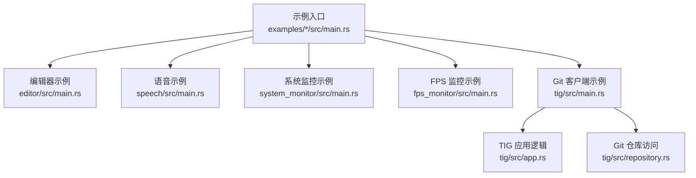

**图示来源**
- [examples/editor/src/main.rs:1-35](file://examples/editor/src/main.rs#L1-L35)
- [examples/speech/src/main.rs:1-40](file://examples/speech/src/main.rs#L1-L40)
- [examples/system_monitor/src/main.rs:1-20](file://examples/system_monitor/src/main.rs#L1-L20)
- [examples/fps_monitor/src/main.rs:1-20](file://examples/fps_monitor/src/main.rs#L1-L20)
- [examples/tig/src/main.rs:1-20](file://examples/tig/src/main.rs#L1-L20)
- [examples/tig/src/app.rs:1-35](file://examples/tig/src/app.rs#L1-L35)
- [examples/tig/src/repository.rs:1-30](file://examples/tig/src/repository.rs#L1-L30)

**章节来源**
- [README.md:219-248](file://README.md#L219-L248)

## 核心组件
本节从四个示例中抽取关键能力，并说明它们如何体现异步、集成与监控等高级特性。

- 代码编辑器
  - 基于 `EditorState` 与 LSP 提供者接口，实现补全、诊断、悬停、定义跳转、颜色信息等。
  - 使用 Tree-sitter 语言注册与语法高亮，支持外部语言扩展。
  - 通过后台任务执行自动校对与诊断，避免阻塞 UI。
  - 侧边文件树与状态栏提供丰富的编辑体验。

- 语音识别
  - 封装平台识别器与演示识别器，统一事件模型。
  - 实时波形、会话日志、错误通知与键盘快捷键。
  - 支持切换引擎与语言，动态重建识别会话。

- 系统监控
  - 定时采集 CPU、内存、磁盘、电池信息。
  - 图表渲染进程列表与指标趋势。
  - 表格排序、分页与状态栏展示。

- FPS 监控
  - 使用 `gpui-fps` 叠加 HUD，观察帧时间变化。
  - 自定义 3D Hilbert 曲线负载场景，调节曲线数量作为负载旋钮。
  - 不依赖组件层，展示底层 GPUI 与性能工具的组合。

- Git 客户端
  - 调用外部 `git` 命令解析历史与差异。
  - 异步加载提交与文件变更，保持 UI 响应。
  - 统一/分屏差异视图、上下文行控制、导航与复制哈希。

**章节来源**
- [examples/editor/src/main.rs:57-138](file://examples/editor/src/main.rs#L57-L138)
- [examples/editor/src/main.rs:160-351](file://examples/editor/src/main.rs#L160-L351)
- [examples/editor/src/main.rs:812-871](file://examples/editor/src/main.rs#L812-L871)
- [examples/speech/src/main.rs:131-140](file://examples/speech/src/main.rs#L131-L140)
- [examples/speech/src/main.rs:257-304](file://examples/speech/src/main.rs#L257-L304)
- [examples/system_monitor/src/main.rs:258-317](file://examples/system_monitor/src/main.rs#L258-L317)
- [examples/fps_monitor/src/main.rs:1-20](file://examples/fps_monitor/src/main.rs#L1-L20)
- [examples/tig/src/repository.rs:60-150](file://examples/tig/src/repository.rs#L60-L150)

## 架构总览
以下架构图映射到实际源码文件，展示各示例与框架层的协作关系。

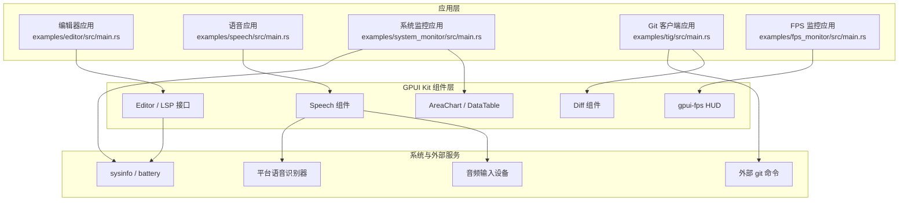

**图示来源**
- [examples/editor/src/main.rs:10-35](file://examples/editor/src/main.rs#L10-L35)
- [examples/speech/src/main.rs:17-36](file://examples/speech/src/main.rs#L17-L36)
- [examples/system_monitor/src/main.rs:4-16](file://examples/system_monitor/src/main.rs#L4-L16)
- [examples/tig/src/main.rs:6-12](file://examples/tig/src/main.rs#L6-L12)
- [examples/fps_monitor/src/main.rs:11-14](file://examples/fps_monitor/src/main.rs#L11-L14)

## 详细组件分析

### 代码编辑器：异步 LSP 与语法高亮
编辑器示例展示了完整的 LSP 集成流程：补全、诊断、悬停、定义跳转、颜色信息与代码动作。它通过后台任务模拟慢速补全源，验证编辑器对异步响应的处理；并通过 `autocorrect` 库进行文本校对，生成诊断与快速修复。

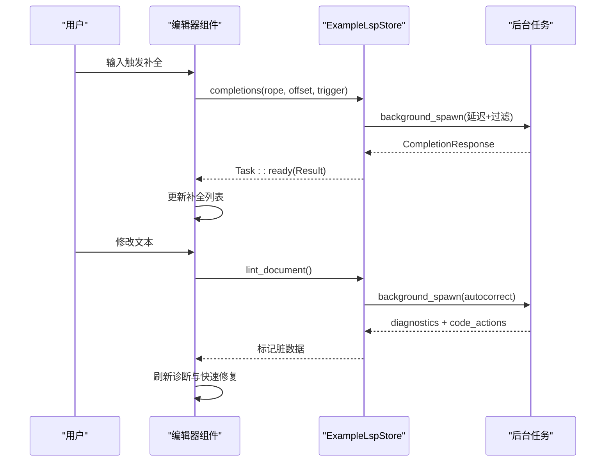

**图示来源**
- [examples/editor/src/main.rs:160-217](file://examples/editor/src/main.rs#L160-L217)
- [examples/editor/src/main.rs:812-871](file://examples/editor/src/main.rs#L812-L871)

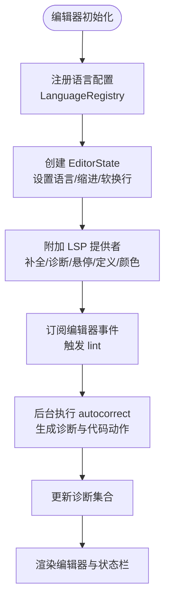

**图示来源**
- [examples/editor/src/main.rs:57-69](file://examples/editor/src/main.rs#L57-L69)
- [examples/editor/src/main.rs:690-752](file://examples/editor/src/main.rs#L690-L752)
- [examples/editor/src/main.rs:1136-1190](file://examples/editor/src/main.rs#L1136-L1190)

**章节来源**
- [examples/editor/src/main.rs:57-138](file://examples/editor/src/main.rs#L57-L138)
- [examples/editor/src/main.rs:160-351](file://examples/editor/src/main.rs#L160-L351)
- [examples/editor/src/main.rs:812-871](file://examples/editor/src/main.rs#L812-L871)
- [examples/editor/src/main.rs:1136-1190](file://examples/editor/src/main.rs#L1136-L1190)

### 语音识别：平台识别器与演示识别器
语音示例提供了统一的识别会话模型，支持系统识别器与演示识别器两种后端。演示识别器无需网络与服务，通过能量阈值判断语音片段，按节奏输出临时假说与最终短语。

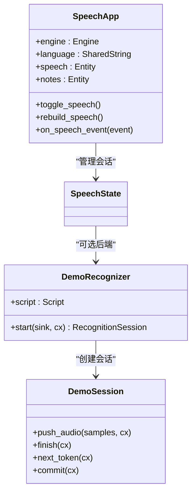

**图示来源**
- [examples/speech/src/main.rs:165-180](file://examples/speech/src/main.rs#L165-L180)
- [examples/speech/src/demo.rs:24-56](file://examples/speech/src/demo.rs#L24-L56)
- [examples/speech/src/demo.rs:110-195](file://examples/speech/src/demo.rs#L110-L195)

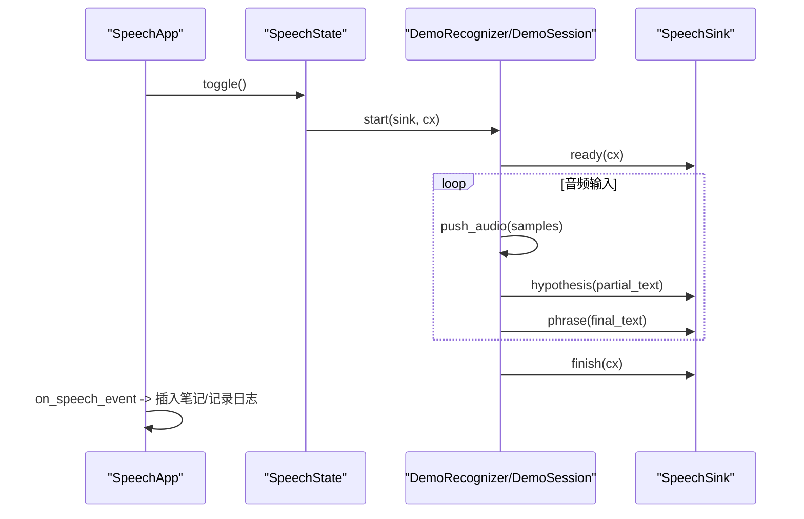

**图示来源**
- [examples/speech/src/main.rs:257-304](file://examples/speech/src/main.rs#L257-L304)
- [examples/speech/src/demo.rs:171-195](file://examples/speech/src/demo.rs#L171-L195)

**章节来源**
- [examples/speech/src/main.rs:131-140](file://examples/speech/src/main.rs#L131-L140)
- [examples/speech/src/main.rs:257-304](file://examples/speech/src/main.rs#L257-L304)
- [examples/speech/src/demo.rs:1-56](file://examples/speech/src/demo.rs#L1-L56)
- [examples/speech/src/demo.rs:110-195](file://examples/speech/src/demo.rs#L110-L195)

### 系统监控：实时指标与进程表
系统监控示例以固定间隔采集系统指标，维护滑动窗口数据点，并使用面积图展示 CPU 与内存使用率。进程表支持排序与截断，状态栏显示磁盘、内存、CPU 与电池信息。

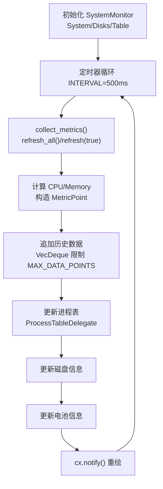

**图示来源**
- [examples/system_monitor/src/main.rs:258-317](file://examples/system_monitor/src/main.rs#L258-L317)
- [examples/system_monitor/src/main.rs:319-369](file://examples/system_monitor/src/main.rs#L319-L369)

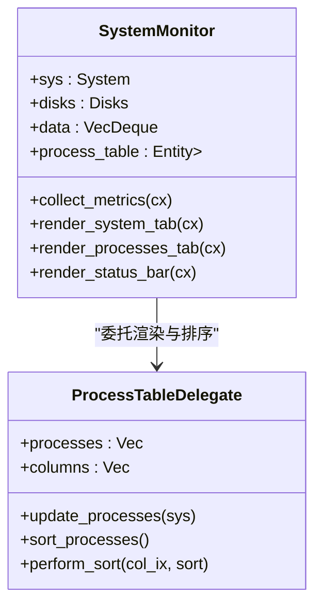

**图示来源**
- [examples/system_monitor/src/main.rs:87-164](file://examples/system_monitor/src/main.rs#L87-L164)
- [examples/system_monitor/src/main.rs:258-317](file://examples/system_monitor/src/main.rs#L258-L317)

**章节来源**
- [examples/system_monitor/src/main.rs:258-317](file://examples/system_monitor/src/main.rs#L258-L317)
- [examples/system_monitor/src/main.rs:319-369](file://examples/system_monitor/src/main.rs#L319-L369)
- [examples/system_monitor/src/main.rs:403-448](file://examples/system_monitor/src/main.rs#L403-L448)
- [examples/system_monitor/src/main.rs:475-550](file://examples/system_monitor/src/main.rs#L475-L550)

### FPS 监控：无组件层的性能可视化
FPS 监控示例不使用组件层，直接组合 GPUI 与 `gpui-fps`，通过 3D Hilbert 曲线制造负载，并在每帧请求动画回调，叠加 HUD 观察帧时间。

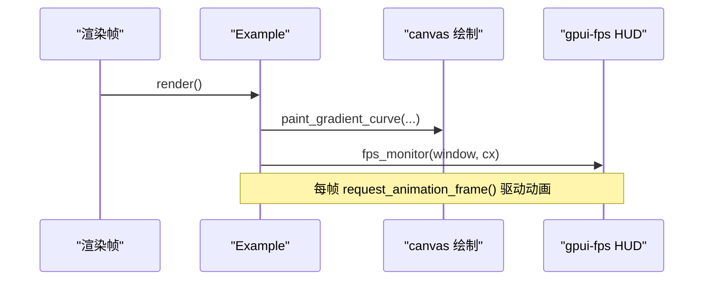

**图示来源**
- [examples/fps_monitor/src/main.rs:176-208](file://examples/fps_monitor/src/main.rs#L176-L208)
- [examples/fps_monitor/src/main.rs:210-235](file://examples/fps_monitor/src/main.rs#L210-L235)

**章节来源**
- [examples/fps_monitor/src/main.rs:1-20](file://examples/fps_monitor/src/main.rs#L1-L20)
- [examples/fps_monitor/src/main.rs:176-208](file://examples/fps_monitor/src/main.rs#L176-L208)
- [examples/fps_monitor/src/main.rs:394-426](file://examples/fps_monitor/src/main.rs#L394-L426)

### Git 客户端：异步历史与差异视图
Git 客户端示例通过命令行调用 `git`，解析历史与差异，并在 UI 中展示提交列表、文件变更与消息。所有耗时操作均放在后台任务中，避免阻塞主线程。

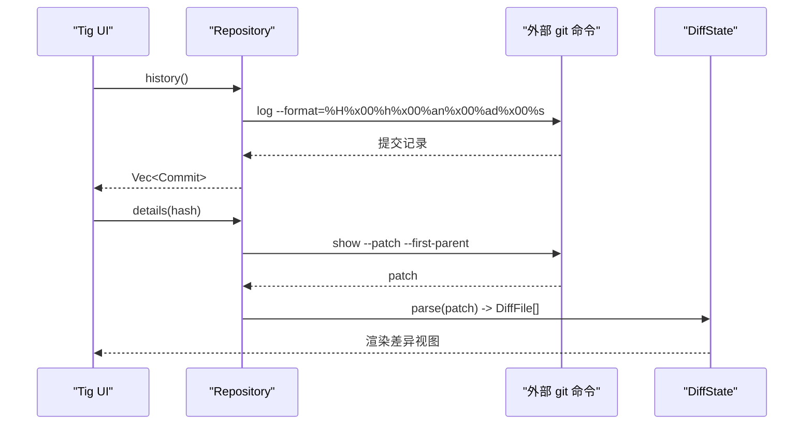

**图示来源**
- [examples/tig/src/repository.rs:60-150](file://examples/tig/src/repository.rs#L60-L150)
- [examples/tig/src/app.rs:204-275](file://examples/tig/src/app.rs#L204-L275)

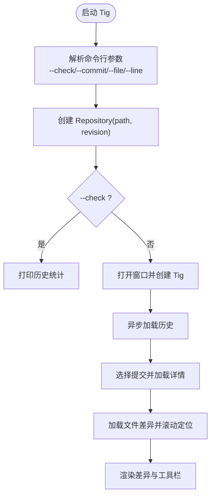

**图示来源**
- [examples/tig/src/main.rs:13-55](file://examples/tig/src/main.rs#L13-L55)
- [examples/tig/src/main.rs:87-104](file://examples/tig/src/main.rs#L87-L104)
- [examples/tig/src/app.rs:138-188](file://examples/tig/src/app.rs#L138-L188)

**章节来源**
- [examples/tig/src/main.rs:13-55](file://examples/tig/src/main.rs#L13-L55)
- [examples/tig/src/main.rs:87-104](file://examples/tig/src/main.rs#L87-L104)
- [examples/tig/src/repository.rs:60-150](file://examples/tig/src/repository.rs#L60-L150)
- [examples/tig/src/app.rs:204-275](file://examples/tig/src/app.rs#L204-L275)

## 依赖关系分析
示例之间的依赖主要面向 GPUI Kit 组件与外部系统：
- 编辑器依赖 Tree-sitter 语言包与 LSP 类型。
- 语音示例依赖 cpal 获取默认输入设备，以及平台识别器。
- 系统监控依赖 sysinfo 与 battery。
- FPS 监控依赖 gpui-fps。
- Git 客户端依赖外部 git 命令与 diff 组件。

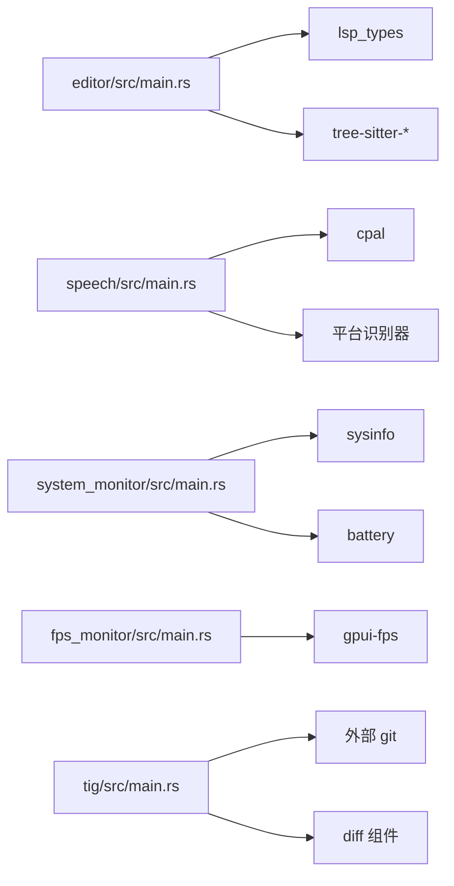

**图示来源**
- [examples/editor/src/main.rs:10-35](file://examples/editor/src/main.rs#L10-L35)
- [examples/speech/src/main.rs:17-36](file://examples/speech/src/main.rs#L17-L36)
- [examples/system_monitor/src/main.rs:4-16](file://examples/system_monitor/src/main.rs#L4-L16)
- [examples/fps_monitor/src/main.rs:11-14](file://examples/fps_monitor/src/main.rs#L11-L14)
- [examples/tig/src/main.rs:6-12](file://examples/tig/src/main.rs#L6-L12)

**章节来源**
- [examples/editor/src/main.rs:10-35](file://examples/editor/src/main.rs#L10-L35)
- [examples/speech/src/main.rs:17-36](file://examples/speech/src/main.rs#L17-L36)
- [examples/system_monitor/src/main.rs:4-16](file://examples/system_monitor/src/main.rs#L4-L16)
- [examples/fps_monitor/src/main.rs:11-14](file://examples/fps_monitor/src/main.rs#L11-L14)
- [examples/tig/src/main.rs:6-12](file://examples/tig/src/main.rs#L6-L12)

## 性能与监控
- 编辑器：通过后台任务执行诊断与补全，避免 UI 卡顿；使用 Rope 高效处理大文本。
- 语音：演示识别器通过能量阈值与窗口采样降低误判；会话日志限制长度防止内存增长。
- 系统监控：固定采样间隔与最大数据点限制，保证图表平滑且内存可控。
- FPS 监控：每帧请求动画回调，HUD 仅驱动自身子树重绘，减少不必要渲染。

建议：
- 对长耗时任务使用 `background_spawn` 或 `spawn`，并在 UI 层做取消与版本检查，避免陈旧结果覆盖新状态。
- 对高频事件（如语音 partial、鼠标移动）进行节流或合并，减少重绘频率。
- 对大数据集使用虚拟列表与增量更新，避免一次性渲染全部项。

[本节为通用指导，不直接分析具体文件]

## 故障排查指南
- 编辑器
  - 补全无响应：检查触发字符与延迟任务是否返回空数组；确认 LSP 提供者已附加。
  - 诊断未更新：确认 `is_dirty` 标志被设置，并在渲染时清空并填充诊断集合。
- 语音
  - 无法识别：检查平台权限与语言包；若不可用，切换到 Demo 引擎验证流程。
  - 日志过多：调整 `LOG_LIMIT`，避免日志无限增长。
- 系统监控
  - 图表不更新：确认定时器任务仍在运行，且 `collect_metrics` 正常刷新数据。
  - 进程表为空：检查 `sys.refresh_all()` 与 `processes()` 返回值。
- FPS 监控
  - HUD 不显示：确保在 `render` 中调用 `fps_monitor(window, cx)`。
  - 场景不动画：确认每帧调用 `request_animation_frame()`。
- Git 客户端
  - 历史为空：检查仓库是否存在 HEAD 与提交；非仓库路径会返回错误。
  - 差异解析失败：确认 patch 格式与编码；必要时转换 UTF-8。

**章节来源**
- [examples/editor/src/main.rs:1136-1148](file://examples/editor/src/main.rs#L1136-L1148)
- [examples/speech/src/main.rs:295-304](file://examples/speech/src/main.rs#L295-L304)
- [examples/system_monitor/src/main.rs:300-317](file://examples/system_monitor/src/main.rs#L300-L317)
- [examples/fps_monitor/src/main.rs:176-208](file://examples/fps_monitor/src/main.rs#L176-L208)
- [examples/tig/src/repository.rs:66-78](file://examples/tig/src/repository.rs#L66-L78)

## 结论
这四个高级示例覆盖了现代桌面应用的关键领域：富文本编辑、语音交互、系统可观测性与版本控制集成。它们共同体现了以下企业级实践：
- 异步优先：所有 I/O 与耗时计算都放入后台任务，UI 保持响应。
- 组件解耦：通过 Provider 与 Delegate 模式分离数据与渲染。
- 可观测性：HUD、日志与状态栏提供运行时洞察。
- 可扩展性：语言注册、识别器替换、差异视图选项与命令扩展。
- 跨平台：利用 GPUI 与系统 API 适配不同平台行为。

将这些模式应用到真实产品，可以显著提升用户体验与系统稳定性。

[本节为总结性内容，不直接分析具体文件]

## 附录：企业级实践清单
- 编辑器
  - 使用 LSP 接口抽象补全、诊断、悬停与定义跳转。
  - 通过 Tree-sitter 注册语言，支持外部语法扩展。
  - 后台任务执行诊断，结合状态栏与快速修复提升效率。
- 语音
  - 统一识别器接口，支持平台与演示后端。
  - 会话生命周期管理：开始、部分结果、最终结果、取消与错误。
  - 日志与通知机制，便于问题定位与用户反馈。
- 系统监控
  - 固定采样周期与数据窗口，平衡实时性与资源占用。
  - 图表与表格组合展示，提供多维度指标。
  - 状态栏聚合关键指标，便于快速感知系统健康。
- FPS 监控
  - 使用 HUD 叠加观察帧时间，配合负载场景调优渲染。
  - 最小化重绘范围，避免全局刷新。
- Git 客户端
  - 异步加载历史与差异，保持 UI 流畅。
  - 差异视图支持多种模式与上下文行控制。
  - 命令行集成与错误处理，提供明确的用户提示。

[本节为通用指导，不直接分析具体文件]