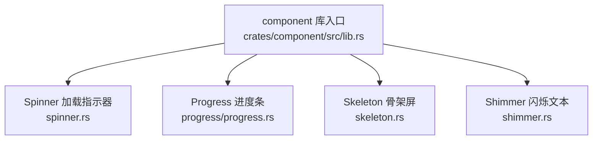
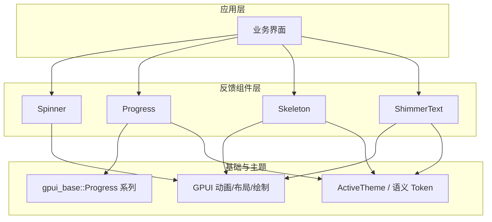
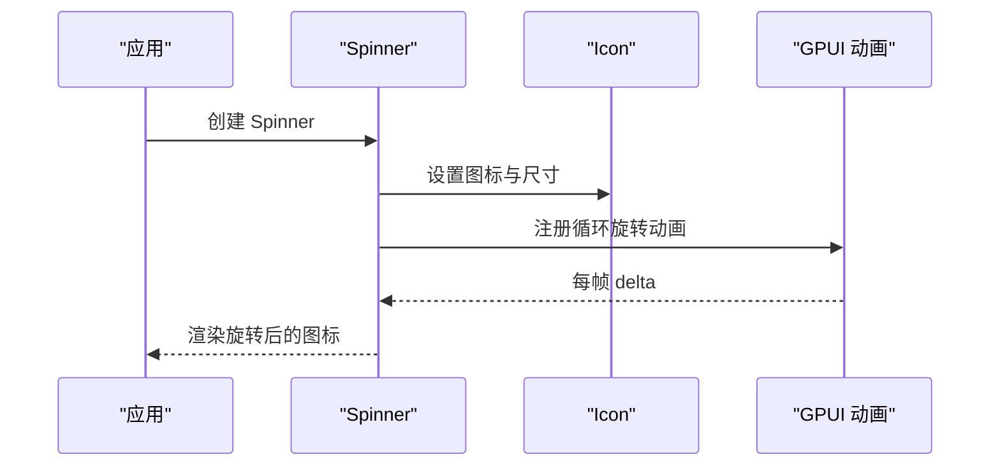
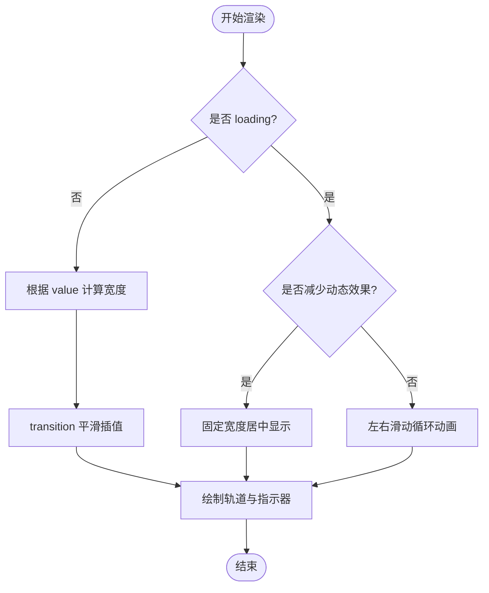
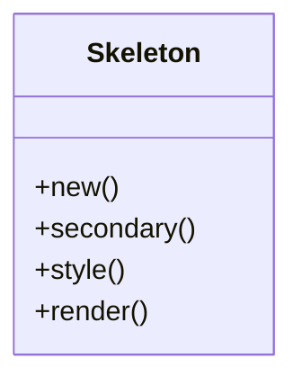
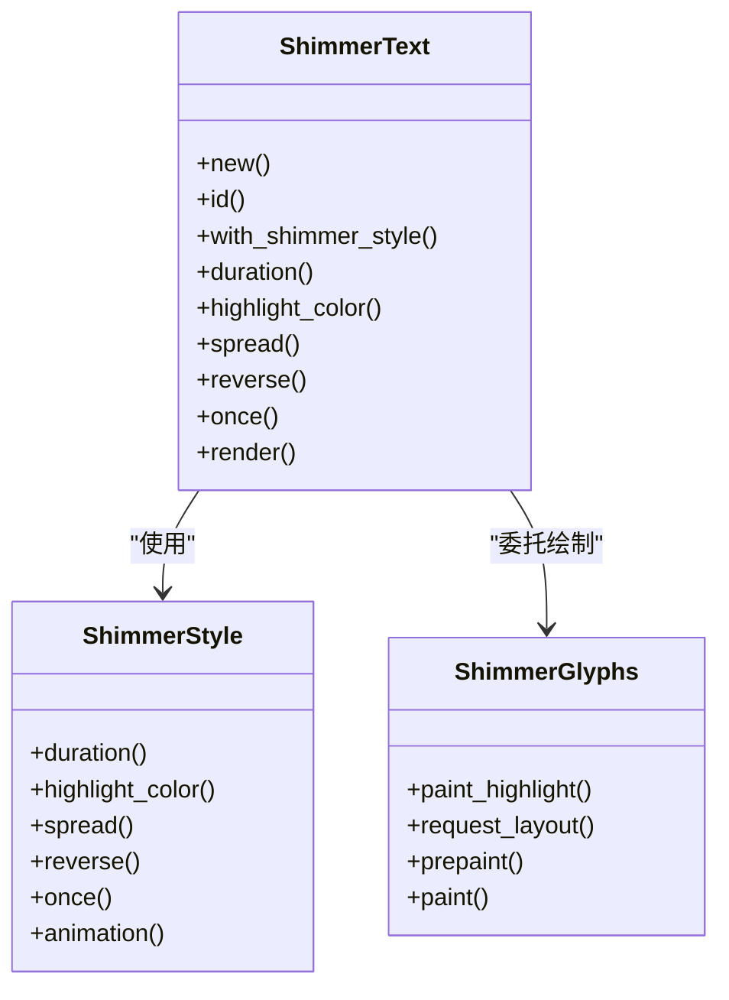
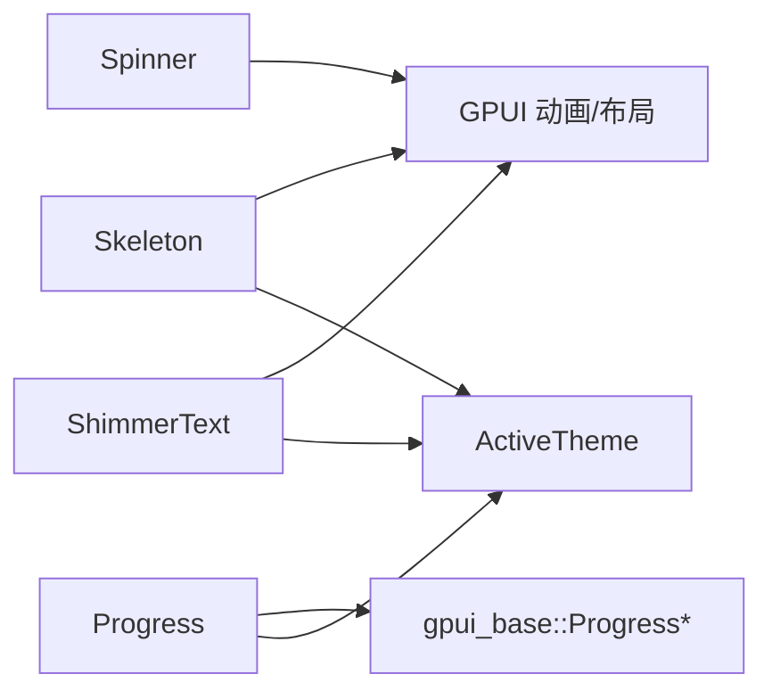

# 反馈组件

<cite>
**本文引用的文件**   
- [crates/component/src/lib.rs](file://crates/component/src/lib.rs)
- [crates/component/src/spinner.rs](file://crates/component/src/spinner.rs)
- [crates/component/src/progress/progress.rs](file://crates/component/src/progress/progress.rs)
- [crates/component/src/skeleton.rs](file://crates/component/src/skeleton.rs)
- [crates/component/src/shimmer.rs](file://crates/component/src/shimmer.rs)
</cite>

## 目录
1. [引言](#引言)
2. [项目结构](#项目结构)
3. [核心组件](#核心组件)
4. [架构总览](#架构总览)
5. [详细组件分析](#详细组件分析)
6. [依赖关系分析](#依赖关系分析)
7. [性能与可访问性](#性能与可访问性)
8. [场景化选型指南](#场景化选型指南)
9. [自定义样式与主题适配](#自定义样式与主题适配)
10. [故障排查](#故障排查)
11. [结论](#结论)

## 引言
本章节面向 GPUI Kit 的“用户反馈”类组件，聚焦 Spinner（加载指示器）、Progress（进度条）、Skeleton（骨架屏）、Shimmer（闪烁效果）四类组件。文档将说明它们的职责边界、动画控制方式、状态同步机制、性能优化策略、无障碍支持以及在不同加载场景下的选择建议，并给出主题与样式的定制方法，帮助你在保证流畅体验的同时实现一致的设计语言。

## 项目结构
GPUI Kit 将这些反馈组件统一暴露于 component crate 中，并通过 lib.rs 进行模块导出和全局初始化。Spinner、Progress、Skeleton、Shimmer 分别位于独立源文件中，便于单独维护与测试。

图表来源
- [crates/component/src/lib.rs:29-85](file://crates/component/src/lib.rs#L29-L85)

章节来源
- [crates/component/src/lib.rs:1-172](file://crates/component/src/lib.rs#L1-L172)

## 核心组件
- Spinner：循环旋转的图标加载指示器，支持尺寸、颜色、缓动函数与动画时长配置，遵循系统“减少动态效果”设置。
- Progress：线性进度条，支持确定值与不确定模式；提供尺寸、圆角、颜色、无障碍标签等能力，并与基础进度组件协作完成平滑过渡。
- Skeleton：骨架占位块，支持主次色与呼吸式透明度动画，适合列表或卡片内容未就绪时的布局占位。
- Shimmer：基于文本布局的高性能闪烁高亮层，支持相对/绝对宽度、方向、单次播放、主题自适应与减少动态效果降级。

章节来源
- [crates/component/src/spinner.rs:1-104](file://crates/component/src/spinner.rs#L1-L104)
- [crates/component/src/progress/progress.rs:1-190](file://crates/component/src/progress/progress.rs#L1-L190)
- [crates/component/src/skeleton.rs:1-60](file://crates/component/src/skeleton.rs#L1-L60)
- [crates/component/src/shimmer.rs:1-658](file://crates/component/src/shimmer.rs#L1-L658)

## 架构总览
以下图展示了四个反馈组件在渲染与动画层面的交互关系，以及与主题、GPUI 基础进度组件的关系。

图表来源
- [crates/component/src/spinner.rs:60-74](file://crates/component/src/spinner.rs#L60-L74)
- [crates/component/src/progress/progress.rs:81-171](file://crates/component/src/progress/progress.rs#L81-L171)
- [crates/component/src/skeleton.rs:37-58](file://crates/component/src/skeleton.rs#L37-L58)
- [crates/component/src/shimmer.rs:208-240](file://crates/component/src/shimmer.rs#L208-L240)

## 详细组件分析

### Spinner（加载指示器）
- 功能要点
  - 默认使用内置 Loader 图标，可通过 icon 替换为其他图标。
  - 支持 with_size 设置尺寸、color 设置颜色、ease 设置缓动函数。
  - 通过 Animation 持续旋转，遵循 reduce_motion 时不请求帧。
- 关键流程
  - 构建 Spinner → 设置 Icon 与尺寸 → 绑定旋转动画 → 渲染到 div 容器。
- 可访问性与辅助
  - 作为纯视觉指示器，通常不需要额外无障碍标签；若需表达上下文，可在外层包裹语义元素。

图表来源
- [crates/component/src/spinner.rs:18-50](file://crates/component/src/spinner.rs#L18-L50)
- [crates/component/src/spinner.rs:60-74](file://crates/component/src/spinner.rs#L60-L74)

章节来源
- [crates/component/src/spinner.rs:1-104](file://crates/component/src/spinner.rs#L1-L104)

### Progress（进度条）
- 功能要点
  - 支持 value（0-100）与 loading（不确定模式）。
  - 通过 BaseProgress、ProgressTrack、ProgressIndicator 组合实现背景轨道与前景指示器。
  - 使用 transition 对 value 做平滑插值，结合主题 motion tokens 控制时长与缓动。
  - 支持 size（XSmall/Small/Medium/Large/自定义），自动计算高度与圆角。
  - 支持 accessibility_label 暴露给辅助技术。
- 不确定模式动画
  - 当 loading=true 且未启用 reduce_motion 时，指示器左右滑动形成无限循环动画。
  - 当 reduce_motion=true 时，退化为静态居中片段，避免动画帧。
- 确定模式动画
  - 使用 transition 对 value 做插值，宽度按百分比更新，圆角跟随主题半径。

图表来源
- [crates/component/src/progress/progress.rs:81-171](file://crates/component/src/progress/progress.rs#L81-L171)

章节来源
- [crates/component/src/progress/progress.rs:1-190](file://crates/component/src/progress/progress.rs#L1-L190)

### Skeleton（骨架屏）
- 功能要点
  - 默认高度与背景色来自主题 skeleton token，secondary 可选次要色（降低透明度）。
  - 使用重复动画以 bounce(ease_in_out) 驱动透明度变化，营造呼吸感。
- 适用场景
  - 列表项、卡片、表单字段等未知内容的占位布局，保持页面结构与节奏稳定。

图表来源
- [crates/component/src/skeleton.rs:8-58](file://crates/component/src/skeleton.rs#L8-L58)

章节来源
- [crates/component/src/skeleton.rs:1-60](file://crates/component/src/skeleton.rs#L1-L60)

### Shimmer（闪烁效果）
- 功能要点
  - ShimmerStyle：封装动画时长、高亮颜色、spread（相对/绝对）、方向、单次播放等。
  - ShimmerText：对外暴露便捷 API，内部委托 ShimmerGlyphs 进行高性能绘制。
  - ShimmerGlyphs：复用 StyledText 的布局结果，叠加多层 ContentMask 绘制高亮带，避免逐帧重建文本运行。
- 主题与对比度
  - 自动根据当前主题明暗与文本/背景色计算高亮色，确保可读性与对比度。
  - 支持 override highlight_color 强制指定高亮色。
- 减少动态效果
  - 当 reduce_motion=true 时，直接渲染文本而不触发动画帧。

图表来源
- [crates/component/src/shimmer.rs:52-127](file://crates/component/src/shimmer.rs#L52-L127)
- [crates/component/src/shimmer.rs:140-240](file://crates/component/src/shimmer.rs#L140-L240)
- [crates/component/src/shimmer.rs:248-425](file://crates/component/src/shimmer.rs#L248-L425)

章节来源
- [crates/component/src/shimmer.rs:1-658](file://crates/component/src/shimmer.rs#L1-L658)

## 依赖关系分析
- 组件与 GPUI
  - 所有组件均依赖 GPUI 的 Element/RenderOnce/Animation 体系进行布局与动画。
  - Shimmer 深度依赖 GPUI 的文本布局与绘制管线（StyledText、LineLayout、ContentMask）。
- 组件与基础库
  - Progress 依赖 gpui_base 的 Progress、ProgressTrack、ProgressIndicator 与 transition 工具。
- 组件与主题
  - Skeleton、Shimmer、Progress 均读取 ActiveTheme 与语义 token，保证明暗主题一致性。

图表来源
- [crates/component/src/progress/progress.rs:1-10](file://crates/component/src/progress/progress.rs#L1-L10)
- [crates/component/src/skeleton.rs:1-6](file://crates/component/src/skeleton.rs#L1-L6)
- [crates/component/src/shimmer.rs:1-10](file://crates/component/src/shimmer.rs#L1-L10)

章节来源
- [crates/component/src/progress/progress.rs:1-190](file://crates/component/src/progress/progress.rs#L1-L190)
- [crates/component/src/skeleton.rs:1-60](file://crates/component/src/skeleton.rs#L1-L60)
- [crates/component/src/shimmer.rs:1-658](file://crates/component/src/shimmer.rs#L1-L658)

## 性能与可访问性
- 性能优化
  - Shimmer 复用 StyledText 布局，避免每帧重建文本运行；使用多层 ContentMask 合成柔和高亮带，减少重绘开销。
  - Progress 使用 transition 对 value 做插值，配合主题 motion tokens，避免频繁刷新导致的抖动。
  - Skeleton 与 Spinner 在 reduce_motion 下退化为静态或无动画路径，降低帧率压力。
- 可访问性
  - Progress 支持 accessibility_label，便于屏幕阅读器播报进度信息。
  - Spinner 作为装饰性指示器，无需额外语义；建议在业务层为其添加上下文描述。
  - Skeleton 与 Shimmer 主要用于视觉占位与提示，不承载关键信息，但应避免遮挡真实内容。

章节来源
- [crates/component/src/progress/progress.rs:61-65](file://crates/component/src/progress/progress.rs#L61-L65)
- [crates/component/src/shimmer.rs:129-140](file://crates/component/src/shimmer.rs#L129-L140)
- [crates/component/src/spinner.rs:90-103](file://crates/component/src/spinner.rs#L90-L103)

## 场景化选型指南
- 需要明确进度百分比的场景（如上传、下载、任务步骤）
  - 首选 Progress，开启确定模式并绑定 value。
  - 如需强调主题色，使用 color 覆盖；必要时设置 accessibility_label。
- 仅表示“正在处理”，无需具体进度的场景（如按钮点击后等待响应）
  - 使用 Spinner，搭配业务文案或外层容器传达状态。
- 内容尚未就绪，需要保持布局稳定的场景（如列表、卡片、表单）
  - 使用 Skeleton，必要时切换 secondary 色以区分层级。
- 文本内容即将出现，希望用“思考中”的闪烁效果引导注意力的场景
  - 使用 ShimmerText，调整 duration、spread、reverse、once 匹配交互节奏。

[本节为概念性指导，不直接分析具体文件]

## 自定义样式与主题适配
- Progress
  - 通过 size 控制高度与圆角；通过 color 覆盖主题进度色；通过 style 进一步微调圆角与边距。
  - 在主题 radius 为零时，自动回退为直角，保证与整体 UI 风格一致。
- Skeleton
  - 使用 secondary 切换次要色；通过 style 自定义宽高、间距、圆角等。
  - 背景色来自主题 skeleton token，随明暗主题自动适配。
- Shimmer
  - 使用 highlight_color 强制高亮色；spread 支持相对比例或绝对像素；reverse 控制方向；once 控制单次播放。
  - 自动根据主题明暗与文本/背景色计算高亮色，确保可读性。
- Spinner
  - 使用 with_size 控制尺寸；color 覆盖图标颜色；ease 自定义缓动曲线。

章节来源
- [crates/component/src/progress/progress.rs:96-109](file://crates/component/src/progress/progress.rs#L96-L109)
- [crates/component/src/skeleton.rs:37-58](file://crates/component/src/skeleton.rs#L37-L58)
- [crates/component/src/shimmer.rs:61-127](file://crates/component/src/shimmer.rs#L61-L127)
- [crates/component/src/spinner.rs:30-50](file://crates/component/src/spinner.rs#L30-L50)

## 故障排查
- 动画不生效或卡顿
  - 检查是否启用了 reduce_motion；在减少动态效果模式下，部分组件会禁用动画或退化为静态表现。
  - 确认动画时长与缓动函数是否合理，过短或过于复杂的缓动可能影响流畅度。
- 进度条宽度异常
  - 确认 value 范围在 0-100；超出范围会被钳制。
  - 检查是否在 loading 模式下误传了 value（loading 模式下忽略 value）。
- Shimmer 高亮不可见或对比度不足
  - 尝试设置 highlight_color 强制高亮色；或调整 spread 使高亮带更宽。
  - 检查主题明暗与文本颜色是否导致对比度过低。
- Skeleton 布局错位
  - 检查外层容器的宽高约束；Skeleton 默认高度较小，可能需要配合父级布局使用。

章节来源
- [crates/component/src/spinner.rs:90-103](file://crates/component/src/spinner.rs#L90-L103)
- [crates/component/src/progress/progress.rs:53-59](file://crates/component/src/progress/progress.rs#L53-L59)
- [crates/component/src/shimmer.rs:435-461](file://crates/component/src/shimmer.rs#L435-L461)

## 结论
Spinner、Progress、Skeleton、Shimmer 共同构成了 GPUI Kit 的用户反馈体系：Spinner 表达“进行中”，Progress 表达“有进度”，Skeleton 表达“占位布局”，Shimmer 表达“文本即将出现”。它们共享主题与动画基础设施，并在 reduce_motion 下提供一致的降级体验。在实际项目中，应根据数据状态与交互目标选择合适的组件，并通过主题与样式 API 保持一致的视觉语言，最终达成流畅、可访问、可维护的用户体验。