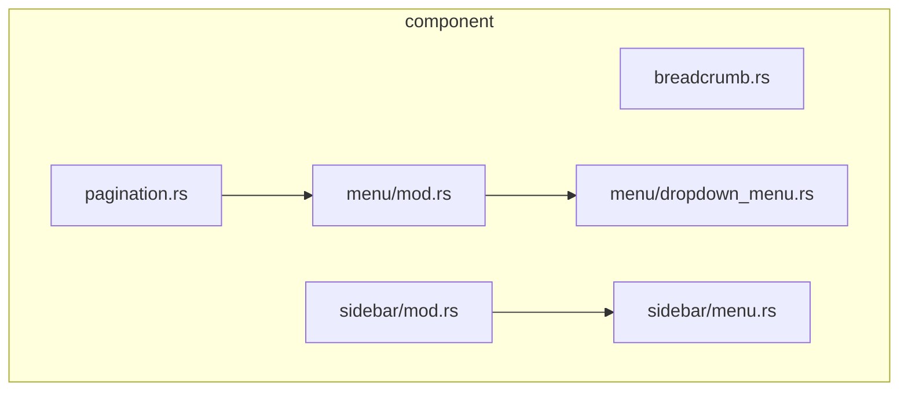
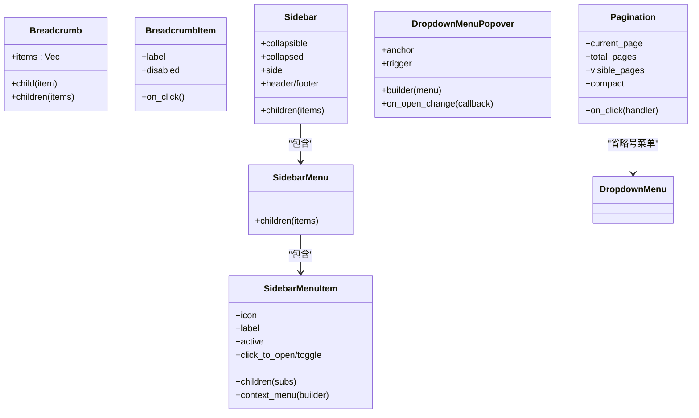
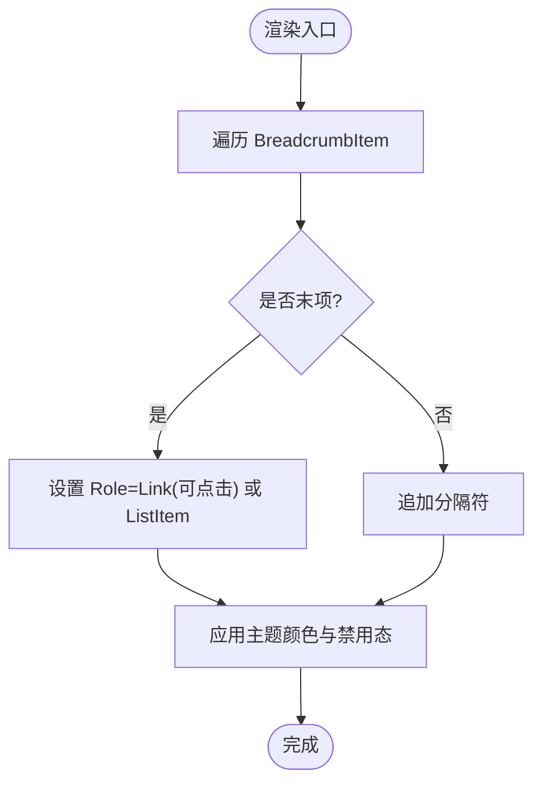
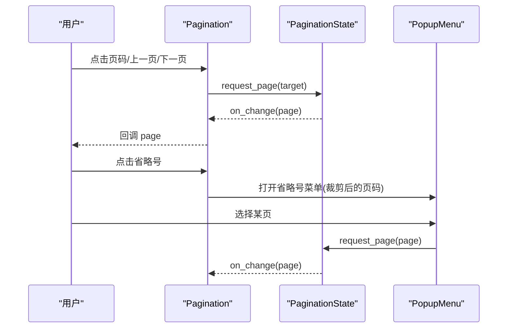
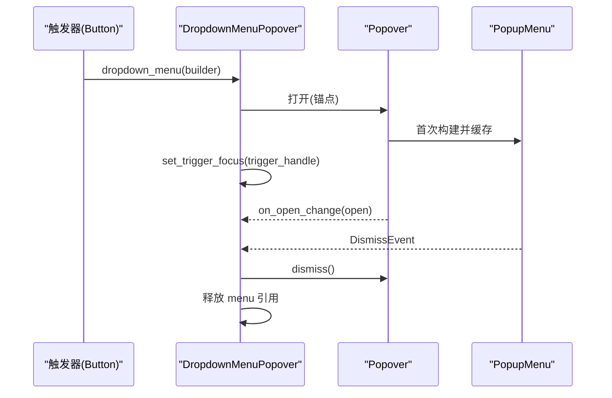
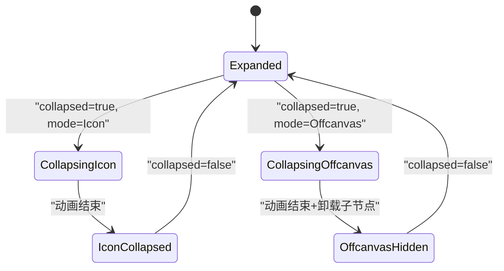
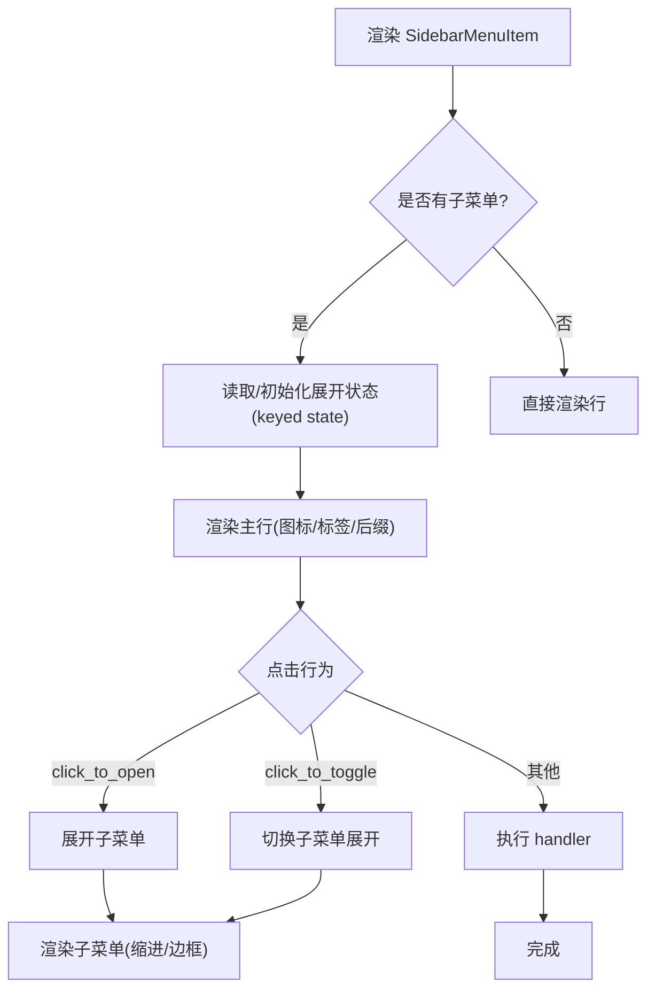
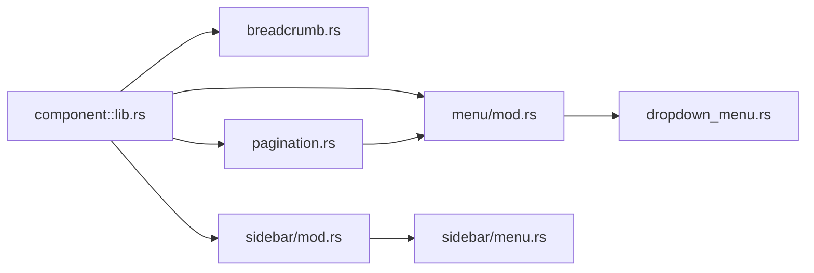

# 导航组件

<cite>
**本文引用的文件**   
- [lib.rs](file://crates/component/src/lib.rs)
- [breadcrumb.rs](file://crates/component/src/breadcrumb.rs)
- [pagination.rs](file://crates/component/src/pagination.rs)
- [menu/mod.rs](file://crates/component/src/menu/mod.rs)
- [dropdown_menu.rs](file://crates/component/src/menu/dropdown_menu.rs)
- [sidebar/mod.rs](file://crates/component/src/sidebar/mod.rs)
- [sidebar/menu.rs](file://crates/component/src/sidebar/menu.rs)
</cite>

## 目录
1. [引言](#引言)
2. [项目结构](#项目结构)
3. [核心组件](#核心组件)
4. [架构总览](#架构总览)
5. [详细组件分析](#详细组件分析)
6. [依赖关系分析](#依赖关系分析)
7. [性能与可访问性](#性能与可访问性)
8. [多平台与响应式适配](#多平台与响应式适配)
9. [疑难解答](#疑难解答)
10. [结论](#结论)

## 引言
本章节面向 GPUI Kit 的导航相关组件，聚焦以下能力：
- Breadcrumb（面包屑）：轻量级路径导航，支持禁用、点击回调与无障碍语义。
- Pagination（分页）：基于基础状态机驱动的分页控件，支持紧凑模式、省略号菜单与键盘交互。
- Menu（菜单）：下拉菜单、上下文菜单、弹出菜单等组合，提供触发器锚点、打开/关闭回调与快捷键提示。
- Sidebar（侧边栏）：可折叠（图标宽度或 Offcanvas）、带分组与子菜单的导航容器，内置滚动与动画过渡。

这些组件共同构成应用内导航体系，强调状态管理、路由集成、键盘导航与无障碍访问，并提供复杂导航结构的构建方法与用户体验优化技巧。

## 项目结构
导航相关代码位于 component crate 中，按功能模块划分：
- breadcrumb.rs：面包屑实现
- pagination.rs：分页实现
- menu/*：菜单子系统（下拉、上下文、弹出菜单等）
- sidebar/*：侧边栏及其菜单项、分组、头部、尾部

图表来源
- [breadcrumb.rs:1-179](file://crates/component/src/breadcrumb.rs#L1-L179)
- [pagination.rs:1-279](file://crates/component/src/pagination.rs#L1-L279)
- [menu/mod.rs:1-19](file://crates/component/src/menu/mod.rs#L1-L19)
- [dropdown_menu.rs:1-435](file://crates/component/src/menu/dropdown_menu.rs#L1-L435)
- [sidebar/mod.rs:1-781](file://crates/component/src/sidebar/mod.rs#L1-L781)
- [sidebar/menu.rs:1-474](file://crates/component/src/sidebar/menu.rs#L1-L474)

章节来源
- [lib.rs:29-96](file://crates/component/src/lib.rs#L29-L96)

## 核心组件
- Breadcrumb：以水平布局渲染多个 BreadcrumbItem，自动插入分隔符；末项高亮，可点击项具备 Link 角色。
- Pagination：封装基础分页状态，渲染上一页/下一页按钮、页码按钮与省略号菜单；支持 compact 模式与可见页数控制。
- Menu：通过 DropdownMenu trait 为 Button 等元素提供下拉菜单能力；内部复用 PopupMenu 并处理焦点与生命周期。
- Sidebar：提供可折叠侧边栏容器，支持 Icon 与 Offcanvas 两种折叠模式，内置列表滚动与动画过渡；SidebarMenu/SidebarMenuItem 提供层级菜单与子菜单展开。

章节来源
- [breadcrumb.rs:11-179](file://crates/component/src/breadcrumb.rs#L11-L179)
- [pagination.rs:37-259](file://crates/component/src/pagination.rs#L37-L259)
- [menu/mod.rs:9-18](file://crates/component/src/menu/mod.rs#L9-L18)
- [dropdown_menu.rs:11-79](file://crates/component/src/menu/dropdown_menu.rs#L11-L79)
- [sidebar/mod.rs:31-298](file://crates/component/src/sidebar/mod.rs#L31-L298)
- [sidebar/menu.rs:18-84](file://crates/component/src/sidebar/menu.rs#L18-L84)

## 架构总览
导航组件围绕“状态 + 渲染”的模式组织：
- 状态层：PaginationState 驱动分页；DropdownMenuState 管理菜单实体；SidebarAnimationState 管理折叠动画。
- 渲染层：各组件实现 RenderOnce，将状态映射到 UI 元素树。
- 交互层：on_click/on_open_change 等回调与 GPUI 事件系统对接；菜单与侧边栏使用 keyed state 保持跨帧稳定。

图表来源
- [breadcrumb.rs:11-179](file://crates/component/src/breadcrumb.rs#L11-L179)
- [pagination.rs:37-259](file://crates/component/src/pagination.rs#L37-L259)
- [dropdown_menu.rs:35-79](file://crates/component/src/menu/dropdown_menu.rs#L35-L79)
- [sidebar/mod.rs:220-298](file://crates/component/src/sidebar/mod.rs#L220-L298)
- [sidebar/menu.rs:18-84](file://crates/component/src/sidebar/menu.rs#L18-L84)

## 详细组件分析

### Breadcrumb（面包屑）
- 数据结构：Breadcrumb 持有 BreadcrumbItem 列表；每个 Item 包含 label、disabled、on_click 与 is_last 标记。
- 渲染逻辑：遍历 items，为每项分配 id 与 is_last；非末项后插入分隔符；末项使用主题前景色，其余使用 muted 色。
- 交互与无障碍：当 on_click 存在且未禁用时，设置 Role::Link 并绑定点击回调；否则为 Role::ListItem。
- 样式：整体采用小字号、浅灰文字与间距；可通过 StyleRefinement 自定义。

图表来源
- [breadcrumb.rs:91-179](file://crates/component/src/breadcrumb.rs#L91-L179)

章节来源
- [breadcrumb.rs:11-179](file://crates/component/src/breadcrumb.rs#L11-L179)

### Pagination（分页）
- 状态驱动：基于 BasePagination 与 PaginationState，维护 current_page、total_pages、visible_pages 与 disabled。
- 导航按钮：上一页/下一页根据 state.previous_page()/next_page() 计算目标页；若不可用则禁用按钮。
- 页码渲染：非 compact 模式下渲染页码按钮；选中项 outline，其他 ghost；点击调用 state.request_page。
- 省略号菜单：对隐藏页范围进行裁剪，最多展示 MAX_ELLIPSIS_MENU_PAGES 个页面，避免大量重绘。
- 国际化：使用 t! 宏提供 previous/next 文案。

图表来源
- [pagination.rs:117-259](file://crates/component/src/pagination.rs#L117-L259)

章节来源
- [pagination.rs:19-279](file://crates/component/src/pagination.rs#L19-L279)

### Menu（菜单）
- DropdownMenu trait：为 Button 等元素扩展 dropdown_menu 方法，默认锚点 TopLeft，也可指定任意 Anchor。
- DropdownMenuPopover：包装 Popover，内部维护 PopupMenu 实体，首次打开创建并缓存，关闭后释放；监听 DismissEvent 清理资源。
- 焦点与快捷键：TriggerFocus 在触发元素上注册 FocusHandle，确保菜单打开首帧即可解析快捷键提示。
- 打开/关闭回调：on_open_change 暴露新 open 状态，便于上层同步路由或埋点。

图表来源
- [dropdown_menu.rs:35-174](file://crates/component/src/menu/dropdown_menu.rs#L35-L174)

章节来源
- [menu/mod.rs:1-19](file://crates/component/src/menu/mod.rs#L1-L19)
- [dropdown_menu.rs:11-174](file://crates/component/src/menu/dropdown_menu.rs#L11-L174)

### Sidebar（侧边栏）
- 折叠模式：
  - Icon：收缩至固定图标宽度，内容仍保留但仅显示图标。
  - Offcanvas：完全滑出布局，宽度动画至 0，并在动画结束后卸载子节点。
  - None：禁用折叠。
- 布局与动画：
  - 使用 SidebarLayout 计算 icon_collapsed/offcanvas_collapsed 与 wrapper 类型（None/Static/Animated）。
  - 通过 EffectTransition 对 wrapper 宽度做平滑过渡；使用 use_keyed_state 保存动画状态，避免每帧重建导致的状态丢失。
- 内容与滚动：
  - 内部使用 list + ScrollBounce 承载 SidebarItem 列表，支持垂直滚动条。
  - header/footer 区域在折叠时调整内边距。
- 可访问性：
  - SidebarToggleButton 支持 accessibility_label，保证无标签图标按钮仍可被读屏识别。

图表来源
- [sidebar/mod.rs:69-112](file://crates/component/src/sidebar/mod.rs#L69-L112)
- [sidebar/mod.rs:488-556](file://crates/component/src/sidebar/mod.rs#L488-L556)

章节来源
- [sidebar/mod.rs:31-298](file://crates/component/src/sidebar/mod.rs#L31-L298)
- [sidebar/mod.rs:382-556](file://crates/component/src/sidebar/mod.rs#L382-L556)

### SidebarMenu 与 SidebarMenuItem（侧边栏菜单）
- SidebarMenu：作为 SidebarItem，渲染一组 SidebarMenuItem；受父级 collapsed 影响。
- SidebarMenuItem：
  - 支持图标、标签、后缀、禁用、激活态、子菜单。
  - click_to_open/click_to_toggle 控制点击行为：仅展开子菜单或切换展开状态。
  - context_menu 支持右键上下文菜单。
  - 折叠态下为图标项提供 Tooltip，提升可用性。
  - 子菜单通过 key state 管理展开状态，caret 按钮负责切换。

图表来源
- [sidebar/menu.rs:92-436](file://crates/component/src/sidebar/menu.rs#L92-L436)

章节来源
- [sidebar/menu.rs:18-84](file://crates/component/src/sidebar/menu.rs#L18-L84)
- [sidebar/menu.rs:92-436](file://crates/component/src/sidebar/menu.rs#L92-L436)

## 依赖关系分析
- 组件初始化：component::init 会依次初始化 theme/global_state/root/input/diff/date_picker/dock/sheet/list/command/carousel/notification/popover/questionnaire/menu/table/tooltip 等子系统，确保菜单等弹窗类组件可用。
- 模块导出：lib.rs 显式 pub mod 了 breadcrumb/pagination/menu/sidebar 等导航相关模块，供外部使用。
- 组件间耦合：
  - Pagination 依赖 menu::PopupMenu 用于省略号菜单。
  - DropdownMenu 依赖 Popover 与 PopupMenu，并通过 keyed state 管理生命周期。
  - Sidebar 依赖 scroll、animation、button、theme 等基础能力。

图表来源
- [lib.rs:29-96](file://crates/component/src/lib.rs#L29-L96)
- [lib.rs:127-151](file://crates/component/src/lib.rs#L127-L151)
- [pagination.rs:11-17](file://crates/component/src/pagination.rs#L11-L17)
- [dropdown_menu.rs:1-10](file://crates/component/src/menu/dropdown_menu.rs#L1-L10)
- [sidebar/mod.rs:1-25](file://crates/component/src/sidebar/mod.rs#L1-L25)

章节来源
- [lib.rs:127-151](file://crates/component/src/lib.rs#L127-L151)

## 性能与可访问性
- 性能要点
  - Pagination 省略号菜单限制最大展示页数为 100，避免悬停时大规模重绘。
  - DropdownMenu 缓存 PopupMenu 实体，仅在关闭后重建，减少重复构建开销。
  - Sidebar 使用 keyed state 存储动画状态，避免每帧重建导致的布局抖动；Offcanvas 模式在动画结束后卸载子节点，降低渲染成本。
- 可访问性要点
  - BreadcrumbItem 在可点击时设置 Role::Link，否则为 Role::ListItem。
  - SidebarMenuItem 行设置 Role::TreeItem，并提供 aria_selected 与 aria_label；子菜单 caret 按钮具有可读描述。
  - SidebarToggleButton 支持 accessibility_label，确保图标按钮可被辅助技术识别。

章节来源
- [pagination.rs:19-35](file://crates/component/src/pagination.rs#L19-L35)
- [dropdown_menu.rs:121-174](file://crates/component/src/menu/dropdown_menu.rs#L121-L174)
- [sidebar/mod.rs:507-556](file://crates/component/src/sidebar/mod.rs#L507-L556)
- [breadcrumb.rs:91-115](file://crates/component/src/breadcrumb.rs#L91-L115)
- [sidebar/menu.rs:292-318](file://crates/component/src/sidebar/menu.rs#L292-L318)
- [sidebar/menu.rs:347-370](file://crates/component/src/sidebar/menu.rs#L347-L370)
- [sidebar/mod.rs:334-341](file://crates/component/src/sidebar/mod.rs#L334-L341)

## 多平台与响应式适配
- 多平台
  - 组件基于 GPUI 抽象，天然支持桌面端与 WebAssembly 环境；菜单、侧边栏等交互遵循 GPUI 的事件与焦点模型。
  - 主题与 token 由 theme 子系统统一管理，确保在不同平台上视觉一致。
- 响应式
  - Sidebar 支持 side 左右两侧布局，配合 Offcanvas 模式可在移动端以抽屉形式呈现。
  - Pagination 支持 compact 模式，在小屏幕或工具栏中节省空间。
  - 通过 StyleRefinement 与尺寸 API（如 Size、w/h/px）灵活适配不同视口。

[本节为通用指导，不直接分析具体文件]

## 疑难解答
- 菜单打开后无法释放
  - 现象：窗口关闭但未手动 dismiss 菜单，内存泄漏。
  - 原因：强引用循环导致 PopupMenu 与 DropdownMenuState 无法释放。
  - 解决：组件已使用弱引用订阅 DismissEvent，并确保 popover 与 menu 随窗口关闭而释放；测试用例覆盖该场景。
- 快捷键提示未显示
  - 现象：菜单打开后快捷键提示未渲染。
  - 原因：触发元素的焦点上下文未在首帧建立。
  - 解决：TriggerFocus 在触发元素上注册 FocusHandle，确保首帧即能解析快捷键提示。
- 侧边栏折叠卡顿
  - 现象：频繁切换 collapsed 导致闪烁或掉帧。
  - 原因：未使用 keyed state 或错误地重建动画状态。
  - 解决：使用 window.use_keyed_state 保存 SidebarAnimationState，避免每帧重建；Offcanvas 模式在动画结束后卸载子节点。

章节来源
- [dropdown_menu.rs:349-401](file://crates/component/src/menu/dropdown_menu.rs#L349-L401)
- [dropdown_menu.rs:403-433](file://crates/component/src/menu/dropdown_menu.rs#L403-L433)
- [sidebar/mod.rs:507-556](file://crates/component/src/sidebar/mod.rs#L507-L556)

## 结论
GPUI Kit 的导航组件以清晰的状态驱动与稳定的生命周期管理为核心，提供了从轻量面包屑到复杂侧边栏的全套解决方案。通过 DropdownMenu 的菜单能力与 Sidebar 的可折叠容器，开发者可以高效构建多层级导航结构；同时，组件在性能与可访问性方面做了充分考量，适合在多平台与响应式场景中使用。建议结合路由系统与全局状态管理，统一处理页面跳转与导航状态同步，以获得一致的用户体验。