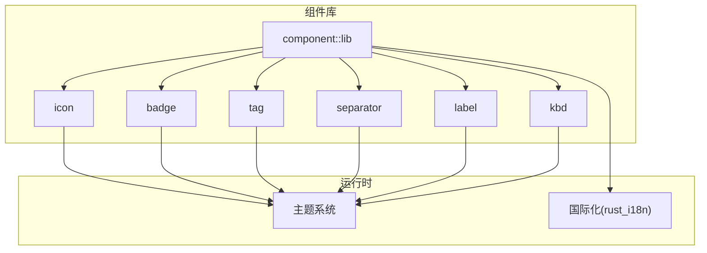
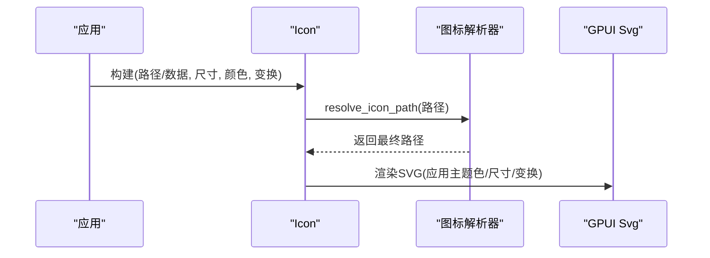
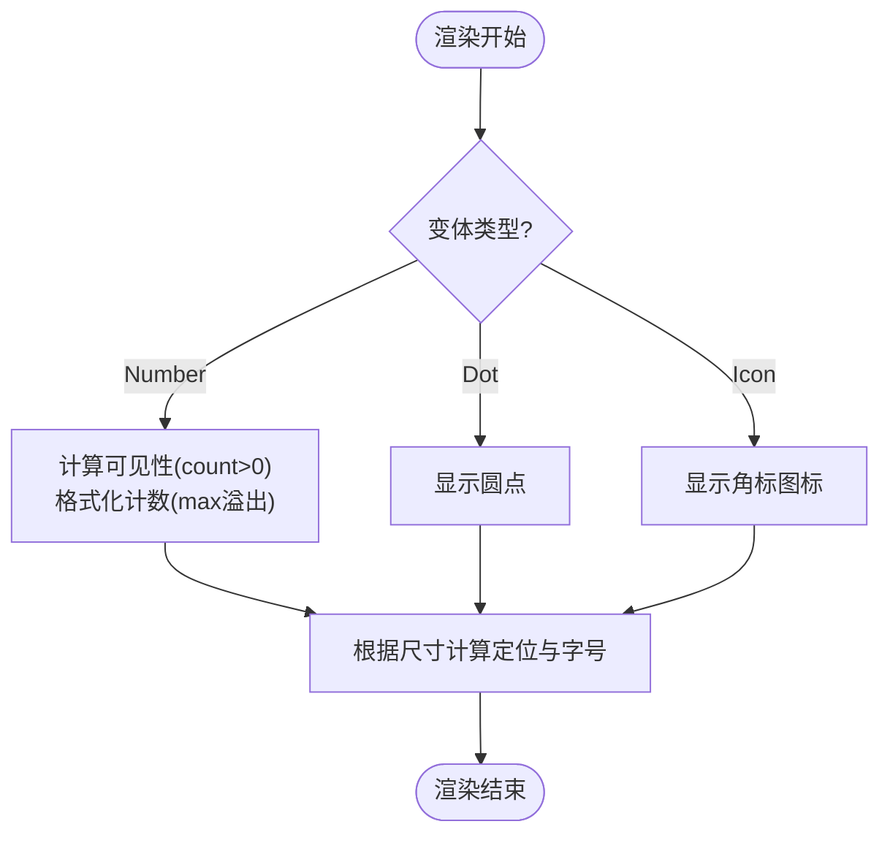
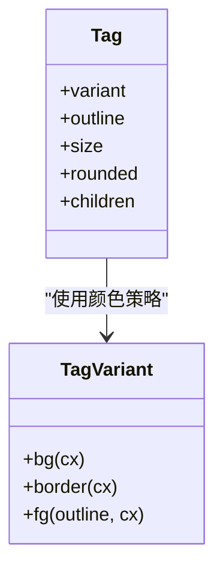
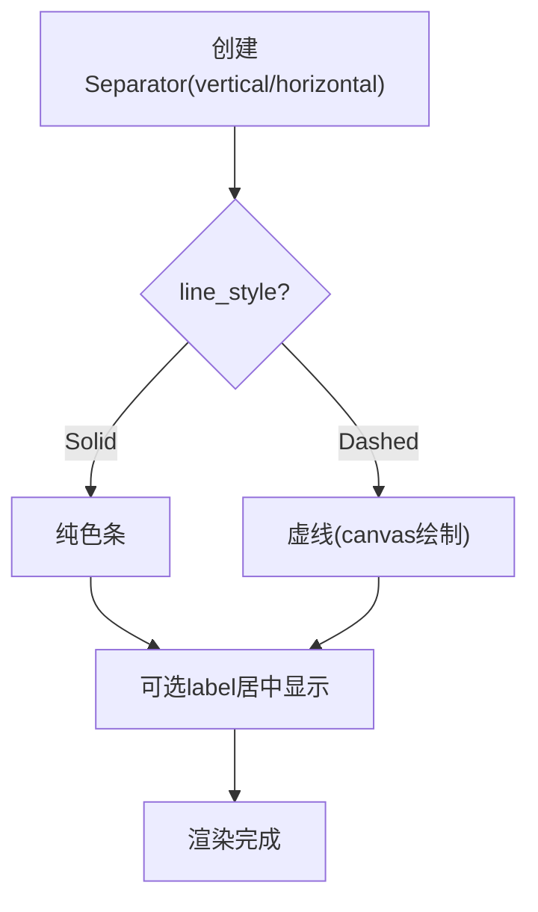
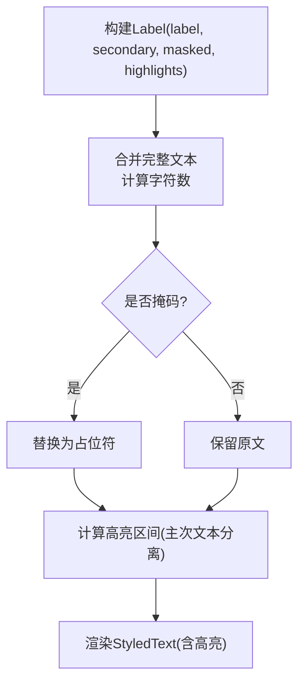
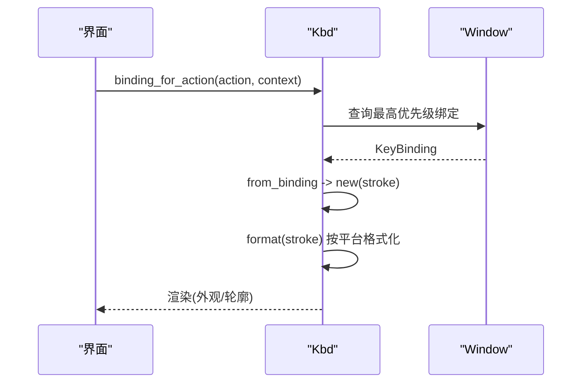
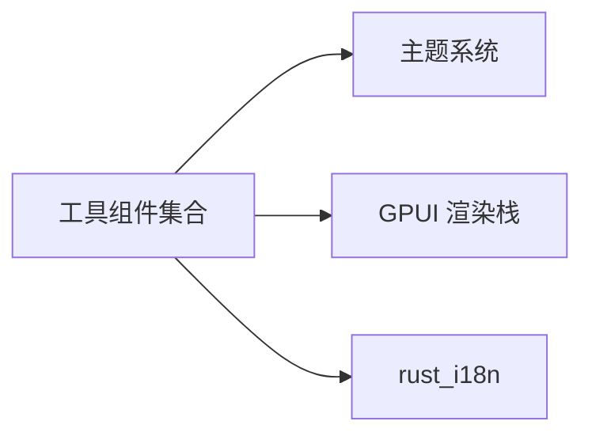

# 工具组件

<cite>
**本文引用的文件**   
- [lib.rs](file://crates/component/src/lib.rs)
- [icon.rs](file://crates/component/src/icon.rs)
- [badge.rs](file://crates/component/src/badge.rs)
- [tag.rs](file://crates/component/src/tag.rs)
- [separator.rs](file://crates/component/src/separator.rs)
- [label.rs](file://crates/component/src/label.rs)
- [kbd.rs](file://crates/component/src/kbd.rs)
</cite>

## 目录
1. [简介](#简介)
2. [项目结构](#项目结构)
3. [核心组件](#核心组件)
4. [架构总览](#架构总览)
5. [详细组件分析](#详细组件分析)
6. [依赖关系分析](#依赖关系分析)
7. [性能考虑](#性能考虑)
8. [故障排查指南](#故障排查指南)
9. [结论](#结论)
10. [附录](#附录)

## 简介
本章节面向 GPUI Kit 的工具类辅助 UI 组件，包括：
- Icon（图标）
- Badge（徽章）
- Tag（标签）
- Separator（分隔符）
- Label（文本标签）
- Kbd（键盘快捷键提示）

这些组件提供语义化使用、样式定制、国际化支持、可访问性最佳实践与跨平台兼容性指导。它们通常作为更复杂业务组件的“原子”元素，便于组合与主题化扩展。

## 项目结构
工具组件位于 component 包中，统一通过模块导出对外暴露。初始化入口会注册主题、全局状态、输入系统、命令面板等基础设施，确保组件在渲染时能正确读取主题与语言环境。



图示来源
- [lib.rs:125-151](file://crates/component/src/lib.rs#L125-L151)
- [icon.rs:1-10](file://crates/component/src/icon.rs#L1-L10)
- [badge.rs:1-7](file://crates/component/src/badge.rs#L1-L7)
- [tag.rs:1-6](file://crates/component/src/tag.rs#L1-L6)
- [separator.rs:1-5](file://crates/component/src/separator.rs#L1-L5)
- [label.rs:1-10](file://crates/component/src/label.rs#L1-L10)
- [kbd.rs:1-9](file://crates/component/src/kbd.rs#L1-L9)

章节来源
- [lib.rs:1-172](file://crates/component/src/lib.rs#L1-L172)

## 核心组件
本节概述各工具组件的职责、关键能力与典型用法要点。

- Icon（图标）
  - 支持从路径或原始 SVG 数据加载；支持旋转、变换、尺寸与颜色定制；支持全局解析器替换图标资源路径。
  - 与主题系统联动，自动继承文本颜色与尺寸。
- Badge（徽章）
  - 支持数字、圆点、图标三种变体；支持最大计数显示；支持尺寸与背景色定制；默认隐藏 0 计数。
- Tag（标签）
  - 支持多种预设变体与自定义颜色；支持轮廓模式、圆角、尺寸；悬停透明度变化。
- Separator（分隔符）
  - 支持水平/垂直方向、实线/虚线样式；可选标签文字；颜色来自主题。
- Label（文本标签）
  - 支持主文本与次要文本；支持掩码显示；支持高亮匹配（前缀/全量匹配），区分主次文本样式。
- Kbd（键盘快捷键）
  - 支持外观/轮廓两种展示；支持从动作绑定自动获取快捷键；按平台格式化按键名称与修饰键顺序。

章节来源
- [icon.rs:114-281](file://crates/component/src/icon.rs#L114-L281)
- [badge.rs:29-166](file://crates/component/src/badge.rs#L29-L166)
- [tag.rs:8-274](file://crates/component/src/tag.rs#L8-L274)
- [separator.rs:7-156](file://crates/component/src/separator.rs#L7-L156)
- [label.rs:53-220](file://crates/component/src/label.rs#L53-L220)
- [kbd.rs:11-265](file://crates/component/src/kbd.rs#L11-L265)

## 架构总览
工具组件遵循统一的渲染与样式约定：
- 所有组件实现 RenderOnce，按需一次性渲染为 GPUI 元素。
- 通过 ActiveTheme 读取主题色与半径等设计令牌。
- 通过 Sizable 接口统一尺寸控制。
- 通过 rust_i18n 提供国际化能力。

```mermaid
classDiagram
class Icon {
+path()
+data()
+rotate()
+transform()
+text_color()
+with_size()
}
class Badge {
+dot()
+count()
+icon()
+max()
+color()
+with_size()
}
class Tag {
+primary()
+secondary()
+danger()
+success()
+warning()
+info()
+custom()
+color()
+outline()
+rounded()
+with_size()
}
class Separator {
+vertical()
+horizontal()
+dashed()
+label()
+color()
}
class Label {
+new()
+secondary()
+masked()
+highlights()
}
class Kbd {
+new()
+appearance()
+outline()
+binding_for_action()
+format()
}
Icon --> "ActiveTheme" : "读取主题"
Badge --> "ActiveTheme" : "读取主题"
Tag --> "ActiveTheme" : "读取主题"
Separator --> "ActiveTheme" : "读取主题"
Label --> "ActiveTheme" : "读取主题"
Kbd --> "ActiveTheme" : "读取主题"
```

图示来源
- [icon.rs:242-258](file://crates/component/src/icon.rs#L242-L258)
- [badge.rs:94-99](file://crates/component/src/badge.rs#L94-L99)
- [tag.rs:215-232](file://crates/component/src/tag.rs#L215-L232)
- [separator.rs:120-124](file://crates/component/src/separator.rs#L120-L124)
- [label.rs:194-198](file://crates/component/src/label.rs#L194-L198)
- [kbd.rs:228-232](file://crates/component/src/kbd.rs#L228-L232)

## 详细组件分析

### Icon（图标）
- 语义化使用
  - 通过命名图标或自定义路径/数据构建图标。
  - 支持旋转与变换，适合动态指示状态或动画衔接。
- 样式定制
  - 支持 text_color 与 with_size；未设置基础尺寸时自动采用文本大小。
  - 支持全局解析器 set_icon_resolver 替换绘制路径，实现运行时切换图标风格。
- 国际化支持
  - 图标本身不携带文案，但可与 Label/Kbd 等配合表达多语言界面。
- 可访问性与跨平台
  - 作为装饰性图形，建议与语义化容器配合，避免影响屏幕阅读器。
  - 与主题系统一致，适配明暗主题。



图示来源
- [icon.rs:92-106](file://crates/component/src/icon.rs#L92-L106)
- [icon.rs:206-239](file://crates/component/src/icon.rs#L206-L239)
- [icon.rs:260-281](file://crates/component/src/icon.rs#L260-L281)

章节来源
- [icon.rs:1-386](file://crates/component/src/icon.rs#L1-L386)

### Badge（徽章）
- 语义化使用
  - 数字变体：当 count=0 时隐藏；超过 max 显示“N+”。
  - 圆点变体：用于在线状态、通知等轻量提示。
  - 图标变体：在角标位置叠加小图标。
- 样式定制
  - 支持 size（Large/Medium/Small/XSmall）与 color（背景）。
  - 自动根据尺寸计算内边距与定位偏移。
- 国际化支持
  - 无文案，仅承载视觉信息。
- 可访问性与跨平台
  - 作为装饰性元素，不应成为焦点目标；如需传达状态，建议由父级元素承担语义。



图示来源
- [badge.rs:101-166](file://crates/component/src/badge.rs#L101-L166)

章节来源
- [badge.rs:1-166](file://crates/component/src/badge.rs#L1-L166)

### Tag（标签）
- 语义化使用
  - 用于状态、分类、筛选等小型标识；支持 outline 轮廓模式。
- 样式定制
  - 预设变体：Primary/Secondary/Danger/Success/Warning/Info。
  - 自定义变体：支持 background/foreground/border 三原色。
  - 圆角：支持 rounded 与 rounded_full；尺寸影响默认圆角。
- 国际化支持
  - 标签内容通常为文案，应结合 i18n 进行本地化。
- 可访问性与跨平台
  - 非交互元素；如需点击，请包裹交互容器并赋予语义角色。



图示来源
- [tag.rs:8-119](file://crates/component/src/tag.rs#L8-L119)
- [tag.rs:121-274](file://crates/component/src/tag.rs#L121-L274)

章节来源
- [tag.rs:1-274](file://crates/component/src/tag.rs#L1-L274)

### Separator（分隔符）
- 语义化使用
  - 用于分割区域或分组；支持 label 作为分组标题。
- 样式定制
  - 方向：vertical/horizontal。
  - 线条：solid/dashed；颜色来自主题或自定义。
- 国际化支持
  - label 文案需本地化。
- 可访问性与跨平台
  - 纯装饰；无需焦点管理。



图示来源
- [separator.rs:26-77](file://crates/component/src/separator.rs#L26-L77)
- [separator.rs:79-118](file://crates/component/src/separator.rs#L79-L118)
- [separator.rs:126-156](file://crates/component/src/separator.rs#L126-L156)

章节来源
- [separator.rs:1-156](file://crates/component/src/separator.rs#L1-L156)

### Label（文本标签）
- 语义化使用
  - 主文本 + 可选次要文本；支持 masked 掩码显示敏感信息。
  - highlights 支持前缀匹配与全量匹配，区分主次文本样式。
- 样式定制
  - 次要文本使用 muted 前景色；匹配命中使用蓝色高亮。
- 国际化支持
  - 文案应通过 i18n 注入，避免硬编码。
- 可访问性与跨平台
  - 掩码模式下跳过高亮测量，保证可读性与一致性。
  - 测试支持记录显示文本，便于自动化验证。



图示来源
- [label.rs:95-191](file://crates/component/src/label.rs#L95-L191)
- [label.rs:200-220](file://crates/component/src/label.rs#L200-L220)

章节来源
- [label.rs:1-471](file://crates/component/src/label.rs#L1-L471)

### Kbd（键盘快捷键）
- 语义化使用
  - 展示用户操作提示；可从 Action 绑定自动推导快捷键。
- 样式定制
  - appearance=false 时仅输出字符串；否则以胶囊样式展示。
  - outline=true 时采用描边风格。
- 国际化支持
  - 修饰键与功能键名称按平台格式化（macOS 使用符号，Windows 使用英文单词）。
- 可访问性与跨平台
  - 非交互元素；测试支持 debug_selector 以便断言渲染。



图示来源
- [kbd.rs:59-101](file://crates/component/src/kbd.rs#L59-L101)
- [kbd.rs:103-225](file://crates/component/src/kbd.rs#L103-L225)
- [kbd.rs:234-265](file://crates/component/src/kbd.rs#L234-L265)

章节来源
- [kbd.rs:1-343](file://crates/component/src/kbd.rs#L1-L343)

## 依赖关系分析
- 组件对主题系统的依赖
  - 所有工具组件通过 ActiveTheme 读取颜色、半径等设计令牌，确保与主题一致。
- 组件对 GPUI 的依赖
  - 基于 GPUI 的元素体系（div/svg/canvas）、样式系统与事件模型。
- 国际化依赖
  - 通过 rust_i18n 提供 locale/set_locale 能力，组件文案应走 i18n。



图示来源
- [lib.rs:125-151](file://crates/component/src/lib.rs#L125-L151)
- [icon.rs:1-10](file://crates/component/src/icon.rs#L1-L10)
- [badge.rs:1-7](file://crates/component/src/badge.rs#L1-L7)
- [tag.rs:1-6](file://crates/component/src/tag.rs#L1-L6)
- [separator.rs:1-5](file://crates/component/src/separator.rs#L1-L5)
- [label.rs:1-10](file://crates/component/src/label.rs#L1-L10)
- [kbd.rs:1-9](file://crates/component/src/kbd.rs#L1-L9)

章节来源
- [lib.rs:1-172](file://crates/component/src/lib.rs#L1-L172)

## 性能考虑
- Icon
  - 使用路径缓存与数据共享（Arc<[u8]>），减少重复解析与内存拷贝。
  - 全局解析器应在回调中保持轻量，避免频繁 IO。
- Badge
  - 仅在必要时渲染角标；数字变体在 count=0 时隐藏，降低布局开销。
- Tag
  - 悬停透明度变化为轻量样式变更，注意避免过度嵌套导致重绘。
- Separator
  - 虚线通过 canvas 绘制，尽量复用容器尺寸以减少重绘。
- Label
  - 掩码模式跳过高亮测量，避免不必要的字符串处理。
- Kbd
  - appearance=false 时直接返回字符串，避免额外布局。

[本节为通用性能建议，不直接分析具体文件]

## 故障排查指南
- 图标未显示或路径被替换异常
  - 检查是否设置了 set_icon_resolver；确认回调返回的路径可由 AssetSource 加载。
  - 若使用 data 方式传入 SVG，不会被解析器替换。
- 徽章不显示
  - 数字变体：确认 count > 0；检查 max 溢出逻辑是否符合预期。
  - 尺寸与定位：Large/Medium/Small/XSmall 会影响偏移与字号。
- 标签颜色不符合预期
  - 检查 variant 与 outline 的组合；Color/Custom 变体会根据主题明暗调整透明度。
- 分隔符虚线不清晰
  - 确认容器尺寸足够；虚线通过 canvas 绘制，受边界与缩放影响。
- 标签高亮错位
  - 掩码模式下不会计算高亮；检查 secondary 与 highlights 的边界跨越情况。
- 快捷键显示不正确
  - 确认 action 已注册绑定；binding_for_action 依赖上一帧的焦点上下文。
  - 平台差异：macOS 使用符号，Windows 使用英文单词与“+”连接。

章节来源
- [icon.rs:92-106](file://crates/component/src/icon.rs#L92-L106)
- [badge.rs:101-166](file://crates/component/src/badge.rs#L101-L166)
- [tag.rs:26-119](file://crates/component/src/tag.rs#L26-L119)
- [separator.rs:90-118](file://crates/component/src/separator.rs#L90-L118)
- [label.rs:151-191](file://crates/component/src/label.rs#L151-L191)
- [kbd.rs:59-101](file://crates/component/src/kbd.rs#L59-L101)

## 结论
工具组件为 GPUI Kit 提供了稳定、可组合、可主题化的基础 UI 单元。通过统一的尺寸与样式接口、完善的主题集成与国际化支持，开发者可以高效构建一致的界面体验。在实际项目中，建议：
- 将文案全部走 i18n，避免硬编码。
- 使用主题色与设计令牌，而非硬编码颜色值。
- 对装饰性元素（Badge/Icon/Separator）不赋予交互语义，将语义交由父级容器。
- 在需要动态替换图标时，优先使用 set_icon_resolver。

[本节为总结性内容，不直接分析具体文件]

## 附录
- 组件组合模式示例（概念性）
  - 列表项：Label（主/次文本）+ Badge（数量/状态）+ Tag（分类）+ Separator（分组）
  - 工具栏：Icon（操作）+ Kbd（快捷键提示）+ Separator（分隔）
  - 表单行：Label（字段名）+ Input（输入）+ Tag（校验状态）
- 设计系统集成方法
  - 通过 theme tokens 统一颜色、圆角、字号与间距。
  - 使用 Sizable 统一尺寸规范，避免散落的像素值。
- 可访问性最佳实践
  - 为交互容器添加合适的角色与标签；装饰性元素不干扰读屏。
  - 对比度符合 WCAG 要求，尤其在高亮与掩码场景。
- 跨平台兼容性指导
  - 快捷键显示遵循平台约定；图标资源路径由应用侧统一管理。
  - 主题明暗模式下的颜色与透明度需兼顾可读性。

[本节为概念性内容，不直接分析具体文件]