# 布局组件

<cite>
**本文引用的文件**   
- [crates/base/src/dock/mod.rs](file://crates/base/src/dock/mod.rs)
- [crates/base/src/dock/dock_area.rs](file://crates/base/src/dock/dock_area.rs)
- [crates/base/src/dock/panel.rs](file://crates/base/src/dock/panel.rs)
- [crates/base/src/dock/tab_group.rs](file://crates/base/src/dock/tab_group.rs)
- [crates/base/src/dock/state.rs](file://crates/base/src/dock/state.rs)
- [crates/base/src/tabs.rs](file://crates/base/src/tabs.rs)
- [crates/base/src/tree.rs](file://crates/base/src/tree.rs)
- [crates/base/src/resizable/mod.rs](file://crates/base/src/resizable/mod.rs)
- [crates/base/src/collapsible.rs](file://crates/base/src/collapsible.rs)
- [crates/base/src/accordion.rs](file://crates/base/src/accordion.rs)
</cite>

## 目录

1. [引言](#引言)
2. [项目结构](#项目结构)
3. [核心布局组件总览](#核心布局组件总览)
4. [架构总览](#架构总览)
5. [Dock 停靠面板详解](#dock-停靠面板详解)
6. [Tabs 标签页详解](#tabs-标签页详解)
7. [Tree 树形控件详解](#tree-树形控件详解)
8. [Resizable 可调整大小容器详解](#resizable-可调整大小容器详解)
9. [Collapsible 可折叠容器详解](#collapsible-可折叠容器详解)
10. [Accordion 手风琴详解](#accordion-手风琴详解)
11. [嵌套关系与组合模式](#嵌套关系与组合模式)
12. [状态管理与事件流](#状态管理与事件流)
13. [拖拽交互与放置目标](#拖拽交互与放置目标)
14. [动画与可见性控制](#动画与可见性控制)
15. [响应式设计建议](#响应式设计建议)
16. [无障碍访问支持](#无障碍访问支持)
17. [性能优化与最佳实践](#性能优化与最佳实践)
18. [故障排查指南](#故障排查指南)
19. [结论](#结论)

## 引言

本文件面向 GPUI Kit 的布局子系统，聚焦 Dock、Tabs、Tree、Resizable、Collapsible、Accordion 等布局组件。这些组件共同构成复杂桌面应用的主界面骨架：Dock 负责区域级停靠与持久化，Resizable 负责分栏尺寸分配，Tabs 管理多文档标签，Tree 提供层级导航，Collapsible 和 Accordion 则用于局部内容展开与折叠。

在 GPUI Kit 中，布局组件强调以下设计原则：

- **数据驱动布局**：Dock 使用纯数据树描述布局，实体只是树的投影。
- **行为与外观分离**：基础层提供交互、拖拽、焦点、事件；外观由渲染器或上层皮肤实现。
- **受控状态优先**：多数组件暴露 `open`、`selected`、`disabled` 等属性，由调用方维护真实状态。
- **稳定标识符**：节点、面板、标签项都使用稳定 ID，便于重排、序列化、恢复。
- **可扩展渲染**：通过上下文对象、回调、渲染器接口扩展 UI，而不侵入核心逻辑。

## 项目结构

布局相关代码主要位于 `crates/base/src` 下，其中 Dock 是一个独立子模块，其他布局组件以单文件或小型目录组织。

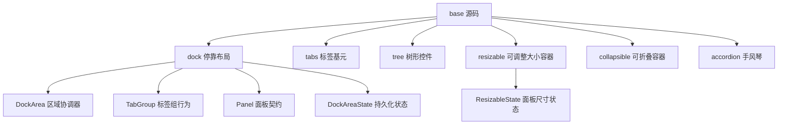

**图表来源**
- [crates/base/src/dock/mod.rs:1-203](file://crates/base/src/dock/mod.rs#L1-L203)
- [crates/base/src/dock/dock_area.rs:1-116](file://crates/base/src/dock/dock_area.rs#L1-L116)
- [crates/base/src/dock/tab_group.rs:1-159](file://crates/base/src/dock/tab_group.rs#L1-L159)
- [crates/base/src/dock/panel.rs:1-132](file://crates/base/src/dock/panel.rs#L1-L132)
- [crates/base/src/dock/state.rs:1-84](file://crates/base/src/dock/state.rs#L1-L84)
- [crates/base/src/resizable/mod.rs:1-54](file://crates/base/src/resizable/mod.rs#L1-L54)

**章节来源**
- [crates/base/src/dock/mod.rs:1-203](file://crates/base/src/dock/mod.rs#L1-L203)

## 核心布局组件总览

| 组件 | 主要职责 | 典型使用场景 | 关键特性 |
|---|---|---|---|
| Dock | 中心区与左、右、下停靠区的布局、拖拽、持久化 | IDE 工作区、编辑器主界面 | 数据树、稳定 ID、渲染器分离、缩放、锁定 |
| Tabs | 标签集合与单个标签元素 | 文档标签、配置页签 | 语义角色、无障碍位置信息、点击激活 |
| Tree | 虚拟化的层级列表 | 资源管理器、目录树、菜单树 | 展开折叠、键盘导航、选中、右键状态 |
| Resizable | 水平或垂直分栏尺寸分配 | 侧边栏加主内容、双栏对比 | 固定面板、最小尺寸、比例恢复、事件通知 |
| Collapsible | 可控展开/折叠的内容容器 | 设置区块、详情面板 | 可选挂载保留、进度揭示动画 |
| Accordion | 多个可展开区块的组合 | FAQ、分组设置、步骤说明 | 标题、面板、触发器、受控状态 |

**章节来源**
- [crates/base/src/tabs.rs:15-35](file://crates/base/src/tabs.rs#L15-L35)
- [crates/base/src/tree.rs:39-96](file://crates/base/src/tree.rs#L39-L96)
- [crates/base/src/resizable/mod.rs:15-31](file://crates/base/src/resizable/mod.rs#L15-L31)
- [crates/base/src/collapsible.rs:12-47](file://crates/base/src/collapsible.rs#L12-L47)
- [crates/base/src/accordion.rs:15-77](file://crates/base/src/accordion.rs#L15-L77)

## 架构总览

Dock 是布局系统的核心编排者。它不直接绘制颜色、边框或分割线，而是把“布局行为”和“外观渲染”拆开：

- **布局数据**：`PaneTree`、`DockLayout`、`NodeId`、`PanelId` 描述结构。
- **区域协调**：`DockArea` 维护中心区和各停靠区，并缓存容器实体。
- **标签组**：`TabGroup` 管理一组面板的显示、激活、拖放、缩放。
- **面板契约**：`Panel` 定义可停靠内容的行为，如是否可关闭、是否可缩放、是否可见。
- **持久化**：`DockAreaState`、`DockState`、`PanelState` 描述磁盘格式。

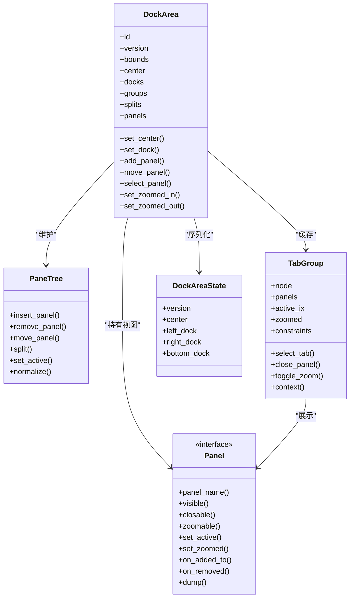

**图表来源**
- [crates/base/src/dock/dock_area.rs:95-116](file://crates/base/src/dock/dock_area.rs#L95-L116)
- [crates/base/src/dock/tab_group.rs:136-159](file://crates/base/src/dock/tab_group.rs#L136-L159)
- [crates/base/src/dock/panel.rs:18-93](file://crates/base/src/dock/panel.rs#L18-L93)
- [crates/base/src/dock/state.rs:4-84](file://crates/base/src/dock/state.rs#L4-L84)

**章节来源**
- [crates/base/src/dock/mod.rs:1-168](file://crates/base/src/dock/mod.rs#L1-L168)
- [crates/base/src/dock/dock_area.rs:1-116](file://crates/base/src/dock/dock_area.rs#L1-L116)

## Dock 停靠面板详解

### 设计理念

Dock 的核心思想是：**布局即数据**。每个区域——中心区以及可选的左、右、下停靠区——都是一棵 `PaneTree`。容器只有两种形态：拆分容器和标签容器。面板只能存在于标签容器中。

这种设计的优势包括：

- 布局可以脱离窗口环境测试。
- 布局可以比较、归一化、序列化。
- 拖拽不会破坏未触达容器的实体。
- 稳定 ID 让 reconcile 成为 diff，而不是重建整棵树。

**章节来源**
- [crates/base/src/dock/mod.rs:1-111](file://crates/base/src/dock/mod.rs#L1-L111)

### DockArea 的职责

`DockArea` 是停靠区域的协调器，负责：

1. 维护中心区和各停靠区的布局树。
2. 缓存容器实体，避免重复创建。
3. 将布局编辑转换为实际 UI 实体。
4. 处理面板添加、移除、移动、选择。
5. 处理停靠区打开、关闭、缩放、锁定。
6. 发出 `DockEvent::LayoutChanged` 供外部持久化。

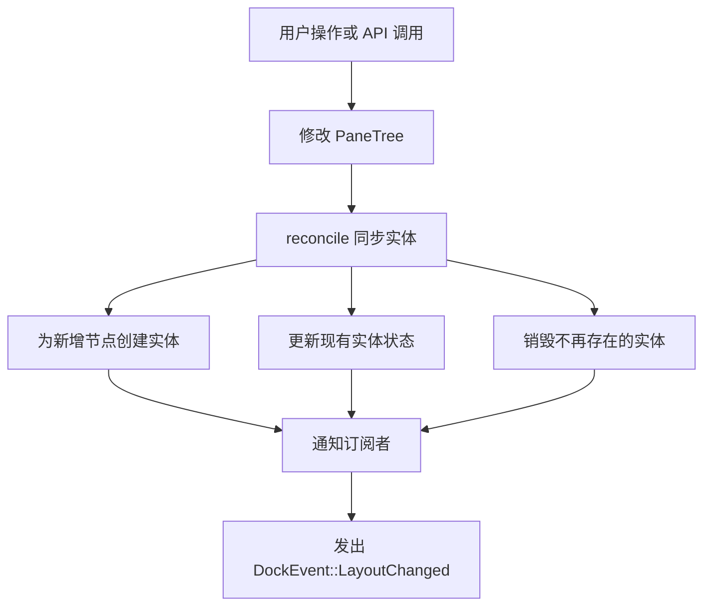

**图表来源**
- [crates/base/src/dock/dock_area.rs:1-45](file://crates/base/src/dock/dock_area.rs#L1-L45)
- [crates/base/src/dock/dock_area.rs:228-365](file://crates/base/src/dock/dock_area.rs#L228-L365)

**章节来源**
- [crates/base/src/dock/dock_area.rs:95-226](file://crates/base/src/dock/dock_area.rs#L95-L226)
- [crates/base/src/dock/dock_area.rs:228-365](file://crates/base/src/dock/dock_area.rs#L228-L365)

### 面板契约

`Panel` 是可停靠内容的行为契约。它不负责外观，只回答 Dock 需要知道的属性：

| 方法 | 含义 |
|---|---|
| `panel_name` | 面板类型名称，用于持久化 |
| `visible` | 面板是否可见 |
| `closable` | 面板是否允许关闭 |
| `zoomable` | 面板是否允许全屏缩放 |
| `set_active` | 面板变为或失去活动状态 |
| `set_zoomed` | 所在标签组进入或退出缩放 |
| `on_added_to` | 面板加入标签组时回调 |
| `on_removed` | 面板永久离开停靠区时回调 |
| `dump` | 输出面板自身状态 |

**章节来源**
- [crates/base/src/dock/panel.rs:18-93](file://crates/base/src/dock/panel.rs#L18-L93)

### 持久化状态

Dock 的持久化结构包含版本、中心区、左、右、下停靠区。每个停靠区记录面板结构、放置位置、尺寸、是否打开。

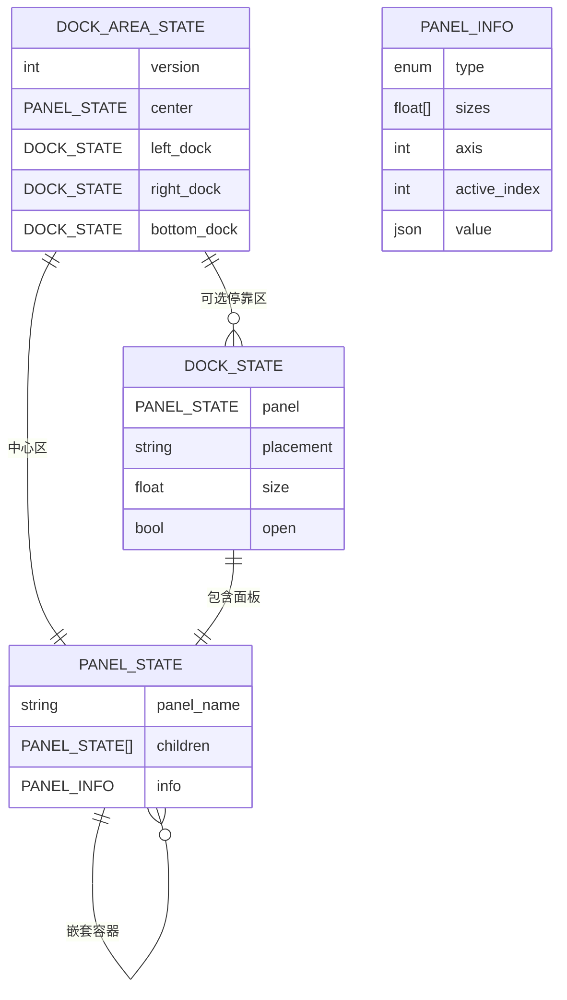

**图表来源**
- [crates/base/src/dock/state.rs:4-84](file://crates/base/src/dock/state.rs#L4-L84)
- [crates/base/src/dock/state.rs:156-191](file://crates/base/src/dock/state.rs#L156-L191)

**章节来源**
- [crates/base/src/dock/state.rs:4-136](file://crates/base/src/dock/state.rs#L4-L136)
- [crates/base/src/dock/state.rs:156-191](file://crates/base/src/dock/state.rs#L156-L191)

## Tabs 标签页详解

Tabs 提供两个层次：

- `Tabs`：标签集合根元素，提供 `TabList` 语义。
- `Tab`：单个标签，负责点击、禁用、选中、无障碍标签和位置信息。

Tabs 本身不维护选中状态，也不引入新的键盘导航规则。选中状态由调用方通过 `selected` 控制，这使 Tabs 更适合作为基础原语，由上层组合出完整标签栏。

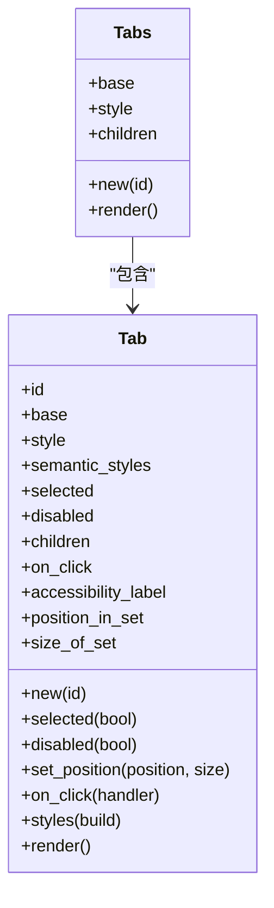

**图表来源**
- [crates/base/src/tabs.rs:22-35](file://crates/base/src/tabs.rs#L22-L35)
- [crates/base/src/tabs.rs:186-235](file://crates/base/src/tabs.rs#L186-L235)

**章节来源**
- [crates/base/src/tabs.rs:15-184](file://crates/base/src/tabs.rs#L15-L184)
- [crates/base/src/tabs.rs:186-235](file://crates/base/src/tabs.rs#L186-L235)

## Tree 树形控件详解

Tree 是一个虚拟化树控件，适合大量层级数据。它使用 `uniform_list` 只渲染可见条目，并通过 `TreeState` 管理展开、折叠、选中、滚动和键盘导航。

### 数据结构

| 类型 | 作用 |
|---|---|
| `TreeItem` | 树节点，包含 ID、标签、子节点、展开和禁用状态 |
| `TreeEntry` | 扁平化后的可见条目，附带深度信息 |
| `TreeState` | 渲染状态、选中索引、滚动句柄、渲染回调 |
| `TreeEntryState` | 渲染时的选中、右键状态 |

**章节来源**
- [crates/base/src/tree.rs:34-96](file://crates/base/src/tree.rs#L34-L96)
- [crates/base/src/tree.rs:169-214](file://crates/base/src/tree.rs#L169-L214)

### 展开与折叠流程

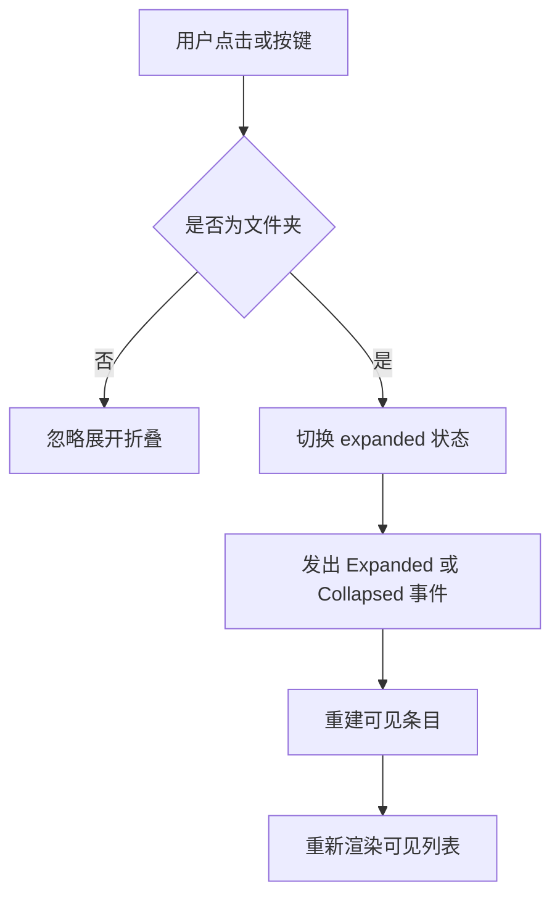

**图表来源**
- [crates/base/src/tree.rs:349-367](file://crates/base/src/tree.rs#L349-L367)
- [crates/base/src/tree.rs:369-376](file://crates/base/src/tree.rs#L369-L376)

**章节来源**
- [crates/base/src/tree.rs:349-376](file://crates/base/src/tree.rs#L349-L376)

### 键盘导航

Tree 注册了上下左右键绑定：

- `up` / `down`：在可见条目间移动选中。
- `left`：折叠当前选中的文件夹。
- `right`：展开当前选中的文件夹。
- `confirm`：对文件夹执行展开或折叠。

**章节来源**
- [crates/base/src/tree.rs:19-27](file://crates/base/src/tree.rs#L19-L27)
- [crates/base/src/tree.rs:378-439](file://crates/base/src/tree.rs#L378-L439)

### 选中与定位

Tree 支持通过 ID 选中、显示祖先路径、滚动到指定条目。如果目标被隐藏，Tree 会自动展开其祖先节点。

**章节来源**
- [crates/base/src/tree.rs:228-285](file://crates/base/src/tree.rs#L228-L285)
- [crates/base/src/tree.rs:298-319](file://crates/base/src/tree.rs#L298-L319)

## Resizable 可调整大小容器详解

Resizable 提供水平或垂直方向的面板分组，支持拖拽分割线调整宽度或高度。它适合侧边栏、主内容区、辅助面板等常见布局。

### 核心概念

| 概念 | 说明 |
|---|---|
| `h_resizable` | 水平方向可调整大小的容器 |
| `v_resizable` | 垂直方向可调整大小的容器 |
| `resizable_panel` | 单个可调整大小的面板 |
| `ResizableState` | 面板数量、尺寸、轴、当前正在调整的面板索引 |
| `PANEL_MIN_SIZE` | 默认最小面板尺寸 |

**章节来源**
- [crates/base/src/resizable/mod.rs:15-31](file://crates/base/src/resizable/mod.rs#L15-L31)
- [crates/base/src/resizable/mod.rs:33-54](file://crates/base/src/resizable/mod.rs#L33-L54)

### 尺寸分配算法

当用户拖动分割线时，Resizable 会：

1. 同步当前面板的实际尺寸。
2. 计算目标尺寸变化。
3. 根据面板的最小/最大范围限制新尺寸。
4. 向相邻面板分配或回收空间。
5. 跳过标记为 `fixed` 的面板，除非拖动发生在其自身分割线上。
6. 确保总尺寸不超过容器尺寸。
7. 发出 `ResizablePanelEvent::Resized`。

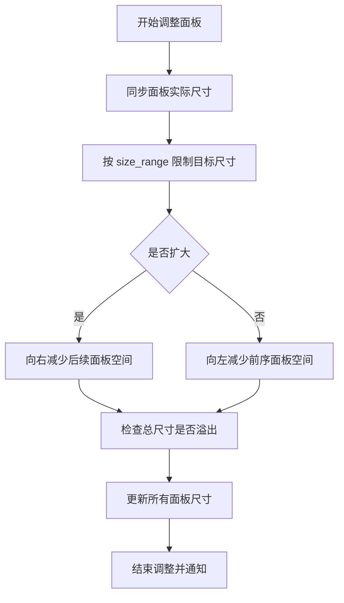

**图表来源**
- [crates/base/src/resizable/mod.rs:302-379](file://crates/base/src/resizable/mod.rs#L302-L379)

**章节来源**
- [crates/base/src/resizable/mod.rs:302-379](file://crates/base/src/resizable/mod.rs#L302-L379)

### 固定面板与比例恢复

Resizable 支持 `fixed` 面板。固定面板在容器尺寸变化时保持自身尺寸，其余面板按比例共享剩余空间。如果容器暂时过小，也不会丢失比例信息。

**章节来源**
- [crates/base/src/resizable/mod.rs:381-435](file://crates/base/src/resizable/mod.rs#L381-L435)

## Collapsible 可折叠容器详解

Collapsible 是一个无样式的可控展开/折叠容器。它有两种内容呈现方式：

- 普通内容：仅在 `open` 为真时渲染。
- 揭示内容：通过 `reveal(id, progress)` 保留挂载并按进度显示。

这使得 Collapsible 既能节省渲染开销，又能配合动画系统实现平滑展开效果。

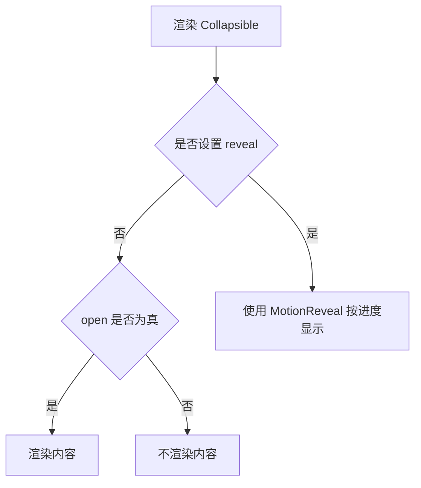

**图表来源**
- [crates/base/src/collapsible.rs:68-81](file://crates/base/src/collapsible.rs#L68-L81)

**章节来源**
- [crates/base/src/collapsible.rs:12-81](file://crates/base/src/collapsible.rs#L12-L81)

## Accordion 手风琴详解

Accordion 由三个部分组成：

- `Accordion`：手风琴根容器，语义角色为 `Group`。
- `AccordionItem`：一个标题与一个面板的组合。
- `AccordionHeader`：标题区域，内部包含 `AccordionTrigger`。
- `AccordionPanel`：受控挂载的内容区域。
- `AccordionTrigger`：按钮式触发器，请求切换 `open` 状态。

Accordion 的状态完全由调用方控制。触发器只发出变更请求，不直接修改外部状态。

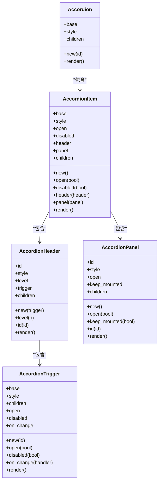

**图表来源**
- [crates/base/src/accordion.rs:15-77](file://crates/base/src/accordion.rs#L15-L77)
- [crates/base/src/accordion.rs:136-204](file://crates/base/src/accordion.rs#L136-L204)
- [crates/base/src/accordion.rs:206-271](file://crates/base/src/accordion.rs#L206-L271)
- [crates/base/src/accordion.rs:273-360](file://crates/base/src/accordion.rs#L273-L360)

**章节来源**
- [crates/base/src/accordion.rs:15-360](file://crates/base/src/accordion.rs#L15-L360)

## 嵌套关系与组合模式

这些布局组件通常不是孤立使用的，而是组合成多层界面：

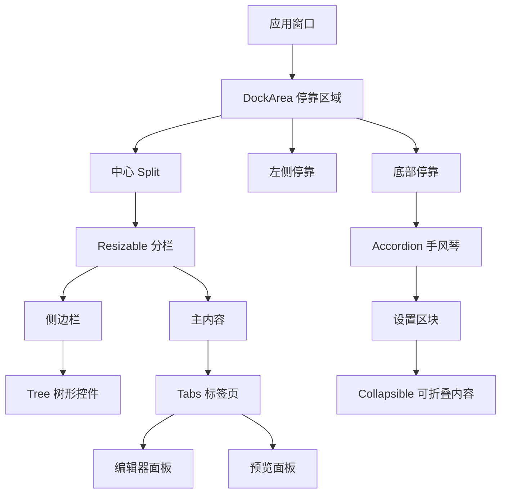

**图表来源**
- [crates/base/src/dock/dock_area.rs:95-116](file://crates/base/src/dock/dock_area.rs#L95-L116)
- [crates/base/src/resizable/mod.rs:15-31](file://crates/base/src/resizable/mod.rs#L15-L31)
- [crates/base/src/tree.rs:493-564](file://crates/base/src/tree.rs#L493-L564)
- [crates/base/src/tabs.rs:186-235](file://crates/base/src/tabs.rs#L186-L235)
- [crates/base/src/accordion.rs:15-77](file://crates/base/src/accordion.rs#L15-L77)
- [crates/base/src/collapsible.rs:12-47](file://crates/base/src/collapsible.rs#L12-L47)

**章节来源**
- [crates/base/src/dock/dock_area.rs:95-116](file://crates/base/src/dock/dock_area.rs#L95-L116)
- [crates/base/src/resizable/mod.rs:15-31](file://crates/base/src/resizable/mod.rs#L15-L31)

## 状态管理与事件流

### Dock 状态流

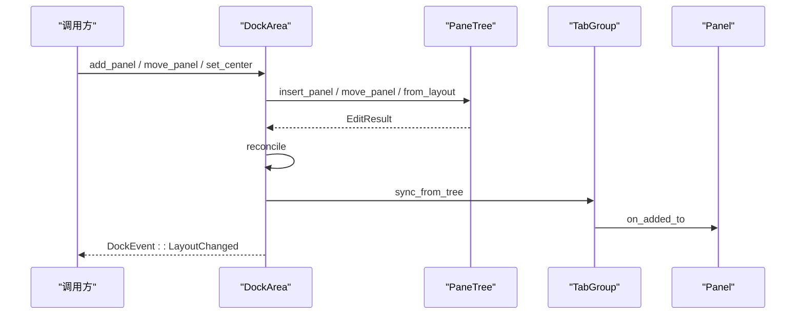

**图表来源**
- [crates/base/src/dock/dock_area.rs:367-457](file://crates/base/src/dock/dock_area.rs#L367-L457)
- [crates/base/src/dock/tab_group.rs:325-348](file://crates/base/src/dock/tab_group.rs#L325-L348)

**章节来源**
- [crates/base/src/dock/dock_area.rs:367-457](file://crates/base/src/dock/dock_area.rs#L367-L457)
- [crates/base/src/dock/tab_group.rs:325-348](file://crates/base/src/dock/tab_group.rs#L325-L348)

### Tree 状态流

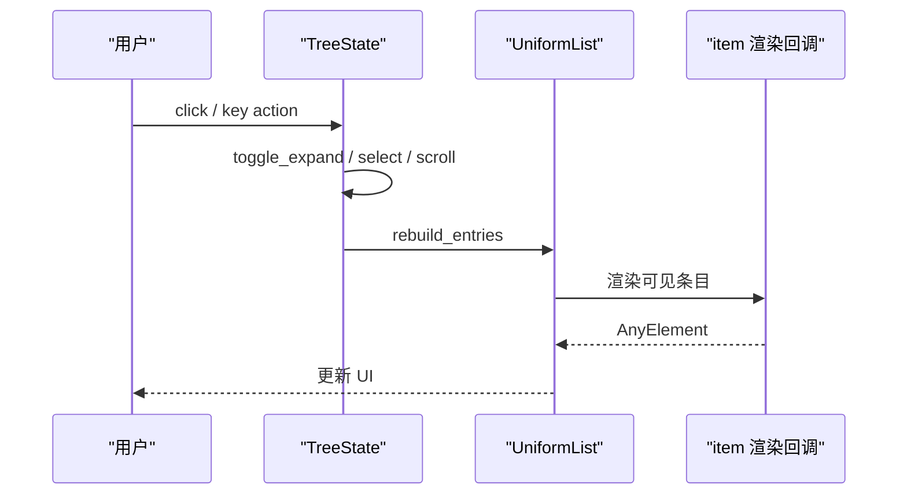

**图表来源**
- [crates/base/src/tree.rs:441-491](file://crates/base/src/tree.rs#L441-L491)
- [crates/base/src/tree.rs:349-376](file://crates/base/src/tree.rs#L349-L376)

**章节来源**
- [crates/base/src/tree.rs:441-491](file://crates/base/src/tree.rs#L441-L491)

### Accordion 状态流

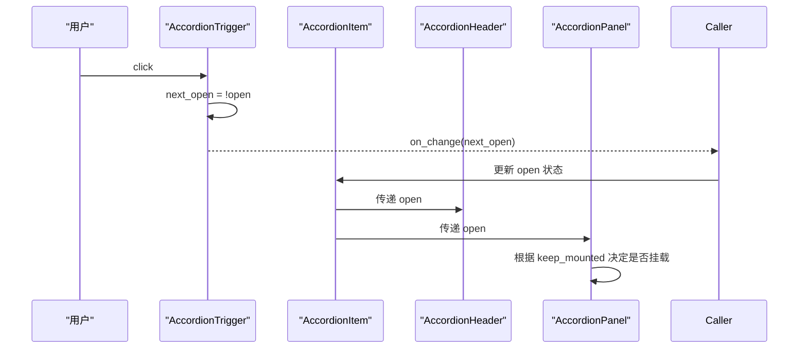

**图表来源**
- [crates/base/src/accordion.rs:344-360](file://crates/base/src/accordion.rs#L344-L360)
- [crates/base/src/accordion.rs:124-134](file://crates/base/src/accordion.rs#L124-L134)
- [crates/base/src/accordion.rs:255-271](file://crates/base/src/accordion.rs#L255-L271)

**章节来源**
- [crates/base/src/accordion.rs:344-360](file://crates/base/src/accordion.rs#L344-L360)
- [crates/base/src/accordion.rs:124-134](file://crates/base/src/accordion.rs#L124-L134)

## 拖拽交互与放置目标

Dock 的拖拽能力集中在 `TabGroup` 和 Dock 的 drag 模块中。拖拽分为两类：

- 面板拖拽：从一个标签组移动到另一个标签组或拆分位置。
- 宿主拖拽：应用自定义拖拽项落入 Dock。

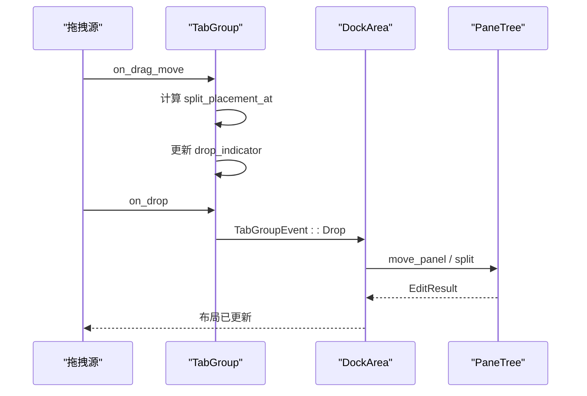

**图表来源**
- [crates/base/src/dock/tab_group.rs:514-669](file://crates/base/src/dock/tab_group.rs#L514-L669)
- [crates/base/src/dock/dock_area.rs:478-553](file://crates/base/src/dock/dock_area.rs#L478-L553)

**章节来源**
- [crates/base/src/dock/tab_group.rs:514-669](file://crates/base/src/dock/tab_group.rs#L514-L669)
- [crates/base/src/dock/dock_area.rs:478-553](file://crates/base/src/dock/dock_area.rs#L478-L553)

## 动画与可见性控制

GPUI Kit 的布局组件在动画方面采取“行为与表现分离”的策略：

- Collapsible 支持 `reveal(id, progress)`，将内容交给 `MotionReveal` 控制。
- Accordion 的 `AccordionPanel` 支持 `keep_mounted`，避免频繁销毁重建。
- Tree 使用虚拟化列表，只渲染可见条目。
- Dock 的缩放和折叠通过状态变化驱动，具体动画由上层皮肤决定。

**章节来源**
- [crates/base/src/collapsible.rs:42-47](file://crates/base/src/collapsible.rs#L42-L47)
- [crates/base/src/collapsible.rs:68-81](file://crates/base/src/collapsible.rs#L68-L81)
- [crates/base/src/accordion.rs:206-271](file://crates/base/src/accordion.rs#L206-L271)
- [crates/base/src/tree.rs:448-491](file://crates/base/src/tree.rs#L448-L491)

## 响应式设计建议

虽然这些组件没有内置媒体查询，但可以通过以下方式实现响应式布局：

1. **使用 Resizable 的比例分配**：在宽屏上显示侧边栏，窄屏上隐藏或折叠。
2. **结合 Dock 的停靠区开关**：在小窗口中关闭非核心停靠区。
3. **使用 Collapsible 和 Accordion**：将次要内容折叠，只在需要时展开。
4. **监听容器尺寸变化**：在父组件中根据宽度切换布局策略。
5. **避免深层嵌套**：小屏幕下尽量扁平化 Tree 和 Accordion。

**章节来源**
- [crates/base/src/resizable/mod.rs:381-435](file://crates/base/src/resizable/mod.rs#L381-L435)
- [crates/base/src/collapsible.rs:12-47](file://crates/base/src/collapsible.rs#L12-L47)
- [crates/base/src/accordion.rs:15-77](file://crates/base/src/accordion.rs#L15-L77)

## 无障碍访问支持

### Tabs

- `Tabs` 提供 `Role::TabList`。
- `Tab` 提供 `Role::Tab`。
- 支持 `aria_selected`、`aria_label`、`aria_position_in_set`、`aria_size_of_set`。
- 禁用标签不会触发点击。

**章节来源**
- [crates/base/src/tabs.rs:149-184](file://crates/base/src/tabs.rs#L149-L184)
- [crates/base/src/tabs.rs:228-235](file://crates/base/src/tabs.rs#L228-L235)

### Tree

- Tree 根提供 `Role::Tree`。
- 条目提供 `Role::TreeItem`。
- 支持 `aria_label`、`aria_selected`、`aria_expanded`。
- 支持键盘上下左右导航。

**章节来源**
- [crates/base/src/tree.rs:448-491](file://crates/base/src/tree.rs#L448-L491)
- [crates/base/src/tree.rs:19-27](file://crates/base/src/tree.rs#L19-L27)

### Accordion

- `Accordion` 提供 `Role::Group`。
- `AccordionHeader` 提供 `Role::Heading`。
- `AccordionPanel` 提供 `Role::Region`。
- `AccordionTrigger` 提供 `Role::Button` 和 `aria_expanded`。

**章节来源**
- [crates/base/src/accordion.rs:58-65](file://crates/base/src/accordion.rs#L58-L65)
- [crates/base/src/accordion.rs:188-204](file://crates/base/src/accordion.rs#L188-L204)
- [crates/base/src/accordion.rs:255-271](file://crates/base/src/accordion.rs#L255-L271)
- [crates/base/src/accordion.rs:344-360](file://crates/base/src/accordion.rs#L344-L360)

## 性能优化与最佳实践

### Dock

- 使用稳定 `NodeId` 和 `PanelId`，避免不必要的实体重建。
- 对 `DockEvent::LayoutChanged` 做防抖持久化。
- 避免频繁调用 `set_center` 或 `set_dock`，合并多次布局变更。
- 使用 `is_empty` 判断区域可见性，避免渲染空区域。

**章节来源**
- [crates/base/src/dock/mod.rs:14-47](file://crates/base/src/dock/mod.rs#L14-L47)
- [crates/base/src/dock/dock_area.rs:38-45](file://crates/base/src/dock/dock_area.rs#L38-L45)
- [crates/base/src/dock/dock_area.rs:205-214](file://crates/base/src/dock/dock_area.rs#L205-L214)

### Tree

- 使用 `TreeState::items` 批量替换数据，避免逐条插入。
- 使用 `scroll_handle` 控制滚动位置。
- 对大型树使用虚拟化渲染，不要手动展开全部节点。
- 使用 `reveal_item` 自动展开祖先并滚动到目标。

**章节来源**
- [crates/base/src/tree.rs:216-226](file://crates/base/src/tree.rs#L216-L226)
- [crates/base/src/tree.rs:267-285](file://crates/base/src/tree.rs#L267-L285)
- [crates/base/src/tree.rs:448-491](file://crates/base/src/tree.rs#L448-L491)

### Resizable

- 合理设置 `size_range`，避免极端尺寸导致布局抖动。
- 使用 `fixed` 面板固定侧边栏宽度。
- 监听 `on_resize` 保存用户偏好。
- 避免频繁调用 `resize_panel`，合并程序化调整。

**章节来源**
- [crates/base/src/resizable/mod.rs:62-91](file://crates/base/src/resizable/mod.rs#L62-L91)
- [crates/base/src/resizable/mod.rs:202-242](file://crates/base/src/resizable/mod.rs#L202-L242)

### Accordion 与 Collapsible

- 对重型内容使用 `keep_mounted` 或 `reveal`，避免频繁销毁。
- 默认关闭不常用区块，减少初始渲染压力。
- 使用受控状态，避免组件内部状态与应用状态不一致。

**章节来源**
- [crates/base/src/accordion.rs:232-235](file://crates/base/src/accordion.rs#L232-L235)
- [crates/base/src/collapsible.rs:42-47](file://crates/base/src/collapsible.rs#L42-L47)

## 故障排查指南

### Dock 面板无法关闭

可能原因：

- 面板 `closable` 返回假。
- 标签组不可关闭（例如停靠区最后一个组）。
- 停靠区处于锁定状态。
- 面板已被隐藏，但仍在布局树中。

排查建议：

1. 检查 `Panel::closable`。
2. 检查 `TabGroupConstraints::is_closable`。
3. 检查 `DockArea::is_locked`。
4. 检查 `Panel::visible`。

**章节来源**
- [crates/base/src/dock/panel.rs:32-42](file://crates/base/src/dock/panel.rs#L32-L42)
- [crates/base/src/dock/tab_group.rs:218-229](file://crates/base/src/dock/tab_group.rs#L218-L229)
- [crates/base/src/dock/dock_area.rs:216-225](file://crates/base/src/dock/dock_area.rs#L216-L225)

### Tree 选中项不可见

可能原因：

- 目标节点被隐藏。
- 祖先节点未展开。
- 选中索引无效。
- 滚动位置未更新。

排查建议：

1. 使用 `set_selected_item` 自动展开祖先。
2. 使用 `reveal_item` 滚动到目标。
3. 检查 `entries` 长度和 `selected_index`。
4. 确认 `TreeItem` 的 ID 唯一且稳定。

**章节来源**
- [crates/base/src/tree.rs:237-248](file://crates/base/src/tree.rs#L237-L248)
- [crates/base/src/tree.rs:275-285](file://crates/base/src/tree.rs#L275-L285)
- [crates/base/src/tree.rs:298-319](file://crates/base/src/tree.rs#L298-L319)

### Resizable 面板尺寸异常

可能原因：

- 容器尺寸为 0。
- 面板超出 `size_range`。
- 固定面板与非固定面板混合布局。
- 频繁调整导致状态未收敛。

排查建议：

1. 检查容器 `container_size`。
2. 检查 `size_range` 是否合理。
3. 区分 `fixed` 面板和普通面板。
4. 使用 `adjust_to_container_size` 的逻辑理解比例恢复。

**章节来源**
- [crates/base/src/resizable/mod.rs:381-435](file://crates/base/src/resizable/mod.rs#L381-L435)
- [crates/base/src/resizable/mod.rs:282-288](file://crates/base/src/resizable/mod.rs#L282-L288)

### Accordion 点击无响应

可能原因：

- 触发器被禁用。
- 调用方未更新 `open` 状态。
- 面板被隐藏或未挂载。
- 无障碍禁用导致交互被屏蔽。

排查建议：

1. 检查 `AccordionTrigger::disabled`。
2. 检查 `on_change` 是否正确更新外部状态。
3. 检查 `AccordionPanel::open` 和 `keep_mounted`。
4. 检查无障碍禁用扩展。

**章节来源**
- [crates/base/src/accordion.rs:304-317](file://crates/base/src/accordion.rs#L304-L317)
- [crates/base/src/accordion.rs:255-271](file://crates/base/src/accordion.rs#L255-L271)
- [crates/base/src/tabs.rs:182-183](file://crates/base/src/tabs.rs#L182-L183)

## 结论

GPUI Kit 的布局组件围绕“数据驱动、行为与外观分离、受控状态、稳定标识、可扩展渲染”五个核心原则构建。Dock 提供复杂桌面应用的布局骨架，Resizable 提供灵活的分栏尺寸管理，Tabs、Tree、Collapsible、Accordion 则覆盖常见的交互模式。

在实际项目中，推荐采用以下组合：

- 使用 Dock 作为主界面容器。
- 使用 Resizable 划分侧边栏与主内容。
- 使用 Tree 管理资源或配置层级。
- 使用 Tabs 管理多文档。
- 使用 Accordion 和 Collapsible 管理局部展开内容。
- 通过持久化状态保存用户布局偏好。
- 通过无障碍语义提升可访问性。
- 通过虚拟化、延迟挂载、防抖持久化优化性能。