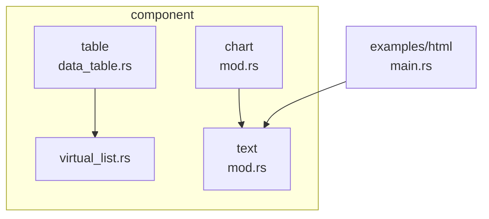
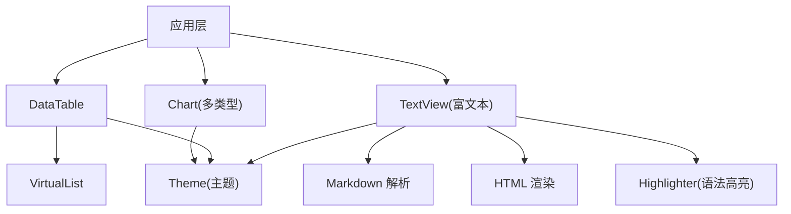
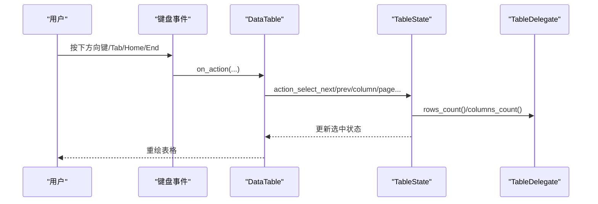
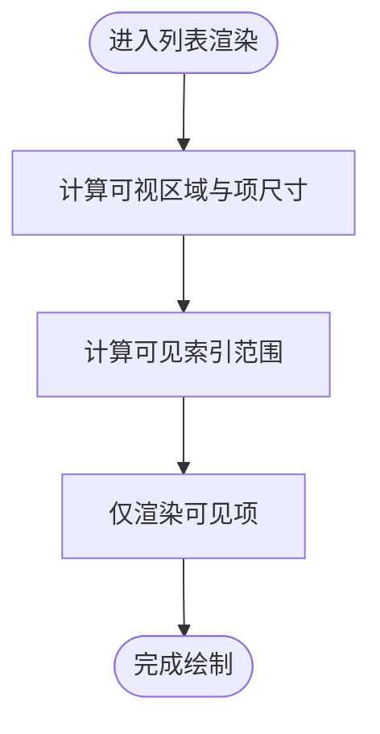
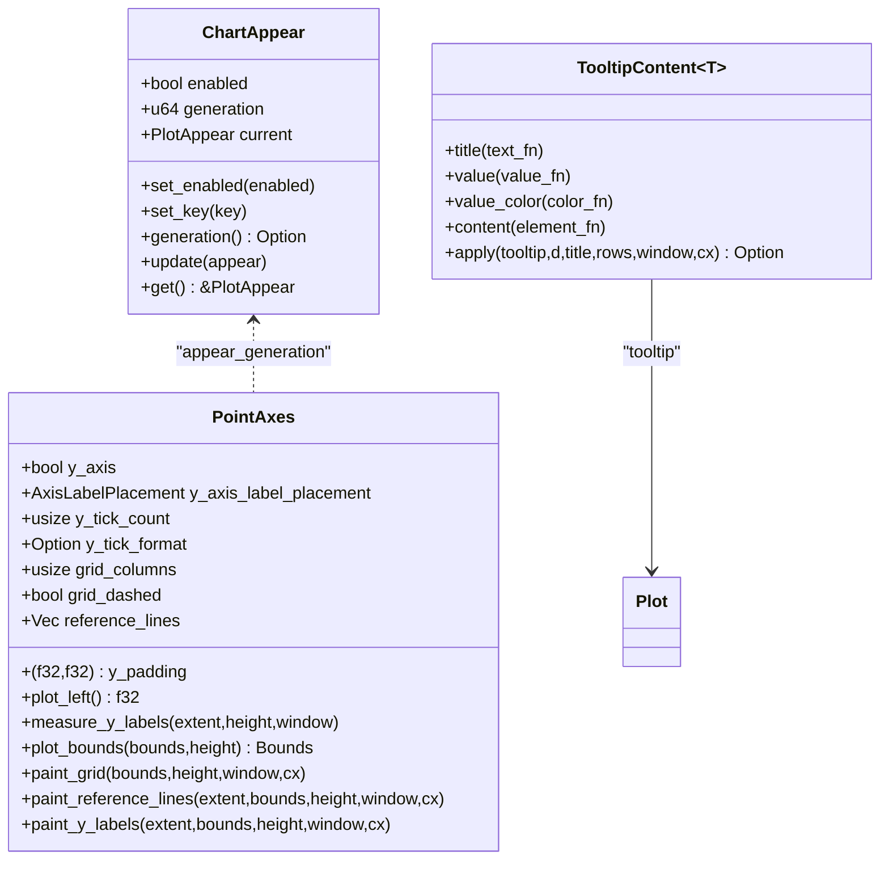
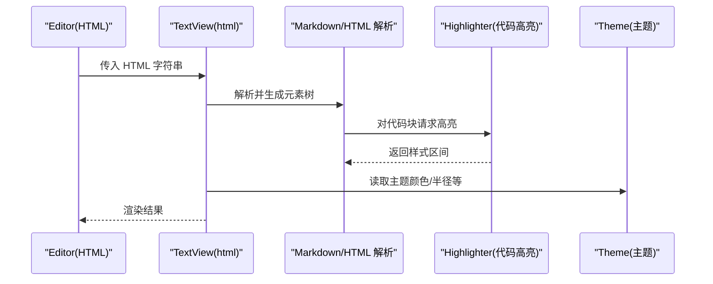
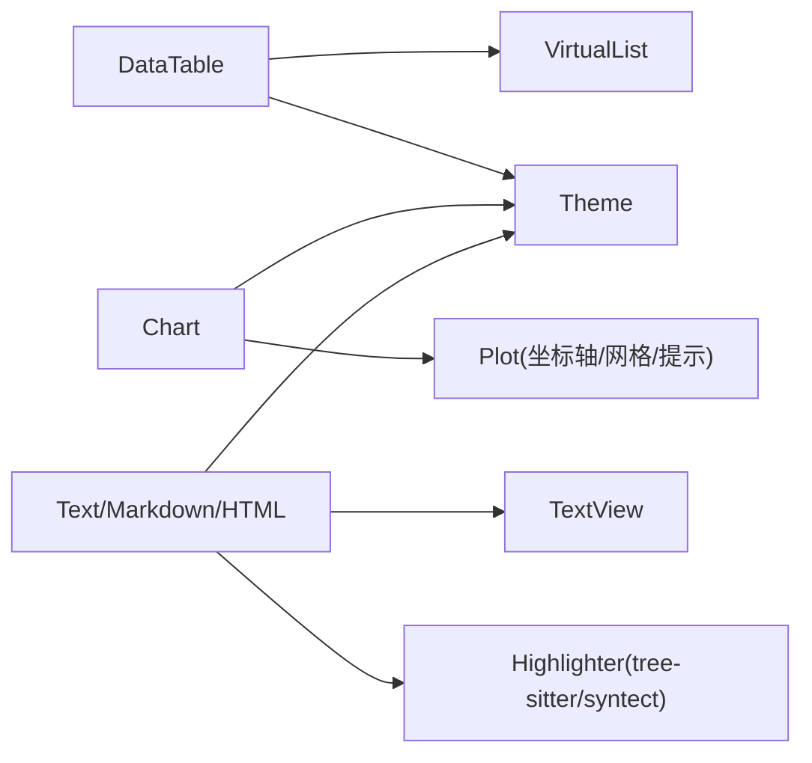

# 数据展示

<cite>
**本文引用的文件**   
- [crates/component/src/table/mod.rs](file://crates/component/src/table/mod.rs)
- [crates/component/src/table/data_table.rs](file://crates/component/src/table/data_table.rs)
- [crates/component/src/virtual_list.rs](file://crates/component/src/virtual_list.rs)
- [crates/component/src/chart/mod.rs](file://crates/component/src/chart/mod.rs)
- [crates/component/src/text/mod.rs](file://crates/component/src/text/mod.rs)
- [examples/html/src/main.rs](file://examples/html/src/main.rs)
</cite>

## 目录
1. [简介](#简介)
2. [项目结构](#项目结构)
3. [核心组件](#核心组件)
4. [架构总览](#架构总览)
5. [详细组件分析](#详细组件分析)
6. [依赖关系分析](#依赖关系分析)
7. [性能考虑](#性能考虑)
8. [故障排查指南](#故障排查指南)
9. [结论](#结论)
10. [附录](#附录)

## 简介
本章节面向 GPUI Kit 的数据展示能力，聚焦以下组件与能力：
- Table（数据表格）：支持行列/单元格选择、虚拟滚动、列宽调整、固定列、排序、右键菜单等。
- VirtualList（虚拟列表）：基于 gpui_base 的虚拟化列表，用于大数据集的高效渲染。
- Chart（图表）：提供折线、面积、柱状、饼图、雷达、K线、桑基等多种图表类型，统一配置与交互。
- Text（文本渲染）：富文本、Markdown、HTML 渲染，主题适配与代码块高亮。
- Markdown（Markdown 渲染）：通过 TextView 扩展点注入语法高亮与样式。
- HTML（HTML 渲染）：示例应用演示编辑器与 HTML 预览联动。

重点覆盖：
- 大数据集处理与虚拟化技术
- 图表配置与交互
- 富文本编辑与高亮
- 性能优化策略
- 自定义渲染器与主题定制方法
- 实际业务场景的应用示例

## 项目结构
GPUI Kit 将数据展示相关能力分布在 component 包中：
- table：数据表格实现与状态管理
- virtual_list：虚拟化列表导出与兼容性封装
- chart：图表族类与公共工具
- text：富文本、Markdown、HTML 渲染与主题集成
- examples/html：HTML 渲染示例

**图示来源**
- [crates/component/src/table/data_table.rs:1-384](file://crates/component/src/table/data_table.rs#L1-L384)
- [crates/component/src/virtual_list.rs:1-23](file://crates/component/src/virtual_list.rs#L1-L23)
- [crates/component/src/chart/mod.rs:1-800](file://crates/component/src/chart/mod.rs#L1-L800)
- [crates/component/src/text/mod.rs:1-519](file://crates/component/src/text/mod.rs#L1-L519)
- [examples/html/src/main.rs:1-120](file://examples/html/src/main.rs#L1-L120)

**章节来源**
- [crates/component/src/table/mod.rs:1-19](file://crates/component/src/table/mod.rs#L1-L19)
- [crates/component/src/virtual_list.rs:1-23](file://crates/component/src/virtual_list.rs#L1-L23)
- [crates/component/src/chart/mod.rs:1-800](file://crates/component/src/chart/mod.rs#L1-L800)
- [crates/component/src/text/mod.rs:1-519](file://crates/component/src/text/mod.rs#L1-L519)
- [examples/html/src/main.rs:1-120](file://examples/html/src/main.rs#L1-L120)

## 核心组件
- DataTable：面向大数据集的表格组件，内置键盘导航、可访问性属性、滚动与边框样式控制。
- VirtualList：复用 gpui_base 的虚拟化能力，提供垂直/水平虚拟列表。
- Chart：统一的图表构建体系，包含坐标轴、刻度、网格、提示框、动画出现等通用逻辑。
- Text/Markdown/HTML：基于 TextView 的富文本渲染管线，支持 Markdown 解析、HTML 渲染、代码块高亮与主题映射。

**章节来源**
- [crates/component/src/table/data_table.rs:62-177](file://crates/component/src/table/data_table.rs#L62-L177)
- [crates/component/src/virtual_list.rs:1-23](file://crates/component/src/virtual_list.rs#L1-L23)
- [crates/component/src/chart/mod.rs:57-154](file://crates/component/src/chart/mod.rs#L57-L154)
- [crates/component/src/text/mod.rs:36-80](file://crates/component/src/text/mod.rs#L36-L80)

## 架构总览
下图展示了数据展示组件在应用中的协作关系：DataTable 依赖虚拟化列表；Chart 使用 plot 子系统与主题；Text/Markdown/HTML 通过 TextView 管线进行渲染，并与 highlighter 集成以支持代码高亮。

**图示来源**
- [crates/component/src/table/data_table.rs:1-384](file://crates/component/src/table/data_table.rs#L1-L384)
- [crates/component/src/virtual_list.rs:1-23](file://crates/component/src/virtual_list.rs#L1-L23)
- [crates/component/src/chart/mod.rs:1-800](file://crates/component/src/chart/mod.rs#L1-L800)
- [crates/component/src/text/mod.rs:1-519](file://crates/component/src/text/mod.rs#L1-L519)

## 详细组件分析

### DataTable（数据表格）
- 功能要点
  - 行/列/单元格选择模式，键盘导航（上下左右、Home/End、PageUp/PageDown、Tab/Shift+Tab）。
  - 可访问性：当启用行或单元格选择时，role 为 Grid，否则为 Table；暴露 aria_row_count/aria_column_count。
  - 外观：条纹、边框、固定列边框、表头行高度、滚动回弹、滚动条可见性。
  - 尺寸：通过 Sizable 接口设置整体尺寸。
- 关键流程
  - 初始化绑定快捷键上下文。
  - 渲染时根据 state 计算 role 与行列数，挂载 action 监听，应用主题背景与圆角边框。
  - 焦点环仅在键盘输入时显示，可通过 focus_ring 开关。

**图示来源**
- [crates/component/src/table/data_table.rs:17-31](file://crates/component/src/table/data_table.rs#L17-L31)
- [crates/component/src/table/data_table.rs:203-265](file://crates/component/src/table/data_table.rs#L203-L265)

**章节来源**
- [crates/component/src/table/mod.rs:1-19](file://crates/component/src/table/mod.rs#L1-L19)
- [crates/component/src/table/data_table.rs:17-31](file://crates/component/src/table/data_table.rs#L17-L31)
- [crates/component/src/table/data_table.rs:62-177](file://crates/component/src/table/data_table.rs#L62-L177)
- [crates/component/src/table/data_table.rs:203-265](file://crates/component/src/table/data_table.rs#L203-L265)

### VirtualList（虚拟列表）
- 设计要点
  - 直接复用 gpui_base 的 VirtualList/VirtualListScrollHandle，并提供 h_virtual_list/v_virtual_list。
  - 兼容旧版 handle 类型，确保与 ScrollbarHandle 互操作。
- 适用场景
  - 长列表、无限滚动、大数据集展示。
  - 与 DataTable 配合，支撑高效渲染。

**图示来源**
- [crates/component/src/virtual_list.rs:1-23](file://crates/component/src/virtual_list.rs#L1-L23)

**章节来源**
- [crates/component/src/virtual_list.rs:1-23](file://crates/component/src/virtual_list.rs#L1-L23)

### Chart（图表）
- 组件族
  - LineChart/AreaChart/BarChart/PieChart/RadarChart/CandlestickChart/SankeyChart。
- 公共能力
  - 出现动画（appear）与 key 控制，跨系列 tooltip 内容定制，坐标轴与网格绘制，刻度标签格式化，x/y 比例尺与值域计算。
  - 交互：hover 点、十字准线、路径缓存、点击/悬停命中测试。
- 典型流程（以点线图为例）
  - 计算 x 轴点数量与范围，建立 y 值比例尺与 ValueExtent。
  - 绘制网格、参考线、y 轴标签。
  - 渲染系列路径/区域，叠加 hover 点与 tooltip。

**图示来源**
- [crates/component/src/chart/mod.rs:57-101](file://crates/component/src/chart/mod.rs#L57-L101)
- [crates/component/src/chart/mod.rs:382-566](file://crates/component/src/chart/mod.rs#L382-L566)
- [crates/component/src/chart/mod.rs:286-380](file://crates/component/src/chart/mod.rs#L286-L380)

**章节来源**
- [crates/component/src/chart/mod.rs:1-800](file://crates/component/src/chart/mod.rs#L1-L800)

### Text / Markdown / HTML（富文本渲染）
- 能力概览
  - 通过 TextView 提供富文本、Markdown、HTML 渲染能力。
  - 主题适配：将组件主题映射到 TextView 的基础样式（前景色、链接、选择、代码块、表格、内联代码等）。
  - 代码块高亮：支持 tree-sitter 与 syntect 两种后端，按语言注册与缓存高亮器，避免重复解析。
  - HTML 渲染示例：编辑器与 HTML 预览联动，支持复制格式切换（纯文本/源码/跨样式源码）。

**图示来源**
- [examples/html/src/main.rs:55-107](file://examples/html/src/main.rs#L55-L107)
- [crates/component/src/text/mod.rs:36-80](file://crates/component/src/text/mod.rs#L36-L80)
- [crates/component/src/text/mod.rs:82-144](file://crates/component/src/text/mod.rs#L82-L144)

**章节来源**
- [crates/component/src/text/mod.rs:1-519](file://crates/component/src/text/mod.rs#L1-L519)
- [examples/html/src/main.rs:1-120](file://examples/html/src/main.rs#L1-L120)

## 依赖关系分析
- DataTable 依赖虚拟化列表能力（通过 VirtualList），并在渲染阶段委托 TableState/TableDelegate 获取行列信息与单元格渲染。
- Chart 依赖 plot 子系统的坐标轴、网格、提示框与主题；通过 caller_id 保证多个图表实例的交互隔离。
- Text/Markdown/HTML 依赖 TextView 基础能力，并通过 theme adapter 注入默认样式；代码高亮依赖 highlighter 后端（tree-sitter/syntect）。

**图示来源**
- [crates/component/src/table/data_table.rs:1-384](file://crates/component/src/table/data_table.rs#L1-L384)
- [crates/component/src/virtual_list.rs:1-23](file://crates/component/src/virtual_list.rs#L1-L23)
- [crates/component/src/chart/mod.rs:1-800](file://crates/component/src/chart/mod.rs#L1-L800)
- [crates/component/src/text/mod.rs:1-519](file://crates/component/src/text/mod.rs#L1-L519)

**章节来源**
- [crates/component/src/table/data_table.rs:1-384](file://crates/component/src/table/data_table.rs#L1-L384)
- [crates/component/src/chart/mod.rs:1-800](file://crates/component/src/chart/mod.rs#L1-L800)
- [crates/component/src/text/mod.rs:1-519](file://crates/component/src/text/mod.rs#L1-L519)

## 性能考虑
- 大数据集与虚拟化
  - 使用 VirtualList 仅渲染可视区域项，降低 DOM/节点创建与布局成本。
  - DataTable 结合虚拟化列表，适合万级行列数据的稳定渲染。
- 图表渲染优化
  - 使用 appear_generation 控制动画帧，避免无意义重绘。
  - 合理设置 point_count 与 labeled_items，减少轴标签与网格计算量。
  - 使用 path cache 与 ContentMask 裁剪，降低重叠绘制开销。
- 富文本与高亮
  - 共享高亮器缓存（shared_code_block_highlighter），避免频繁重建解析器。
  - 按语言注册后刷新缓存，避免重复解析；主题变化时自动失效旧缓存。
- 主题与样式
  - 通过 base_text_view_style 一次性映射主题到 TextView 样式，减少每帧计算。

[本节为通用指导，不直接分析具体文件]

## 故障排查指南
- 表格不可见或无法交互
  - 检查是否启用了 row_selectable/cell_selectable，role 应为 Grid；确认 aria_row_count/aria_column_count 已设置。
  - 若键盘导航无效，确认 key_context 与 action 监听是否正确绑定。
- 虚拟列表卡顿
  - 确认项高度与可视区域计算正确；避免在 render 中进行昂贵计算。
- 图表交互异常
  - 多个图表兄弟节点未命名 id 可能导致 hover 状态冲突；必要时显式设置 id。
  - appear_key 不一致会导致动画重复播放，需保持稳定 key。
- 富文本高亮缺失
  - 确认已安装代码块高亮器；检查语言注册与主题是否匹配。
  - 若动态注册新语言，注意缓存刷新与 Arc 生命周期。

**章节来源**
- [crates/component/src/table/data_table.rs:203-265](file://crates/component/src/table/data_table.rs#L203-L265)
- [crates/component/src/chart/mod.rs:38-55](file://crates/component/src/chart/mod.rs#L38-L55)
- [crates/component/src/text/mod.rs:82-144](file://crates/component/src/text/mod.rs#L82-L144)

## 结论
GPUI Kit 的数据展示组件围绕“虚拟化 + 主题化 + 可扩展”的设计展开：
- DataTable 提供企业级表格能力，结合虚拟化应对大数据集。
- VirtualList 作为底层虚拟化能力，被表格与列表广泛复用。
- Chart 族类统一了坐标轴、网格、提示与动画，便于扩展新的图表类型。
- Text/Markdown/HTML 通过 TextView 管线与 highlighter 集成，提供高性能富文本体验。
在实际业务中，建议优先使用虚拟化与主题适配，按需开启交互与动画，以获得最佳性能与一致性体验。

[本节为总结性内容，不直接分析具体文件]

## 附录
- 实际业务场景示例
  - 数据报表：DataTable + VirtualList 展示海量记录，支持分页、排序、筛选与导出。
  - 监控大屏：Chart 族类实时刷新，使用 appear_key 区分不同指标，避免动画抖动。
  - 文档与日志：TextView 渲染 Markdown/HTML，代码块高亮辅助定位问题。
  - HTML 编辑器：如示例所示，左侧编辑器与右侧 HTML 预览联动，支持多种复制格式。

[本节为概念性说明，不直接分析具体文件]