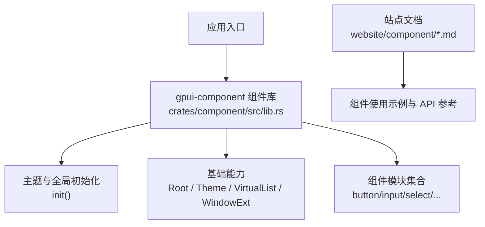
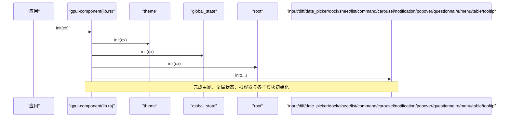
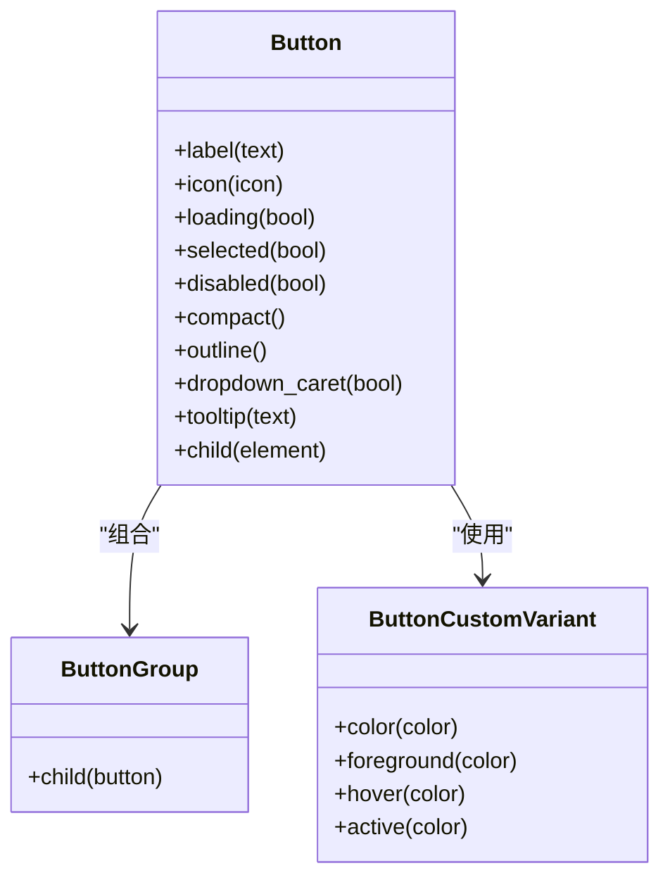
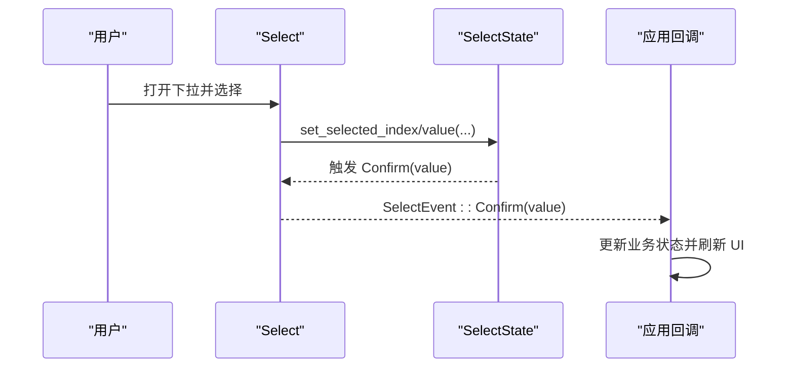
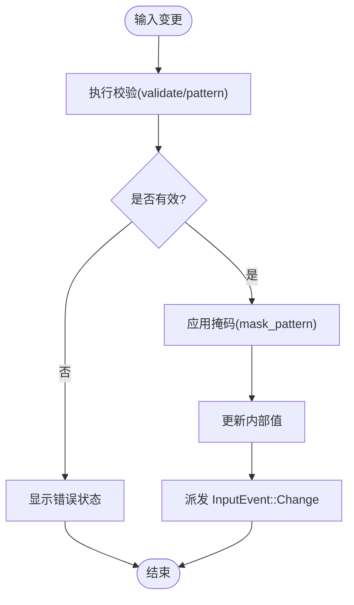
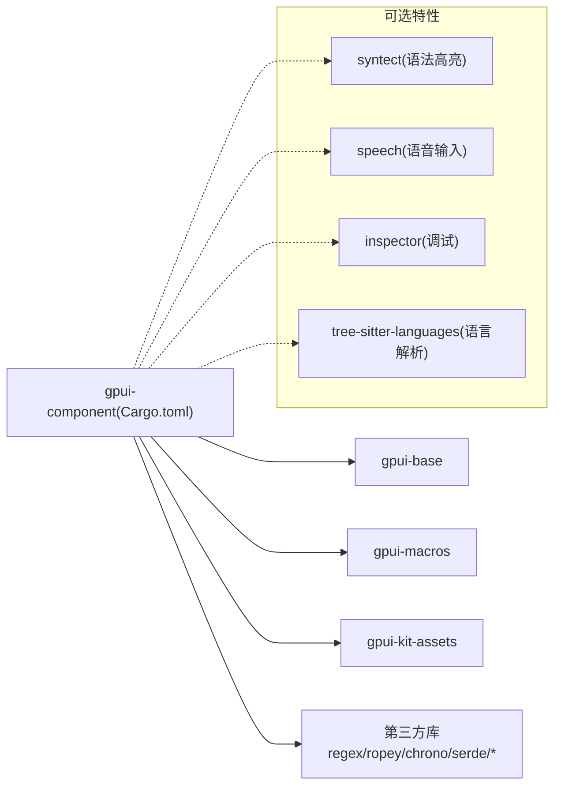

# 组件库

<cite>
**本文引用的文件**   
- [crates/component/src/lib.rs](file://crates/component/src/lib.rs)
- [crates/component/Cargo.toml](file://crates/component/Cargo.toml)
- [website/component/index.md](file://website/component/index.md)
- [website/component/button.md](file://website/component/button.md)
- [website/component/input.md](file://website/component/input.md)
- [website/component/select.md](file://website/component/select.md)
- [website/component/checkbox.md](file://website/component/checkbox.md)
- [website/component/dock.md](file://website/component/dock.md)
- [website/component/tabs.md](file://website/component/tabs.md)
- [website/component/tree.md](file://website/component/tree.md)
- [website/component/table.md](file://website/component/table.md)
</cite>

## 目录
1. [简介](#简介)
2. [项目结构](#项目结构)
3. [核心组件](#核心组件)
4. [架构总览](#架构总览)
5. [详细组件分析](#详细组件分析)
6. [依赖关系分析](#依赖关系分析)
7. [性能与可访问性](#性能与可访问性)
8. [故障排查指南](#故障排查指南)
9. [结论](#结论)
10. [附录：组件分类索引](#附录组件分类索引)

## 简介
本文件为 GPUI Kit 组件库的完整文档，覆盖表单控件、布局组件、数据展示、覆盖层、导航与反馈等类别，提供 75+ 个预构建组件的功能说明、API 要点、事件处理、样式定制与组合模式。文档以仓库中的官方文档与源码入口为依据，帮助你在桌面端快速搭建高质量 UI。

## 项目结构
GPUI Kit 的组件实现集中在 crates/component 中，并通过 lib.rs 统一导出；网站文档位于 website/component，提供每个组件的详细用法示例与 API 参考。

图表来源
- [crates/component/src/lib.rs:125-151](file://crates/component/src/lib.rs#L125-L151)
- [website/component/index.md:1-90](file://website/component/index.md#L1-L90)

章节来源
- [crates/component/src/lib.rs:1-172](file://crates/component/src/lib.rs#L1-L172)
- [website/component/index.md:1-90](file://website/component/index.md#L1-L90)

## 核心组件
本节聚焦常用且高复用的组件族，给出关键属性、事件与样式要点，并附上“代码片段路径”以便在仓库中定位示例。

- 按钮 Button
  - 功能要点：多变体（primary/secondary/danger/warning/success/info/ghost/link/text）、尺寸（xsmall/small/large）、图标（Icon/Spinner/ProgressCircle）、加载态、选中态、禁用态、分组 ButtonGroup、自定义变体。
  - 常用属性与方法：label、icon、loading、selected、disabled、compact、outline、dropdown_caret、tooltip、child。
  - 事件：on_click。
  - 样式：通过 Sizable、ButtonVariants、ActiveTheme 进行尺寸与颜色定制。
  - 代码片段路径
    - [website/component/button.md:19-35](file://website/component/button.md#L19-L35)
    - [website/component/button.md:47-113](file://website/component/button.md#L47-L113)
    - [website/component/button.md:115-204](file://website/component/button.md#L115-L204)
    - [website/component/button.md:265-329](file://website/component/button.md#L265-L329)

- 输入 Input
  - 功能要点：单行文本输入、占位符、默认值、清理按钮、前后缀、密码掩码、尺寸、禁用/只读、ESC 清理、校验、掩码、上下文菜单、触摸选择、粘贴钩子、光标闪烁策略、内联 Token（@提及）。
  - 常用属性与方法：placeholder、default_value、cleanable、prefix/suffix、masked、content_type、mask_toggle、size、disabled、readonly、validate/pattern、mask_pattern、context_menu、appearance、token、on_token_click/on_token_hover、on_paste。
  - 事件：InputEvent::Change/PressEnter/Focus/Blur。
  - 样式：Sizable、Appearance 控制、主题 token。
  - 代码片段路径
    - [website/component/input.md:20-124](file://website/component/input.md#L20-L124)
    - [website/component/input.md:137-178](file://website/component/input.md#L137-L178)
    - [website/component/input.md:180-290](file://website/component/input.md#L180-L290)
    - [website/component/input.md:315-552](file://website/component/input.md#L315-L552)

- 下拉选择 Select
  - 功能要点：列表选择、搜索、分组、自定义渲染、无障碍标签、尺寸、禁用、清空、空状态、滚动回弹、键盘导航。
  - 常用属性与方法：placeholder、searchable、accessibility_label、title_prefix、menu_width/menu_max_h、appearance、empty、scroll_bounce。
  - 事件：SelectEvent::Confirm。
  - 样式：主题 token（background/input/foreground/muted_foreground/accent/border/radius 等）。
  - 代码片段路径
    - [website/component/select.md:31-100](file://website/component/select.md#L31-L100)
    - [website/component/select.md:102-167](file://website/component/select.md#L102-L167)
    - [website/component/select.md:169-268](file://website/component/select.md#L169-L268)
    - [website/component/select.md:270-421](file://website/component/select.md#L270-L421)

- 复选框 Checkbox
  - 功能要点：二元选择、标签、禁用、尺寸、无障碍名称、Tab 顺序、受控模式。
  - 常用属性与方法：label、checked、on_change、text_xs/sm/base/lg、disabled、accessibility_label、tab_index/tab_stop。
  - 事件：on_change（推荐）或兼容的 on_click。
  - 样式：Sizable、Disableable。
  - 代码片段路径
    - [website/component/checkbox.md:18-68](file://website/component/checkbox.md#L18-L68)
    - [website/component/checkbox.md:70-125](file://website/component/checkbox.md#L70-L125)
    - [website/component/checkbox.md:126-169](file://website/component/checkbox.md#L126-L169)

- 工作区 Dock
  - 功能要点：拖拽标签组、嵌套分割、边缘停靠、持久化布局、面板注册与恢复、皮肤化外观。
  - 常用 API：DockSkin::dock_area、DockLayout（h_split/v_split/tabs）、panel_handle、DockAreaState（dump/load）、register_panel、set_panel_style/set_toggle_button_visible。
  - 事件：DockEvent（含 LayoutChanged）。
  - 代码片段路径
    - [website/component/dock.md:15-35](file://website/component/dock.md#L15-L35)
    - [website/component/dock.md:39-77](file://website/component/dock.md#L39-L77)
    - [website/component/dock.md:79-137](file://website/component/dock.md#L79-L137)
    - [website/component/dock.md:139-159](file://website/component/dock.md#L139-L159)

- 标签 Tabs
  - 功能要点：多种变体（默认/下划线/胶囊/轮廓/分段/文件夹）、尺寸、图标、前后缀、禁用、动态增删、菜单溢出、最大宽度、滚动追踪、关闭按钮组合。
  - 常用 API：TabBar（new/child/children/selected_index/on_click/prefix/suffix/track_scroll/with_menu/max_width）、Tab（label/icon/id/prefix/suffix/disabled/selected/on_click/variant）。
  - 代码片段路径
    - [website/component/tabs.md:16-113](file://website/component/tabs.md#L16-L113)
    - [website/component/tabs.md:115-246](file://website/component/tabs.md#L115-L246)
    - [website/component/tabs.md:248-483](file://website/component/tabs.md#L248-L483)

- 树 Tree
  - 功能要点：层级数据展示、展开/折叠、键盘导航、自定义项渲染、懒加载、搜索过滤、多选、滚动回弹。
  - 常用 API：TreeState（items/set_items/selected_index/set_selected_index/set_selected_item/scroll_to_item）、TreeItem（child/children/expanded/disabled/is_folder/is_expanded/is_disabled）、tree() 渲染闭包。
  - 代码片段路径
    - [website/component/tree.md:18-72](file://website/component/tree.md#L18-L72)
    - [website/component/tree.md:74-187](file://website/component/tree.md#L74-L187)
    - [website/component/tree.md:189-413](file://website/component/tree.md#L189-L413)

- 表格 Table
  - 功能要点：声明式表格、表头/表体/表尾/标题、列宽、对齐、无边框与自定义样式。
  - 常用 API：Table/TableHeader/TableBody/TableFooter/TableRow/TableHead/TableCell/TableCaption。
  - 对比 DataTable：轻量无虚拟滚动/排序/列管理，适合静态小数据集。
  - 代码片段路径
    - [website/component/table.md:19-115](file://website/component/table.md#L19-L115)
    - [website/component/table.md:117-166](file://website/component/table.md#L117-L166)

章节来源
- [website/component/button.md:1-374](file://website/component/button.md#L1-L374)
- [website/component/input.md:1-552](file://website/component/input.md#L1-L552)
- [website/component/select.md:1-421](file://website/component/select.md#L1-L421)
- [website/component/checkbox.md:1-169](file://website/component/checkbox.md#L1-L169)
- [website/component/dock.md:1-159](file://website/component/dock.md#L1-L159)
- [website/component/tabs.md:1-483](file://website/component/tabs.md#L1-L483)
- [website/component/tree.md:1-413](file://website/component/tree.md#L1-L413)
- [website/component/table.md:1-166](file://website/component/table.md#L1-L166)

## 架构总览
组件库在应用启动时进行统一初始化，随后按模块按需导出。

图表来源
- [crates/component/src/lib.rs:125-151](file://crates/component/src/lib.rs#L125-L151)

章节来源
- [crates/component/src/lib.rs:125-151](file://crates/component/src/lib.rs#L125-L151)

## 详细组件分析

### 组件类图（以 Button 为例）

图表来源
- [website/component/button.md:288-329](file://website/component/button.md#L288-L329)

章节来源
- [website/component/button.md:288-329](file://website/component/button.md#L288-L329)

### 交互时序（Select 确认流程）

图表来源
- [website/component/select.md:218-232](file://website/component/select.md#L218-L232)

章节来源
- [website/component/select.md:218-232](file://website/component/select.md#L218-L232)

### 算法流程图（Input 掩码与校验）

图表来源
- [website/component/input.md:137-178](file://website/component/input.md#L137-L178)

章节来源
- [website/component/input.md:137-178](file://website/component/input.md#L137-L178)

### 概念总览（组件组合模式）
- 表单组合：Input + Select + Checkbox + Form 容器，配合受控模式与统一校验。
- 布局组合：Dock + Tabs + Resizable + Sidebar/Toolbar/StatusBar。
- 数据展示：Table/DataTable + VirtualList + Pagination + Chart。
- 覆盖层：Dialog + Popover + Tooltip + Sheet + Notification。
- 导航：Breadcrumb + Menu + Pagination + Tabs。
- 反馈：Spinner + Progress + Skeleton + Shimmer。

[本图为概念示意，不直接映射具体源码文件]

## 依赖关系分析
组件库对外暴露大量模块，并在 Cargo.toml 中声明特性开关与平台相关依赖。

图表来源
- [crates/component/Cargo.toml:17-43](file://crates/component/Cargo.toml#L17-L43)
- [crates/component/Cargo.toml:120-143](file://crates/component/Cargo.toml#L120-L143)
- [crates/component/Cargo.toml:151-161](file://crates/component/Cargo.toml#L151-L161)
- [crates/component/Cargo.toml:167-204](file://crates/component/Cargo.toml#L167-L204)

章节来源
- [crates/component/Cargo.toml:1-272](file://crates/component/Cargo.toml#L1-L272)

## 性能与可访问性
- 性能
  - 大数据列表优先使用 VirtualList 或 DataTable 的虚拟化能力，避免全量渲染。
  - Tree 支持懒加载与滚动回弹，减少初始开销。
  - Dock 将布局计算与渲染解耦，便于复用与优化。
- 可访问性
  - Select 支持 accessibility_label 与语义值，确保屏幕阅读器可用。
  - Checkbox 在无可见标签时需设置 accessibility_label。
  - Input 的触摸选择、上下文菜单与剪贴板行为遵循平台一致性。

章节来源
- [website/component/select.md:70-83](file://website/component/select.md#L70-L83)
- [website/component/checkbox.md:92-101](file://website/component/checkbox.md#L92-L101)
- [website/component/input.md:236-290](file://website/component/input.md#L236-L290)

## 故障排查指南
- Select 无法选择或搜索不到选项
  - 检查 SearchableVec 的数据类型与 SelectItem 实现是否正确。
  - 确认 searchable(true) 已启用，必要时自定义 matches。
  - 参考：[website/component/select.md:85-138](file://website/component/select.md#L85-L138)
- Input 校验失败或掩码异常
  - 校验函数需返回布尔值；正则表达式需正确编译。
  - 掩码模式需匹配输入字符集；数字掩码注意小数位数与分隔符。
  - 参考：[website/component/input.md:137-178](file://website/component/input.md#L137-L178)
- Dock 布局无法恢复
  - 确保在应用初始化阶段 register_panel 所有可恢复面板。
  - 序列化/反序列化 DockAreaState 的版本兼容性。
  - 参考：[website/component/dock.md:110-137](file://website/component/dock.md#L110-L137)
- Tabs 内容截断或滚动异常
  - 对自定义 child 的 Tab 需要自行添加 truncate。
  - 使用 track_scroll 与 ScrollHandle 联动滚动。
  - 参考：[website/component/tabs.md:222-267](file://website/component/tabs.md#L222-L267)

章节来源
- [website/component/select.md:85-138](file://website/component/select.md#L85-L138)
- [website/component/input.md:137-178](file://website/component/input.md#L137-L178)
- [website/component/dock.md:110-137](file://website/component/dock.md#L110-L137)
- [website/component/tabs.md:222-267](file://website/component/tabs.md#L222-L267)

## 结论
GPUI Kit 提供了从基础控件到复杂布局与数据展示的完整组件生态。通过统一的初始化与主题体系、丰富的 API 与组合模式，开发者可以快速构建生产级桌面应用。建议优先采用受控模式与虚拟化方案，结合 Dock/Tabs/VirtualList/DataTable 等高级组件提升性能与体验。

## 附录：组件分类索引
以下为官网提供的组件分类索引，便于快速定位各组件文档。

- 基础组件
  - Accordion、Alert、Attachment、Avatar、Badge、Bubble、Button、Checkbox、Collapsible、DropdownButton、Icon、Image、Kbd、Label、Marker、Message、MessageScroller、Pagination、Progress、Questionnaire、Radio、Rating、Skeleton、Slider、Spinner、Stepper、Switch、Tag、TextView、Toggle、Tooltip
- 表单组件
  - Input、Textarea、Editor、Select、Combobox、NumberInput、DatePicker、TimeField、OtpInput、Speech、ColorPicker、Form
- 布局组件
  - DescriptionList、GroupBox、Root、Theme、Dialog、Notification、Popover、Resizable、Scrollable、Sheet、Sidebar、StatusBar、Toolbar
- 高级组件
  - Diff、Calendar、Carousel、Command、Chart、List、Menu、Settings、DataTable、Dock、Tabs、Tree、VirtualList

章节来源
- [website/component/index.md:10-89](file://website/component/index.md#L10-L89)