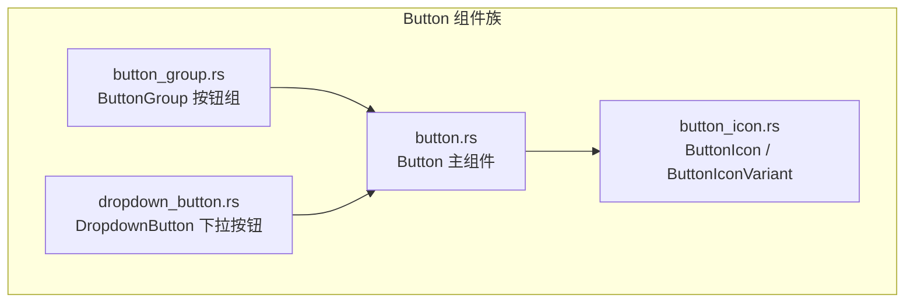
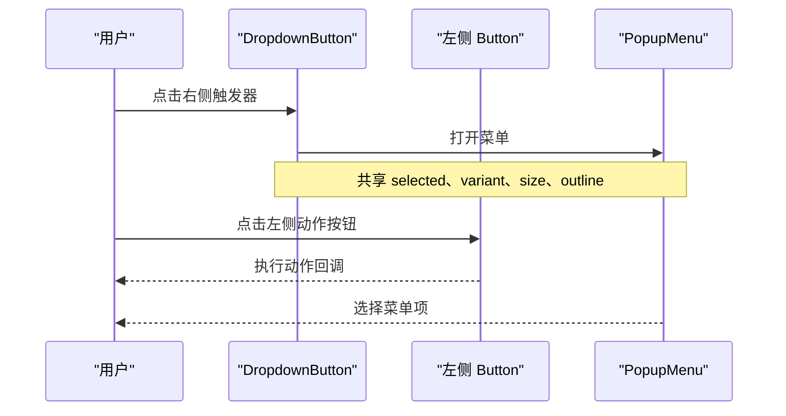
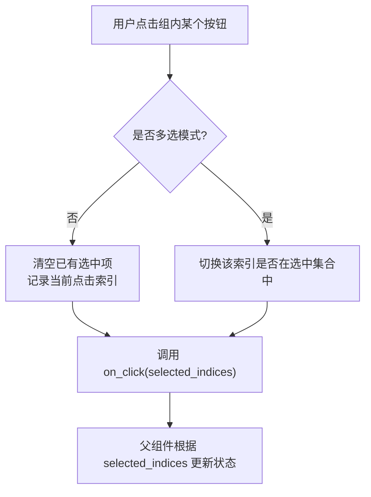
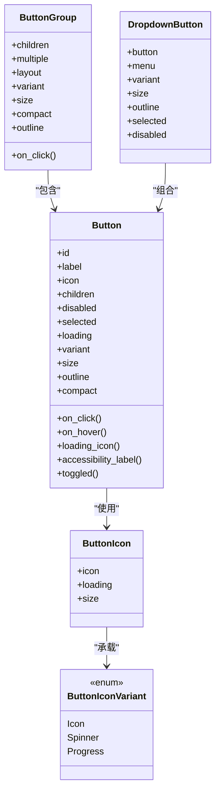

# Button 按钮

<cite>
**本文引用的文件**   
- [crates/component/src/button/button.rs](file://crates/component/src/button/button.rs)
- [crates/component/src/button/button_group.rs](file://crates/component/src/button/button_group.rs)
- [crates/component/src/button/dropdown_button.rs](file://crates/component/src/button/dropdown_button.rs)
- [crates/component/src/button/button_icon.rs](file://crates/component/src/button/button_icon.rs)
- [website/zh-CN/component/button.md](file://website/zh-CN/component/button.md)
- [website/base/primitives/button.md](file://website/base/primitives/button.md)
</cite>

## 目录
1. [简介](#简介)
2. [项目结构与组件定位](#项目结构与组件定位)
3. [核心概念与能力总览](#核心概念与能力总览)
4. [基础按钮用法](#基础按钮用法)
5. [变体、尺寸与样式定制](#变体尺寸与样式定制)
6. [图标按钮与加载状态](#图标按钮与加载状态)
7. [下拉按钮与菜单组合](#下拉按钮与菜单组合)
8. [按钮组与切换按钮组](#按钮组与切换按钮组)
9. [事件处理与状态管理](#事件处理与状态管理)
10. [无障碍访问与键盘导航](#无障碍访问与键盘导航)
11. [依赖关系与架构说明](#依赖关系与架构说明)
12. [常见问题与排错建议](#常见问题与排错建议)
13. [结论](#结论)

## 简介
Button 按钮是 gpui-kit 中用于表达可点击操作的核心组件。它既提供语义化、可访问的基础行为，又通过变体、尺寸、图标、分组和下拉等扩展能力，覆盖从简单动作到复杂交互的常见场景。文档面向不同技术背景的读者，先给出高层使用方式，再深入到属性、事件、样式和无障碍细节。

## 项目结构与组件定位
Button 相关代码位于 component 包的 button 子模块中，包含以下关键文件：
- button.rs：Button 主实现、变体、尺寸、样式、无障碍与渲染逻辑
- button_group.rs：ButtonGroup 按钮组，支持单选/多选、布局、统一样式
- dropdown_button.rs：DropdownButton 下拉按钮，将“动作按钮 + 菜单触发器”组合为一个控件
- button_icon.rs：ButtonIcon 与 ButtonIconVariant，封装静态图标、Spinner 和 ProgressCircle 的统一显示与加载态切换

**图表来源**
- [crates/component/src/button/button.rs:188-234](file://crates/component/src/button/button.rs#L188-L234)
- [crates/component/src/button/button_group.rs:16-33](file://crates/component/src/button/button_group.rs#L16-L33)
- [crates/component/src/button/dropdown_button.rs:25-41](file://crates/component/src/button/dropdown_button.rs#L25-L41)
- [crates/component/src/button/button_icon.rs:7-12](file://crates/component/src/button/button_icon.rs#L7-L12)

**章节来源**
- [crates/component/src/button/button.rs:188-234](file://crates/component/src/button/button.rs#L188-L234)
- [crates/component/src/button/button_group.rs:16-33](file://crates/component/src/button/button_group.rs#L16-L33)
- [crates/component/src/button/dropdown_button.rs:25-41](file://crates/component/src/button/dropdown_button.rs#L25-L41)
- [crates/component/src/button/button_icon.rs:7-12](file://crates/component/src/button/button_icon.rs#L7-L12)

## 核心概念与能力总览
- 基础按钮：通过 `Button::new` 创建，支持 label、icon、children、tooltip、on_click、on_hover 等。
- 变体：primary、secondary、danger、warning、success、info、ghost、link、text、custom。
- 尺寸：xsmall、small、medium（默认）、large，也支持自定义 Size。
- 状态：disabled、loading、selected、open（由弹出层驱动）。
- 外观：outline、compact、rounded、border_corners、border_edges、focus_ring。
- 组合：ButtonGroup 按钮组、DropdownButton 下拉按钮。
- 图标：Icon、IconName、Spinner、ProgressCircle，统一通过 ButtonIcon 适配。
- 无障碍：accessibility_id、accessibility_label、toggled、role、focus ring、键盘激活。

**章节来源**
- [website/zh-CN/component/button.md:1-334](file://website/zh-CN/component/button.md#L1-L334)
- [crates/component/src/button/button.rs:48-159](file://crates/component/src/button/button.rs#L48-L159)
- [crates/component/src/button/button.rs:584-600](file://crates/component/src/button/button.rs#L584-L600)

## 基础按钮用法
基础按钮适合表达单一明确的操作，例如保存、删除、确认、取消等。典型用法包括：
- 设置唯一 id，便于测试和无障碍标识
- 设置 label 或 icon，或同时设置
- 注册 on_click 回调处理用户点击
- 配合 tooltip 提供辅助说明
- 使用 disabled、loading、selected 控制状态

参考示例路径：
- [基础按钮示例:37-45](file://website/zh-CN/component/button.md#L37-L45)

**章节来源**
- [website/zh-CN/component/button.md:37-45](file://website/zh-CN/component/button.md#L37-L45)
- [crates/component/src/button/button.rs:242-288](file://crates/component/src/button/button.rs#L242-L288)

## 变体、尺寸与样式定制
### 变体
ButtonVariants trait 提供了丰富的视觉语义：
- primary：强调主操作
- secondary：次要操作
- danger：危险操作
- warning：警告操作
- success：成功反馈
- info：信息提示
- ghost：透明背景，常用于工具栏或密集区域
- link：无内边距，像链接一样
- text：纯文本风格
- custom：完全自定义颜色、前景色、悬停、按下、阴影

参考示例路径：
- [变体示例:47-78](file://website/zh-CN/component/button.md#L47-L78)
- [Outline 叠加示例:80-89](file://website/zh-CN/component/button.md#L80-L89)
- [自定义变体示例:283-300](file://website/zh-CN/component/button.md#L283-L300)

**章节来源**
- [crates/component/src/button/button.rs:48-159](file://crates/component/src/button/button.rs#L48-L159)
- [website/zh-CN/component/button.md:47-89](file://website/zh-CN/component/button.md#L47-L89)
- [website/zh-CN/component/button.md:283-300](file://website/zh-CN/component/button.md#L283-L300)

### 尺寸
Button 支持 Sizable trait：
- xsmall：超小
- small：小
- medium：默认
- large：大
- 也可传入自定义 Size

参考示例路径：
- [尺寸示例:101-112](file://website/zh-CN/component/button.md#L101-L112)

**章节来源**
- [crates/component/src/button/button.rs:584-593](file://crates/component/src/button/button.rs#L584-L593)
- [website/zh-CN/component/button.md:101-112](file://website/zh-CN/component/button.md#L101-L112)

### 紧凑模式与轮廓线
- compact：减少内边距，适合密集布局
- outline：描边风格，可与任意变体叠加

参考示例路径：
- [紧凑模式示例:91-99](file://website/zh-CN/component/button.md#L91-L99)
- [Outline 叠加示例:80-89](file://website/zh-CN/component/button.md#L80-L89)

**章节来源**
- [crates/component/src/button/button.rs:452-456](file://crates/component/src/button/button.rs#L452-L456)
- [crates/component/src/button/button.rs:335-339](file://crates/component/src/button/button.rs#L335-L339)
- [website/zh-CN/component/button.md:80-99](file://website/zh-CN/component/button.md#L80-L99)

### 圆角与边框控制
- rounded：None、Small、Medium、Large、Size(px)
- border_corners：控制四个角的边框是否绘制
- border_edges：控制四条边的边框是否绘制

这些方法在 ButtonGroup 和 DropdownButton 内部被用来拼接相邻按钮或左右两半按钮的视觉效果。

**章节来源**
- [crates/component/src/button/button.rs:23-37](file://crates/component/src/button/button.rs#L23-L37)
- [crates/component/src/button/button.rs:341-357](file://crates/component/src/button/button.rs#L341-L357)
- [crates/component/src/button/button_group.rs:182-229](file://crates/component/src/button/button_group.rs#L182-L229)
- [crates/component/src/button/dropdown_button.rs:186-224](file://crates/component/src/button/dropdown_button.rs#L186-L224)

## 图标按钮与加载状态
### 支持的图标类型
Button.icon 接受多种图标类型，统一通过 ButtonIcon 包装：
- Icon / IconName：静态图标
- Spinner：加载旋转图标
- ProgressCircle：环形进度图标

所有图标会自动适配按钮尺寸，并可继续设置颜色、大小等属性。

参考示例路径：
- [图标类型示例:114-143](file://website/zh-CN/component/button.md#L114-L143)
- [Spinner 示例:141-157](file://website/zh-CN/component/button.md#L141-L157)
- [ProgressCircle 示例:159-180](file://website/zh-CN/component/button.md#L159-L180)

**章节来源**
- [crates/component/src/button/button_icon.rs:4-12](file://crates/component/src/button/button_icon.rs#L4-L12)
- [crates/component/src/button/button_icon.rs:52-104](file://crates/component/src/button/button_icon.rs#L52-L104)
- [website/zh-CN/component/button.md:114-180](file://website/zh-CN/component/button.md#L114-L180)

### 动态图标更新
图标可以根据业务状态动态变化，例如安装按钮在安装前显示下载图标，安装中显示 ProgressCircle，完成后显示成功图标。

参考示例路径：
- [动态图标更新示例:182-211](file://website/zh-CN/component/button.md#L182-L211)

**章节来源**
- [website/zh-CN/component/button.md:182-211](file://website/zh-CN/component/button.md#L182-L211)

### 加载状态与图标替换
当 loading(true) 时：
- 如果当前图标已经是 Spinner 或 ProgressCircle，则保持显示
- 如果当前图标是普通 Icon，则自动替换为 Spinner
- 可通过 loading_icon 指定自定义加载图标

参考示例路径：
- [加载态示例:213-227](file://website/zh-CN/component/button.md#L213-L227)

**章节来源**
- [crates/component/src/button/button_icon.rs:116-131](file://crates/component/src/button/button_icon.rs#L116-L131)
- [crates/component/src/button/button.rs:446-479](file://crates/component/src/button/button.rs#L446-L479)
- [website/zh-CN/component/button.md:213-227](file://website/zh-CN/component/button.md#L213-L227)

## 下拉按钮与菜单组合
DropdownButton 是一个“动作按钮 + 菜单触发器”的组合控件。两个半部分视觉上连接在一起，hover 和选中状态共享，菜单打开时整体可读性更强。

主要能力：
- 左侧按钮：保留自己的 label、icon、tooltip、on_click
- 右侧触发器：带下拉箭头，打开 PopupMenu
- 共享 variant、size、outline、selected、disabled
- 支持自定义锚点位置
- 支持无障碍标签，屏幕阅读器会读出“更多选项”等语义名称

参考示例路径：
- [下拉箭头示例:229-237](file://website/zh-CN/component/button.md#L229-L237)

**图表来源**
- [crates/component/src/button/dropdown_button.rs:18-23](file://crates/component/src/button/dropdown_button.rs#L18-L23)
- [crates/component/src/button/dropdown_button.rs:161-240](file://crates/component/src/button/dropdown_button.rs#L161-L240)

**章节来源**
- [crates/component/src/button/dropdown_button.rs:18-41](file://crates/component/src/button/dropdown_button.rs#L18-L41)
- [crates/component/src/button/dropdown_button.rs:43-121](file://crates/component/src/button/dropdown_button.rs#L43-L121)
- [crates/component/src/button/dropdown_button.rs:161-240](file://crates/component/src/button/dropdown_button.rs#L161-L240)
- [website/zh-CN/component/button.md:229-237](file://website/zh-CN/component/button.md#L229-L237)

## 按钮组与切换按钮组
ButtonGroup 用于把多个 Button 组合成一个控件，适合尺寸选择、状态筛选、批量操作等场景。

主要能力：
- child / children：添加一个或多个按钮
- multiple：开启多选模式；默认单选
- layout：水平或垂直布局
- compact / outline：对组内按钮统一应用紧凑或描边风格
- variant / size：对组内按钮统一应用变体和尺寸
- on_click：返回被选中的按钮索引集合

切换按钮组示例：
- 通过 Selectable 的 selected 控制每个按钮的选中状态
- 通过 on_click 接收 Vec<usize> 表示当前选中的按钮索引

参考示例路径：
- [按钮组示例:259-266](file://website/zh-CN/component/button.md#L259-L266)
- [切换式按钮组示例:268-281](file://website/zh-CN/component/button.md#L268-L281)

**图表来源**
- [crates/component/src/button/button_group.rs:234-264](file://crates/component/src/button/button_group.rs#L234-L264)

**章节来源**
- [crates/component/src/button/button_group.rs:16-33](file://crates/component/src/button/button_group.rs#L16-L33)
- [crates/component/src/button/button_group.rs:42-130](file://crates/component/src/button/button_group.rs#L42-L130)
- [crates/component/src/button/button_group.rs:152-266](file://crates/component/src/button/button_group.rs#L152-L266)
- [website/zh-CN/component/button.md:259-281](file://website/zh-CN/component/button.md#L259-L281)

## 事件处理与状态管理
### 点击事件
Button.on_click 接收 ClickEvent、Window、App，适合执行具体业务逻辑。ButtonGroup.on_click 则返回被选中的按钮索引集合。

参考示例路径：
- [基础点击示例:37-45](file://website/zh-CN/component/button.md#L37-L45)
- [切换按钮组 on_click 示例:268-281](file://website/zh-CN/component/button.md#L268-L281)

**章节来源**
- [crates/component/src/button/button.rs:458-471](file://crates/component/src/button/button.rs#L458-L471)
- [crates/component/src/button/button_group.rs:100-129](file://crates/component/src/button/button_group.rs#L100-L129)
- [website/zh-CN/component/button.md:37-45](file://website/zh-CN/component/button.md#L37-L45)
- [website/zh-CN/component/button.md:268-281](file://website/zh-CN/component/button.md#L268-L281)

### 悬停事件
Button.on_hover 接收布尔值，表示鼠标是否悬停。适合做高级交互，如联动其他面板、预览内容等。

**章节来源**
- [crates/component/src/button/button.rs:467-471](file://crates/component/src/button/button.rs#L467-L471)

### 状态管理
常用状态：
- disabled：禁用按钮，不可点击
- loading：加载中，保持交互不可用但保留正常外观
- selected：选中样式，常用于切换按钮或分组按钮
- open：由弹出层驱动，使按钮呈现“已展开”的选中样式

参考示例路径：
- [状态示例:239-257](file://website/zh-CN/component/button.md#L239-L257)

**章节来源**
- [crates/component/src/button/button.rs:513-538](file://crates/component/src/button/button.rs#L513-L538)
- [website/zh-CN/component/button.md:239-257](file://website/zh-CN/component/button.md#L239-L257)

## 无障碍访问与键盘导航
Button 基于 gpui-base 的 Button 原语，提供语义结构、键盘激活和无障碍元数据。

关键点：
- accessibility_id：开发者设置的无障碍标识
- accessibility_label：屏幕阅读器读出的名称，优先于可见 label
- toggled：声明按钮是切换控件，暴露 pressed 状态
- role：可覆盖语义角色
- focus ring：焦点环开关，track_focus 可接入外部 FocusHandle
- tab_index / tab_stop：控制 Tab 顺序和是否可聚焦
- keyboard activation：Enter、Space 等键可激活按钮

Base 层文档强调：
- 提供可访问名称
- 保留键盘激活能力
- 正确暴露禁用状态
- 在消费端设计系统中验证焦点、悬停、按下、选中、禁用、减少动态效果和高对比度状态

参考路径：
- [Base Button 无障碍说明:47-54](file://website/base/primitives/button.md#L47-L54)
- [中文 Base Button 无障碍说明:37-44](file://website/base/primitives/button.md#L37-L44)

**章节来源**
- [website/base/primitives/button.md:33-44](file://website/base/primitives/button.md#L33-L44)
- [website/base/primitives/button.md:47-54](file://website/base/primitives/button.md#L47-L54)
- [crates/component/src/button/button.rs:380-398](file://crates/component/src/button/button.rs#L380-L398)
- [crates/component/src/button/button.rs:481-505](file://crates/component/src/button/button.rs#L481-L505)
- [crates/component/src/button/button.rs:513-538](file://crates/component/src/button/button.rs#L513-L538)

## 依赖关系与架构说明
Button 组件族围绕“基础行为 + 表现层 + 组合控件”分层组织：
- 基础行为：gpui_base::Button 提供可访问、可聚焦、可激活的原语
- 表现层：Button 通过 ButtonVariant、Sizable、Styled 等 trait 控制外观
- 组合控件：ButtonGroup、DropdownButton 复用 Button 的行为和样式
- 图标抽象：ButtonIcon 统一 Icon、Spinner、ProgressCircle

**图表来源**
- [crates/component/src/button/button.rs:188-234](file://crates/component/src/button/button.rs#L188-L234)
- [crates/component/src/button/button_group.rs:16-33](file://crates/component/src/button/button_group.rs#L16-L33)
- [crates/component/src/button/dropdown_button.rs:25-41](file://crates/component/src/button/dropdown_button.rs#L25-L41)
- [crates/component/src/button/button_icon.rs:7-12](file://crates/component/src/button/button_icon.rs#L7-L12)
- [crates/component/src/button/button_icon.rs:52-59](file://crates/component/src/button/button_icon.rs#L52-L59)

**章节来源**
- [crates/component/src/button/button.rs:188-234](file://crates/component/src/button/button.rs#L188-L234)
- [crates/component/src/button/button_group.rs:16-33](file://crates/component/src/button/button_group.rs#L16-L33)
- [crates/component/src/button/dropdown_button.rs:25-41](file://crates/component/src/button/dropdown_button.rs#L25-L41)
- [crates/component/src/button/button_icon.rs:7-12](file://crates/component/src/button/button_icon.rs#L7-L12)

## 常见问题与排错建议
- 按钮不响应点击：检查是否设置了 disabled(true) 或 loading(true)。loading 状态下按钮保持外观但不响应指针交互。
- 图标不显示：确保 icon 或 label 至少有一个；若只传 icon，则为图标按钮模式。
- 加载态图标未切换：确认 loading(true) 且当前图标不是 Spinner 或 ProgressCircle；如需自定义加载图标，使用 loading_icon。
- 按钮组多选无效：确认 multiple(true)，并在 on_click 中处理 Vec<usize>。
- 下拉按钮样式不一致：DropdownButton 会合并外层 variant/size/outline 与内层 Button 的值；必要时在外层显式设置。
- 无障碍名称不正确：为图标按钮或复杂内容按钮设置 accessibility_label，避免屏幕阅读器朗读错误内容。
- 焦点环异常：可使用 focus_ring(false) 关闭，或通过 track_focus 接入外部 FocusHandle。

**章节来源**
- [crates/component/src/button/button.rs:531-538](file://crates/component/src/button/button.rs#L531-L538)
- [crates/component/src/button/button.rs:325-328](file://crates/component/src/button/button.rs#L325-L328)
- [crates/component/src/button/button_icon.rs:116-131](file://crates/component/src/button/button_icon.rs#L116-L131)
- [crates/component/src/button/button_group.rs:234-264](file://crates/component/src/button/button_group.rs#L234-L264)
- [crates/component/src/button/dropdown_button.rs:61-71](file://crates/component/src/button/dropdown_button.rs#L61-L71)
- [crates/component/src/button/button.rs:380-398](file://crates/component/src/button/button.rs#L380-L398)
- [crates/component/src/button/button.rs:553-562](file://crates/component/src/button/button.rs#L553-L562)

## 结论
Button 按钮组件以 gpui-base 的可访问原语为基础，通过变体、尺寸、图标、分组和下拉等扩展能力，覆盖了从基础动作到复杂组合交互的广泛场景。使用时应：
- 明确按钮语义：主操作、次要操作、危险操作、信息提示等
- 合理使用状态：disabled、loading、selected、open
- 善用组合控件：ButtonGroup 管理一组互斥或非互斥选项，DropdownButton 组合动作与菜单
- 关注无障碍：提供 accessible name、保留键盘激活、正确暴露 disabled 和 toggled
- 遵循主题与设计系统：通过 theme tokens 和自定义变体保持一致的视觉语言