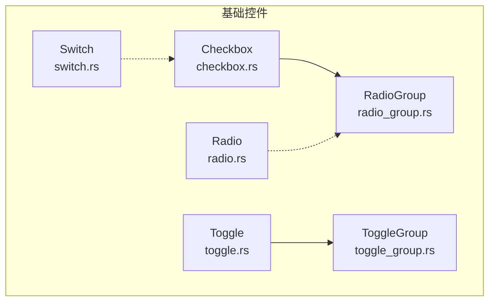
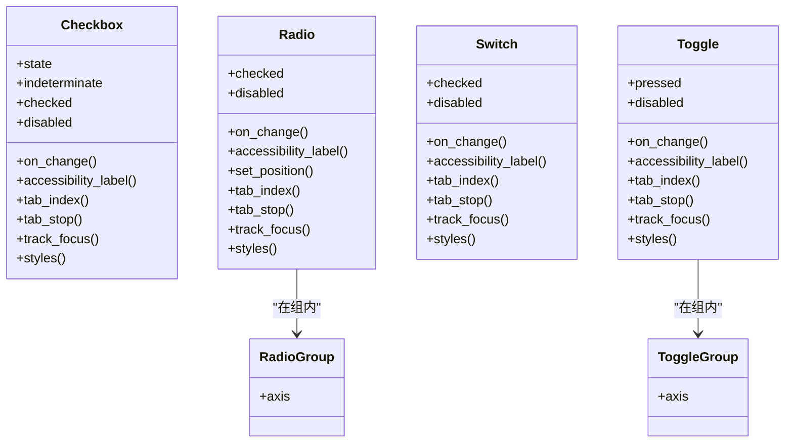
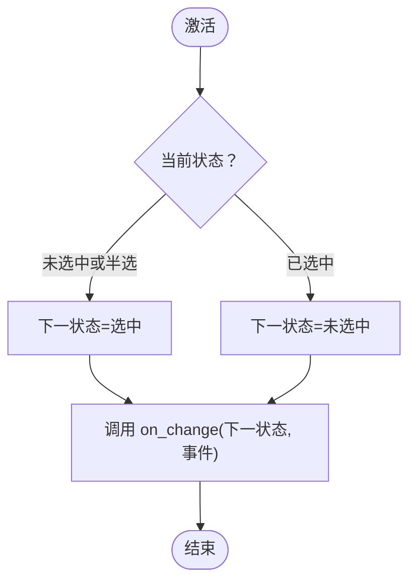
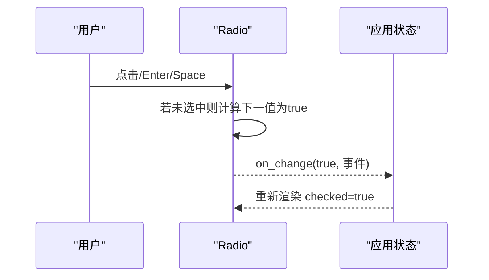
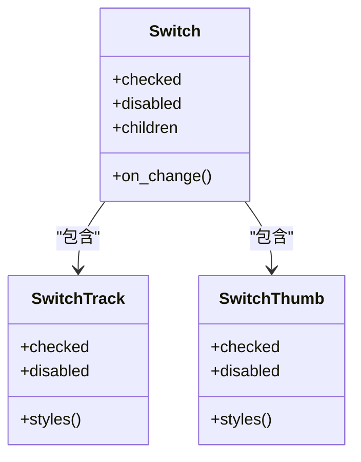
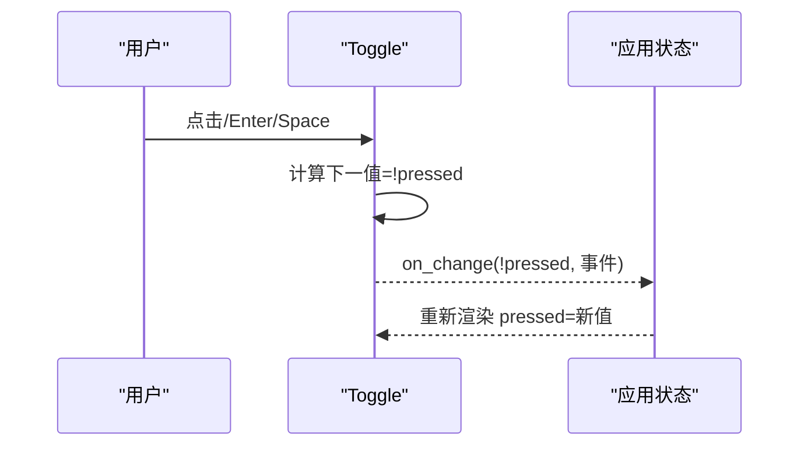
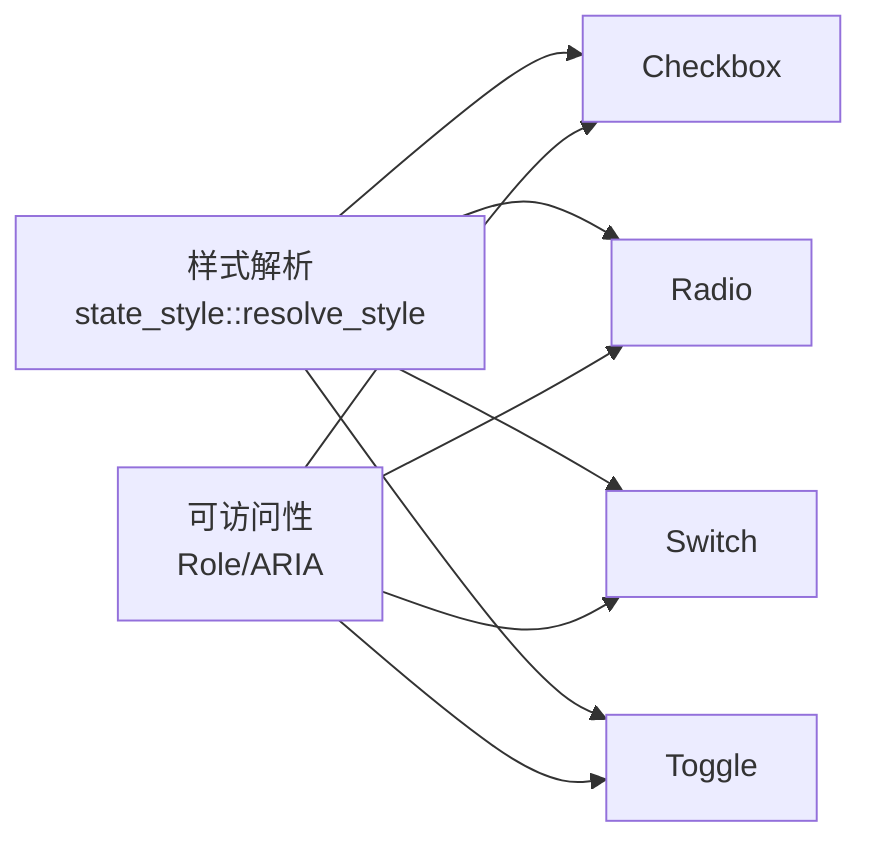

# Checkbox、Radio、Switch 开关控件

<cite>
**本文引用的文件**   
- [checkbox.rs](file://crates/base/src/checkbox.rs)
- [radio.rs](file://crates/base/src/radio.rs)
- [radio_group.rs](file://crates/base/src/radio_group.rs)
- [switch.rs](file://crates/base/src/switch.rs)
- [toggle.rs](file://crates/base/src/toggle.rs)
- [toggle_group.rs](file://crates/base/src/toggle_group.rs)
</cite>

## 目录
1. [简介](#简介)
2. [项目结构](#项目结构)
3. [核心组件](#核心组件)
4. [架构总览](#架构总览)
5. [详细组件分析](#详细组件分析)
6. [依赖关系分析](#依赖关系分析)
7. [性能与动画](#性能与动画)
8. [表单集成与验证](#表单集成与验证)
9. [无障碍与键盘操作](#无障碍与键盘操作)
10. [自定义样式与主题](#自定义样式与主题)
11. [故障排查](#故障排查)
12. [结论](#结论)

## 简介
本文件面向 Checkbox（复选框）、Radio（单选框）、Switch（开关）和 Toggle（切换按钮）四个基础交互控件，系统性说明其属性配置、状态管理、分组用法、表单集成、验证规则、自定义样式、无障碍访问、键盘操作与动画特性，并给出最佳实践建议。这些控件位于基础 UI 层，提供语义化、可访问、可聚焦的交互原语；视觉呈现由应用侧通过样式系统完成。

## 项目结构
- 基础控件实现位于 crates/base/src：
  - checkbox.rs：Checkbox 与 CheckboxIndicator
  - radio.rs：Radio
  - radio_group.rs：RadioGroup
  - switch.rs：Switch、SwitchTrack、SwitchThumb
  - toggle.rs：Toggle
  - toggle_group.rs：ToggleGroup
- 文档站点与示例位于 website 与 story 等目录，但本文件聚焦源码实现与行为契约。

图表来源
- [checkbox.rs:44-195](file://crates/base/src/checkbox.rs#L44-L195)
- [radio.rs:15-171](file://crates/base/src/radio.rs#L15-L171)
- [radio_group.rs:10-68](file://crates/base/src/radio_group.rs#L10-L68)
- [switch.rs:15-336](file://crates/base/src/switch.rs#L15-L336)
- [toggle.rs:15-138](file://crates/base/src/toggle.rs#L15-L138)
- [toggle_group.rs:10-68](file://crates/base/src/toggle_group.rs#L10-L68)

章节来源
- [checkbox.rs:44-195](file://crates/base/src/checkbox.rs#L44-L195)
- [radio.rs:15-171](file://crates/base/src/radio.rs#L15-L171)
- [radio_group.rs:10-68](file://crates/base/src/radio_group.rs#L10-L68)
- [switch.rs:15-336](file://crates/base/src/switch.rs#L15-L336)
- [toggle.rs:15-138](file://crates/base/src/toggle.rs#L15-L138)
- [toggle_group.rs:10-68](file://crates/base/src/toggle_group.rs#L10-L68)

## 核心组件
- Checkbox：支持三态（未选中、选中、半选），提供 on_change、state、indeterminate、disabled、accessibility_label、tab_index/tab_stop、track_focus、styles 等能力。
- Radio：单选控件，checked/on_change/disabled/accessibility_label/set_position/tab_index/tab_stop/track_focus/styles。
- Switch：二元开关，checked/on_change/disabled/accessibility_label/tab_index/tab_stop/track_focus/styles，并提供 Track/Thumb 子部件。
- Toggle：切换按钮，pressed/on_change/disabled/accessibility_label/tab_index/tab_stop/track_focus/styles。
- RadioGroup/ToggleGroup：语义分组容器，设置方向 axis，暴露 Role 与 aria_orientation。

章节来源
- [checkbox.rs:18-195](file://crates/base/src/checkbox.rs#L18-L195)
- [radio.rs:15-171](file://crates/base/src/radio.rs#L15-L171)
- [switch.rs:15-336](file://crates/base/src/switch.rs#L15-L336)
- [toggle.rs:15-138](file://crates/base/src/toggle.rs#L15-L138)
- [radio_group.rs:10-68](file://crates/base/src/radio_group.rs#L10-L68)
- [toggle_group.rs:10-68](file://crates/base/src/toggle_group.rs#L10-L68)

## 架构总览
所有控件遵循统一模式：
- 受控状态：由应用通过 checked/pushed/state 等属性驱动渲染。
- 事件回调：on_change 返回“下一个期望值”，应用负责更新自身状态并回写。
- 可访问性：内置 Role、aria_toggled/selected/label、position_in_set/size_of_set 等。
- 焦点与键盘：非禁用时参与 Tab 导航，Enter/Space 触发激活。
- 样式系统：通过 styles 注入语义状态样式，优先级高于实例样式。

图表来源
- [checkbox.rs:44-195](file://crates/base/src/checkbox.rs#L44-L195)
- [radio.rs:15-171](file://crates/base/src/radio.rs#L15-L171)
- [switch.rs:15-336](file://crates/base/src/switch.rs#L15-L336)
- [toggle.rs:15-138](file://crates/base/src/toggle.rs#L15-L138)
- [radio_group.rs:10-68](file://crates/base/src/radio_group.rs#L10-L68)
- [toggle_group.rs:10-68](file://crates/base/src/toggle_group.rs#L10-L68)

## 详细组件分析

### Checkbox 复选框
- 状态模型
  - 三态枚举：未选中、选中、半选。
  - 激活逻辑：未选中/半选 → 选中；选中 → 未选中。
- 关键 API
  - state/checked/indeterminate：控制显示状态。
  - disabled：禁用指针与键盘激活。
  - on_change：回调接收“下一个状态”与点击事件。
  - accessibility_label：为无文本子节点的场景提供可访问名称。
  - tab_index/tab_stop/track_focus：焦点与遍历控制。
  - styles：按语义状态（checked/indeterminate/disabled）注入样式。
- 可访问性与角色
  - 暴露 CheckBox 角色、aria_toggled、可选 label。
  - 禁用时不响应点击，且阻止父级冒泡。
- 测试覆盖要点
  - 指针与 Enter/Space 各触发一次。
  - 半选激活变为选中。
  - 禁用状态下不可用且允许事件冒泡到父级。
  - 可访问性节点包含 role/label/toggled/action 支持情况。

图表来源
- [checkbox.rs:27-42](file://crates/base/src/checkbox.rs#L27-L42)
- [checkbox.rs:370-406](file://crates/base/src/checkbox.rs#L370-L406)

章节来源
- [checkbox.rs:18-195](file://crates/base/src/checkbox.rs#L18-L195)
- [checkbox.rs:370-406](file://crates/base/src/checkbox.rs#L370-L406)
- [checkbox.rs:408-713](file://crates/base/src/checkbox.rs#L408-L713)

### Radio 单选框
- 状态模型
  - 布尔 checked；已选中的单选框再次激活无效。
- 关键 API
  - checked/disabled/on_change/accessibility_label/set_position/tab_index/tab_stop/track_focus/styles。
  - set_position(size)：向辅助技术报告“第 x 项，共 y 项”。
- 可访问性与角色
  - 暴露 RadioButton 角色，同时设置 aria_selected 与 aria_toggled。
  - 禁用时不可用且不触发 on_change。
- 分组
  - 使用 RadioGroup 包裹，设置 axis 以声明方向。

图表来源
- [radio.rs:193-239](file://crates/base/src/radio.rs#L193-L239)

章节来源
- [radio.rs:15-171](file://crates/base/src/radio.rs#L15-L171)
- [radio.rs:193-239](file://crates/base/src/radio.rs#L193-L239)
- [radio.rs:241-416](file://crates/base/src/radio.rs#L241-L416)
- [radio_group.rs:10-68](file://crates/base/src/radio_group.rs#L10-L68)

### Switch 开关
- 状态模型
  - 布尔 checked；激活时回调“取反后的值”。
- 关键 API
  - checked/disabled/on_change/accessibility_label/tab_index/tab_stop/track_focus/styles。
  - SwitchTrack/SwitchThumb：轨道与滑块子部件，各自支持 checked/disabled 语义样式。
- 可访问性与角色
  - 暴露 Switch 角色与 aria_toggled。
  - 禁用时阻止鼠标事件冒泡，避免父级误触。
- 组合用法
  - 将 Track/Thumb 作为 children 构建外观，状态与样式由 Switch 驱动。

图表来源
- [switch.rs:58-155](file://crates/base/src/switch.rs#L58-L155)
- [switch.rs:157-241](file://crates/base/src/switch.rs#L157-L241)
- [switch.rs:243-336](file://crates/base/src/switch.rs#L243-L336)

章节来源
- [switch.rs:15-336](file://crates/base/src/switch.rs#L15-L336)
- [switch.rs:358-400](file://crates/base/src/switch.rs#L358-L400)
- [switch.rs:402-744](file://crates/base/src/switch.rs#L402-L744)

### Toggle 切换按钮
- 状态模型
  - 布尔 pressed；激活时回调“取反后的值”。
- 关键 API
  - pressed/disabled/on_change/accessibility_label/tab_index/tab_stop/track_focus/styles。
- 可访问性与角色
  - 暴露 Button 角色与 aria_toggled。
  - 禁用时阻止鼠标事件冒泡。
- 布局特性
  - 默认 flex 居中布局，适合承载图标/文字等任意内容。

图表来源
- [toggle.rs:160-213](file://crates/base/src/toggle.rs#L160-L213)

章节来源
- [toggle.rs:15-138](file://crates/base/src/toggle.rs#L15-L138)
- [toggle.rs:160-213](file://crates/base/src/toggle.rs#L160-L213)
- [toggle.rs:215-459](file://crates/base/src/toggle.rs#L215-L459)

### 分组容器：RadioGroup 与 ToggleGroup
- RadioGroup
  - 语义角色 RadioGroup，aria_orientation 对应 Axis。
  - 用于组织一组 Radio，便于辅助技术理解集合关系。
- ToggleGroup
  - 语义角色 Toolbar，aria_orientation 对应 Axis。
  - 用于组织一组 Toggle，形成工具栏式选择。

章节来源
- [radio_group.rs:10-68](file://crates/base/src/radio_group.rs#L10-L68)
- [toggle_group.rs:10-68](file://crates/base/src/toggle_group.rs#L10-L68)

## 依赖关系分析
- 内部依赖
  - 所有控件均依赖 GPUI 的 Element/Style/Focus/Role 体系。
  - 样式解析统一通过 state_style::resolve_style 合并实例样式与语义状态样式。
  - 可访问性通过 accesskit 角色与属性暴露给系统辅助技术。
- 耦合与内聚
  - 控件之间低耦合，仅通过分组容器建立弱关联。
  - 每个控件高内聚地封装了交互、可访问性与样式优先级。

图表来源
- [checkbox.rs:180-194](file://crates/base/src/checkbox.rs#L180-L194)
- [radio.rs:107-117](file://crates/base/src/radio.rs#L107-L117)
- [switch.rs:280-290](file://crates/base/src/switch.rs#L280-L290)
- [toggle.rs:91-101](file://crates/base/src/toggle.rs#L91-L101)

章节来源
- [checkbox.rs:180-194](file://crates/base/src/checkbox.rs#L180-L194)
- [radio.rs:107-117](file://crates/base/src/radio.rs#L107-L117)
- [switch.rs:280-290](file://crates/base/src/switch.rs#L280-L290)
- [toggle.rs:91-101](file://crates/base/src/toggle.rs#L91-L101)

## 性能与动画
- 渲染路径
  - 控件均为 RenderOnce，避免重复计算，减少重绘开销。
- 样式优先级
  - 语义状态样式（如 checked/disabled）优先于实例样式，确保状态可见性。
- 动画
  - 控件本身不包含动画实现；动画可通过上层样式系统或动效库叠加。
  - 建议在 Switch Thumb/Track 与 Toggle 内容变化处添加过渡效果。

[本节为通用指导，不直接分析具体文件]

## 表单集成与验证
- 受控模式
  - 所有控件采用受控模式：应用持有状态，on_change 回调中更新状态并回写 checked/pushed/state。
- 表单绑定建议
  - 将 Checkbox/Radio/Switch/Toggle 的值映射到表单字段。
  - 对 Radio 使用 RadioGroup 统一管理选项集合。
  - 对 Checkbox 列表使用数组存储选中项，结合 indeterminate 表达部分选中。
- 验证规则
  - 在提交前校验必填项（例如至少选择一个 Radio）。
  - 对 Checkbox 集合进行数量/互斥规则校验。
  - 对 Switch/Toggle 进行业务合法性校验（如权限开关需满足前置条件）。

章节来源
- [checkbox.rs:140-151](file://crates/base/src/checkbox.rs#L140-L151)
- [radio.rs:124-134](file://crates/base/src/radio.rs#L124-L134)
- [switch.rs:292-299](file://crates/base/src/switch.rs#L292-L299)
- [toggle.rs:108-115](file://crates/base/src/toggle.rs#L108-L115)

## 无障碍与键盘操作
- 键盘操作
  - 非禁用控件支持 Enter/Space 激活。
  - Tab 顺序由 tab_index/tab_stop 控制，或通过 track_focus 接入外部焦点句柄。
- 可访问性属性
  - Checkbox：Role::CheckBox，aria_toggled，可选 aria_label。
  - Radio：Role::RadioButton，aria_selected/aria_toggled，可选 position_in_set/size_of_set。
  - Switch：Role::Switch，aria_toggled。
  - Toggle：Role::Button，aria_toggled。
- 禁用行为
  - 禁用控件不触发 on_change，且会阻止事件冒泡到父级（Switch/Toggle 明确拦截鼠标按下）。

章节来源
- [checkbox.rs:370-406](file://crates/base/src/checkbox.rs#L370-L406)
- [radio.rs:193-239](file://crates/base/src/radio.rs#L193-L239)
- [switch.rs:358-400](file://crates/base/src/switch.rs#L358-L400)
- [toggle.rs:160-213](file://crates/base/src/toggle.rs#L160-L213)

## 自定义样式与主题
- 语义状态样式
  - 所有控件提供 styles 方法，分别针对 checked/pressed/indeterminate/disabled 注入样式。
  - 语义状态样式优先级高于实例样式，保证状态可见性。
- 组合部件样式
  - SwitchTrack/SwitchThumb 可独立设置 checked/disabled 样式。
  - CheckboxIndicator 可独立设置选中/半选/禁用样式。
- 主题扩展
  - 通过样式系统集中定义主题 token，并在 styles 中引用，实现全局主题切换。

章节来源
- [checkbox.rs:197-226](file://crates/base/src/checkbox.rs#L197-L226)
- [checkbox.rs:242-268](file://crates/base/src/checkbox.rs#L242-L268)
- [radio.rs:38-57](file://crates/base/src/radio.rs#L38-L57)
- [switch.rs:37-56](file://crates/base/src/switch.rs#L37-L56)
- [switch.rs:69-88](file://crates/base/src/switch.rs#L69-L88)
- [switch.rs:168-187](file://crates/base/src/switch.rs#L168-L187)
- [toggle.rs:35-54](file://crates/base/src/toggle.rs#L35-L54)

## 故障排查
- 现象：点击后 on_change 未触发
  - 检查是否设置了 disabled=true。
  - 确认未将 checked 固定为 true（Radio 已选中时不会再次触发）。
- 现象：键盘 Enter/Space 无效
  - 确认控件未被禁用，且参与了焦点遍历（tab_stop=true 或未显式关闭）。
  - 若使用 track_focus，确保外部焦点句柄有效。
- 现象：禁用后父级仍被点击
  - Switch/Toggle 在禁用时会阻止鼠标按下冒泡；若仍有冒泡，检查是否存在其他监听器。
- 现象：可访问性读屏未播报
  - 为无文本子节点的控件设置 accessibility_label。
  - Radio 使用 set_position/size_of_set 以便播报“第 x 项，共 y 项”。

章节来源
- [checkbox.rs:370-406](file://crates/base/src/checkbox.rs#L370-L406)
- [radio.rs:193-239](file://crates/base/src/radio.rs#L193-L239)
- [switch.rs:358-400](file://crates/base/src/switch.rs#L358-L400)
- [toggle.rs:160-213](file://crates/base/src/toggle.rs#L160-L213)

## 结论
Checkbox、Radio、Switch、Toggle 提供了统一的受控状态、可访问性与键盘交互基础。通过 RadioGroup/ToggleGroup 可实现语义分组；通过 styles 可灵活定制语义状态样式。推荐在表单场景中采用受控模式，结合验证逻辑与无障碍标签，确保可用性与可维护性。动画与主题应通过上层样式系统实现，保持控件职责单一、可组合性强。