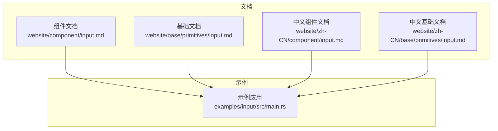
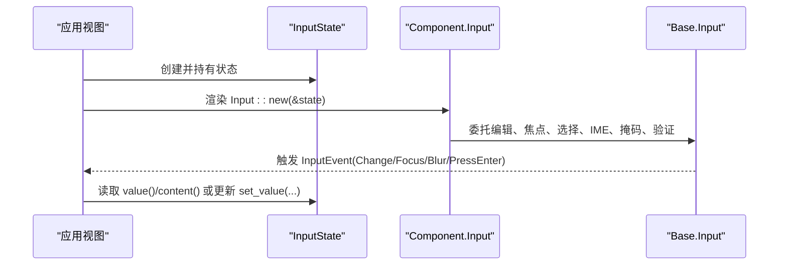
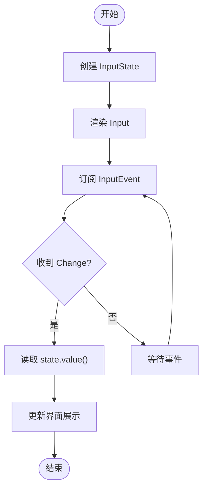
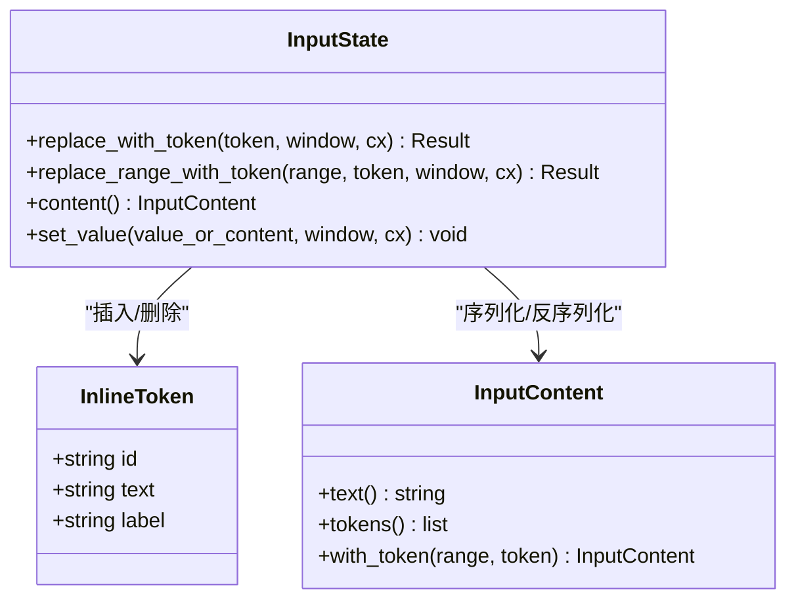
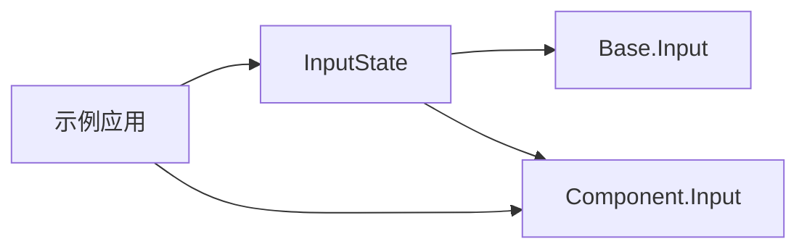

# Input 输入框

<cite>
**本文引用的文件**   
- [website/component/input.md](file://website/component/input.md)
- [website/zh-CN/component/input.md](file://website/zh-CN/component/input.md)
- [website/base/primitives/input.md](file://website/base/primitives/input.md)
- [website/zh-CN/base/primitives/input.md](file://website/zh-CN/base/primitives/input.md)
- [examples/input/src/main.rs](file://examples/input/src/main.rs)
</cite>

## 目录
1. [简介](#简介)
2. [项目结构](#项目结构)
3. [核心组件](#核心组件)
4. [架构总览](#架构总览)
5. [详细组件分析](#详细组件分析)
6. [依赖关系分析](#依赖关系分析)
7. [性能与可用性](#性能与可用性)
8. [故障排查](#故障排查)
9. [结论](#结论)
10. [附录：API 速查与示例索引](#附录api-速查与示例索引)

## 简介
Input 输入框是单行文本输入组件，提供校验、掩码、前后缀、清除按钮、密码显示切换、触摸选择、上下文菜单、粘贴钩子、光标闪烁策略以及原子行内 token（提及/引用）等能力。它由两层组成：
- Base 层：负责编辑行为、焦点、选择、键盘输入、IME、掩码、验证与事件。
- Component 层：在 Base 之上提供主题、尺寸、边框、前后缀槽位、清除按钮等成品样式与交互增强。

本文件面向使用者，系统说明基础用法、输入类型、验证与格式化、高级特性、表单集成、数据绑定、错误处理与国际化支持等实践要点。

## 项目结构
仓库中与 Input 相关的文档与示例分布如下：
- 组件文档（Component 层）：website/component/input.md 与中文对应版 website/zh-CN/component/input.md
- 基础文档（Base 层）：website/base/primitives/input.md 与中文对应版 website/zh-CN/base/primitives/input.md
- 可运行示例：examples/input/src/main.rs

图表来源
- [website/component/input.md:1-20](file://website/component/input.md#L1-L20)
- [website/base/primitives/input.md:1-20](file://website/base/primitives/input.md#L1-L20)
- [examples/input/src/main.rs:1-10](file://examples/input/src/main.rs#L1-L10)

章节来源
- [website/component/input.md:1-20](file://website/component/input.md#L1-L20)
- [website/base/primitives/input.md:1-20](file://website/base/primitives/input.md#L1-L20)
- [examples/input/src/main.rs:1-10](file://examples/input/src/main.rs#L1-L10)

## 核心组件
- InputState：持久化状态实体，持有值、选区、掩码、校验、token 等编辑态；对外发出 Change、PressEnter、Focus、Blur 等事件。
- Input（Component 层）：带主题、尺寸、边框、前后缀、清除按钮的成品输入控件。
- Input（Base 层）：无产品样式的单行输入控件，专注编辑行为与事件。

关键职责划分：
- Base 层：编辑、焦点、选择、键盘、IME、掩码、验证、事件。
- Component 层：外观、布局、交互增强（如清除按钮、mask_toggle）。

章节来源
- [website/base/primitives/input.md:1-20](file://website/base/primitives/input.md#L1-L20)
- [website/component/input.md:1-12](file://website/component/input.md#L1-L12)

## 架构总览
Input 的使用通常遵循“创建一次状态 + 渲染控件 + 订阅事件”的模式。Component 层 Input 基于 Base 层 Input 的能力，叠加样式与常用交互。

图表来源
- [website/component/input.md:14-28](file://website/component/input.md#L14-L28)
- [website/base/primitives/input.md:22-44](file://website/base/primitives/input.md#L22-L44)
- [examples/input/src/main.rs:20-39](file://examples/input/src/main.rs#L20-L39)

## 详细组件分析

### 基础输入框与初始化
- 通过 InputState::new 创建一次状态，再使用 Input::new(&state) 渲染。
- 支持 placeholder、default_value、cleanable、disabled、readonly、size 等常见配置。
- 可通过 appearance(false) 将内部输入嵌入自定义容器，实现无边框或自定义外框。

章节来源
- [website/component/input.md:20-57](file://website/component/input.md#L20-L57)
- [website/zh-CN/component/input.md:18-55](file://website/zh-CN/component/input.md#L18-L55)
- [website/base/primitives/input.md:22-44](file://website/base/primitives/input.md#L22-L44)

### 前缀、后缀与输入组
- 通过 prefix/suffix 插入图标、按钮等元素，常用于搜索、操作按钮等场景。
- 多个附加元素、共享外框和工具栏的组合方式见 Input Group（组件文档中已提示）。

章节来源
- [website/component/input.md:59-81](file://website/component/input.md#L59-L81)
- [website/zh-CN/component/input.md:57-76](file://website/zh-CN/component/input.md#L57-L76)

### 清除按钮与 ESC 清空
- cleanable(true) 在有值时显示清除按钮。
- clean_on_escape() 可在按下 ESC 时清空输入内容。

章节来源
- [website/component/input.md:52-57](file://website/component/input.md#L52-L57)
- [website/component/input.md:126-135](file://website/component/input.md#L126-L135)
- [website/zh-CN/component/input.md:50-55](file://website/zh-CN/component/input.md#L50-L55)
- [website/zh-CN/component/input.md:119-128](file://website/zh-CN/component/input.md#L119-L128)

### 密码输入与可见性切换
- 设置 masked(true) 与 content_type(InputContentType::Password)，并使用 mask_toggle() 显示/隐藏明文。
- 掩码状态下，复制/剪切被禁用，双击选中整串值；恢复明文后行为恢复正常。

章节来源
- [website/component/input.md:83-101](file://website/component/input.md#L83-L101)
- [website/zh-CN/component/input.md:78-95](file://website/zh-CN/component/input.md#L78-L95)

### 数字输入与数值格式化
- 使用 MaskPattern::Number 配置千分位分隔符与小数位数，适用于金额、数量等场景。
- Base 层还提供 min/max/step/step_by 等数值步进能力，配合 unmask_value() 获取底层值。

章节来源
- [website/component/input.md:153-178](file://website/component/input.md#L153-L178)
- [website/base/primitives/input.md:46-59](file://website/base/primitives/input.md#L46-L59)

### 校验规则与正则模式
- validate 回调用于自定义校验逻辑（例如解析为浮点数是否成功）。
- pattern 支持正则表达式进行字符级过滤。
- 提交前应结合 unmask_value()/value() 与业务校验进行二次确认。

章节来源
- [website/component/input.md:137-151](file://website/component/input.md#L137-L151)
- [website/zh-CN/component/input.md:130-142](file://website/zh-CN/component/input.md#L130-L142)
- [website/base/primitives/input.md:46-59](file://website/base/primitives/input.md#L46-L59)

### 输入掩码与格式化
- 支持字符串掩码（如电话号码）、自定义模板（字母/数字占位），以及 Number 掩码。
- 掩码会改变用户可见文本，但底层值可通过 unmask_value() 获取。

章节来源
- [website/component/input.md:153-178](file://website/component/input.md#L153-L178)
- [website/base/primitives/input.md:46-59](file://website/base/primitives/input.md#L46-L59)

### 事件与数据绑定
- 订阅 InputEvent::Change、PressEnter、Focus、Blur，并在 Change 中读取最新 value()。
- 示例展示了在 Example 视图中订阅事件并更新展示文本。

图表来源
- [website/component/input.md:180-198](file://website/component/input.md#L180-L198)
- [examples/input/src/main.rs:20-39](file://examples/input/src/main.rs#L20-L39)

章节来源
- [website/component/input.md:180-198](file://website/component/input.md#L180-L198)
- [website/zh-CN/component/input.md:168-186](file://website/zh-CN/component/input.md#L168-L186)
- [examples/input/src/main.rs:20-39](file://examples/input/src/main.rs#L20-L39)

### 上下文菜单与粘贴钩子
- context_menu 可关闭或替换内置右键菜单，复用内置 Cut/Copy/Paste 等操作。
- on_paste 拦截剪贴板，支持图片与外部文件路径，返回 true 表示消费该粘贴。

章节来源
- [website/component/input.md:216-234](file://website/component/input.md#L216-L234)
- [website/component/input.md:256-290](file://website/component/input.md#L256-L290)
- [website/zh-CN/component/input.md:202-218](file://website/zh-CN/component/input.md#L202-L218)
- [website/zh-CN/component/input.md:228-255](file://website/zh-CN/component/input.md#L228-L255)

### 触摸选择
- 长按选中单词，拖动 handle 调整选区，滚动边缘自动滚动；只读输入仅允许复制与全选；密码输入不暴露明文到剪贴板。

章节来源
- [website/component/input.md:236-254](file://website/component/input.md#L236-L254)
- [website/zh-CN/component/input.md:220-226](file://website/zh-CN/component/input.md#L220-L226)

### 光标闪烁策略
- 全局 Theme::cursor_blink 控制所有输入的光标闪烁策略，支持闪烁/常亮/空闲超时等。
- Component 层通过 Theme::update 同步策略到 Base，避免被主题切换覆盖。

章节来源
- [website/component/input.md:292-313](file://website/component/input.md#L292-L313)
- [website/base/primitives/input.md:81-123](file://website/base/primitives/input.md#L81-L123)
- [website/zh-CN/base/primitives/input.md:59-82](file://website/zh-CN/base/primitives/input.md#L59-L82)

### 原子行内 Token（提及/引用）
- 支持在输入中插入不可分割的 token（如 @alice），复制与 value() 返回真实文本。
- 支持自定义 token 渲染、点击打开资源、悬停预览、保存/恢复草稿（content/set_value）。
- 适用范围：Input 与 Textarea；不支持 Editor、NumberInput、格式化 mask 或密码输入。

图表来源
- [website/component/input.md:359-498](file://website/component/input.md#L359-L498)
- [website/zh-CN/component/input.md:320-423](file://website/zh-CN/component/input.md#L320-L423)
- [website/base/primitives/input.md:134-162](file://website/base/primitives/input.md#L134-L162)

章节来源
- [website/component/input.md:359-498](file://website/component/input.md#L359-L498)
- [website/zh-CN/component/input.md:320-423](file://website/zh-CN/component/input.md#L320-L423)
- [website/base/primitives/input.md:134-162](file://website/base/primitives/input.md#L134-L162)

### 多输入表单与数据绑定
- 在表单中组合多个 Input，分别绑定不同字段；提交时统一收集各字段的 value()/content()。
- 示例展示了垂直布局下并列两个输入框。

章节来源
- [website/component/input.md:345-357](file://website/component/input.md#L345-L357)
- [website/zh-CN/component/input.md:306-318](file://website/zh-CN/component/input.md#L306-L318)

### 国际化支持
- 组件文档未直接定义 i18n API；实际文案建议通过应用自身的本地化机制注入（如 Label、Tooltip、Toast 等）。
- 对于输入提示、错误信息等，建议在业务层统一翻译。

章节来源
- [website/component/input.md:1-12](file://website/component/input.md#L1-L12)
- [website/base/primitives/input.md:1-15](file://website/base/primitives/input.md#L1-L15)

## 依赖关系分析
- Component.Input 依赖 Base.Input 提供的编辑能力，并叠加样式与交互增强。
- InputState 作为跨层共享的状态实体，承载值、选区、掩码、校验、token 等。
- 示例应用通过订阅 InputEvent 驱动 UI 更新。

图表来源
- [website/base/primitives/input.md:1-20](file://website/base/primitives/input.md#L1-L20)
- [website/component/input.md:1-12](file://website/component/input.md#L1-L12)
- [examples/input/src/main.rs:1-10](file://examples/input/src/main.rs#L1-L10)

章节来源
- [website/base/primitives/input.md:1-20](file://website/base/primitives/input.md#L1-L20)
- [website/component/input.md:1-12](file://website/component/input.md#L1-L12)
- [examples/input/src/main.rs:1-10](file://examples/input/src/main.rs#L1-L10)

## 性能与可用性
- 光标闪烁策略支持空闲超时，减少长时间聚焦下的重绘开销。
- 掩码与校验在输入阶段生效，避免无效数据进入业务层。
- 触摸选择与上下文菜单提升移动端与触控设备的可用性。
- 粘贴钩子可拦截大对象（如图片），避免静默丢弃，同时保持输入流畅。

章节来源
- [website/base/primitives/input.md:81-123](file://website/base/primitives/input.md#L81-L123)
- [website/component/input.md:292-313](file://website/component/input.md#L292-L313)
- [website/component/input.md:256-290](file://website/component/input.md#L256-L290)

## 故障排查
- 掩码模式下复制/剪切不可用：这是预期行为，需先通过 mask_toggle 显示明文。
- 粘贴未生效：检查 on_paste 返回值；true 表示已消费，false 回退默认行为。
- 数值格式化异常：确认 MaskPattern::Number 的小数位与分隔符配置；必要时使用 unmask_value() 获取底层值。
- 校验失败：确保 validate/pattern 与业务语义一致；提交前再次校验。
- token 无法插入：确认当前模式支持 token（非 Editor/NumberInput/掩码/密码）；检查范围与 Unicode grapheme 边界。

章节来源
- [website/component/input.md:83-101](file://website/component/input.md#L83-L101)
- [website/component/input.md:256-290](file://website/component/input.md#L256-L290)
- [website/component/input.md:153-178](file://website/component/input.md#L153-L178)
- [website/component/input.md:137-151](file://website/component/input.md#L137-L151)
- [website/component/input.md:500-511](file://website/component/input.md#L500-L511)

## 结论
Input 输入框在 Base 层提供强大的编辑与输入能力，在 Component 层提供开箱即用的主题与交互增强。通过 InputState 统一管理状态，结合校验、掩码、token、事件与粘贴钩子，可构建健壮且体验良好的输入场景。建议在业务层统一处理国际化与错误提示，并结合表单组件完成复杂的数据绑定与提交流程。

## 附录：API 速查与示例索引
- 基础用法与状态管理
  - 参考：[website/component/input.md:20-57](file://website/component/input.md#L20-L57)、[website/base/primitives/input.md:22-44](file://website/base/primitives/input.md#L22-L44)
- 前缀/后缀与输入组
  - 参考：[website/component/input.md:59-81](file://website/component/input.md#L59-L81)
- 清除按钮与 ESC 清空
  - 参考：[website/component/input.md:52-57](file://website/component/input.md#L52-L57)、[website/component/input.md:126-135](file://website/component/input.md#L126-L135)
- 密码输入与可见性切换
  - 参考：[website/component/input.md:83-101](file://website/component/input.md#L83-L101)
- 数字输入与数值格式化
  - 参考：[website/component/input.md:153-178](file://website/component/input.md#L153-L178)、[website/base/primitives/input.md:46-59](file://website/base/primitives/input.md#L46-L59)
- 校验与正则
  - 参考：[website/component/input.md:137-151](file://website/component/input.md#L137-L151)
- 事件与数据绑定
  - 参考：[website/component/input.md:180-198](file://website/component/input.md#L180-L198)、[examples/input/src/main.rs:20-39](file://examples/input/src/main.rs#L20-L39)
- 上下文菜单与粘贴钩子
  - 参考：[website/component/input.md:216-234](file://website/component/input.md#L216-L234)、[website/component/input.md:256-290](file://website/component/input.md#L256-L290)
- 触摸选择
  - 参考：[website/component/input.md:236-254](file://website/component/input.md#L236-L254)
- 光标闪烁策略
  - 参考：[website/component/input.md:292-313](file://website/component/input.md#L292-L313)、[website/base/primitives/input.md:81-123](file://website/base/primitives/input.md#L81-L123)
- 原子行内 Token
  - 参考：[website/component/input.md:359-498](file://website/component/input.md#L359-L498)、[website/base/primitives/input.md:134-162](file://website/base/primitives/input.md#L134-L162)
- 多输入表单
  - 参考：[website/component/input.md:345-357](file://website/component/input.md#L345-L357)