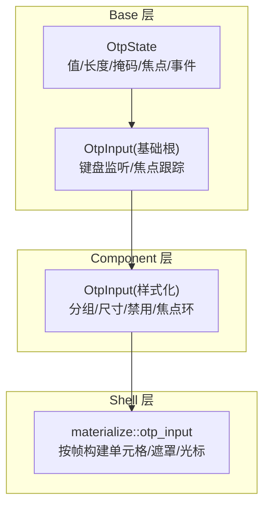
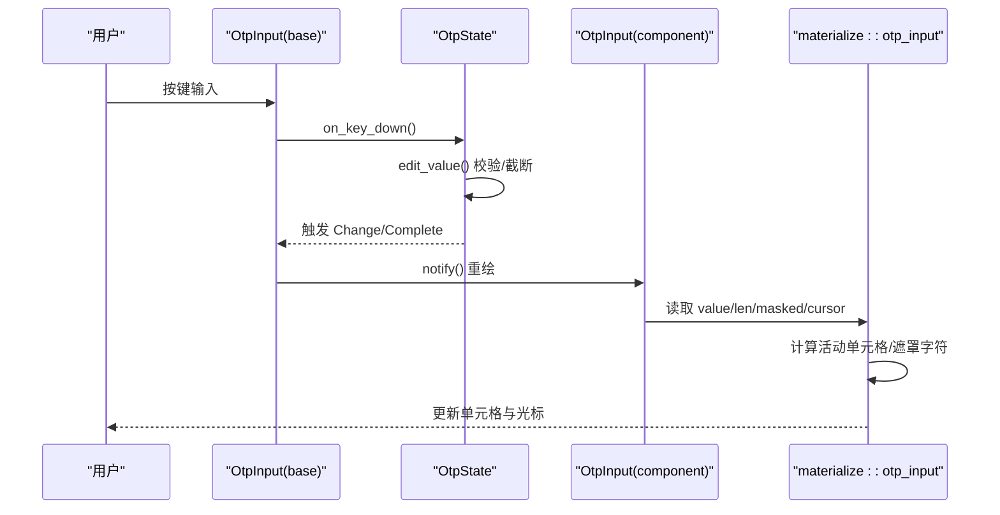
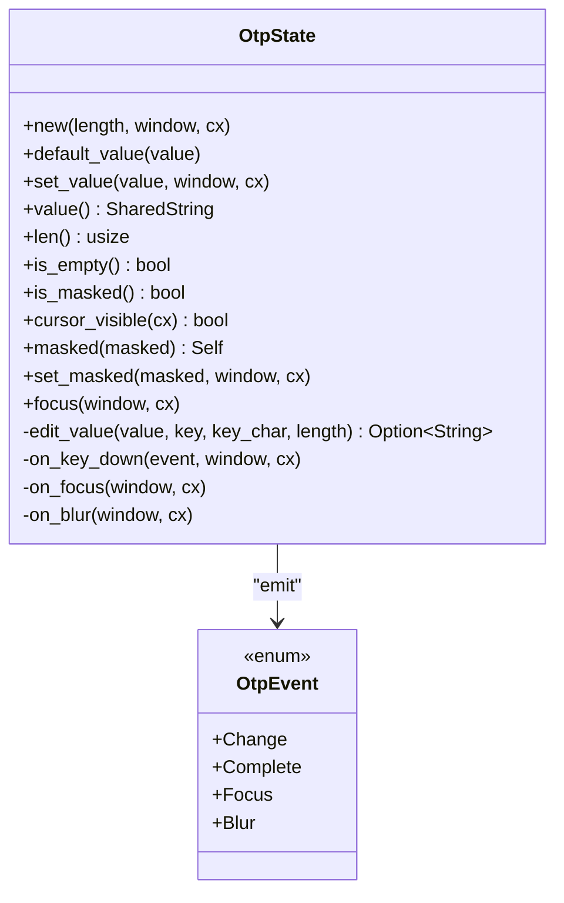
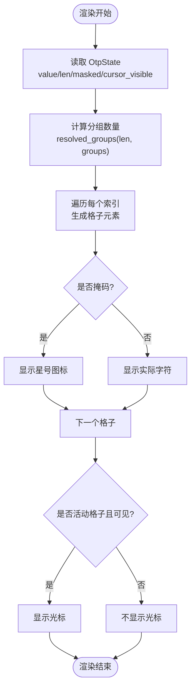
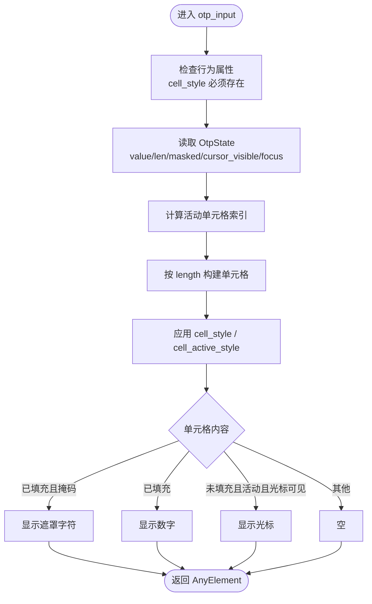
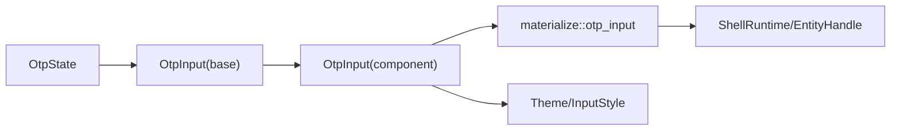

# OTPInput 验证码输入

<cite>
**本文引用的文件**   
- [otp_input.rs](file://crates/base/src/otp_input.rs)
- [otp_input.rs](file://crates/component/src/input/otp_input.rs)
- [otp_input.rs](file://crates/shell/src/materialize/components/otp_input.rs)
- [otp_input.rs](file://crates/base/examples/showcase/components/otp_input.rs)
- [otp_input_story.rs](file://crates/story/src/stories/otp_input_story.rs)
</cite>

## 目录
1. [简介](#简介)
2. [项目结构](#项目结构)
3. [核心组件](#核心组件)
4. [架构总览](#架构总览)
5. [详细组件分析](#详细组件分析)
6. [依赖关系分析](#依赖关系分析)
7. [性能与渲染特性](#性能与渲染特性)
8. [安全性考虑](#安全性考虑)
9. [无障碍访问与键盘导航](#无障碍访问与键盘导航)
10. [常见使用场景与示例](#常见使用场景与示例)
11. [故障排查](#故障排查)
12. [结论](#结论)

## 简介
OTPInput 是用于输入固定长度一次性验证码的输入组件。它提供：
- 固定长度的数字输入，支持掩码显示
- 自动聚焦、光标闪烁、键盘编辑（仅数字与退格）
- 分组展示、尺寸控制、禁用状态
- 事件通知：变更、完成、聚焦、失焦
- 在 gpui-base 中实现交互与状态，在 gpui-component 中提供样式化 UI，在 shell 层为脚本环境构建单元格视图

该组件适合短信验证码、应用内动态口令等场景。

## 项目结构
OTPInput 由三层协作实现：
- base 层：OtpState/OtpInput 负责状态、焦点、键盘处理与基础渲染容器
- component 层：OtpInput 提供样式化单元格、分组、尺寸、禁用等 UI 配置
- shell 层：materialize 中的 otp_input 为脚本环境构建每格单元格，并处理遮罩字符、活动单元格高亮与光标

**图表来源**
- [otp_input.rs:19-161](file://crates/base/src/otp_input.rs#L19-L161)
- [otp_input.rs:21-176](file://crates/component/src/input/otp_input.rs#L21-L176)
- [otp_input.rs:102-214](file://crates/shell/src/materialize/components/otp_input.rs#L102-L214)

**章节来源**
- [otp_input.rs:19-161](file://crates/base/src/otp_input.rs#L19-L161)
- [otp_input.rs:21-176](file://crates/component/src/input/otp_input.rs#L21-L176)
- [otp_input.rs:102-214](file://crates/shell/src/materialize/components/otp_input.rs#L102-L214)

## 核心组件
- OtpState：维护验证码值、位数、掩码开关、焦点句柄、光标闪烁；暴露 value/len/is_masked/cursor_visible/focus 等方法；通过 EventEmitter 发出 OtpEvent
- OtpEvent：Change、Complete、Focus、Blur
- OtpInput（base）：无样式交互根，持有 state，监听键盘事件，转发给 OtpState
- OtpInput（component）：样式化 UI，将 OtpState 的值渲染为若干格子，支持分组、尺寸、禁用、焦点环
- materialize::otp_input：为脚本环境构建单元格，决定遮罩字符、活动单元格、光标样式

**章节来源**
- [otp_input.rs:8-161](file://crates/base/src/otp_input.rs#L8-L161)
- [otp_input.rs:21-176](file://crates/component/src/input/otp_input.rs#L21-L176)
- [otp_input.rs:102-214](file://crates/shell/src/materialize/components/otp_input.rs#L102-L214)

## 架构总览
下图展示了从用户输入到状态更新、再到 UI 重绘的关键流程。

**图表来源**
- [otp_input.rs:121-148](file://crates/base/src/otp_input.rs#L121-L148)
- [otp_input.rs:74-176](file://crates/component/src/input/otp_input.rs#L74-L176)
- [otp_input.rs:163-214](file://crates/shell/src/materialize/components/otp_input.rs#L163-L214)

## 详细组件分析

### OtpState 与 OtpEvent
- 构造参数 length 决定验证码位数
- masked 控制是否掩码显示
- default_value/set_value 设置初始或程序化值
- focus 方法主动聚焦
- 键盘处理：
  - 仅接受数字键与全角数字
  - backspace 删除最后一位
  - 超过 length 时拒绝输入
  - 填满时发出 Complete 事件
- 焦点变化时发出 Focus/Blur 事件
- cursor_visible 由 BlinkCursor 驱动，用于光标闪烁

**图表来源**
- [otp_input.rs:8-161](file://crates/base/src/otp_input.rs#L8-L161)

**章节来源**
- [otp_input.rs:19-161](file://crates/base/src/otp_input.rs#L19-L161)

### Component 层 OtpInput（样式化）
- groups(n)：将格子分为 n 组，默认 2
- with_size(size)：单元格尺寸，支持 XSmall/Small/Medium/Large/自定义 px
- disabled(true)：禁用输入与交互
- focus_ring(enabled)：启用/禁用焦点环
- 渲染逻辑：
  - 根据 value 的长度绘制对应数量的格子
  - 根据 is_masked 显示星号图标或实际字符
  - 根据当前光标位置与焦点状态高亮活动格子
  - 点击任意格子可聚焦到 OtpState

**图表来源**
- [otp_input.rs:74-176](file://crates/component/src/input/otp_input.rs#L74-L176)

**章节来源**
- [otp_input.rs:21-176](file://crates/component/src/input/otp_input.rs#L21-L176)

### Shell 层 materialize::otp_input（脚本环境）
- 为脚本环境构建每个单元格的视图
- 使用 MASK_CHAR（圆点）作为遮罩字符，而非星号图标
- 根据 focus_handle 与窗口激活状态确定活动单元格
- 支持 cell_style 与 cell_active_style 模板
- 对不支持的属性进行警告（如 on_click/accessibility_label/on_change）

**图表来源**
- [otp_input.rs:102-214](file://crates/shell/src/materialize/components/otp_input.rs#L102-L214)
- [otp_input.rs:249-262](file://crates/shell/src/materialize/components/otp_input.rs#L249-L262)

**章节来源**
- [otp_input.rs:102-214](file://crates/shell/src/materialize/components/otp_input.rs#L102-L214)

## 依赖关系分析
- base::OtpState 依赖：
  - Focusable：管理焦点句柄
  - EventEmitter<OtpEvent>：发出变更/完成/聚焦/失焦事件
  - BlinkCursor：控制光标闪烁
- component::OtpInput 依赖：
  - gpui_base::OtpInput（基础根）
  - gpui_base::{OtpEvent, OtpState}
  - 主题系统：input_style、theme tokens
  - Sizable/FocusableExt/Disableable：尺寸、焦点环、禁用
- shell::materialize::otp_input 依赖：
  - gpui_base::OtpInput（基础根）
  - ShellRuntime/EntityHandle：实体生命周期管理
  - Behavior/Children/StateStyles：脚本侧样式与行为声明

**图表来源**
- [otp_input.rs:19-161](file://crates/base/src/otp_input.rs#L19-L161)
- [otp_input.rs:21-176](file://crates/component/src/input/otp_input.rs#L21-L176)
- [otp_input.rs:102-214](file://crates/shell/src/materialize/components/otp_input.rs#L102-L214)

**章节来源**
- [otp_input.rs:19-161](file://crates/base/src/otp_input.rs#L19-L161)
- [otp_input.rs:21-176](file://crates/component/src/input/otp_input.rs#L21-L176)
- [otp_input.rs:102-214](file://crates/shell/src/materialize/components/otp_input.rs#L102-L214)

## 性能与渲染特性
- base 层的 OtpState::render 返回 Empty，避免不必要的复杂渲染；实际视觉由 component/shell 层负责
- 光标闪烁通过 BlinkCursor 周期性通知 OtpState，触发重绘
- shell 层在每个帧构建单元格，但样式模板由脚本声明一次，减少重复开销
- component 层根据 value 长度与分组计算格子布局，复杂度与验证码位数线性相关

[本节为通用性能说明，不直接分析具体代码行]

## 安全性考虑
- 键盘输入过滤：仅允许数字与全角数字，backspace 删除；非数字键被忽略
- 长度限制：超过 length 的输入会被拒绝，防止越界
- 程序化值兼容：set_value 不做过滤，保持向后兼容；但键盘路径仍严格限制
- 掩码显示：is_masked 控制显示为星号或圆点，隐藏敏感信息
- 建议：
  - 前端仅做输入格式与长度校验，后端需再次验证验证码有效性
  - 不要在前端存储明文验证码，提交后立即清理
  - 对频繁重试进行速率限制与防暴力破解策略

**章节来源**
- [otp_input.rs:95-139](file://crates/base/src/otp_input.rs#L95-L139)
- [otp_input.rs:229-236](file://crates/base/src/otp_input.rs#L229-L236)
- [otp_input.rs:249-262](file://crates/shell/src/materialize/components/otp_input.rs#L249-L262)

## 无障碍访问与键盘导航
- 焦点管理：
  - OtpState 实现 Focusable，提供 focus_handle
  - 点击任意单元格可聚焦到 OtpState
  - 聚焦时发出 Focus 事件，失焦时发出 Blur 事件
- 键盘导航：
  - 仅处理数字与 backspace，其他键被忽略
  - 不支持左右方向键移动光标（设计为顺序输入）
- 屏幕阅读器：
  - shell 层对 accessibility_label 等属性给出警告，提示其不适用
  - 建议在父级元素提供语义化标签与说明文本

**章节来源**
- [otp_input.rs:141-148](file://crates/base/src/otp_input.rs#L141-L148)
- [otp_input.rs:121-139](file://crates/base/src/otp_input.rs#L121-L139)
- [otp_input.rs:112-135](file://crates/shell/src/materialize/components/otp_input.rs#L112-L135)

## 常见使用场景与示例

### 基本用法：六位验证码
- 创建 OtpState，length=6
- 使用 component::OtpInput 绑定 state
- 订阅 OtpEvent::Complete 获取完整验证码

参考示例：
- [otp_input_story.rs:55-68](file://crates/story/src/stories/otp_input_story.rs#L55-L68)

### 掩码显示切换
- 通过 set_masked 切换显示模式
- 适用于“显示/隐藏验证码”的用户操作

参考示例：
- [otp_input_story.rs:99-116](file://crates/story/src/stories/otp_input_story.rs#L99-L116)

### 分组展示
- 使用 groups(n) 将格子分为多组，提升可读性
- 例如 6 位验证码分为 2 组或 3 组

参考示例：
- [otp_input_story.rs:155-169](file://crates/story/src/stories/otp_input_story.rs#L155-L169)

### 自定义尺寸
- 使用 with_size(px) 设置单元格宽高
- 适用于不同布局密度

参考示例：
- [otp_input_story.rs:171-178](file://crates/story/src/stories/otp_input_story.rs#L171-L178)

### 禁用状态
- 使用 disabled(true) 禁用输入
- 适用于只读展示或等待后续步骤

参考示例：
- [otp_input_story.rs:180-187](file://crates/story/src/stories/otp_input_story.rs#L180-L187)

### 复制粘贴与键盘导航
- 键盘输入仅支持数字与 backspace
- 不支持方向键移动光标；如需更复杂的编辑体验，可在上层封装额外逻辑
- 复制粘贴行为受底层输入系统影响；若需要精确控制，建议在应用层拦截并校验粘贴内容

[本节为使用指导，不直接分析具体代码行]

## 故障排查
- 单元格不可见：
  - shell 层要求声明 cell_style，否则单元格无尺寸与背景
  - 参考警告信息：缺少 cell_style 会打印警告
- 活动单元格不闪烁：
  - 确保 OtpState 获得焦点且窗口激活
  - 检查 BlinkCursor 是否正常启动/停止
- 输入无效：
  - 确认仅输入数字与全角数字
  - 检查 length 是否过小导致输入被拒绝
- 事件未触发：
  - 确认订阅了 OtpEvent::Change/Complete/Focus/Blur
  - shell 层 on_change 不是 OtpInput 的方法，应订阅 state 的事件

**章节来源**
- [otp_input.rs:155-160](file://crates/shell/src/materialize/components/otp_input.rs#L155-L160)
- [otp_input.rs:112-135](file://crates/shell/src/materialize/components/otp_input.rs#L112-L135)
- [otp_input.rs:121-148](file://crates/base/src/otp_input.rs#L121-L148)

## 结论
OTPInput 通过 base 层的状态与交互、component 层的样式化 UI、shell 层的脚本环境单元格构建，提供了稳定、可定制、安全的验证码输入能力。开发者可根据业务需求灵活配置位数、分组、尺寸、掩码与禁用状态，并通过事件机制处理输入完成与状态变化。在实际使用中，建议结合后端校验与安全策略，确保验证码输入的安全性与用户体验。