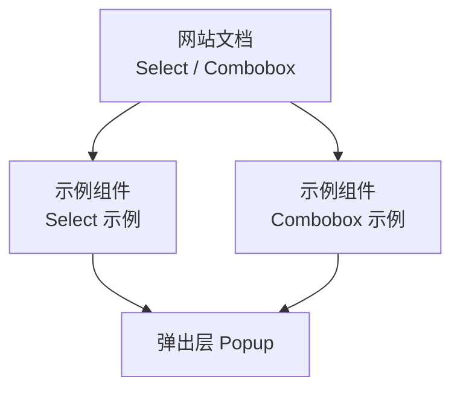
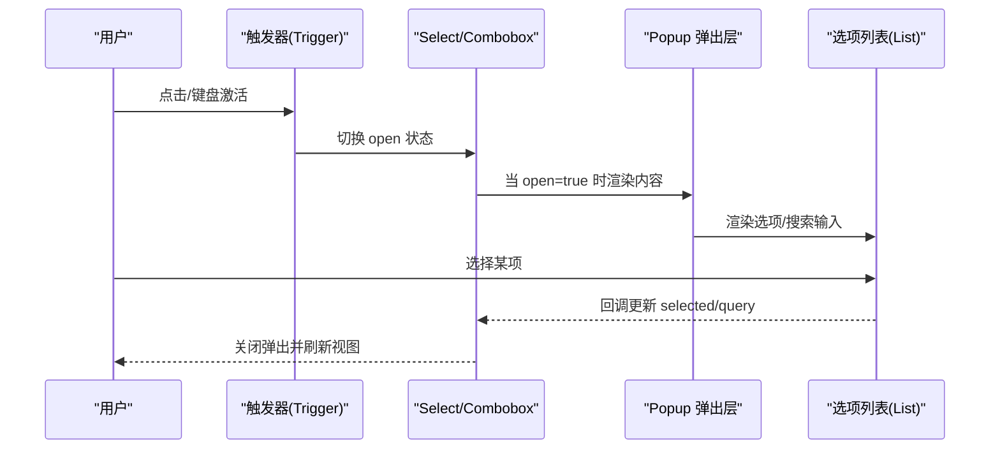
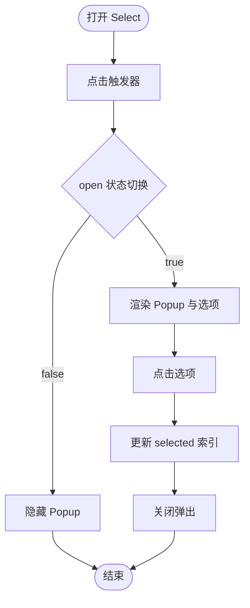
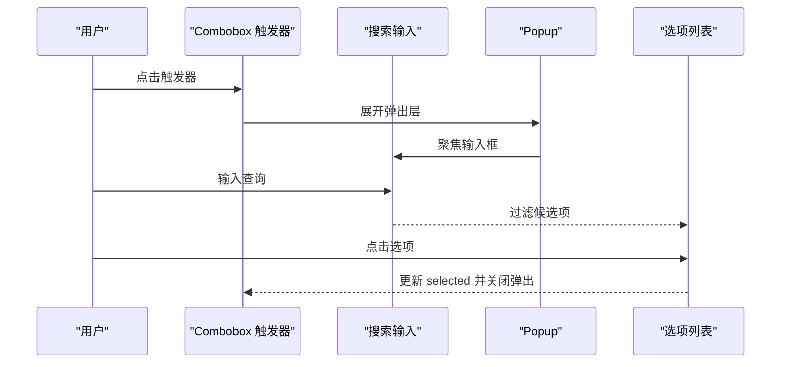

# Select 选择器

<cite>
**本文引用的文件**   
- [select.md](file://website/base/primitives/select.md)
- [combobox.md](file://website/base/primitives/combobox.md)
- [select.rs](file://crates/base/examples/showcase/components/select.rs)
- [combobox.rs](file://crates/base/examples/showcase/components/combobox.rs)
</cite>

## 目录
1. [简介](#简介)
2. [项目结构](#项目结构)
3. [核心组件](#核心组件)
4. [架构总览](#架构总览)
5. [详细组件分析](#详细组件分析)
6. [依赖关系分析](#依赖关系分析)
7. [性能考虑](#性能考虑)
8. [故障排查指南](#故障排查指南)
9. [结论](#结论)
10. [附录](#附录)

## 简介
本文件面向 Select 选择器与 ComboBox 组合框两个基础交互原语，系统说明其下拉选择、搜索过滤、多选扩展、选项配置、自定义渲染、异步加载、数据绑定与值映射、禁用选项等用法；并覆盖键盘导航、无障碍访问与性能优化实践。文档同时给出基于仓库示例的可视化流程图与时序图，帮助读者快速理解实现要点与最佳实践。

## 项目结构
- 文档入口：base 原语文档提供 Select 与 Combobox 的使用说明、导入方式、状态与事件模型、可访问性建议与完整示例链接。
- 示例实现：showcase 组件中分别提供 Select 与 Combobox 的可运行示例，展示触发器、弹出层、选项列表与状态同步。

图表来源
- [select.md:1-59](file://website/base/primitives/select.md#L1-L59)
- [combobox.md:1-54](file://website/base/primitives/combobox.md#L1-L54)
- [select.rs:1-86](file://crates/base/examples/showcase/components/select.rs#L1-L86)
- [combobox.rs:1-108](file://crates/base/examples/showcase/components/combobox.rs#L1-L108)

章节来源
- [select.md:1-59](file://website/base/primitives/select.md#L1-L59)
- [combobox.md:1-54](file://website/base/primitives/combobox.md#L1-L54)

## 核心组件
- Select 选择器
  - 行为：按钮式触发器 + 锚定的弹出列表；支持键盘导航；通过 on_open_change 控制展开状态；可通过 accessibility_label/accessibility_value 暴露语义信息。
  - 典型用法：单值选择、禁用态、占位符显示、自定义触发器与选项渲染。
- ComboBox 组合框
  - 行为：文本输入 + 弹出建议列表；支持查询过滤、键盘可达；on_open_change 控制展开并在展开时聚焦输入框。
  - 典型用法：搜索选择、带过滤的建议列表、自定义输入与选项渲染。

章节来源
- [select.md:27-54](file://website/base/primitives/select.md#L27-L54)
- [combobox.md:27-50](file://website/base/primitives/combobox.md#L27-L50)

## 架构总览
Select 与 Combobox 在示例中均通过 Popup 承载内容区域，形成“触发器 + 弹出层”的结构。Select 更强调语义化与无障碍，Combobox 更强调输入与过滤。

图表来源
- [select.rs:14-83](file://crates/base/examples/showcase/components/select.rs#L14-L83)
- [combobox.rs:19-105](file://crates/base/examples/showcase/components/combobox.rs#L19-L105)

## 详细组件分析

### Select 选择器
- 触发器与状态
  - 使用外部状态控制 open 与 selected，并通过 on_open_change 同步到父级实体。
  - 触发器可自定义样式与图标（如下拉箭头），选中项回显于触发器内。
- 选项列表
  - 通过 Popup 包裹选项 div，按索引高亮当前选中项。
  - 点击选项后更新 selected 并关闭弹出。
- 无障碍
  - 设置 accessibility_label 与 accessibility_value，确保读屏正确播报。
  - 禁用控件不暴露激活能力。

图表来源
- [select.rs:14-83](file://crates/base/examples/showcase/components/select.rs#L14-L83)

章节来源
- [select.rs:1-86](file://crates/base/examples/showcase/components/select.rs#L1-L86)
- [select.md:33-54](file://website/base/primitives/select.md#L33-L54)

### ComboBox 组合框
- 输入与过滤
  - 使用 InputBase 作为搜索框，根据 query 过滤候选项。
  - 展开时自动聚焦输入框，收起时保持触发器焦点。
- 选项列表
  - 过滤后的选项以列表形式呈现，点击后更新 selected 并关闭弹出。
- 无障碍
  - 保证输入、弹出、活动选项与选中值同步，且所有选项均可键盘到达。

图表来源
- [combobox.rs:19-105](file://crates/base/examples/showcase/components/combobox.rs#L19-L105)

章节来源
- [combobox.rs:1-108](file://crates/base/examples/showcase/components/combobox.rs#L1-L108)
- [combobox.md:33-50](file://website/base/primitives/combobox.md#L33-L50)

### 高级用法与实践

- 下拉选择
  - Select：通过外部 open 状态与 on_open_change 控制弹出；触发器显示当前选中或占位符。
  - Combobox：默认展开即显示全部候选，适合短列表；长列表建议结合虚拟滚动。
- 搜索选择
  - Combobox：将输入框置于 Popup 顶部，对候选进行包含匹配过滤。
  - 性能建议：对大数据集采用防抖与分页加载。
- 多选模式
  - 可在选项层维护一个集合类型存储已选项，并在触发器中聚合显示（如标签或计数）。
  - 注意：需自行处理全选/反选、清空、删除标签等交互。
- 选项配置
  - 为每个选项提供 id、label、disabled、icon、extra 等字段，便于统一渲染与筛选。
  - disabled 选项应不可聚焦、不可选择，视觉上置灰。
- 自定义渲染
  - 触发器与选项均可完全自定义（图标、布局、尺寸、颜色、悬停/选中态）。
  - 使用稳定 id 提升可测试性与可访问性。
- 异步加载
  - 在 on_open_change 中发起请求，loading 态显示骨架或转圈，完成后填充选项。
  - 建议在展开时才加载，避免首屏开销；对频繁切换场景做缓存。
- 数据绑定与值映射
  - 对外暴露 valueId（如 ID）与 displayText（如名称），内部维护映射表，提交时使用 valueId。
  - 支持空值、默认值与校验失败时的回退显示。
- 禁用选项
  - 在选项层标记 disabled，并在点击与键盘事件中跳过选择逻辑。
  - 禁用整个控件时，禁止展开与任何交互。

章节来源
- [select.rs:14-83](file://crates/base/examples/showcase/components/select.rs#L14-L83)
- [combobox.rs:19-105](file://crates/base/examples/showcase/components/combobox.rs#L19-L105)

## 依赖关系分析
- 组件耦合
  - Select/Combobox 与 Popup 解耦：通过 open 状态控制内容渲染。
  - 触发器与选项列表通过闭包回调与外部实体状态通信，降低直接依赖。
- 外部依赖
  - 示例中使用 GPUI 的基础元素（div、InputBase）、Popup 与样式 API。
- 潜在循环依赖
  - 示例通过 entity.downgrade() 与回调更新避免强引用循环。

图表来源
- [select.rs:14-83](file://crates/base/examples/showcase/components/select.rs#L14-L83)
- [combobox.rs:19-105](file://crates/base/examples/showcase/components/combobox.rs#L19-L105)

章节来源
- [select.rs:1-86](file://crates/base/examples/showcase/components/select.rs#L1-L86)
- [combobox.rs:1-108](file://crates/base/examples/showcase/components/combobox.rs#L1-L108)

## 性能考虑
- 列表渲染
  - 大量选项建议使用虚拟列表或分页加载，避免一次性构建 DOM。
- 过滤计算
  - 对长列表过滤时加入防抖；必要时在后端侧完成过滤与分页。
- 状态更新
  - 仅在回调中更新状态并触发重绘，不要在每次渲染中重建持久实体。
- 资源复用
  - 复用触发器与选项模板，减少重复创建成本。
- 动画与动效
  - 遵循 reduced-motion 偏好，避免不必要的过渡与重排。

[本节为通用指导，不直接分析具体文件]

## 故障排查指南
- 弹出层不显示
  - 检查 open 状态是否正确传递至 Popup；确认 when(open, ...) 条件分支生效。
- 无法聚焦输入框
  - Combobox 展开时应主动 focus 输入框；检查 on_open_change 中的 focus 调用。
- 无障碍播报异常
  - 为 Select 根节点设置 accessibility_label 与 accessibility_value；确保值为最终提交值而非临时查询。
- 选项点击无效
  - 检查回调是否更新 selected 并调用 notify；确认未因 disabled 被拦截。
- 搜索无结果
  - 核对过滤逻辑大小写与空格处理；必要时增加 trim 与规范化。

章节来源
- [select.md:47-54](file://website/base/primitives/select.md#L47-L54)
- [combobox.md:47-50](file://website/base/primitives/combobox.md#L47-L50)
- [select.rs:14-83](file://crates/base/examples/showcase/components/select.rs#L14-L83)
- [combobox.rs:19-105](file://crates/base/examples/showcase/components/combobox.rs#L19-L105)

## 结论
Select 与 Combobox 提供了稳定的下拉与搜索选择能力。通过外部状态管理、Popup 内容与回调机制，可实现丰富的交互形态。结合无障碍与性能优化实践，可在复杂业务场景中稳健落地。

[本节为总结性内容，不直接分析具体文件]

## 附录
- 快速上手命令
  - Select 示例：cargo run -p gpui-base-examples -- select
  - Combobox 示例：cargo run -p gpui-base-examples -- combobox
- 导入方式
  - Select：use gpui_kit::base::{Select};
  - Combobox：use gpui_kit::base::{Combobox};

章节来源
- [select.md:17-25](file://website/base/primitives/select.md#L17-L25)
- [combobox.md:17-25](file://website/base/primitives/combobox.md#L17-L25)