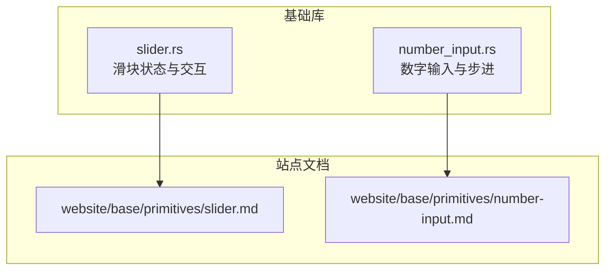
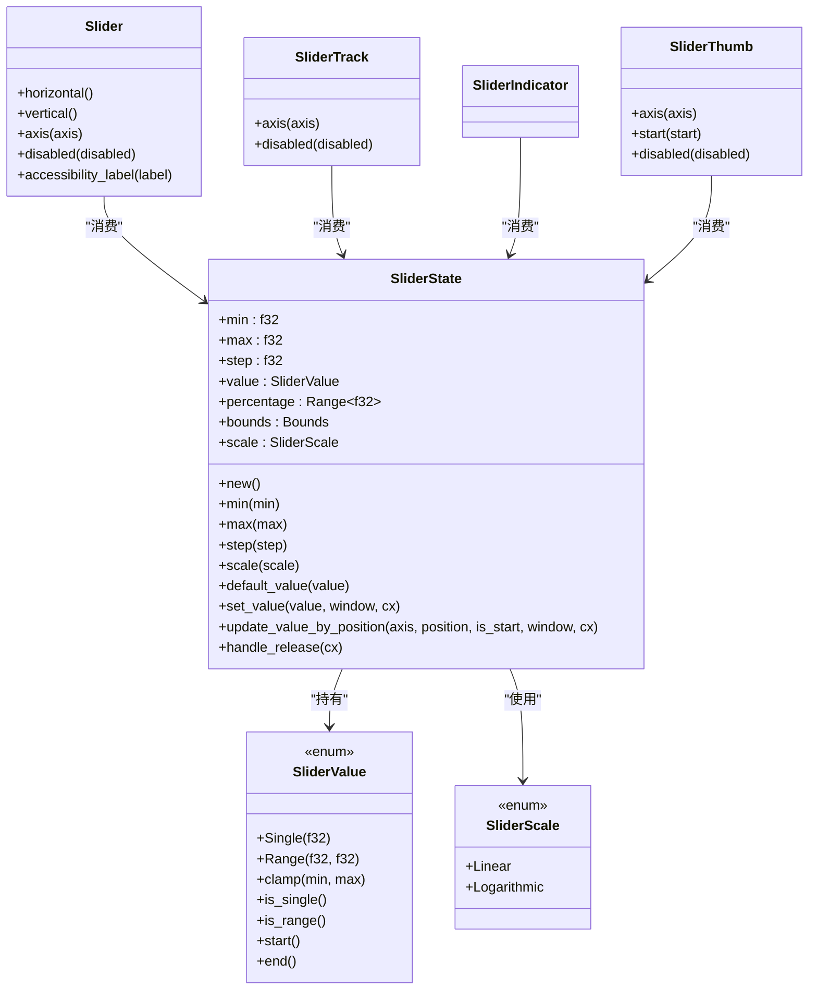
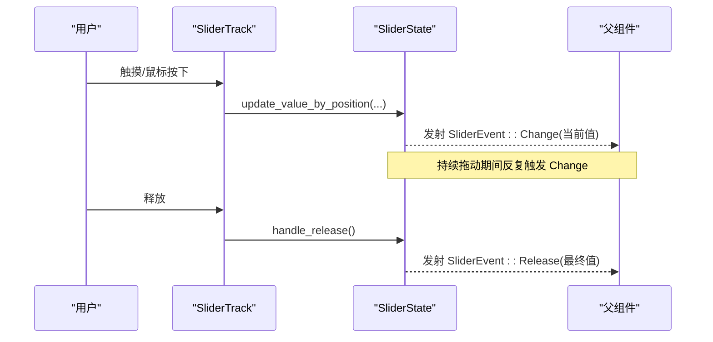
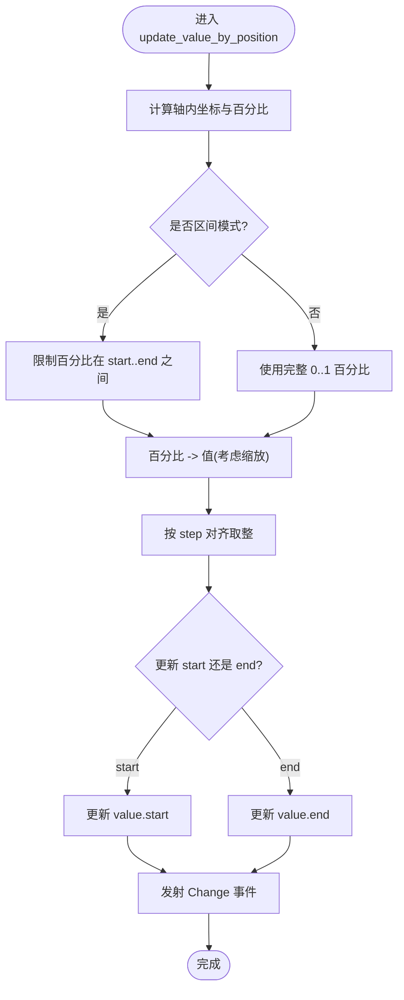
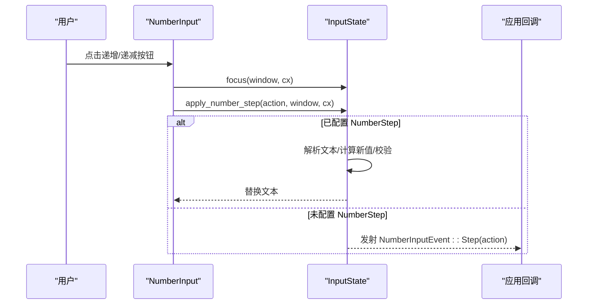
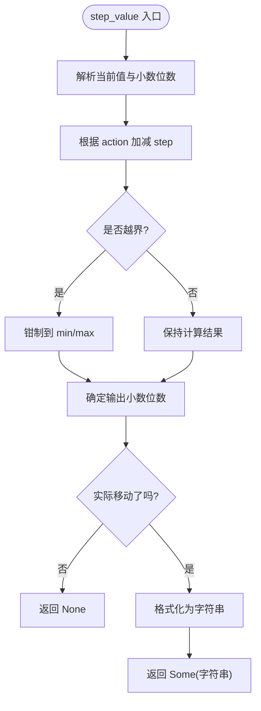
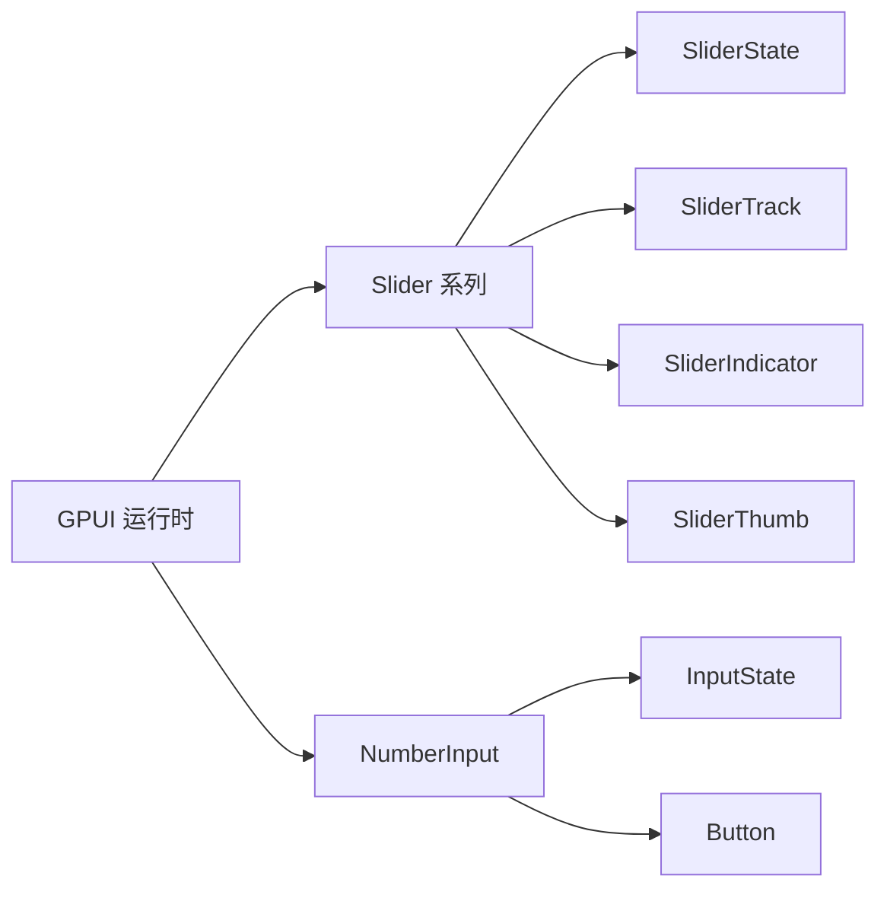

# Slider、NumberInput 数值控件

<cite>
**本文引用的文件**   
- [crates/base/src/slider.rs](file://crates/base/src/slider.rs)
- [crates/base/src/number_input.rs](file://crates/base/src/number_input.rs)
- [website/base/primitives/slider.md](file://website/base/primitives/slider.md)
- [website/base/primitives/number-input.md](file://website/base/primitives/number-input.md)
</cite>

## 目录
1. [简介](#简介)
2. [项目结构](#项目结构)
3. [核心组件](#核心组件)
4. [架构总览](#架构总览)
5. [详细组件分析](#详细组件分析)
6. [依赖关系分析](#依赖关系分析)
7. [性能考虑](#性能考虑)
8. [故障排查指南](#故障排查指南)
9. [结论](#结论)
10. [附录：配置与使用速查](#附录配置与使用速查)

## 简介
本文件面向 Slider 滑块与 NumberInput 数字输入两个数值控件，系统说明其数值范围设置、步进控制、格式化显示、双向绑定、验证规则、单位显示、触摸交互、键盘操作、无障碍访问等特性，并给出性能优化建议与最佳实践。文档内容基于仓库中的实现源码与官方站点文档进行提炼与归纳，力求兼顾技术深度与可读性。

## 项目结构
Slider 与 NumberInput 均位于基础库 crate 中，提供“行为与语义结构”，视觉样式由上层设计系统通过 GPUI 标准样式体系组合呈现。站点文档分别对二者进行了 API 与可访问性说明。

图表来源
- [crates/base/src/slider.rs:1-1033](file://crates/base/src/slider.rs#L1-L1033)
- [crates/base/src/number_input.rs:1-504](file://crates/base/src/number_input.rs#L1-L504)
- [website/base/primitives/slider.md:1-59](file://website/base/primitives/slider.md#L1-L59)
- [website/base/primitives/number-input.md:1-55](file://website/base/primitives/number-input.md#L1-L55)

章节来源
- [crates/base/src/slider.rs:1-1033](file://crates/base/src/slider.rs#L1-L1033)
- [crates/base/src/number_input.rs:1-504](file://crates/base/src/number_input.rs#L1-L504)
- [website/base/primitives/slider.md:1-59](file://website/base/primitives/slider.md#L1-L59)
- [website/base/primitives/number-input.md:1-55](file://website/base/primitives/number-input.md#L1-L55)

## 核心组件
- Slider（滑块）
  - 状态模型：SliderState 持有最小值、最大值、步长、当前值、百分比区间、几何边界、缩放模式、拖拽状态等。
  - 值类型：SliderValue 支持单值或区间值，并提供 clamp、start/end 访问器。
  - 缩放模式：线性与对数两种；对数模式下 min 必须大于 0 且小于 max。
  - 交互：鼠标点击/拖拽、触摸拖动、无障碍 Increment/Decrement 动作。
  - 可组合部件：SliderTrack（轨道）、SliderIndicator（指示条）、SliderThumb（拖拽手柄）。
- NumberInput（数字输入）
  - 基于 InputState 构建，提供递增/递减按钮、步进策略、键盘方向键步进、可访问性标签与数值。
  - 步进策略：固定步长或按值计算步长；step_value 函数保证精度与边界方向。
  - 布局：支持左右按钮布局与右侧堆叠布局。

章节来源
- [crates/base/src/slider.rs:14-185](file://crates/base/src/slider.rs#L14-L185)
- [crates/base/src/slider.rs:196-418](file://crates/base/src/slider.rs#L196-L418)
- [crates/base/src/slider.rs:438-560](file://crates/base/src/slider.rs#L438-L560)
- [crates/base/src/slider.rs:562-738](file://crates/base/src/slider.rs#L562-L738)
- [crates/base/src/slider.rs:797-886](file://crates/base/src/slider.rs#L797-L886)
- [crates/base/src/number_input.rs:13-48](file://crates/base/src/number_input.rs#L13-L48)
- [crates/base/src/number_input.rs:56-91](file://crates/base/src/number_input.rs#L56-L91)
- [crates/base/src/number_input.rs:96-219](file://crates/base/src/number_input.rs#L96-L219)
- [crates/base/src/number_input.rs:233-341](file://crates/base/src/number_input.rs#L233-L341)
- [crates/base/src/number_input.rs:344-386](file://crates/base/src/number_input.rs#L344-L386)

## 架构总览
Slider 采用“状态 + 可组合部件”的架构：SliderState 管理数值与交互逻辑，Slider/SliderTrack/SliderIndicator/SliderThumb 负责渲染与事件转发。NumberInput 以 InputState 为核心，封装步进逻辑与按钮布局，对外暴露可控的 on_step 回调与装饰点。

图表来源
- [crates/base/src/slider.rs:14-185](file://crates/base/src/slider.rs#L14-L185)
- [crates/base/src/slider.rs:196-418](file://crates/base/src/slider.rs#L196-L418)
- [crates/base/src/slider.rs:438-560](file://crates/base/src/slider.rs#L438-L560)
- [crates/base/src/slider.rs:562-738](file://crates/base/src/slider.rs#L562-L738)
- [crates/base/src/slider.rs:797-886](file://crates/base/src/slider.rs#L797-L886)

## 详细组件分析

### Slider 滑块
- 数值范围与步进
  - 通过 min/max 设置范围，step 设置步进；更新值时会按 step 对齐。
  - SliderValue::clamp 用于将值限制在范围内；内部 percentage 区间用于映射位置到值。
- 缩放模式
  - Linear：线性映射。
  - Logarithmic：对数映射，要求 min > 0 且 max > min；适合音量、频率、缩放等场景。
- 双向绑定
  - 父级维护 SliderState 实体，在 Change/Release 回调中更新父状态并触发重绘。
  - set_value 可外部驱动值变化，自动刷新百分比与 UI。
- 触摸与鼠标
  - 轨道层处理 TouchDragEvent，区分开始/移动/结束阶段；非区间模式直接更新 end 值，区间模式根据点击位置决定调整 start 或 end。
  - 鼠标点击与拖拽通过 Drag/DragMove 事件链更新值。
- 无障碍访问
  - 暴露 Role::Slider、aria_numeric_value/min/max/step、orientation；支持 AccessibleAction::Increment/Decrement。
  - 可通过 accessibility_label 为辅助技术命名。
- 可视化部件
  - SliderTrack：记录几何边界，处理指针/触摸交互。
  - SliderIndicator：记录绘制后的 bounds，供状态同步。
  - SliderThumb：可拖拽手柄，支持 start 标记以区分区间左端点。

图表来源
- [crates/base/src/slider.rs:353-418](file://crates/base/src/slider.rs#L353-L418)
- [crates/base/src/slider.rs:611-738](file://crates/base/src/slider.rs#L611-L738)

图表来源
- [crates/base/src/slider.rs:353-393](file://crates/base/src/slider.rs#L353-L393)

章节来源
- [crates/base/src/slider.rs:14-185](file://crates/base/src/slider.rs#L14-L185)
- [crates/base/src/slider.rs:196-418](file://crates/base/src/slider.rs#L196-L418)
- [crates/base/src/slider.rs:438-560](file://crates/base/src/slider.rs#L438-L560)
- [crates/base/src/slider.rs:562-738](file://crates/base/src/slider.rs#L562-L738)
- [crates/base/src/slider.rs:797-886](file://crates/base/src/slider.rs#L797-L886)
- [website/base/primitives/slider.md:1-59](file://website/base/primitives/slider.md#L1-L59)

### NumberInput 数字输入
- 步进控制
  - StepAction 表示递增/递减；NumberStep 支持固定步长或按值计算步长。
  - apply_number_step 会解析当前文本、计算新值、校验有效性后替换文本；若未配置步进策略则向上抛出 NumberInputEvent::Step。
  - step_value 函数保持小数位数与边界方向，避免无效步进。
- 键盘操作
  - 注册上下文 KeyBinding：Up/Down 对应 Increment/Decrement；禁用时传播事件。
- 按钮与布局
  - 内置 decrement/increment 按钮，支持自定义装饰；controls_right 可将按钮堆叠在右侧。
  - 按钮不可聚焦，避免焦点在按钮与编辑器间跳动导致闪烁。
- 可访问性
  - Role::SpinButton；暴露 aria_label 与 aria_numeric_value；通过 key_context 绑定键盘动作。
- 格式化与单位显示
  - 文本区域由 NumberInputText 包裹，应用可自由注入任意编辑器或装饰元素，从而支持单位后缀、前缀、千分位等展示。
  - 步进过程保留小数精度，确保显示一致性。

图表来源
- [crates/base/src/number_input.rs:62-91](file://crates/base/src/number_input.rs#L62-L91)
- [crates/base/src/number_input.rs:233-341](file://crates/base/src/number_input.rs#L233-L341)

图表来源
- [crates/base/src/number_input.rs:344-386](file://crates/base/src/number_input.rs#L344-L386)

章节来源
- [crates/base/src/number_input.rs:13-48](file://crates/base/src/number_input.rs#L13-L48)
- [crates/base/src/number_input.rs:56-91](file://crates/base/src/number_input.rs#L56-L91)
- [crates/base/src/number_input.rs:96-219](file://crates/base/src/number_input.rs#L96-L219)
- [crates/base/src/number_input.rs:233-341](file://crates/base/src/number_input.rs#L233-L341)
- [crates/base/src/number_input.rs:344-386](file://crates/base/src/number_input.rs#L344-L386)
- [website/base/primitives/number-input.md:1-55](file://website/base/primitives/number-input.md#L1-L55)

## 依赖关系分析
- Slider 依赖
  - GPUI 事件与可访问性接口：AccessibleAction、Role、Orientation、TouchPhase 等。
  - 几何与布局：Bounds、Axis、Pixels。
  - 自身部件：SliderTrack/SliderIndicator/SliderThumb 共同协作完成交互与渲染。
- NumberInput 依赖
  - InputState：文本编辑、掩码、焦点管理。
  - Button：步进按钮的基础样式与交互。
  - GPUI 可访问性与键盘绑定：KeyBinding、actions!、Role::SpinButton。

图表来源
- [crates/base/src/slider.rs:1-13](file://crates/base/src/slider.rs#L1-L13)
- [crates/base/src/number_input.rs:1-12](file://crates/base/src/number_input.rs#L1-L12)

章节来源
- [crates/base/src/slider.rs:1-13](file://crates/base/src/slider.rs#L1-L13)
- [crates/base/src/number_input.rs:1-12](file://crates/base/src/number_input.rs#L1-L12)

## 性能考虑
- 避免重复创建持久实体
  - 父组件应复用 SliderState/InputState 实体，仅在回调中更新值并调用 notify，不要在每次渲染中重建。
- 减少不必要的重绘
  - SliderIndicator 在 prepaint 中仅当 bounds 变化时才更新状态，降低保留视图下的冗余渲染。
- 合理选择缩放模式
  - 对数缩放涉及幂运算与对数，频繁更新时可结合节流或合并更新批次。
- 步进与格式化
  - NumberInput 的 step_value 会解析与格式化字符串，建议在批量更新时合并多次步进，避免频繁文本替换。
- 触摸与鼠标事件
  - 轨道层的触摸层使用 canvas 插入 hitbox，避免覆盖层拦截拖拽；注意在复杂层级结构中确认 hitbox 命中。

[本节为通用性能建议，不直接分析具体代码行]

## 故障排查指南
- 对数缩放报错
  - 现象：启用 SliderScale::Logarithmic 时报断言失败。
  - 原因：min 必须大于 0 且小于 max。
  - 解决：确保 min > 0 且 max > min。
- 步进无效
  - 现象：点击递增/递减无变化。
  - 原因：step_value 判断未发生实际移动（如已到边界），返回 None。
  - 解决：检查 min/max 与当前值，或调整 step 大小。
- 焦点闪烁
  - 现象：点击步进按钮时焦点环闪烁。
  - 原因：按钮获取了焦点导致焦点往返。
  - 解决：NumberInput 已将按钮设为不可聚焦；若自定义按钮，请保持 focusable(false)。
- 无障碍读屏异常
  - 现象：读屏未正确播报数值或方向。
  - 解决：为 Slider 设置 accessibility_label，为 NumberInput 设置 aria_label 与正确的 role/value。

章节来源
- [crates/base/src/slider.rs:212-263](file://crates/base/src/slider.rs#L212-L263)
- [crates/base/src/number_input.rs:344-386](file://crates/base/src/number_input.rs#L344-L386)
- [crates/base/src/number_input.rs:233-341](file://crates/base/src/number_input.rs#L233-L341)

## 结论
Slider 与 NumberInput 提供了稳健的数值输入能力：前者擅长直观的范围调节与双指/触摸交互，后者擅长精确的数字编辑与键盘步进。两者均遵循 GPUI 的可访问性与事件模型，便于在设计系统中统一风格与行为。推荐在表单场景中优先使用 NumberInput 进行精确输入，在参数调节场景中优先使用 Slider 进行快速探索；必要时可组合使用以满足不同交互需求。

[本节为总结性内容，不直接分析具体代码行]

## 附录：配置与使用速查
- Slider 常用配置
  - 范围：min、max
  - 步进：step
  - 缩放：SliderScale::Linear / Logarithmic
  - 初始值：default_value(SliderValue::Single 或 Range)
  - 方向：horizontal / vertical / axis(Axis)
  - 可访问性：accessibility_label、aria_* 属性自动设置
- NumberInput 常用配置
  - 步进策略：NumberStep::Fixed 或 by_value
  - 按钮装饰：decrement_button / increment_button
  - 布局：controls_right
  - 可访问性：accessibility_label、role=SpinButton、aria_numeric_value
  - 格式化/单位：通过 NumberInputText 注入自定义编辑器或装饰元素

章节来源
- [crates/base/src/slider.rs:196-418](file://crates/base/src/slider.rs#L196-L418)
- [crates/base/src/number_input.rs:96-219](file://crates/base/src/number_input.rs#L96-L219)
- [website/base/primitives/slider.md:27-50](file://website/base/primitives/slider.md#L27-L50)
- [website/base/primitives/number-input.md:27-50](file://website/base/primitives/number-input.md#L27-L50)