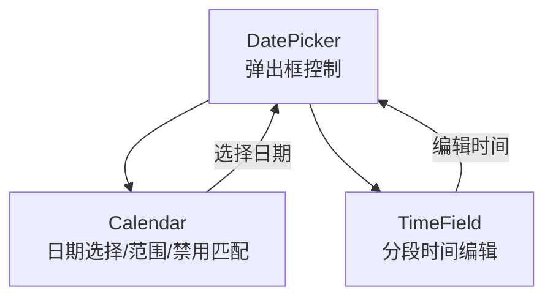
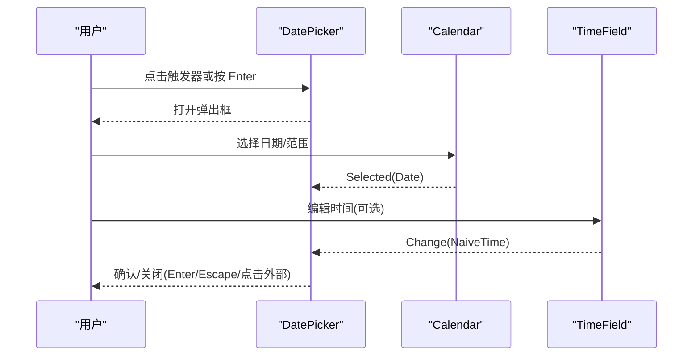
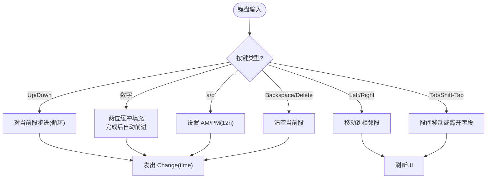
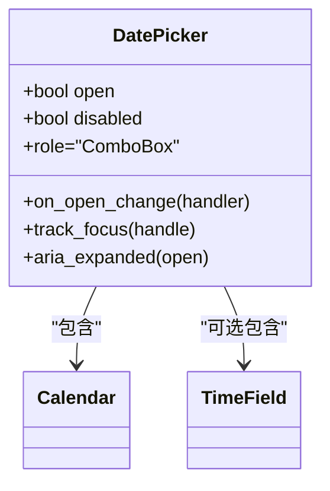
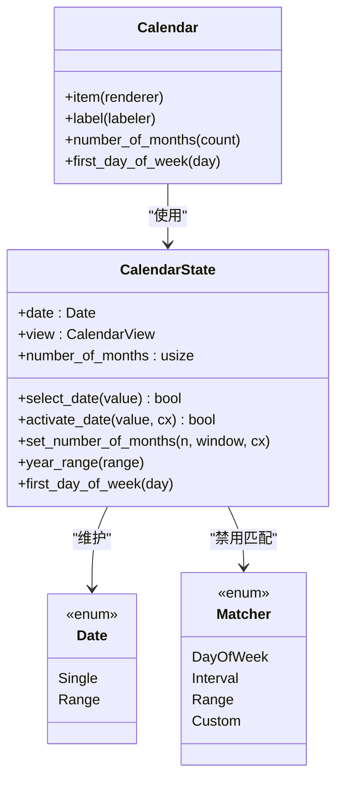

# TimeField、DatePicker 时间日期控件

<cite>
**本文引用的文件**   
- [time_field.rs](file://crates/base/src/time_field.rs)
- [date_picker.rs](file://crates/base/src/date_picker.rs)
- [calendar.rs](file://crates/base/src/calendar.rs)
- [time-field.md](file://website/component/time-field.md)
- [date-picker.md](file://website/component/date-picker.md)
- [calendar.md](file://website/component/calendar.md)
</cite>

## 目录
1. [简介](#简介)
2. [项目结构](#项目结构)
3. [核心组件](#核心组件)
4. [架构总览](#架构总览)
5. [详细组件分析](#详细组件分析)
6. [依赖关系分析](#依赖关系分析)
7. [性能与可用性](#性能与可用性)
8. [故障排查指南](#故障排查指南)
9. [结论](#结论)
10. [附录：常用模式与最佳实践](#附录常用模式与最佳实践)

## 简介
本文件面向 TimeField（时间字段）、DatePicker（日期选择器）与 Calendar（日历）三个组件，系统说明其数据模型、交互行为、键盘导航、无障碍访问、本地化与主题定制方式，并给出日期计算、格式化、验证等实际示例与常见使用模式。文档同时覆盖基础库实现与站点文档中的用法说明，帮助读者快速上手并构建健壮的时间日期输入体验。

## 项目结构
TimeField、DatePicker、Calendar 的核心实现位于基础库 crates/base/src 下；网站文档在 website/component 下提供面向用户的 API 与示例。三者协作关系如下：
- DatePicker 作为组合入口，负责弹出框开关、触发器与展示容器。
- Calendar 提供日期选择、范围选择、禁用匹配、多月份视图等能力。
- TimeField 提供分段式时间编辑，支持 12/24 小时制与秒精度。

图表来源
- [date_picker.rs:18-58](file://crates/base/src/date_picker.rs#L18-L58)
- [calendar.rs:561-627](file://crates/base/src/calendar.rs#L561-L627)
- [time_field.rs:533-568](file://crates/base/src/time_field.rs#L533-L568)

章节来源
- [date_picker.rs:1-115](file://crates/base/src/date_picker.rs#L1-L115)
- [calendar.rs:1-137](file://crates/base/src/calendar.rs#L1-L137)
- [time_field.rs:1-116](file://crates/base/src/time_field.rs#L1-L116)

## 核心组件
- TimeFieldState / TimeField：分段时间编辑器，支持分钟/秒精度，24/12 小时制，键盘驱动编辑与无障碍语义。
- DatePickerState / DatePicker：受控的日期选择器根节点，管理打开/关闭、禁用状态、占位符、尺寸、外观等。
- CalendarState / Calendar：日历主体，支持单日期/范围选择、多月份显示、禁用匹配、周起始日、年/月视图切换等。

章节来源
- [time_field.rs:303-453](file://crates/base/src/time_field.rs#L303-L453)
- [date_picker.rs:18-58](file://crates/base/src/date_picker.rs#L18-L58)
- [calendar.rs:169-395](file://crates/base/src/calendar.rs#L169-L395)

## 架构总览
下图展示了用户操作从 DatePicker 到 Calendar 与 TimeField 的调用路径，以及事件回传流程。

图表来源
- [date_picker.rs:80-114](file://crates/base/src/date_picker.rs#L80-L114)
- [calendar.rs:258-268](file://crates/base/src/calendar.rs#L258-L268)
- [time_field.rs:372-389](file://crates/base/src/time_field.rs#L372-L389)

## 详细组件分析

### TimeField 时间字段
- 数据模型
  - TimePrecision：分钟/秒精度。
  - HourCycle：24 小时(H23)/12 小时(H12)。
  - TimeSegment：时/分/秒/AMPM 段。
  - TimeFieldEvent::Change：用户编辑后发出新时间。
- 关键行为
  - 键盘步进 Up/Down 对当前段循环步进，不进位。
  - Left/Right、Tab/Shift-Tab 在段间移动。
  - 数字键自动填充两位，完成后自动跳到下一段。
  - 12 小时制下 a/p 设置 AM/PM。
  - Backspace/Delete 清空当前段。
- 无障碍与语义
  - 根元素 role=TimeInput，aria-value 输出格式化后的时间字符串。
  - 通过 FocusHandle 管理焦点，支持 tab_stop。
- 渲染与可定制
  - render_segment 回调允许自定义每个段的呈现。
  - 默认以“:”分隔数值段，AM/PM 前无分隔符。

图表来源
- [time_field.rs:372-441](file://crates/base/src/time_field.rs#L372-L441)
- [time_field.rs:576-647](file://crates/base/src/time_field.rs#L576-L647)

章节来源
- [time_field.rs:34-116](file://crates/base/src/time_field.rs#L34-L116)
- [time_field.rs:303-453](file://crates/base/src/time_field.rs#L303-L453)
- [time_field.rs:533-647](file://crates/base/src/time_field.rs#L533-L647)
- [time-field.md:1-94](file://website/component/time-field.md#L1-L94)

### DatePicker 日期选择器
- 角色与职责
  - 作为受控根节点，持有 open/disabled/focus_handle 等状态。
  - 绑定 Confirm/Cancel 动作：Enter 打开/确认，Esc 关闭。
  - 暴露 on_open_change 回调，由上层决定弹出框的显示与定位。
- 与 Calendar/TimeField 集成
  - 通常承载 Calendar 作为内容区，并在需要时嵌入 TimeField。
  - 支持 number_of_months、cleanable、placeholder、appearance 等 UI 配置。
- 键盘与无障碍
  - role=ComboBox，aria-expanded 随 open 变化。
  - 通过 track_focus 与 a11y_disabled 增强可访问性。

图表来源
- [date_picker.rs:18-58](file://crates/base/src/date_picker.rs#L18-L58)
- [date_picker.rs:80-114](file://crates/base/src/date_picker.rs#L80-L114)

章节来源
- [date_picker.rs:1-115](file://crates/base/src/date_picker.rs#L1-L115)
- [date-picker.md:1-506](file://website/component/date-picker.md#L1-L506)

### Calendar 日历
- 数据模型
  - Date：Single(Option<NaiveDate>) 或 Range(Option<NaiveDate>, Option<NaiveDate>)。
  - Matcher：DayOfWeek/Interval/Range/Custom 多种禁用匹配策略。
  - CalendarView：Day/Month/Year 三种视图。
- 状态与交互
  - select_date/activate_date：处理单选/范围选择逻辑，完成时发出 Selected(Date)。
  - set_number_of_months：控制多月份显示。
  - year_range/set_year_range：限制年份选择范围。
  - first_day_of_week：设置周起始日。
- 渲染与可定制
  - item(labeler, renderer)：为每个日历项提供自定义渲染与标签。
  - header/body 分别渲染导航头与网格内容，支持 Month/Year 视图布局。

图表来源
- [calendar.rs:12-82](file://crates/base/src/calendar.rs#L12-L82)
- [calendar.rs:84-137](file://crates/base/src/calendar.rs#L84-L137)
- [calendar.rs:169-395](file://crates/base/src/calendar.rs#L169-L395)
- [calendar.rs:561-627](file://crates/base/src/calendar.rs#L561-L627)

章节来源
- [calendar.rs:1-137](file://crates/base/src/calendar.rs#L1-L137)
- [calendar.rs:169-395](file://crates/base/src/calendar.rs#L169-L395)
- [calendar.rs:561-627](file://crates/base/src/calendar.rs#L561-L627)
- [calendar.md:1-379](file://website/component/calendar.md#L1-L379)

## 依赖关系分析
- DatePicker 依赖 Calendar 与 TimeField 的组合，但不直接持有其内部状态，而是通过各自的 State 实体进行受控更新。
- Calendar 依赖 chrono 提供的 NaiveDate/Weekday 等类型，用于日期计算与周起始日。
- TimeField 依赖 chrono 的 NaiveTime 与 Timelike trait，用于时间截断与格式化。

图表来源
- [date_picker.rs:1-15](file://crates/base/src/date_picker.rs#L1-L15)
- [calendar.rs:1-10](file://crates/base/src/calendar.rs#L1-L10)
- [time_field.rs:1-17](file://crates/base/src/time_field.rs#L1-L17)

章节来源
- [date_picker.rs:1-115](file://crates/base/src/date_picker.rs#L1-L115)
- [calendar.rs:1-137](file://crates/base/src/calendar.rs#L1-L137)
- [time_field.rs:1-116](file://crates/base/src/time_field.rs#L1-L116)

## 性能与可用性
- 性能
  - Calendar 的 month_days 按可见月份生成周列表，避免全量计算；年份分页以 20 年为一页，减少渲染压力。
  - TimeField 的 SegmentEditor 是无窗口纯逻辑对象，便于测试与复用。
- 可用性
  - DatePicker 使用 ComboBox 语义与 aria-expanded，配合 focus 跟踪提升可访问性。
  - TimeField 提供 TimeInput 语义与 aria-value，确保屏幕阅读器可读。
  - Calendar 为每个日历项提供 with_label，保证辅助技术名称可用。

章节来源
- [calendar.rs:306-321](file://crates/base/src/calendar.rs#L306-L321)
- [time_field.rs:576-647](file://crates/base/src/time_field.rs#L576-L647)
- [date_picker.rs:80-114](file://crates/base/src/date_picker.rs#L80-L114)

## 故障排查指南
- 问题：DatePicker 无法打开/关闭
  - 检查 on_open_change 是否被正确设置，Confirm/Cancel 动作是否被拦截。
  - 确认 disabled 状态未阻止交互。
- 问题：TimeField 输入无效
  - 确认 precision/hour_cycle 配置与期望一致。
  - 检查是否在 12 小时制下使用 a/p 设置 AM/PM。
- 问题：Calendar 禁用日期不生效
  - 校验 Matcher 配置是否正确（区间/范围/自定义函数）。
  - 确认 select_date/activate_date 返回值与业务侧校验逻辑一致。

章节来源
- [date_picker.rs:80-114](file://crates/base/src/date_picker.rs#L80-L114)
- [time_field.rs:372-441](file://crates/base/src/time_field.rs#L372-L441)
- [calendar.rs:217-268](file://crates/base/src/calendar.rs#L217-L268)

## 结论
TimeField、DatePicker、Calendar 共同构成完整的时间日期输入体系：DatePicker 负责弹出与组合，Calendar 提供丰富的日期选择与禁用策略，TimeField 提供精确且易用的时间编辑。三者在键盘导航、无障碍语义与主题定制方面保持一致的设计语言，适合构建复杂表单与调度界面。

## 附录：常用模式与最佳实践
- 时间格式与本地化
  - TimeField 根据 precision 与 hour_cycle 自动选择显示格式；如需固定显示格式，可在上层格式化输出。
  - DatePicker 支持 date_format 自定义日期显示；时间部分遵循 precision/hour_cycle。
- 日期范围与约束
  - 使用 Matcher::range/interval/custom 限制可选日期；结合业务校验（如最大时长）在事件回调中修正状态。
- 键盘导航与无障碍
  - 保持 DatePicker 的 Confirm/Cancel 行为；TimeField 的段间移动与数字输入符合预期；Calendar 项提供 label 给辅助技术。
- 主题定制
  - 通过 Calendar.item 与 TimeField.render_segment 自定义视觉样式；DatePicker 支持 appearance(false) 以完全接管外观。

章节来源
- [time-field.md:1-94](file://website/component/time-field.md#L1-L94)
- [date-picker.md:1-506](file://website/component/date-picker.md#L1-L506)
- [calendar.md:1-379](file://website/component/calendar.md#L1-L379)