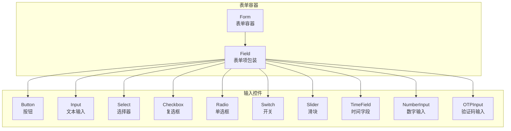
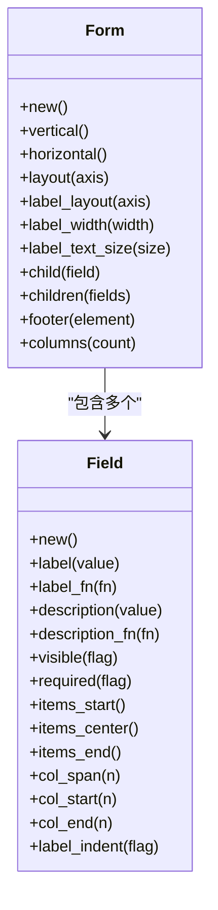
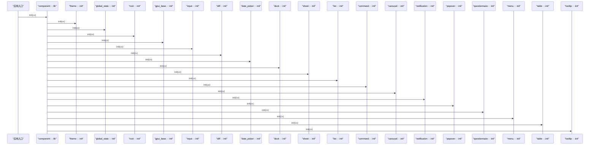
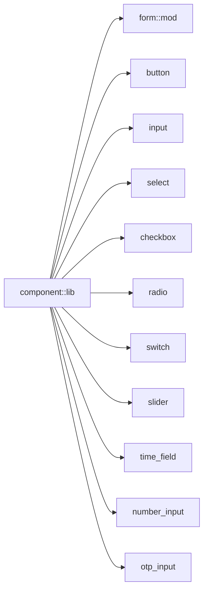

# 表单控件

<cite>
**本文引用的文件**   
- [crates/component/src/lib.rs](file://crates/component/src/lib.rs)
- [crates/component/src/form/mod.rs](file://crates/component/src/form/mod.rs)
- [crates/component/src/form/form.rs](file://crates/component/src/form/form.rs)
- [crates/component/src/form/field.rs](file://crates/component/src/form/field.rs)
- [crates/component/src/button.rs](file://crates/component/src/button.rs)
- [crates/component/src/input.rs](file://crates/component/src/input.rs)
- [crates/component/src/select.rs](file://crates/component/src/select.rs)
- [crates/component/src/checkbox.rs](file://crates/component/src/checkbox.rs)
- [crates/component/src/radio.rs](file://crates/component/src/radio.rs)
- [crates/component/src/switch.rs](file://crates/component/src/switch.rs)
- [crates/component/src/slider.rs](file://crates/component/src/slider.rs)
- [crates/component/src/time_field.rs](file://crates/component/src/time_field.rs)
- [crates/component/src/number_input.rs](file://crates/component/src/number_input.rs)
- [crates/component/src/otp_input.rs](file://crates/component/src/otp_input.rs)
</cite>

## 目录
1. [简介](#简介)
2. [项目结构](#项目结构)
3. [核心组件](#核心组件)
4. [架构总览](#架构总览)
5. [详细组件分析](#详细组件分析)
6. [依赖分析](#依赖分析)
7. [性能考虑](#性能考虑)
8. [故障排查指南](#故障排查指南)
9. [结论](#结论)
10. [附录](#附录)

## 简介
本章节面向 GPUI Kit 的表单控件，系统性梳理并文档化以下输入组件：Button（按钮）、Input（输入框）、Select（选择器）、Checkbox（复选框）、Radio（单选框）、Switch（开关）、Slider（滑块）、TimeField（时间字段）、NumberInput（数字输入）、OTPInput（验证码输入）。内容覆盖属性、事件、样式定制、组合模式、表单验证、数据绑定与无障碍访问支持等高级主题，并提供最佳实践指导。

## 项目结构
GPUI Kit 将表单相关能力拆分为“基础表单容器”和“具体输入控件”两层：
- 基础表单容器：Form 与 Field，负责布局、标签对齐、列网格、可见性与必填标记等通用能力。
- 具体输入控件：Button、Input、Select、Checkbox、Radio、Switch、Slider、TimeField、NumberInput、OTPInput 等，提供各自的数据类型、交互行为与样式语义。

图表来源
- [crates/component/src/form/form.rs:12-104](file://crates/component/src/form/form.rs#L12-L104)
- [crates/component/src/form/field.rs:79-227](file://crates/component/src/form/field.rs#L79-L227)

章节来源
- [crates/component/src/lib.rs:29-120](file://crates/component/src/lib.rs#L29-L120)
- [crates/component/src/form/mod.rs:1-21](file://crates/component/src/form/mod.rs#L1-L21)

## 核心组件
本节聚焦表单容器 Form 与表单项 Field 的能力边界，为后续各输入控件的组合使用奠定基础。

- Form（表单容器）
  - 作用：承载多个 Field，统一控制标签与控制项的排列方向、列数、尺寸间距以及底部操作区。
  - 关键能力：
    - 布局方向：垂直/水平（标签在上方或右侧）。
    - 列网格：columns 控制字段列数；Field 可设置 col_span/col_start/col_end 进行跨列与定位。
    - 尺寸：通过 Size 影响整体间距。
    - 底部区域：footer 放置全宽的操作区（如提交按钮组）。
  - 典型用法：v_form/h_form 快速创建；child/children 添加 Field；footer 放置提交/重置等操作。

- Field（表单项包装）
  - 作用：为任意输入控件提供统一的标签、描述、必填标记、对齐方式与可见性控制。
  - 关键能力：
    - 标签：label/label_fn，支持静态文本或动态构建。
    - 描述：description/description_fn，用于辅助说明。
    - 必填：required，渲染时显示必填标记。
    - 对齐：items_start/items_center/items_end 控制标签与控件的对齐。
    - 可见性：visible 控制是否渲染。
    - 网格：col_span/col_start/col_end 控制列跨度与起始/结束位置。
    - 缩进：label_indent 控制水平布局下输入是否相对标签宽度缩进。

图表来源
- [crates/component/src/form/form.rs:12-104](file://crates/component/src/form/form.rs#L12-L104)
- [crates/component/src/form/field.rs:79-227](file://crates/component/src/form/field.rs#L79-L227)

章节来源
- [crates/component/src/form/form.rs:12-158](file://crates/component/src/form/form.rs#L12-L158)
- [crates/component/src/form/field.rs:79-351](file://crates/component/src/form/field.rs#L79-L351)

## 架构总览
下图展示从应用入口到表单容器的初始化与模块导出关系，体现库如何暴露表单能力。

图表来源
- [crates/component/src/lib.rs:127-151](file://crates/component/src/lib.rs#L127-L151)

## 详细组件分析

### Button（按钮）
- 角色：触发操作的交互元素，常作为表单 footer 中的提交/取消按钮。
- 常见属性与能力（基于库内 button 模块）：
  - 外观变体：主按钮、次按钮、危险按钮等语义化样式。
  - 尺寸：小/中/大等尺寸选项。
  - 状态：禁用、加载态（通常配合异步提交）。
  - 图标：前后缀图标以增强语义。
  - 事件：点击回调，常用于触发表单校验与提交流程。
- 样式定制：
  - 通过主题 token 与组件样式 API 调整颜色、圆角、阴影等。
- 无障碍：
  - 语义化为按钮，支持键盘焦点与屏幕阅读器朗读。
- 使用建议：
  - 在表单 footer 中放置“提交”“重置”等操作按钮，保持右对齐。
  - 提交前执行表单校验，失败时阻止提交并提示错误。

章节来源
- [crates/component/src/lib.rs:36-36](file://crates/component/src/lib.rs#L36-L36)
- [crates/component/src/button.rs](file://crates/component/src/button.rs)

### Input（输入框）
- 角色：通用文本输入控件，适合姓名、邮箱、地址等字符串输入。
- 常见属性与能力（基于库内 input 模块）：
  - 值绑定：受控与非受控两种模式。
  - 占位符：placeholder。
  - 只读/禁用：readOnly/disabled。
  - 前缀/后缀：icon、append/prepend。
  - 校验反馈：错误消息、成功/警告状态。
  - 事件：on_change/on_blur/on_focus 等。
- 样式定制：
  - 边框、圆角、背景、字体大小、高度等。
- 无障碍：
  - 关联 label，支持 aria-describedby 与错误信息联动。
- 使用建议：
  - 与 Field.label/Field.description 搭配，提供清晰上下文。
  - 结合表单验证规则，实时或失焦时反馈错误。

章节来源
- [crates/component/src/lib.rs:55-55](file://crates/component/src/lib.rs#L55-L55)
- [crates/component/src/input.rs](file://crates/component/src/input.rs)

### Select（选择器）
- 角色：从预定义选项中选择一个或多个值（多选需看实现）。
- 常见属性与能力（基于库内 select 模块）：
  - 选项列表：options，支持分组与禁用项。
  - 值绑定：value 与 onChange。
  - 搜索过滤：searchable（若实现）。
  - 清空与默认提示：clearable/placeholder。
- 样式定制：
  - 下拉面板、选中项高亮、分隔线等。
- 无障碍：
  - 语义化为选择控件，支持键盘导航与屏幕阅读器。
- 使用建议：
  - 选项较多时使用 searchable 提升体验。
  - 对必选项使用 Field.required 标记。

章节来源
- [crates/component/src/lib.rs:76-76](file://crates/component/src/lib.rs#L76-L76)
- [crates/component/src/select.rs](file://crates/component/src/select.rs)

### Checkbox（复选框）
- 角色：布尔型或多选型输入。
- 常见属性与能力（基于库内 checkbox 模块）：
  - 值绑定：checked/onChange。
  - 禁用/只读。
  - 标签文案：可与 Field.label 配合。
- 样式定制：
  - 勾选态颜色、尺寸、动画。
- 无障碍：
  - 语义化为复选框，支持键盘切换与朗读。
- 使用建议：
  - 多选项场景建议使用 Checkbox Group（若存在）或集合绑定。

章节来源
- [crates/component/src/lib.rs:39-39](file://crates/component/src/lib.rs#L39-L39)
- [crates/component/src/checkbox.rs](file://crates/component/src/checkbox.rs)

### Radio（单选框）
- 角色：在一组互斥选项中选择一个。
- 常见属性与能力（基于库内 radio 模块）：
  - 值绑定：value/onChange。
  - 禁用/只读。
  - 与 Field.label 配合显示选项名。
- 样式定制：
  - 选中态颜色、尺寸、间距。
- 无障碍：
  - 语义化为单选控件，支持键盘上下切换。
- 使用建议：
  - 选项较少且互斥时使用；选项较多时可考虑 Select。

章节来源
- [crates/component/src/lib.rs:71-71](file://crates/component/src/lib.rs#L71-L71)
- [crates/component/src/radio.rs](file://crates/component/src/radio.rs)

### Switch（开关）
- 角色：二元状态的快捷切换控件。
- 常见属性与能力（基于库内 switch 模块）：
  - 值绑定：checked/onChange。
  - 禁用/只读。
  - 自定义开启/关闭文案（可选）。
- 样式定制：
  - 轨道与滑块颜色、尺寸、动画时长。
- 无障碍：
  - 语义化为开关，支持键盘空格切换与朗读。
- 使用建议：
  - 适用于即时生效的二元设置（如通知开关）。

章节来源
- [crates/component/src/lib.rs:88-88](file://crates/component/src/lib.rs#L88-L88)
- [crates/component/src/switch.rs](file://crates/component/src/switch.rs)

### Slider（滑块）
- 角色：连续或离散数值范围选择。
- 常见属性与能力（基于库内 slider 模块）：
  - 值绑定：value/onChange。
  - 范围：min/max/step。
  - 刻度与标签（可选）。
- 样式定制：
  - 轨道、滑块、刻度颜色与尺寸。
- 无障碍：
  - 语义化为滑块，支持键盘左右调节与朗读当前值。
- 使用建议：
  - 对精度要求不高且直观调节的场景优先使用。

章节来源
- [crates/component/src/lib.rs:83-83](file://crates/component/src/lib.rs#L83-L83)
- [crates/component/src/slider.rs](file://crates/component/src/slider.rs)

### TimeField（时间字段）
- 角色：时间输入与格式化展示。
- 常见属性与能力（基于库内 time_field 模块）：
  - 值绑定：time/onChange。
  - 格式：format（如 HH:mm、HH:mm:ss）。
  - 禁用/只读。
- 样式定制：
  - 输入框外观、分隔符样式。
- 无障碍：
  - 语义化为时间输入，支持键盘输入与屏幕阅读器。
- 使用建议：
  - 与 Field.label/Field.description 搭配，明确时间含义与时区。

章节来源
- [crates/component/src/lib.rs:119-119](file://crates/component/src/lib.rs#L119-L119)
- [crates/component/src/time_field.rs](file://crates/component/src/time_field.rs)

### NumberInput（数字输入）
- 角色：精确的数字输入，支持步进与范围限制。
- 常见属性与能力（基于库内 number_input 模块）：
  - 值绑定：value/onChange。
  - 范围：min/max/step。
  - 千分位格式化（可选）。
- 样式定制：
  - 输入框外观、增减按钮样式。
- 无障碍：
  - 语义化为数字输入，支持键盘上下键步进与朗读。
- 使用建议：
  - 价格、数量等需要严格数值约束的场景。

章节来源
- [crates/component/src/lib.rs:119-119](file://crates/component/src/lib.rs#L119-L119)
- [crates/component/src/number_input.rs](file://crates/component/src/number_input.rs)

### OTPInput（验证码输入）
- 角色：一次性验证码的多格输入控件。
- 常见属性与能力（基于库内 otp_input 模块）：
  - 值绑定：value/onChange。
  - 长度：length（通常为 4/6）。
  - 自动聚焦与跳转下一格。
- 样式定制：
  - 格子边框、选中态、错误态。
- 无障碍：
  - 语义化为验证码输入，支持键盘输入与屏幕阅读器。
- 使用建议：
  - 与 Field.label/Field.description 搭配，提示验证码用途与有效期。

章节来源
- [crates/component/src/lib.rs:119-119](file://crates/component/src/lib.rs#L119-L119)
- [crates/component/src/otp_input.rs](file://crates/component/src/otp_input.rs)

## 依赖分析
- 模块导出：component::lib 集中导出所有子模块，包括 form、button、input、select、checkbox、radio、switch、slider、time_field、number_input、otp_input 等。
- 表单容器依赖：Form 与 Field 位于 form 子模块，对外暴露 v_form/h_form/field 便捷构造器。
- 运行时初始化：init 函数按序初始化主题、全局状态、根节点、输入系统、日期选择、抽屉、列表、命令面板、轮播、通知、气泡、问卷、菜单、表格、提示等子系统。

图表来源
- [crates/component/src/lib.rs:29-120](file://crates/component/src/lib.rs#L29-L120)
- [crates/component/src/form/mod.rs:1-21](file://crates/component/src/form/mod.rs#L1-L21)

章节来源
- [crates/component/src/lib.rs:29-120](file://crates/component/src/lib.rs#L29-L120)
- [crates/component/src/form/mod.rs:1-21](file://crates/component/src/form/mod.rs#L1-L21)

## 性能考虑
- 表单渲染：
  - Form 使用网格布局，合理设置 columns 与 Field.col_span 可减少重排。
  - 大量 Field 时，按需 visible=false 隐藏不需要的字段以降低渲染开销。
- 输入控件：
  - 避免在 on_change 中进行昂贵计算，必要时做防抖/节流。
  - 长列表选项的 Select 应启用搜索与虚拟滚动（若实现）。
- 主题与样式：
  - 尽量复用主题 token，减少自定义样式的复杂度。
- 无障碍：
  - 正确设置 label/description，有助于辅助技术读取，提升可访问性同时不影响性能。

[本节为通用指导，不直接分析具体文件]

## 故障排查指南
- 表单布局异常
  - 现象：标签与控件错位、列跨度不正确。
  - 排查：检查 Form.columns 与 Field.col_span/col_start/col_end 配置；确认 Field.label_indent 在水平布局下的预期效果。
  - 参考：Form 与 Field 的布局逻辑。
- 必填标记未显示
  - 现象：Field.required=true 但未显示必填标记。
  - 排查：确认 Field.required 已设置；检查 Field.label 是否渲染。
- 输入控件无法聚焦
  - 现象：键盘无法聚焦或 Tab 顺序异常。
  - 排查：确保控件未被 disabled/hidden；检查父级容器是否拦截了焦点事件。
- 提交按钮无响应
  - 现象：点击 Footer 中的 Button 无回调。
  - 排查：确认 Button 的 onClick 已绑定；校验逻辑是否正确阻止提交。

章节来源
- [crates/component/src/form/form.rs:119-152](file://crates/component/src/form/form.rs#L119-L152)
- [crates/component/src/form/field.rs:241-349](file://crates/component/src/form/field.rs#L241-L349)

## 结论
GPUI Kit 的表单体系以 Form/Field 为核心，将通用布局、标签、描述、必填与网格能力抽象出来，再与各输入控件组合形成完整的表单解决方案。通过合理的属性配置与样式定制，可以构建出既美观又易用的表单界面。结合表单验证、数据绑定与无障碍支持，可在复杂业务场景中提供一致的用户体验。

[本节为总结性内容，不直接分析具体文件]

## 附录

### 表单组合模式与最佳实践
- 基本组合
  - 使用 v_form/h_form 创建表单，Field 包裹各输入控件，Footer 放置提交/重置按钮。
- 列布局
  - 使用 Form.columns 与 Field.col_span/col_start/col_end 实现两列/三列布局。
- 条件字段
  - 使用 Field.visible 根据业务状态显示/隐藏字段。
- 必填与校验
  - 使用 Field.required 标记必填；在提交前集中校验，失败时阻止提交并提示错误。
- 数据绑定
  - 受控模式：将控件 value 与状态绑定，onChange 更新状态。
  - 非受控模式：内部维护值，适合简单场景。
- 无障碍
  - 始终为输入控件提供 label；使用 description 提供辅助说明；确保键盘可达与屏幕阅读器可读。

[本节为概念性指导，不直接分析具体文件]