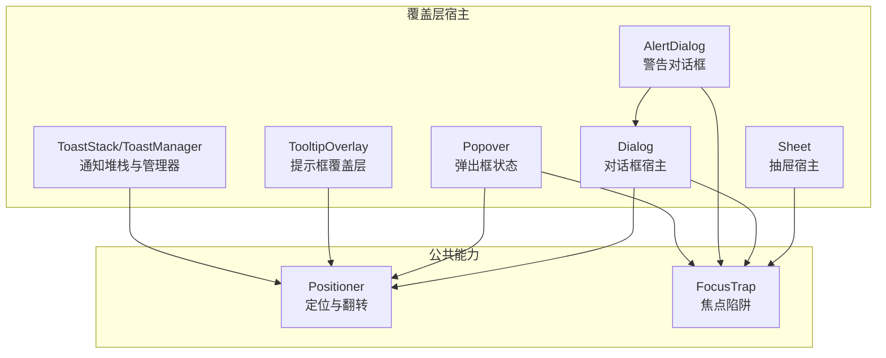
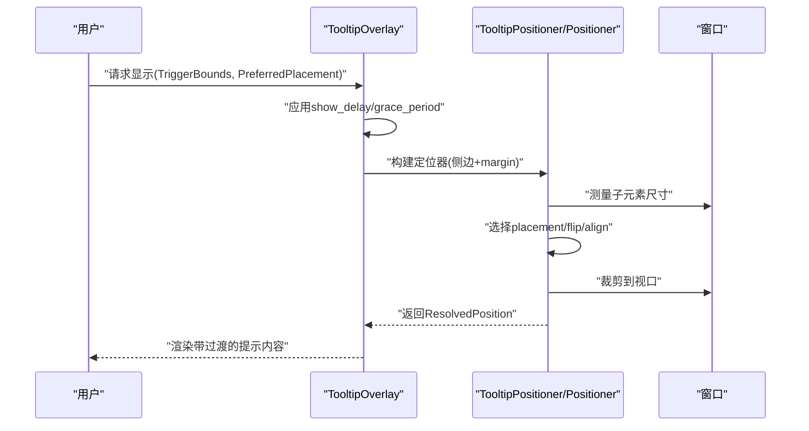
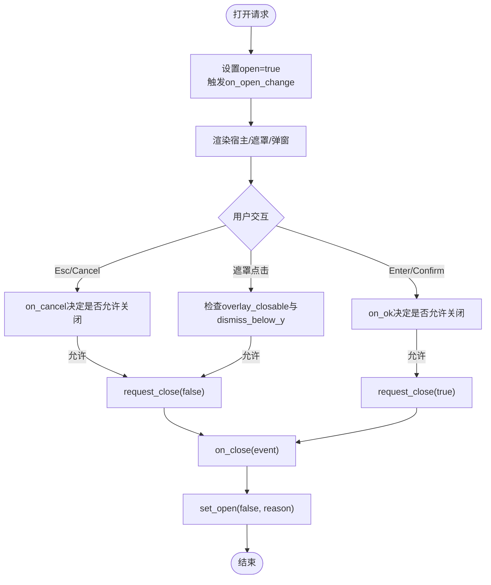
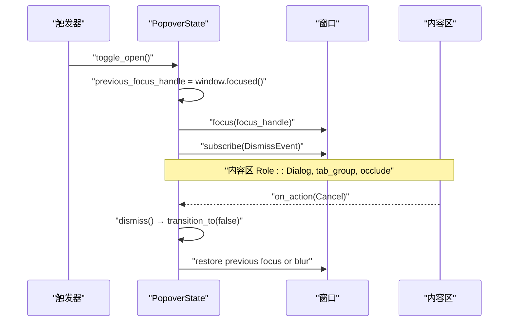
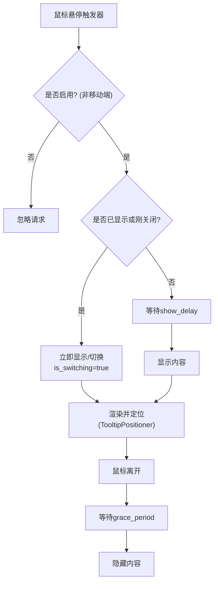
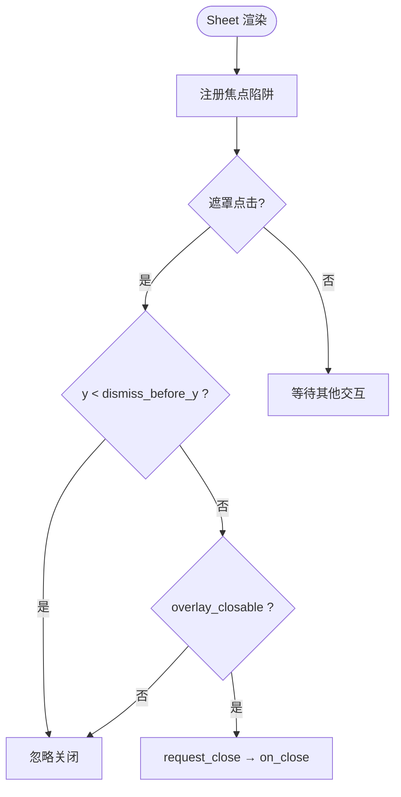
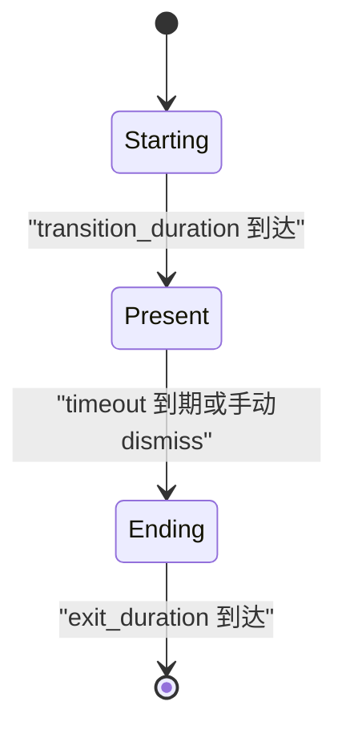
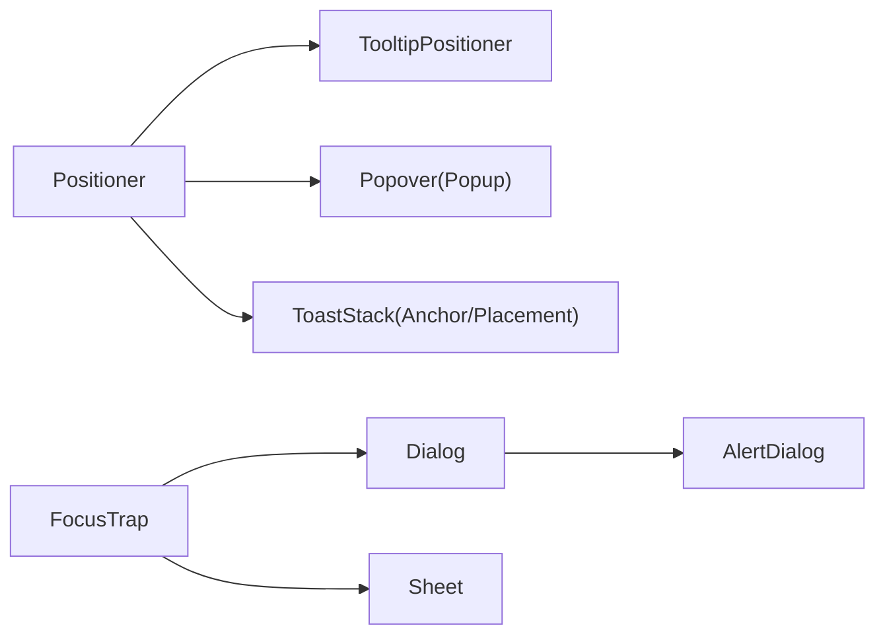
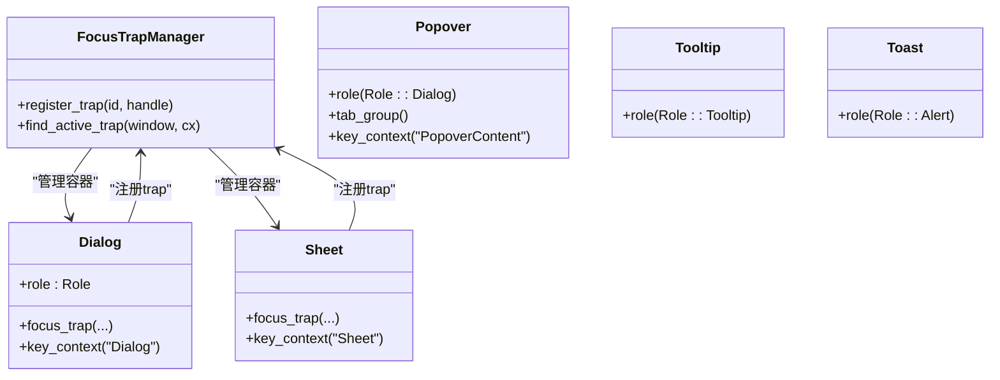

# 覆盖层组件

<cite>
**本文引用的文件**   
- [dialog.rs](file://crates/base/src/dialog.rs)
- [popover.rs](file://crates/base/src/popover.rs)
- [tooltip.rs](file://crates/base/src/tooltip.rs)
- [sheet.rs](file://crates/base/src/sheet.rs)
- [alert_dialog.rs](file://crates/base/src/alert_dialog.rs)
- [toast.rs](file://crates/base/src/toast.rs)
- [positioner.rs](file://crates/base/src/positioner.rs)
- [focus_trap.rs](file://crates/base/src/focus_trap.rs)
</cite>

## 目录
1. [引言](#引言)
2. [项目结构](#项目结构)
3. [核心组件](#核心组件)
4. [架构总览](#架构总览)
5. [详细组件分析](#详细组件分析)
6. [依赖关系分析](#依赖关系分析)
7. [性能与动画](#性能与动画)
8. [无障碍与焦点管理](#无障碍与焦点管理)
9. [移动端适配](#移动端适配)
10. [常见问题与排错](#常见问题与排错)
11. [最佳实践](#最佳实践)
12. [结论](#结论)

## 引言
本文件系统性梳理 GPUI Kit 的覆盖层组件体系，包括对话框、弹出框、提示框、抽屉、警告框与通知。文档聚焦以下关键机制：
- 层级管理与优先级
- 定位算法与视口适配
- 动画过渡与生命周期
- 焦点捕获与键盘交互
- 用户交互模式与无障碍语义
- 移动端适配策略
并给出常见组合使用方案与排错建议。

## 项目结构
覆盖层能力由 base 层的通用原语提供，component 层在此基础上封装业务级组件。本次文档重点围绕 base 层实现：
- Dialog/AlertDialog：模态宿主、焦点陷阱、按键处理、回调顺序
- Popover：受控状态、触发器、内容区、延迟上下文注册
- Tooltip：全局默认值、显示/隐藏延时、切换动画、定位
- Sheet：模态抽屉宿主、遮罩点击、可配置关闭区域
- Toast/ToastStack/ToastManager：通知堆栈、进入/退出过渡、自动隐藏
- Positioner：统一的侧边放置、翻转、对齐、视口裁剪
- FocusTrap：全局焦点陷阱管理器与容器封装

**图示来源**
- [dialog.rs:122-143](file://crates/base/src/dialog.rs#L122-L143)
- [alert_dialog.rs:192-202](file://crates/base/src/alert_dialog.rs#L192-L202)
- [sheet.rs:27-43](file://crates/base/src/sheet.rs#L27-L43)
- [popover.rs:182-202](file://crates/base/src/popover.rs#L182-L202)
- [tooltip.rs:169-184](file://crates/base/src/tooltip.rs#L169-L184)
- [toast.rs:280-332](file://crates/base/src/toast.rs#L280-L332)
- [positioner.rs:58-70](file://crates/base/src/positioner.rs#L58-L70)
- [focus_trap.rs:13-49](file://crates/base/src/focus_trap.rs#L13-L49)

**章节来源**
- [dialog.rs:122-143](file://crates/base/src/dialog.rs#L122-L143)
- [popover.rs:182-202](file://crates/base/src/popover.rs#L182-L202)
- [tooltip.rs:169-184](file://crates/base/src/tooltip.rs#L169-L184)
- [sheet.rs:27-43](file://crates/base/src/sheet.rs#L27-L43)
- [toast.rs:280-332](file://crates/base/src/toast.rs#L280-L332)
- [positioner.rs:58-70](file://crates/base/src/positioner.rs#L58-L70)
- [focus_trap.rs:13-49](file://crates/base/src/focus_trap.rs#L13-L49)

## 核心组件
- Dialog（对话框）
  - 职责：模态宿主、焦点捕获、Esc/Enter/Space 行为、遮罩点击关闭、回调顺序（请求关闭→变更回调→关闭回调）、层级优先级。
  - 关键点：通过 layer 与 topmost 控制渲染优先级；支持 dismiss_below_y 限制顶部区域不关闭；提供 DialogHandle 受控 API。
- AlertDialog（警告对话框）
  - 职责：基于 Dialog 的不可点击遮罩变体，强调确认/取消流程。
  - 关键点：默认禁用遮罩关闭；保留 Dialog 全部能力。
- Popover（弹出框）
  - 职责：非模态弹出，触发器与内容分离，焦点转移与恢复，延迟上下文注册。
  - 关键点：支持 anchor/offset/on_position；内容区为 Role::Dialog；Escape 关闭并恢复焦点。
- Tooltip（提示框）
  - 职责：轻量提示，全局默认显示延时与宽限时间，位置跟随触发器，支持切换动画。
  - 关键点：TooltipDefaults 全局配置；TooltipOverlay 管理 show/hide 任务；TooltipPositioner 复用 Positioner。
- Sheet（抽屉）
  - 职责：模态抽屉宿主，遮罩点击关闭，可配置 dismiss_before_y 忽略顶部区域。
  - 关键点：FocusTrap 约束 Tab 循环；Cancel 动作统一走 request_close→on_close。
- Toast/ToastStack/ToastManager（通知）
  - 职责：通知堆叠、进入/退出过渡、自动隐藏、展开/折叠布局。
  - 关键点：ToastMotion 定义动画参数；ToastManager 维护生命周期；ToastStack 计算几何与弹簧动画。

**章节来源**
- [dialog.rs:122-143](file://crates/base/src/dialog.rs#L122-L143)
- [alert_dialog.rs:192-202](file://crates/base/src/alert_dialog.rs#L192-L202)
- [popover.rs:182-202](file://crates/base/src/popover.rs#L182-L202)
- [tooltip.rs:53-108](file://crates/base/src/tooltip.rs#L53-L108)
- [sheet.rs:27-43](file://crates/base/src/sheet.rs#L27-L43)
- [toast.rs:20-62](file://crates/base/src/toast.rs#L20-L62)

## 架构总览
覆盖层组件共享三类基础设施：
- 定位系统：Positioner 负责侧边放置、翻转、对齐、视口裁剪，被 Tooltip、Popover、Toast 等复用。
- 焦点系统：FocusTrap 提供容器化焦点陷阱，Dialog、Sheet、Popover 在打开时接管焦点并在关闭后恢复。
- 生命周期与优先级：Dialog 通过 deferred + with_priority 控制层级；Tooltip 有独立高优先级常量；Toast 通过 Manager 推进状态机。

**图示来源**
- [tooltip.rs:215-275](file://crates/base/src/tooltip.rs#L215-L275)
- [positioner.rs:211-325](file://crates/base/src/positioner.rs#L211-L325)

**章节来源**
- [tooltip.rs:215-275](file://crates/base/src/tooltip.rs#L215-L275)
- [positioner.rs:211-325](file://crates/base/src/positioner.rs#L211-L325)

## 详细组件分析

### Dialog（对话框）
- 设计要点
  - 模态宿主：绝对定位全屏容器，居中布局，Role::Dialog，焦点捕获。
  - 键盘交互：绑定 Escape/Enter/Space，分别映射 Cancel/Confirm。
  - 遮罩点击：支持 overlay_closable 与 dismiss_below_y 精细控制。
  - 回调顺序：on_cancel/on_ok 决定是否可以关闭；随后调用 request_close 与 on_close。
  - 层级：deferred + with_priority(10 + layer)，topmost 影响遮罩关闭逻辑。
- 数据流
  - 触发 → set_open(true, reason) → on_open_change → 渲染 → 交互 → on_cancel/on_ok → request_close → on_close → set_open(false)。

**图示来源**
- [dialog.rs:525-645](file://crates/base/src/dialog.rs#L525-L645)

**章节来源**
- [dialog.rs:89-94](file://crates/base/src/dialog.rs#L89-L94)
- [dialog.rs:423-512](file://crates/base/src/dialog.rs#L423-L512)
- [dialog.rs:525-645](file://crates/base/src/dialog.rs#L525-L645)

### AlertDialog（警告对话框）
- 设计要点
  - 基于 Dialog，Role::AlertDialog，默认禁止遮罩关闭。
  - 提供 AlertDialogTrigger/Close/Cancel/Action 等无样式部件。
- 典型用法
  - 通过 handle 或 on_open_change 控制打开；通过 on_ok/on_cancel 处理业务确认/取消。

**章节来源**
- [alert_dialog.rs:192-202](file://crates/base/src/alert_dialog.rs#L192-L202)
- [alert_dialog.rs:63-98](file://crates/base/src/alert_dialog.rs#L63-L98)
- [alert_dialog.rs:146-190](file://crates/base/src/alert_dialog.rs#L146-L190)

### Popover（弹出框）
- 设计要点
  - 非模态弹出，拥有触发器与内容区；内容区 Role::Dialog，Tab 分组。
  - 焦点管理：打开时记录 previous_focus_handle，关闭时恢复；支持 track_focus。
  - 延迟上下文：打开时注册 DeferredPopover，避免状态销毁后残留。
  - 定位：anchor/offset/on_position；支持 on_mouse_down_out 外部点击关闭。
- 交互流程
  - 触发器 Enter/Space 切换；内容内按键交由内部控件；Escape 关闭。

**图示来源**
- [popover.rs:96-146](file://crates/base/src/popover.rs#L96-L146)
- [popover.rs:317-391](file://crates/base/src/popover.rs#L317-L391)

**章节来源**
- [popover.rs:18-30](file://crates/base/src/popover.rs#L18-L30)
- [popover.rs:34-49](file://crates/base/src/popover.rs#L34-L49)
- [popover.rs:96-146](file://crates/base/src/popover.rs#L96-L146)
- [popover.rs:182-202](file://crates/base/src/popover.rs#L182-L202)
- [popover.rs:317-391](file://crates/base/src/popover.rs#L317-L391)

### Tooltip（提示框）
- 设计要点
  - 全局默认：show_delay 与 grace_period；移动端默认禁用。
  - 生命周期：request_show/request_hide 异步任务；Switch/Enter 过渡 epoch。
  - 定位：TooltipPositioner 包装 Positioner.side，margin=WINDOW_MARGIN。
- 动画与切换
  - 当已有 tooltip 且快速切换到新 trigger，is_switching=true，previous_bounds 用于平滑过渡。

**图示来源**
- [tooltip.rs:169-184](file://crates/base/src/tooltip.rs#L169-L184)
- [tooltip.rs:215-275](file://crates/base/src/tooltip.rs#L215-L275)
- [tooltip.rs:301-327](file://crates/base/src/tooltip.rs#L301-L327)

**章节来源**
- [tooltip.rs:53-108](file://crates/base/src/tooltip.rs#L53-L108)
- [tooltip.rs:169-184](file://crates/base/src/tooltip.rs#L169-L184)
- [tooltip.rs:215-275](file://crates/base/src/tooltip.rs#L215-L275)
- [tooltip.rs:301-327](file://crates/base/src/tooltip.rs#L301-L327)

### Sheet（抽屉）
- 设计要点
  - 模态宿主：absolute 全屏容器，FocusTrap 约束 Tab 循环。
  - 遮罩点击：overlay_interactive 控制是否拦截事件；overlay_closable 控制是否关闭；dismiss_before_y 忽略顶部区域。
  - 关闭流程：Cancel 动作 → request_close → on_close。

**图示来源**
- [sheet.rs:115-166](file://crates/base/src/sheet.rs#L115-L166)

**章节来源**
- [sheet.rs:23-25](file://crates/base/src/sheet.rs#L23-L25)
- [sheet.rs:45-107](file://crates/base/src/sheet.rs#L45-L107)
- [sheet.rs:115-166](file://crates/base/src/sheet.rs#L115-L166)

### Toast/ToastStack/ToastManager（通知）
- 设计要点
  - ToastManager：队列式存储，Starting/Present/Ending 三阶段，支持自动超时与 dismiss_all。
  - ToastStack：根据 hover/focus 展开/折叠，计算 collapsed/expanded 高度与偏移，使用 Spring 做几何与透明度动画。
  - Toast：语义角色 Role::Alert，供上层自定义呈现。
- 生命周期
  - push → Starting → Present（计时器递减）→ Ending（exit_duration）→ removed。

**图示来源**
- [toast.rs:110-175](file://crates/base/src/toast.rs#L110-L175)
- [toast.rs:177-278](file://crates/base/src/toast.rs#L177-L278)
- [toast.rs:584-660](file://crates/base/src/toast.rs#L584-L660)

**章节来源**
- [toast.rs:20-62](file://crates/base/src/toast.rs#L20-L62)
- [toast.rs:110-175](file://crates/base/src/toast.rs#L110-L175)
- [toast.rs:177-278](file://crates/base/src/toast.rs#L177-L278)
- [toast.rs:280-332](file://crates/base/src/toast.rs#L280-L332)
- [toast.rs:584-660](file://crates/base/src/toast.rs#L584-L660)

## 依赖关系分析
- Positioner 是所有定位相关组件的基石：
  - TooltipPositioner 包装 Positioner.side
  - Popover 使用 Popup + Positioner 进行锚点定位
  - ToastStack 使用 Anchor 与 Placement 计算堆叠位置
- FocusTrap 为模态类组件提供焦点循环：
  - Dialog/Sheet 在渲染时注册 trap，Cancel 动作统一处理
- Dialog 作为 AlertDialog 的基础宿主，提供一致的交互模型

**图示来源**
- [positioner.rs:58-70](file://crates/base/src/positioner.rs#L58-L70)
- [tooltip.rs:330-359](file://crates/base/src/tooltip.rs#L330-L359)
- [popover.rs:317-391](file://crates/base/src/popover.rs#L317-L391)
- [toast.rs:314-332](file://crates/base/src/toast.rs#L314-L332)
- [focus_trap.rs:13-49](file://crates/base/src/focus_trap.rs#L13-L49)
- [dialog.rs:122-143](file://crates/base/src/dialog.rs#L122-L143)
- [alert_dialog.rs:192-202](file://crates/base/src/alert_dialog.rs#L192-L202)
- [sheet.rs:27-43](file://crates/base/src/sheet.rs#L27-L43)

**章节来源**
- [positioner.rs:58-70](file://crates/base/src/positioner.rs#L58-L70)
- [tooltip.rs:330-359](file://crates/base/src/tooltip.rs#L330-L359)
- [popover.rs:317-391](file://crates/base/src/popover.rs#L317-L391)
- [toast.rs:314-332](file://crates/base/src/toast.rs#L314-L332)
- [focus_trap.rs:13-49](file://crates/base/src/focus_trap.rs#L13-L49)
- [dialog.rs:122-143](file://crates/base/src/dialog.rs#L122-L143)
- [alert_dialog.rs:192-202](file://crates/base/src/alert_dialog.rs#L192-L202)
- [sheet.rs:27-43](file://crates/base/src/sheet.rs#L27-L43)

## 性能与动画
- 层级与优先级
  - Dialog 使用 deferred + with_priority(10 + layer) 控制渲染顺序；layer 越大越靠前。
  - Tooltip 使用固定高优先级 TOOLTIP_PRIORITY，确保提示始终在最上层。
- 动画与过渡
  - Tooltip：Switch/Enter 两种过渡，epoch 保证动画一致性。
  - Toast：Spring 几何动画与 fade 透明度动画，collapsed/expanded 状态平滑切换。
- 定位性能
  - Positioner 在 prepaint 阶段一次性计算 placement/flip/clamp，避免重复重排。

**章节来源**
- [dialog.rs:548-645](file://crates/base/src/dialog.rs#L548-L645)
- [tooltip.rs:12-13](file://crates/base/src/tooltip.rs#L12-L13)
- [tooltip.rs:301-327](file://crates/base/src/tooltip.rs#L301-L327)
- [toast.rs:414-581](file://crates/base/src/toast.rs#L414-L581)
- [positioner.rs:370-425](file://crates/base/src/positioner.rs#L370-L425)

## 无障碍与焦点管理
- 语义角色
  - Dialog/AlertDialog：Role::Dialog / Role::AlertDialog
  - Popover 内容区：Role::Dialog
  - Tooltip：Role::Tooltip
  - Toast：Role::Alert
- 焦点陷阱
  - FocusTrapManager 全局管理容器；Dialog/Sheet 在渲染时注册；Cancel 动作统一触发关闭。
- 键盘交互
  - Dialog：Escape/Enter/Space 绑定 Cancel/Confirm
  - Popover：触发器 Enter/Space 切换；内容区 Escape 关闭；内部控件优先
  - Sheet：Escape 触发关闭

**图示来源**
- [focus_trap.rs:52-110](file://crates/base/src/focus_trap.rs#L52-L110)
- [dialog.rs:525-645](file://crates/base/src/dialog.rs#L525-L645)
- [sheet.rs:115-166](file://crates/base/src/sheet.rs#L115-L166)
- [popover.rs:367-391](file://crates/base/src/popover.rs#L367-L391)
- [tooltip.rs:27-33](file://crates/base/src/tooltip.rs#L27-L33)
- [toast.rs:653-660](file://crates/base/src/toast.rs#L653-L660)

**章节来源**
- [focus_trap.rs:52-110](file://crates/base/src/focus_trap.rs#L52-L110)
- [dialog.rs:89-94](file://crates/base/src/dialog.rs#L89-L94)
- [popover.rs:18-30](file://crates/base/src/popover.rs#L18-L30)
- [sheet.rs:23-25](file://crates/base/src/sheet.rs#L23-L25)
- [tooltip.rs:27-33](file://crates/base/src/tooltip.rs#L27-L33)
- [toast.rs:653-660](file://crates/base/src/toast.rs#L653-L660)

## 移动端适配
- Tooltip 默认在移动端禁用：enabled=false，忽略所有 show/hide 请求。
- Toast 可通过 placement 调整堆叠位置（TopRight/BottomLeft 等）。
- Dialog/Sheet 的遮罩关闭逻辑不受平台差异影响，但建议结合 dismiss_below_y/dismiss_before_y 优化触摸体验。

**章节来源**
- [tooltip.rs:169-184](file://crates/base/src/tooltip.rs#L169-L184)
- [toast.rs:314-332](file://crates/base/src/toast.rs#L314-L332)
- [dialog.rs:485-488](file://crates/base/src/dialog.rs#L485-L488)
- [sheet.rs:96-100](file://crates/base/src/sheet.rs#L96-L100)

## 常见问题与排错
- 遮罩点击未生效
  - 检查 overlay_closable 是否为 true；Dialog 需同时满足 topmost；Sheet 需 overlay_interactive=true。
  - 若设置了 dismiss_below_y/dismiss_before_y，确认点击 y 坐标是否在允许范围内。
- 焦点丢失或无法 Tab 循环
  - 确认组件是否调用了 focus_trap；Dialog/Sheet 应在渲染时注册；Popover 内容区应使用 tab_group。
- 提示框不显示
  - 检查 TooltipDefaults 的 show_delay 是否过长；移动端默认禁用，需显式启用或改用其他提示方式。
- 弹出框定位异常
  - 检查 anchor/offset 是否正确；Positioner 会根据视口自动 flip/clamp，必要时使用 on_position 获取最终位置。
- 通知自动隐藏不符合预期
  - 检查 ToastOptions.timeout 是否设置；ToastManager.advance 在 paused=true 时会暂停计时。

**章节来源**
- [dialog.rs:481-488](file://crates/base/src/dialog.rs#L481-L488)
- [sheet.rs:71-100](file://crates/base/src/sheet.rs#L71-L100)
- [popover.rs:367-391](file://crates/base/src/popover.rs#L367-L391)
- [tooltip.rs:215-275](file://crates/base/src/tooltip.rs#L215-L275)
- [positioner.rs:211-325](file://crates/base/src/positioner.rs#L211-L325)
- [toast.rs:177-278](file://crates/base/src/toast.rs#L177-L278)

## 最佳实践
- 组合使用
  - Dialog + AlertDialog：表单提交前用 AlertDialog 二次确认；成功后用 Toast 反馈。
  - Popover + Tooltip：复杂菜单用 Popover，辅助说明用 Tooltip。
  - Sheet + Notification：右侧抽屉编辑详情，完成后用 Toast 提示。
- 层级管理
  - 使用 Dialog.layer 控制嵌套对话框顺序；Tooltip 保持最高优先级。
- 定位与对齐
  - 使用 Positioner 的 placement/align/offset；对边缘场景使用 on_position 回调更新箭头或阴影。
- 无障碍与键盘
  - 为所有可交互元素提供合适的 role 与 label；确保 Escape 能关闭模态；Tab 循环在模态内。
- 移动端优化
  - 禁用 Tooltip 或使用更长的 show_delay；合理设置 dismiss_below_y/dismiss_before_y 提升触控体验。

[本节为概念性指导，不直接分析具体文件]

## 结论
GPUI Kit 的覆盖层组件以 Positioner 与 FocusTrap 为核心基础设施，提供一致且可扩展的交互模型。Dialog/AlertDialog 提供强模态保障，Popover 提供灵活的非模态弹出，Tooltip 提供轻量提示，Sheet 提供抽屉式交互，Toast 提供通知堆叠。通过统一的定位、焦点、动画与无障碍语义，开发者可在桌面与移动端获得一致的用户体验。

[本节为总结性内容，不直接分析具体文件]