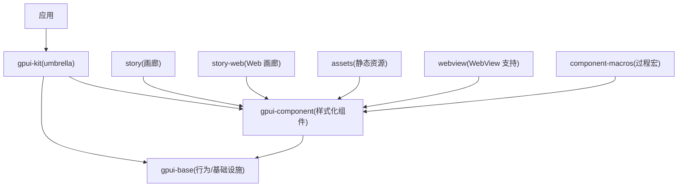
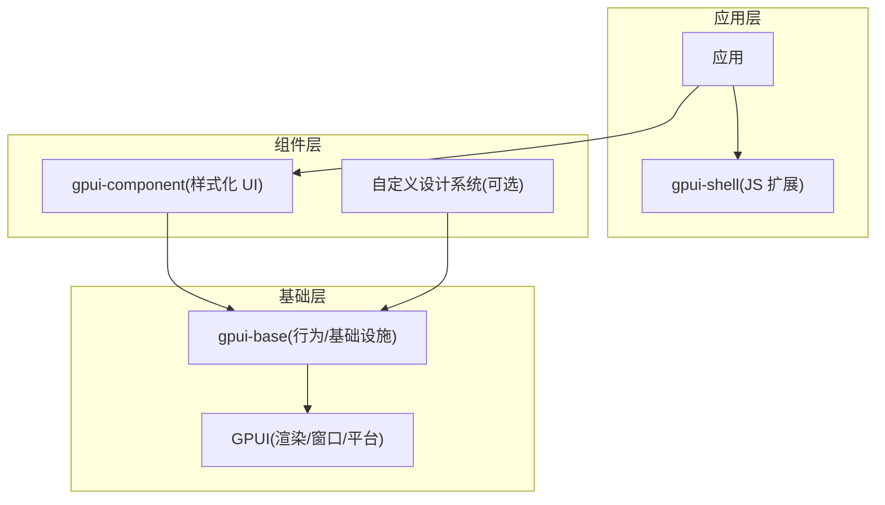
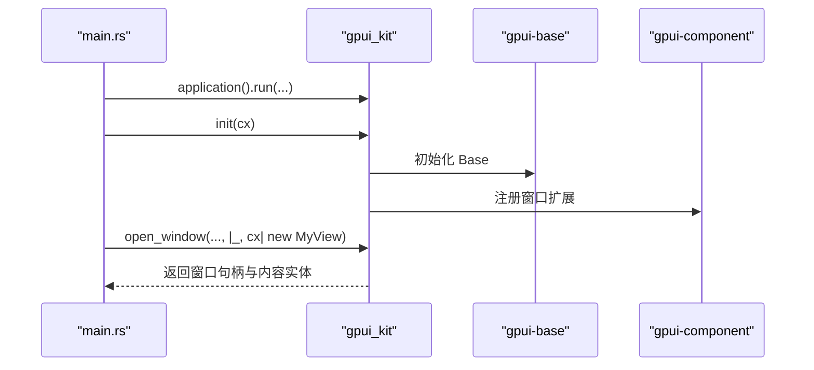
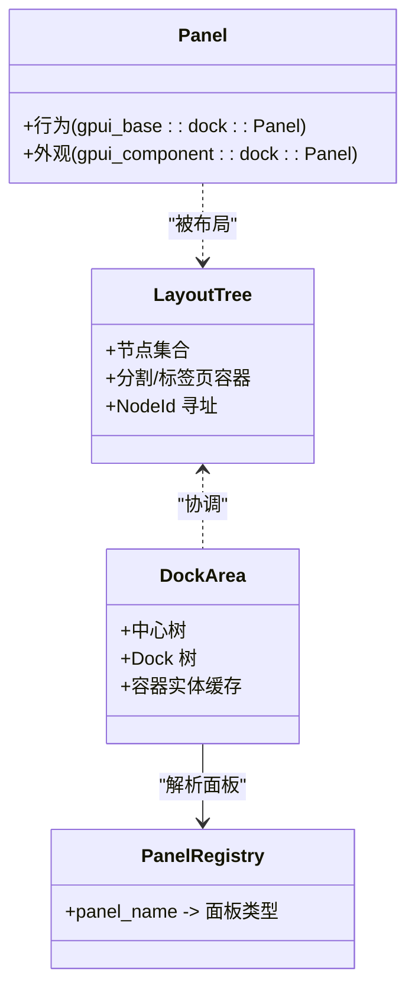
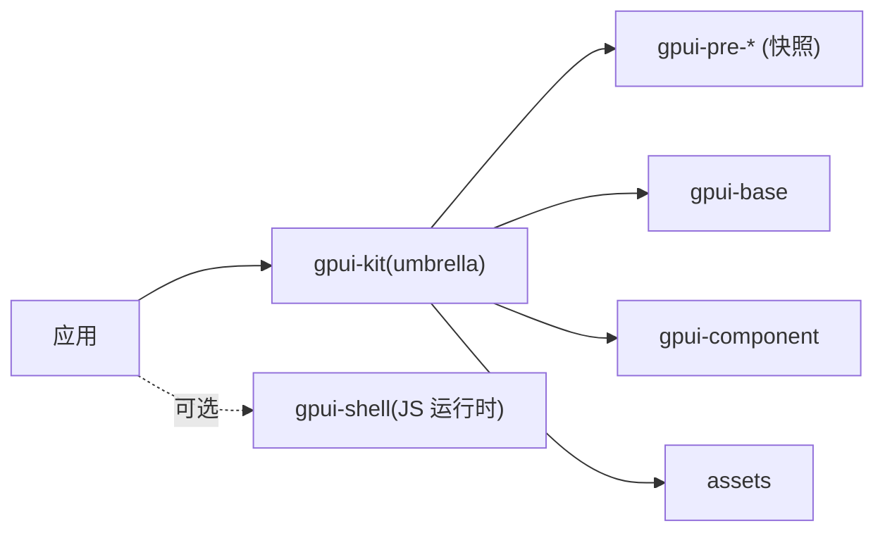
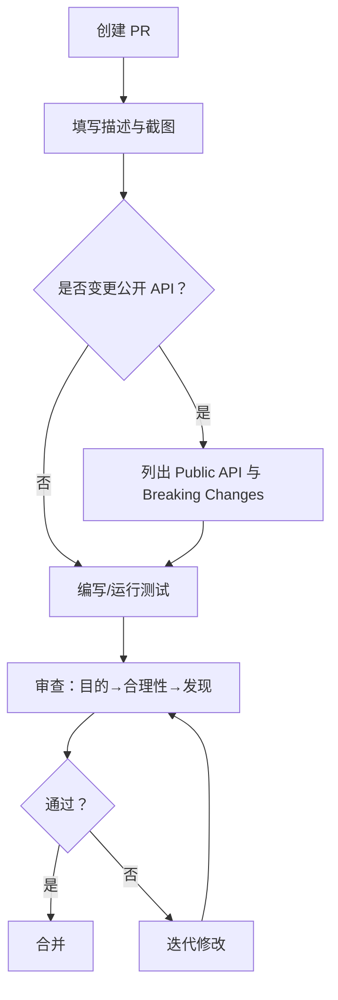
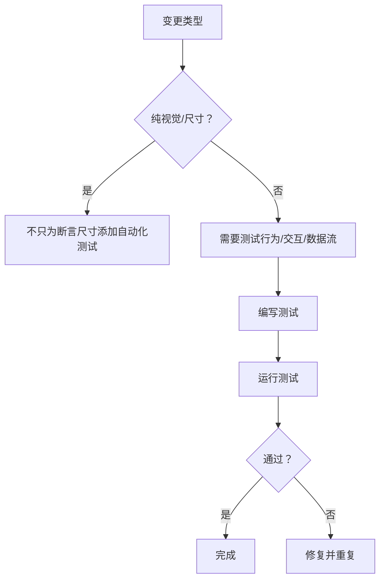
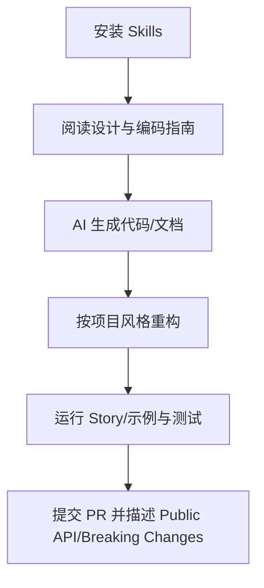

# 贡献指南

<cite>
**本文引用的文件**   
- [CONTRIBUTING.md](file://CONTRIBUTING.md)
- [README.md](file://README.md)
- [AGENTS.md](file://AGENTS.md)
- [CLAUDE.md](file://CLAUDE.md)
- [.github/pull_request_template.md](file://.github/pull_request_template.md)
- [.github/ISSUE_TEMPLATE/01_bug.md](file://.github/ISSUE_TEMPLATE/01_bug.md)
</cite>

## 目录
1. [简介](#简介)
2. [项目结构](#项目结构)
3. [核心组件](#核心组件)
4. [架构总览](#架构总览)
5. [详细组件分析](#详细组件分析)
6. [依赖关系分析](#依赖关系分析)
7. [性能与基准](#性能与基准)
8. [代码规范与风格](#代码规范与风格)
9. [提交流程与审查标准](#提交流程与审查标准)
10. [测试要求与组件测试规则](#测试要求与组件测试规则)
11. [文档更新指南](#文档更新指南)
12. [AI 助手使用指南](#ai-助手使用指南)
13. [问题报告模板与功能请求流程](#问题报告模板与功能请求流程)
14. [故障排查](#故障排查)
15. [结论](#结论)

## 简介
本贡献指南面向希望参与 GPUI Kit 开发的贡献者，涵盖开发环境搭建、代码规范、提交流程、架构与模块职责、依赖关系、代码审查标准、测试要求、文档更新指南以及 AI 助手使用方式。GPUI Kit 是基于 GPUI 的 Rust 桌面应用框架，提供 UI 组件、应用层能力、开发者工具与原生集成；其仓库同时包含站点文档、示例、脚本与发布流程说明。

## 项目结构
仓库采用 Rust workspace 组织，核心由多个 crate 组成：
- `crates/kit`：对外发布的伞形 crate（`gpui-kit`），聚合并固定上游 GPUI 快照版本，暴露 `gpui_kit::*` 根命名空间。
- `crates/base`：无样式的行为、状态与基础设施层（`gpui-base`）。
- `crates/component`：带主题与样式的完整 UI 组件库（`gpui-component`）。
- `crates/story`：用于展示和测试所有组件的画廊应用。
- `crates/story-web`：基于 WebAssembly 的故事画廊网页版。
- `crates/component-macros`：过程宏（如 `IntoPlot`）。
- `crates/assets`：静态资源（图标等）。
- `crates/webview`：WebView 组件支持。
- `examples/`：独立示例应用。
- `website/`：站点文档源码（英文与中文）。
- `script/`：环境与版本相关脚本。
- `.agents/` 与 `.claude/`：AI 助手命令与规则。
- `.github/`：GitHub 工作流、PR 模板与 Issue 模板。

**图表来源**
- [README.md:52-106](file://README.md#L52-L106)
- [AGENTS.md:27-44](file://AGENTS.md#L27-L44)

**章节来源**
- [README.md:52-106](file://README.md#L52-L106)
- [AGENTS.md:27-44](file://AGENTS.md#L27-L44)

## 核心组件
- gpui-kit（umbrella）：为应用提供单一依赖入口，固定上游 GPUI 快照版本，并暴露 `gpui_kit::platform`、`gpui_kit::base`、`gpui_kit::component`、`gpui_kit::assets` 等命名空间。
- gpui-base：无样式的基础设施，包括交互行为、可访问性、焦点管理、布局、动画、虚拟列表、dock 基础设施、语义设计令牌等。
- gpui-component：在 base 之上提供完整的样式化组件体系，遵循 shadcn/ui 与 macOS/Windows 控件的设计启发。
- gpui-shell：Rust 宿主中托管 JavaScript 扩展的运行时（单独发布，不属于 `gpui-kit`）。

**章节来源**
- [README.md:52-106](file://README.md#L52-L106)
- [AGENTS.md:27-44](file://AGENTS.md#L27-L44)

## 架构总览
GPUI Kit 采用三层架构：
- 顶层：应用层（业务逻辑、页面组合）。
- 中间层：`gpui-component`（样式化 UI）、可选的自定义设计系统、`gpui-shell`（JS 扩展）。
- 底层：`gpui-base`（行为与基础设施），再向下是 GPUI 渲染与平台能力。

**图表来源**
- [README.md:52-106](file://README.md#L52-L106)

**章节来源**
- [README.md:52-106](file://README.md#L52-L106)

## 详细组件分析

### 初始化与 Root 视图
- 应用启动时需调用 `gpui_kit::init(cx)`，以完成 Base 初始化并注册 Component 的窗口扩展。
- `gpui_kit::open_window` 是窗口入口，会挂载 Base 的 `Root`；Component 初始化后注册对话框、通知、菜单、tooltip、主题等窗口级能力。
- Base 负责内容容器与覆盖层、键盘导航（Tab/Shift-Tab）、选择复制；Overlay 层自动挂载，不应直接调用已移除的 `Root::render_*_layer`。

**图表来源**
- [AGENTS.md:130-167](file://AGENTS.md#L130-L167)
- [README.md:147-186](file://README.md#L147-L186)

**章节来源**
- [AGENTS.md:130-167](file://AGENTS.md#L130-L167)
- [README.md:147-186](file://README.md#L147-L186)

### 主题系统
- 通过全局单例 `Theme` 配置主题，支持明暗模式切换。
- 通过 `ActiveTheme` trait 访问主题，包括颜色、语法高亮主题、字体、圆角、阴影、滚动条显示模式等。
- 主题 API 应暴露语义 token（颜色、间距、圆角、排版、阴影），而非不断增长的组件特定样式字段。

**章节来源**
- [AGENTS.md:171-182](file://AGENTS.md#L171-L182)

### Dock 系统
- 布局行为位于 `crates/base/src/dock`，`crates/component/src/dock` 是其外观皮肤（`DockSkin`）。
- `LayoutTree` 是纯数据布局树，唯一事实来源；`NodeKind::Split` / `Tabs` 为容器，由 `NodeId` 寻址。
- `DockArea` 拥有中心与 dock 树，将二者协调为按 `NodeId` 索引的容器实体缓存。
- `PanelRegistry` 将持久化的 `panel_name` 解析回面板类型。
- 支持拖拽重排、缩放、锁定、序列化/恢复。

**图表来源**
- [AGENTS.md:183-204](file://AGENTS.md#L183-L204)

**章节来源**
- [AGENTS.md:183-204](file://AGENTS.md#L183-L204)

### 输入系统
- 基于 Rope 数据结构的高效文本存储。
- 支持 LSP 集成（诊断、补全、悬停）与 Tree-sitter 语法高亮。
- 多种输入模式：普通输入、数字输入、OTP 输入等。

**章节来源**
- [AGENTS.md:205-217](file://AGENTS.md#L205-L217)

### 组件设计原则
- 优先无状态组件（`RenderOnce`），能无状态则无状态。
- 尺寸系统：`xs`、`sm`、`md`(默认)、`lg`，通过 `Sizable` trait。
- 鼠标指针：按钮默认使用 `default` 而非 `pointer`（桌面应用约定），链接按钮除外。
- 样式系统：通过 `Styled` trait 与 `ElementExt` 扩展提供类 CSS 的构建式 API。
- Base 控件“无样式”：不安装布局、定位、颜色、尺寸、间距、圆角、边框、阴影、动画；完整呈现属于 `crates/component` 或应用层。例外是基础 Base Input 仅保留语义边框与半径基线。
- 保持 GPUI builder 风格：用 `when`、`when_some`、`when_none`、`map` 表达条件，避免拆分为可变临时元素后再赋值。
- 公共数据类型跨 seam 不暴露 `pub` 字段，使用 builder 构造并通过方法读取；布尔类型 setter 命名与 getter 命名不得冲突。
- 对带有 `pub` 字段的公共结构体加 `#[non_exhaustive]`，并提供 `Default` 或构造函数，使新增字段非破坏性变更。
- 上下文类型拼写完整：`ComboboxTriggerContext`，不使用 `…Ctx`；回调参数中 GPUI 的 `cx` 保留原名，其他上下文按含义命名。

**章节来源**
- [AGENTS.md:218-255](file://AGENTS.md#L218-L255)

## 依赖关系分析
- 应用依赖 `gpui-kit`（umbrella），它固定上游 GPUI 快照版本并重新导出 `gpui`、`base`、`component`、`assets`。
- `gpui-pre-*` crates 是与上游 GPUI 版本对齐的快照，必须保持精确版本匹配（`=x.y.z`），CI 拒绝非精确版本要求。
- `gpui-fast` 是可选后端特性，启用后选择 GPUI Fast 作为核心后端，但导入与初始化保持不变。
- `gpui-shell` 单独发布，不在 `gpui-kit` 内；其 QuickJS 绑定、JIT 运行时与标准模块需使用匹配的 crates.io 版本。

**图表来源**
- [README.md:28-31](file://README.md#L28-L31)
- [CONTRIBUTING.md:9-30](file://CONTRIBUTING.md#L9-L30)
- [AGENTS.md:302-333](file://AGENTS.md#L302-L333)

**章节来源**
- [README.md:28-31](file://README.md#L28-L31)
- [CONTRIBUTING.md:9-30](file://CONTRIBUTING.md#L9-L30)
- [AGENTS.md:302-333](file://AGENTS.md#L302-L333)

## 性能与基准
- 修改渲染代码时应进行性能剖析，确保 FPS 良好。
- macOS 下可通过 `MTL_HUD_ENABLED=1` 启用 Metal HUD 查看 FPS 与性能指标。
- 可使用 Samply 记录与分析性能：`samply record cargo run`。

**章节来源**
- [CONTRIBUTING.md:152-172](file://CONTRIBUTING.md#L152-L172)
- [AGENTS.md:92-100](file://AGENTS.md#L92-L100)

## 代码规范与风格
- 参考现有代码的组织与命名风格，借鉴 macOS/Windows 控件 API 设计命名函数、属性、结构体等。
- 公共 API 变更需在 PR 描述中以 `## Public API` 列出，按 crate 分组，给出签名与一行用途说明；破坏性变更放在 `## Breaking Changes`，并提供旧/新用法 diff。
- 避免滥用 `Kind` 后缀；仅在确实无法用更精确名称概括变体时使用，并尽量限制可见范围。
- 图标系统：默认不包含 SVG 文件，需使用 Lucide 或其他图标库，并按 `IconName` 枚举定义命名 SVG 文件。

**章节来源**
- [CONTRIBUTING.md:75-80](file://CONTRIBUTING.md#L75-L80)
- [CONTRIBUTING.md:52-68](file://CONTRIBUTING.md#L52-L68)
- [AGENTS.md:268-300](file://AGENTS.md#L268-L300)

## 提交流程与审查标准
- 每个 PR 聚焦一个改动，保持差异尽可能小，便于审查与合并。
- PR 模板要求：
  - 标题与描述用英文，说明解决的问题。
  - 截图对比（Before/After）。
  - 公开 API 清单（如有）。
  - 破坏性变更说明（如有）。
  - 测试方法与复现步骤。
  - 检查项：阅读 CONTRIBUTING、确认 AI 生成代码准确性、运行 story 相关用例、必要时验证多平台性能。
- 审查顺序：先说明 PR 目的与范围，再评估需求与方案的合理性，最后给出具体发现、验证结果与局限。

**图表来源**
- [.github/pull_request_template.md:1-41](file://.github/pull_request_template.md#L1-L41)
- [AGENTS.md:257-293](file://AGENTS.md#L257-L293)

**章节来源**
- [.github/pull_request_template.md:1-41](file://.github/pull_request_template.md#L1-L41)
- [CONTRIBUTING.md:7-8](file://CONTRIBUTING.md#L7-L8)
- [AGENTS.md:257-293](file://AGENTS.md#L257-L293)

## 测试要求与组件测试规则
- 当需要手动验证焦点、键盘、选择、菜单或输入行为时，优先使用可访问性驱动的交互测试方法；参见可访问性 UI 测试文档中的 Story 启动方法、可访问性树工作流与完成证据。
- 对于纯视觉或尺寸调整，不要仅为了断言展示尺寸而添加自动化测试；当变更影响行为、交互、数据流或防止有意义的回归时才添加测试。
- 组件测试规则要点：
  - 简洁优先：聚焦复杂逻辑与核心功能，避免过多简单测试。
  - Builder 模式测试：每个组件应有 `test_*_builder` 测试覆盖构建器模式。
  - 复杂逻辑测试：覆盖条件分支、状态转换与边界情况。

**图表来源**
- [CONTRIBUTING.md:99-117](file://CONTRIBUTING.md#L99-L117)
- [AGENTS.md:73-90](file://AGENTS.md#L73-L90)
- [AGENTS.md:389-396](file://AGENTS.md#L389-L396)

**章节来源**
- [CONTRIBUTING.md:99-117](file://CONTRIBUTING.md#L99-L117)
- [AGENTS.md:73-90](file://AGENTS.md#L73-L90)
- [AGENTS.md:389-396](file://AGENTS.md#L389-L396)

## 文档更新指南
- 站点文档源码位于 `website/`，包含英文（`website/docs/`）与中文（`website/zh-CN/docs/`）。
- 修改任何文档文件时，需同步更新英文与中文版本。
- `skills/gpui-kit/references/coding-guides.md` 与 `skills/gpui-kit-design-guides/references/design-guides.md` 是 `website/docs/` 中对应指南的副本，供 AI 技能在离线环境中使用；编辑源文件后需复制到 skills 目录。
- `docs/` 存放内部架构规范（RFC、迁移状态、评审），这些文档不发布到站点，且为单语言。

**章节来源**
- [AGENTS.md:345-363](file://AGENTS.md#L345-L363)

## AI 助手使用指南
- 仓库提供 AI 编码代理技能：
  - `gpui-kit`：设置、组件目录、使用模式、GPUI 机制（元素、实体、异步、焦点、动作、测试）与编码指南。
  - `gpui-kit-design-guides`：设计规范（布局、间距、层次、交互状态、覆盖层、界面文案）。
- 安装方式：`npx skills add longbridge/gpui-kit`。
- Claude Code 通过 `@AGENTS.md` 引用共享规则；Claude Code 本身仅引用该文件。
- 在 AI 辅助贡献中，强调“谁写的代码不重要”，重要的是变更是否深思熟虑、聚焦且经过充分验证；提交前需确保问题真实、实现符合现有模式、UI 变更遵循视觉与交互约定、代码已自我审查与测试、PR 聚焦单一改动。

**图表来源**
- [README.md:196-208](file://README.md#L196-L208)
- [AGENTS.md:1-25](file://AGENTS.md#L1-L25)
- [CLAUDE.md:1-4](file://CLAUDE.md#L1-L4)
- [CONTRIBUTING.md:31-50](file://CONTRIBUTING.md#L31-L50)

**章节来源**
- [README.md:196-208](file://README.md#L196-L208)
- [AGENTS.md:1-25](file://AGENTS.md#L1-L25)
- [CLAUDE.md:1-4](file://CLAUDE.md#L1-L4)
- [CONTRIBUTING.md:31-50](file://CONTRIBUTING.md#L31-L50)

## 问题报告模板与功能请求流程
- 问题报告模板位于 `.github/ISSUE_TEMPLATE/01_bug.md`，包含描述、环境信息、复现步骤、截图、期望与实际结果。
- 功能请求流程建议：
  - 先在 Issues 中提出需求与背景，说明动机与预期收益。
  - 若已有可行方案，可直接提交 PR 并附上 Public API 与 Breaking Changes 说明。
  - 维护者可能直接帮助润色细节并推进合并。

**章节来源**
- [.github/ISSUE_TEMPLATE/01_bug.md:1-36](file://.github/ISSUE_TEMPLATE/01_bug.md#L1-L36)
- [CONTRIBUTING.md:70-73](file://CONTRIBUTING.md#L70-L73)

## 故障排查
- 依赖版本不一致：确保 `gpui-pre-*` 快照版本精确匹配，并在更新上游快照时同步适配 Kit 的 API 变更。
- 构建失败：检查是否启用了 `gpui-fast` 特性但未统一更新两个后端家族；发布前需验证默认与 Fast 两种构建。
- 性能问题：使用 Metal HUD 或 Samply 进行性能剖析，关注 FPS 与渲染瓶颈。
- 可访问性与 UI 测试：如需手动验证，遵循可访问性驱动的工作流；若自动化测试未覆盖场景，明确说明平台或集成点。

**章节来源**
- [CONTRIBUTING.md:9-30](file://CONTRIBUTING.md#L9-L30)
- [CONTRIBUTING.md:152-172](file://CONTRIBUTING.md#L152-L172)
- [CONTRIBUTING.md:99-117](file://CONTRIBUTING.md#L99-L117)

## 结论
本贡献指南总结了 GPUI Kit 的开发环境、架构与模块职责、依赖约束、代码规范、提交流程、审查标准、测试要求、文档更新与 AI 助手使用方式。请严格遵循现有代码风格与组件设计原则，保持 PR 聚焦与最小差异，完善公开 API 与破坏性变更说明，并通过 Story 与测试验证行为与性能。AI 生成的代码同样需要人工审查与重构，以确保质量与一致性。