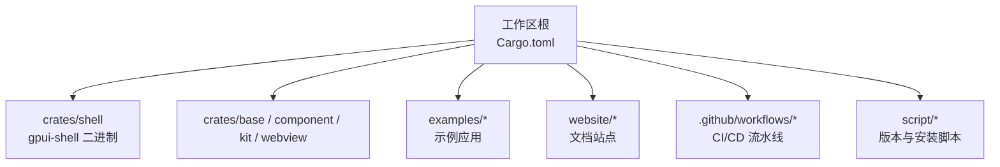
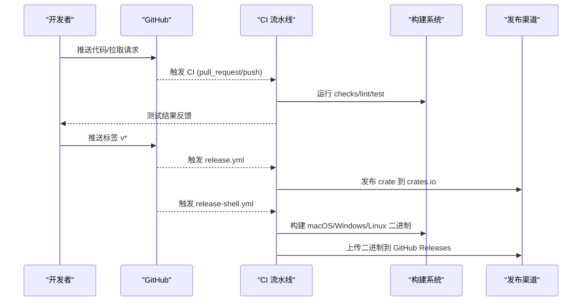
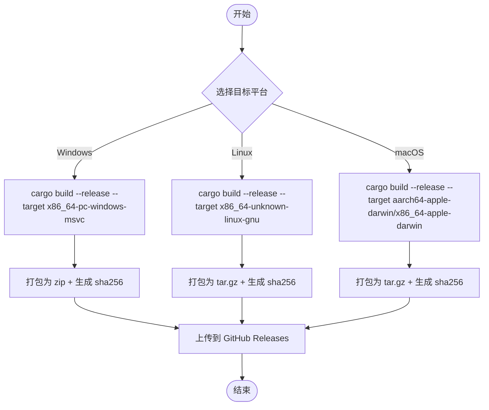
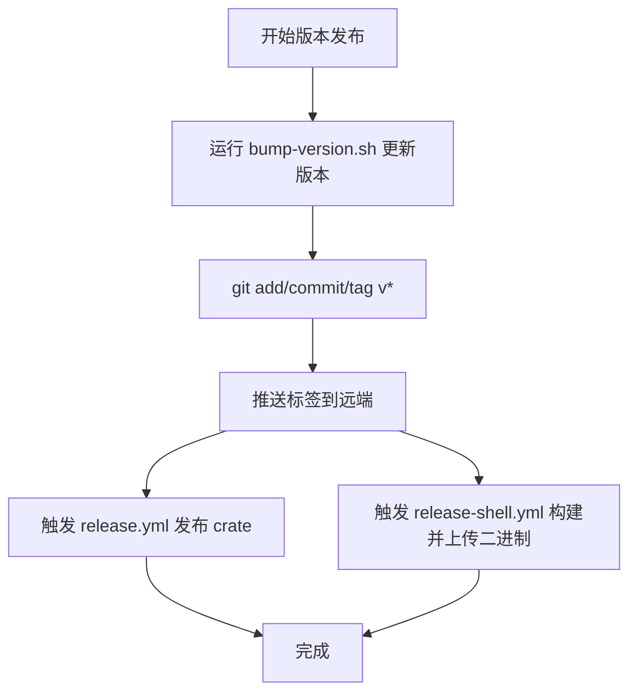
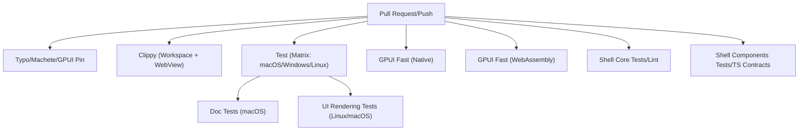
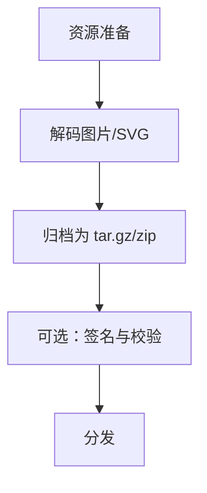
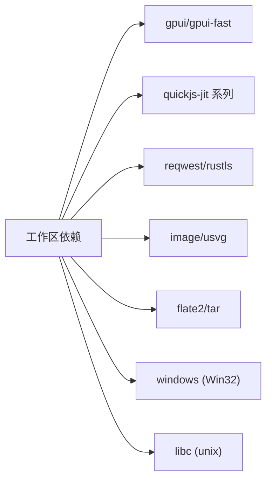

# 部署与打包

<cite>
**本文引用的文件**   
- [工作区配置 Cargo.toml](file://Cargo.toml)
- [CI 流水线 .github/workflows/ci.yml](file://.github/workflows/ci.yml)
- [发布 crate 流水线 .github/workflows/release.yml](file://.github/workflows/release.yml)
- [gpui-shell 发布流水线 .github/workflows/release-shell.yml](file://.github/workflows/release-shell.yml)
- [Makefile](file://Makefile)
- [版本升级脚本 script/bump-version.sh](file://script/bump-version.sh)
- [gpui-shell 包配置 crates/shell/Cargo.toml](file://crates/shell/Cargo.toml)
</cite>

## 目录
1. [简介](#简介)
2. [项目结构](#项目结构)
3. [核心组件](#核心组件)
4. [架构总览](#架构总览)
5. [详细组件分析](#详细组件分析)
6. [依赖分析](#依赖分析)
7. [性能考虑](#性能考虑)
8. [故障排除指南](#故障排除指南)
9. [结论](#结论)
10. [附录](#附录)

## 简介
本指南面向跨平台桌面应用（基于 GPUI）的构建、打包与发布。内容覆盖：
- 多平台（macOS、Windows、Linux）构建与产物组织
- 版本管理与发布流程
- CI/CD 流水线（自动化测试、构建、发布）
- 应用签名与安全注意事项
- 资源文件打包、图标处理与启动优化
- 常见问题排查

## 项目结构
仓库采用 Rust Workspace 管理多个 crate，包含 UI 组件库、运行时 shell、示例与应用、网站文档等。关键目录与职责：
- crates：核心库与二进制（如 gpui-shell）
- examples：示例应用
- website：文档与站点
- script：版本与安装脚本
- .github/workflows：CI/CD 流水线

**图表来源**
- [工作区配置 Cargo.toml:1-44](file://Cargo.toml#L1-L44)
- [.github/workflows/ci.yml:1-30](file://.github/workflows/ci.yml#L1-L30)

**章节来源**
- [工作区配置 Cargo.toml:1-44](file://Cargo.toml#L1-L44)

## 核心组件
- 工作区与成员：通过 workspace.members 声明所有 crate 与示例，默认成员为 story；resolver 使用 v2。
- 依赖统一：workspace.dependencies 集中管理版本，确保跨 crate 一致性。
- 构建与发布：CI 提供检查、Lint、测试、WASM 检查、Shell 相关测试；release.yml 触发 crates.io 发布；release-shell.yml 构建并上传预编译二进制。

**章节来源**
- [工作区配置 Cargo.toml:1-80](file://Cargo.toml#L1-L80)
- [.github/workflows/ci.yml:1-30](file://.github/workflows/ci.yml#L1-L30)
- [.github/workflows/release.yml:1-19](file://.github/workflows/release.yml#L1-L19)
- [.github/workflows/release-shell.yml:1-30](file://.github/workflows/release-shell.yml#L1-L30)

## 架构总览
下图展示从代码到产物的端到端流程：开发者提交 → CI 检查/测试 → 打标签触发发布 → 构建多平台产物 → 上传至 GitHub Releases 或 crates.io。

**图表来源**
- [.github/workflows/ci.yml:1-30](file://.github/workflows/ci.yml#L1-L30)
- [.github/workflows/release.yml:1-19](file://.github/workflows/release.yml#L1-L19)
- [.github/workflows/release-shell.yml:1-30](file://.github/workflows/release-shell.yml#L1-L30)

## 详细组件分析

### 跨平台构建与打包
- 目标平台矩阵：CI 在 macOS、Windows、Linux 上分别执行测试与构建。
- 构建命令：使用 cargo build --release 针对各 target 进行构建。
- 产物组织：
  - Windows：生成 .zip 与 sha256 校验文件
  - Linux/macOS：生成 .tar.gz 与 sha256 校验文件
- 安装器：Linux 额外上传 install.sh 作为安装入口。

**图表来源**
- [.github/workflows/release-shell.yml:34-125](file://.github/workflows/release-shell.yml#L34-L125)

**章节来源**
- [.github/workflows/release-shell.yml:34-125](file://.github/workflows/release-shell.yml#L34-L125)

### 版本管理与发布流程
- 版本号更新：使用脚本批量更新 crate 版本、提交、打标签并推送到远端。
- 发布 crate：当推送以 v 开头的标签时，触发 crates.io 发布。
- 发布二进制：对 gpui-shell 单独构建并上传到 GitHub Releases，支持 workflow_dispatch 与 PR 标记触发。

**图表来源**
- [版本升级脚本 script/bump-version.sh:53-109](file://script/bump-version.sh#L53-L109)
- [.github/workflows/release.yml:1-19](file://.github/workflows/release.yml#L1-L19)
- [.github/workflows/release-shell.yml:1-30](file://.github/workflows/release-shell.yml#L1-L30)

**章节来源**
- [版本升级脚本 script/bump-version.sh:53-109](file://script/bump-version.sh#L53-L109)
- [.github/workflows/release.yml:1-19](file://.github/workflows/release.yml#L1-L19)
- [.github/workflows/release-shell.yml:1-30](file://.github/workflows/release-shell.yml#L1-L30)

### CI/CD 流水线配置要点
- 检查与 Lint：typos、clippy、cargo-machete、gpui-pre pin 检查。
- 测试矩阵：macOS、Windows、Linux 多目标测试；文档测试；UI 渲染测试（Linux 需 Vulkan）。
- GPUI Fast 与 WebAssembly：分别在原生与 wasm32 目标下检查与测试。
- Shell 相关：核心库与组件绑定测试、TypeScript 契约验证、故事覆盖率校验。

**图表来源**
- [.github/workflows/ci.yml:32-156](file://.github/workflows/ci.yml#L32-L156)
- [.github/workflows/ci.yml:158-225](file://.github/workflows/ci.yml#L158-L225)
- [.github/workflows/ci.yml:226-321](file://.github/workflows/ci.yml#L226-L321)

**章节来源**
- [.github/workflows/ci.yml:32-156](file://.github/workflows/ci.yml#L32-L156)
- [.github/workflows/ci.yml:158-225](file://.github/workflows/ci.yml#L158-L225)
- [.github/workflows/ci.yml:226-321](file://.github/workflows/ci.yml#L226-L321)

### 应用签名、代码认证与安全
- 二进制完整性：每个平台产物附带 sha256 校验文件，便于下载后验证。
- 依赖锁定：CI 使用 --locked 确保可重复构建。
- 安全特性：网络层启用 rustls 与系统证书根；避免明文传输。
- 建议：
  - macOS：使用 codesign 对二进制签名，并在分发前 notarize（需 Apple Developer 账号）。
  - Windows：使用 signtool 对 .exe 签名，建议使用企业证书或第三方 CA。
  - Linux：可使用 gpg 对压缩包签名，并提供公钥供用户验证。

**章节来源**
- [.github/workflows/release-shell.yml:91-125](file://.github/workflows/release-shell.yml#L91-L125)
- [工作区配置 Cargo.toml:80-88](file://Cargo.toml#L80-L88)

### 资源文件打包、图标处理与启动优化
- 资源打包：shell 依赖 flate2/tar 用于归档；image/usvg 用于解码图片与 SVG 资源。
- 图标处理：image crate 负责解码 PNG 等格式；usvg 解析 SVG 引用资源。
- 启动优化：
  - 调试构建中提升关键依赖 opt-level 以加速渲染路径。
  - 发布构建 strip symbols 减小体积。
  - 使用 mold 替换链接器以提升链接速度（CI 已启用）。

**图表来源**
- [gpui-shell 包配置 crates/shell/Cargo.toml:86-103](file://crates/shell/Cargo.toml#L86-L103)
- [工作区配置 Cargo.toml:146-186](file://Cargo.toml#L146-L186)

**章节来源**
- [gpui-shell 包配置 crates/shell/Cargo.toml:86-103](file://crates/shell/Cargo.toml#L86-L103)
- [工作区配置 Cargo.toml:146-186](file://Cargo.toml#L146-L186)

### 站点与文档构建
- Makefile 提供 dev-web、dev-gallery、build:website 等快捷命令，便于本地开发与站点构建。

**章节来源**
- [Makefile:1-15](file://Makefile#L1-L15)

## 依赖分析
- 工作区依赖统一：通过 workspace.dependencies 集中管理 gpui-*、quickjs-jit、reqwest 等依赖版本，保证一致性与可复现性。
- 平台相关依赖：windows 目标启用特定 Win32 API features；unix 目标引入 libc。
- 可选功能：gpui-fast、components、webview、quickjs 等 feature 控制编译产物能力。

**图表来源**
- [工作区配置 Cargo.toml:50-122](file://Cargo.toml#L50-L122)
- [gpui-shell 包配置 crates/shell/Cargo.toml:51-122](file://crates/shell/Cargo.toml#L51-L122)

**章节来源**
- [工作区配置 Cargo.toml:50-122](file://Cargo.toml#L50-L122)
- [gpui-shell 包配置 crates/shell/Cargo.toml:51-122](file://crates/shell/Cargo.toml#L51-L122)

## 性能考虑
- 构建性能：
  - 使用 mold 替换链接器（CI 已启用）。
  - 调试构建中对关键依赖开启更高优化级别以减少运行时开销。
- 发布体积：
  - 发布构建 strip symbols 显著减小二进制大小。
- 缓存策略：
  - CI 使用 rust-cache 缓存依赖，减少重复构建时间。
  - 按 job 拆分 feature 集，避免全量重编译。

**章节来源**
- [.github/workflows/ci.yml:24-31](file://.github/workflows/ci.yml#L24-L31)
- [工作区配置 Cargo.toml:146-186](file://Cargo.toml#L146-L186)

## 故障排除指南
- 构建失败（缺少系统依赖）：
  - Linux：安装 mesa-vulkan-drivers 以支持 UI 渲染测试。
  - 通用：运行 script/bootstrap 安装系统依赖。
- 链接缓慢：
  - 确认已启用 mold；或在 CI 中保留 rui314/setup-mold。
- 二进制无法运行：
  - 检查动态库缺失（Linux），必要时安装对应运行时库。
  - 检查签名与完整性校验（sha256）。
- 版本不一致：
  - 确保使用 --locked 与固定依赖版本；运行 check-gpui-pin.ts 验证。
- 站点构建问题：
  - 使用 bun 运行 website 下的构建命令；确保 Node/Bun 环境正确。

**章节来源**
- [.github/workflows/ci.yml:148-156](file://.github/workflows/ci.yml#L148-L156)
- [.github/workflows/ci.yml:76-81](file://.github/workflows/ci.yml#L76-L81)
- [.github/workflows/ci.yml:42-48](file://.github/workflows/ci.yml#L42-L48)
- [Makefile:1-15](file://Makefile#L1-L15)

## 结论
本指南总结了跨平台应用的构建、打包与发布全流程，涵盖 CI/CD 配置、版本管理、安全与性能优化。遵循上述步骤与最佳实践，可实现稳定、可复现且安全的跨平台交付。

## 附录
- 常用命令参考：
  - 本地开发站点：make dev-web / make dev-gallery / make build:website
  - 版本发布：./script/bump-version.sh <VERSION>
  - 构建 gpui-shell：cargo build -p gpui-shell --release --target <TARGET>

**章节来源**
- [Makefile:1-15](file://Makefile#L1-L15)
- [版本升级脚本 script/bump-version.sh:53-109](file://script/bump-version.sh#L53-L109)